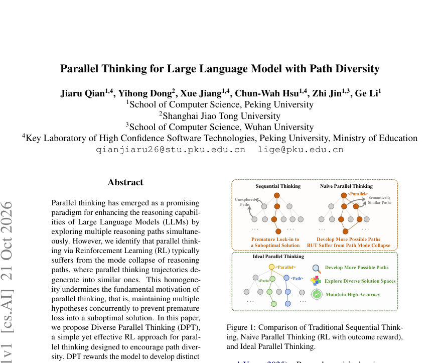
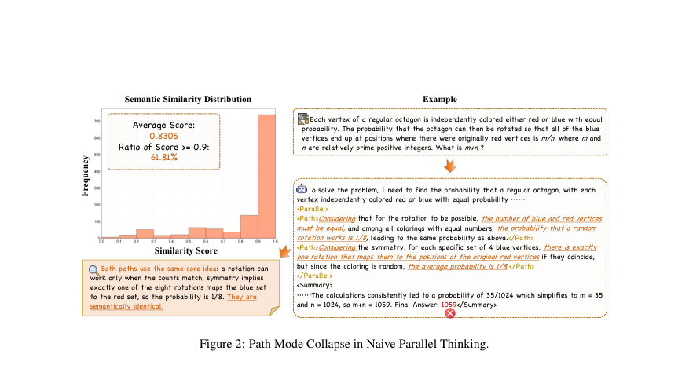
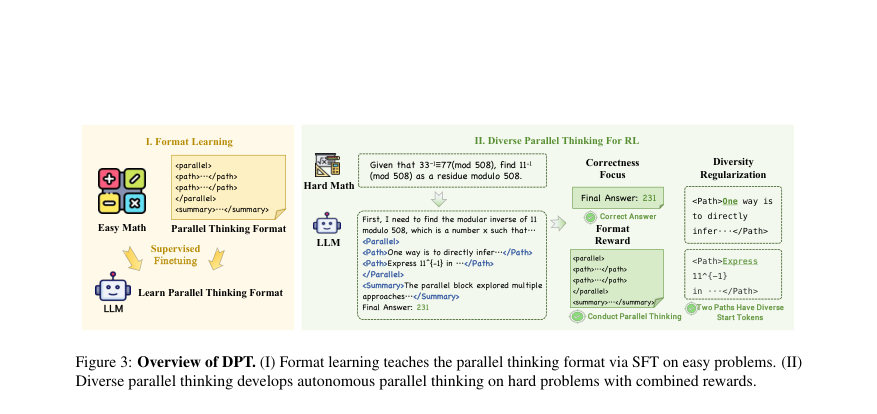

# Parallel Thinking for Large Language Model with Path Diversity

- **게시일:** 2026-10-22
- **arXiv:** [2610.29501v1](http://arxiv.org/abs/2610.29501v1) · [PDF](https://arxiv.org/pdf/2610.29501v1)
- **저자:** Jiaru Qian, Yihong Dong, Xue Jiang, Chun-Wah Hsu, Zhi Jin, Ge Li
- **분야:** cs.AI
- **선정 점수:** 4.64
- **선정 이유:** 최근성 1.1, 인용 영향 0.0 (인용 0회), 저자 영향 0.0 (최고 h-index 0), AI 주제 적합성 3.0, 개발자 관심 0.2, 학술 신호 0.3, 오픈 웨이트·주요 연구조직 신호 0.0

[← 2026-10-22 목록으로 돌아가기](../daily/2026-10-22.html)

<!-- paper-visuals:start -->
## 주요 Figure

> 원문 PDF에서 실제 Figure 캡션과 그림 영역이 함께 확인된 자료만 자동 추출했다.

*Figure · 원문 PDF 1쪽 · Figure 1: Comparison of Traditional Sequential Think-*

*Figure · 원문 PDF 3쪽 · Figure 2: Path Mode Collapse in Naive Parallel Thinking.*

*Figure · 원문 PDF 4쪽 · Figure 3: Overview of DPT. (I) Format learning teaches the parallel thinking format via SFT on easy problems. (II)*

<!-- paper-visuals:end -->

## 한 문장 요약

대규모 언어모델의 병렬 추론에서 경로들의 모드 붕괴를 발견하고, prefix(초기 토큰) 수준의 토큰-기반 다양성 보상으로 병렬 경로의 다양성을 유도하는 RL 기법 DPT를 제안해 성능과 탐색 범위를 개선한다.

## 해결하려는 문제

기존의 병렬 사고(parallel thinking)를 위한 강화학습(RL)은 최종 정답 중심의 보상 때문에 여러 내부 추론 경로들이 동일한 '안전한' 전략(모드)으로 수렴하는 경로 모드 붕괴(path mode collapse)를 겪는다. 이로 인해 병렬 사고의 목적(여러 가설을 동시 유지하여 조기 수렴을 방지하고 다양한 해법을 탐색)이 손상된다. 본문은 이 문제를 실험적으로 관찰하고 이론적으로 분석한 뒤, 병렬 경로 간의 실질적 다양성을 명시적으로 보상하도록 RL 보상 설계를 개선하는 방법을 연구한다.

## 핵심 기여

- 병렬 사고에서 경로 모드 붕괴 현상을 실험(1,156 병렬 블록 샘플)과 이론적 분석(결과 보상만 최적화하면 정책이 안전한 단일 전략 τ*로 수렴함)을 통해 규명함.
- Diverse Parallel Thinking(DPT)이라는 단순하고 일반적인 다양성 인식 RL 프레임워크를 제안함. prefix(경로 시작 부분) 수준의 토큰 비교를 통해 경로 다양성을 보상함으로써 모드 붕괴를 억제함.
- 실험적 검증: 수학 추론( AIME24, AIME25, AMC23, MATH)과 코드·지식 추론(HumanEval, ARC-c, MMLU-Pro)에서 기존 병렬사고 기법(Parallel-R1 등)보다 성능 우수성을 보임.
- 다양성 보상 설계(정확/유사성 비교, prefix 길이 n, K 확장 등)에 대한 체계적 실험(ablations)으로 prefix-1 exact가 전체 평균 성능에서 우수함을 보였고, 다양한 설정의 영향 분석을 제공함.
- 학습 커리큘럼(초기 SFT로 포맷 학습 후 GRPO 기반 RL)과 주기적 보상 적용(매 10스텝 중 마지막 2스텝에 다양성·포맷 보상 적용) 등 실용적 학습 절차를 제시함.

## 접근 방법

* 아키텍처·프로세스: 입력 문제 x에 대해 모델은 특수 제어 태그(<Parallel>, <Path>, 
)를 사용해 하나의 생성 궤적(z) 내에 K개의 병렬 경로 {τ1..τK}를 생성한다.
* 병렬 경로 간 정보격리는 'Unseen' 모드(구조적 어텐션 마스킹)와 'Seen' 모드(경로 간 참조 허용)로 구현 가능하다.
* 학습 절차: (1) Cold-start initialization — GSM8K에서 프롬프트로 생성한 병렬-포맷 예제들로 supervised fine-tuning(SFT)을 수행해 모델이 태그·포맷을 학습하도록 함(프롬프트 후보 모델: DeepSeek-R1-0528-Qwen-3-8B).
* (2) Reinforcement Learning — GRPO(Group Relative Policy Optimization)를 사용해 RL 학습을 진행.
* 보상은 R(zi)=rc(zi)+λf·rf(zi)+λd·rd({τ}), 여기서 rc는 정답 여부(베리파이어 기반 이진 보상), rf는 포맷 보상(적어도 하나의 올바른 <Parallel> 블록), rd는 병렬 경로들 간의 다양성 보상이다.
* 다양성 보상 설계: 각 경로의 처음 n개의 'content token' 접두사(prefix)를 비교해 이진(dexact) 또는 위치별 차이 비율(dsim)로 계산한 후 모든 경로 쌍에 대해 평균화하여 rd∈[0,1]로 정규화함.
* 대표 구성: K=2, λf=0.2, λd=0.1, n=1(Prefix-1 exact).
* 학습 스케줄: 다양성·포맷 보상은 매 10학습스텝 중 마지막 2스텝에만 적용하고 나머지 8스텝은 정답 보상만 사용해 정확도 유지와 탐색 균형을 맞춤.
* 구현 세부: 기준 모델 πref로 사전학습된 베이스 모델을 사용하며 KL 제약으로 정책 이탈을 제한.
* (실험적 구현은 Qwen-3-4B-Base, 코드베이스 VERL 기반.)

## 주요 결과

- 주요 수학 벤치마크 비교(Table 1): DPT (Unseen) 이 모든 보고된 벤치마크·지표에서 Parallel-R1 (Unseen)을 능가함. 대표 수치: AMC23 pass@1=64.4, pass@16=89.9; AIME25 pass@1=18.5, pass@16=40.2; AIME24 pass@1=18.1, pass@16=43.3; MATH pass@1=84.5; 전체 평균 51.3%. (표의 수치는 논문 본문 Table 1 기준.)
- 코드·지식 벤치마크(Table 2): HumanEval=69.51%, ARC-c=65.27%, MMLU-Pro=49.40%로 GRPO·Parallel-R1 대비 향상 보고.
- 경로 간 어휘적 다양성(Jaccard, Table 3): Parallel-R1의 Jaccard 거리(lexical diversity) 대비 DPT가 큰 향상을 보임(예: AIME24: Parallel-R1=0.542 → DPT=0.927, AIME24 Δ=+0.385 등).
- 테스트타임 샘플링 확장(pass@k, AIME25, Table 5): DPT는 모든 샘플 예산에서 우수. AIME25에서 DPT pass@1=18.5, pass@16=40.2, pass@64=49.2, pass@128=53.5, pass@256=57.0로 Parallel-R1와 GRPO보다 지속적 우위.
- 경로 수(K) 확장 실험(Table 4): K=2가 pass@1에서 더 좋고 K=4가 일부 pass@16에서 더 나음(탐색·커버리지의 균형을 시사). 예: AIME25 pass@16 K=2:40.2 → K=4:41.2(소폭 개선).  MATH 등에서 유사 패턴 관찰됨(논문 Table 4).

## 한계

- 저자 명시 한계: 본 연구는 정답 검증 가능한 텍스트 기반 추론(수학, 코드, 지식) 중심으로 평가했으며, 멀티모달 입력이나 상호작용형 추론으로의 확장성은 미검증임. 내부 경로 수(K)는 소수의 설정만 실험했고 학습 중 고정되어 있으며, 문제 난이도나 예산에 따라 동적으로 경로 수를 할당하는 정책은 향후 과제로 남김.
- 본문에서 확인되는 한계(작가 언급과 구분): prefix 기반 다양성은 '저비용의 훈련 프록시'로 설계되었으며 저자들도 prefix 발산이 의미 있는 전략 다양성의 충분조건은 아님을 명시함. 즉, 초기 토큰이 달라도 이후 동일한 전략으로 수렴할 수 있고, 반대로 초기 동일 접두사라도 이후 분기할 수 있어 보상 프록시의 한계가 존재함. 또한 다양성 보상은 학습 중에만 적용되며(추론 부담 없음) 주기적(10스텝 중 마지막 2스텝) 적용 설계는 인위적이고 프록시 실패를 완전히 배제하지 못한다고 저자가 기술함.
- 실험 범위 제약: 주된 백본 및 자원(Qwen-3-4B, 8 A100)으로 실험되었고 대형·다른 아키텍처에 대한 일반화는 본문에서 직접적으로 확인되지 않음.

## 개발자 관점

- 재현·구현: 코드와 구현은 저자 공개 저장소에 있음(본문에 GitHub 링크 표기). 핵심 구성요소는 특수 태그(<Parallel>, <Path>, 
) 처리, cold-start SFT 데이터파이프(프롬프트 생성·필터링), GRPO 기반 RL 루프 및 prefix 기반 다양성 보상(rd) 통합이다.
- 필요 자원·환경: 논문 실험은 Qwen-3-4B-Base로 8 A100 GPU 환경에서 수행되었음(Implementation Details, Appendix A). SFT와 RL 하이퍼파라미터(예: SFT batch 128 lr 1e-5, RL batch 256 lr 1e-6, 300 gradient updates) 등이 본문에 명시되어 있어 재현에 유용함.
- 하이퍼파라미터: 대표 설정 K=2, λf=0.2, λd=0.1, prefix n=1(Prefix-1 exact) 을 기본으로 권장하며, 다양성 보상은 매 10스텝 중 마지막 2스텝에만 적용한다는 점이 중요하다(정확도·탐색의 균형을 위한 설계).
- 배포·추론 비용: 다양성 보상은 학습 전용이며 추론시에는 추가적인 판정기나 보상 모듈을 호출하지 않아 추론 비용 증가 없음(본문의 검증: DPT는 Parallel-R1 대비 토큰·지연·FLOP에서 더 효율적인 측정치를 보임).
- 안전성·검증: 보상 설계가 프록시(초기 토큰 차이)에 의존하므로 reward-hacking과 프록시 실패 위험을 고려해야 함(저자도 관련 문헌을 인용). 다양성 보상 강도(λd)와 적용 빈도는 실제 배포 환경에서 정확도와 안전성 균형을 위해 세심히 튜닝해야 함.

**근거 범위:** 이 분석은 제공된 논문 PDF 본문(페이지 1–15, 본문 및 부록 포함)의 텍스트를 근거로 작성함. 본문에 명시된 표와 부록(A–I)의 수치·설정(예: K, λf, λd, n, 하이퍼파라미터, 평가 데이터셋, 성능 표)을 직접 인용했음. 프롬프트 템플릿의 정확한 문자열(그림·세부 포맷)은 본문에서 일부만 제시되어 있어 세부 재현용 프롬프트는 공개 코드 또는 부수 자료를 참조해야 함. 전반적으로 본문에서 명확히 기술된 내용 위주로 보고하였으므로 신뢰도는 높음.
