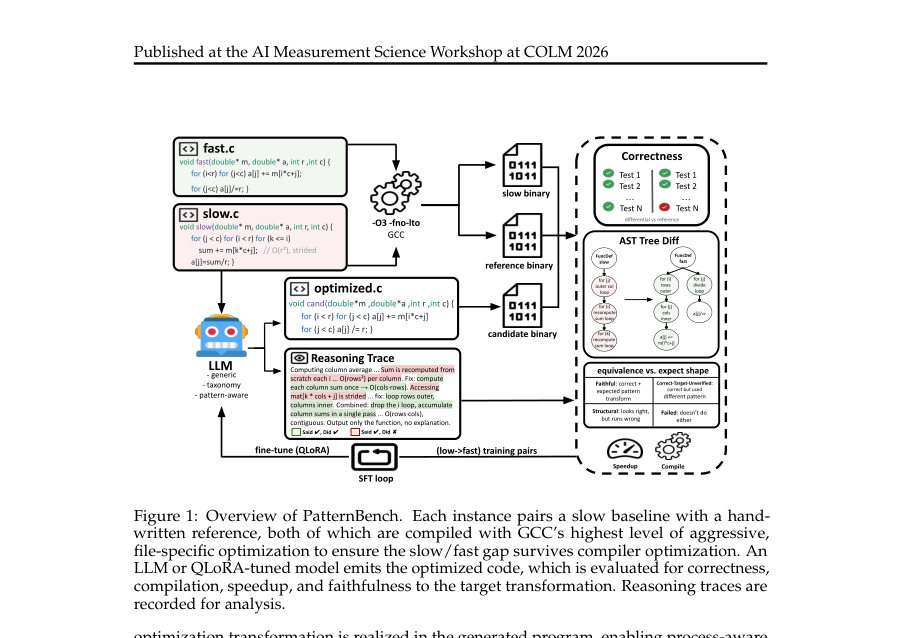
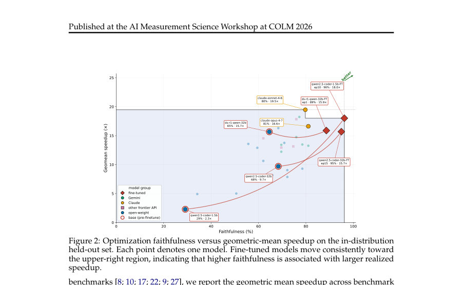

# Pattern-Driven Evaluation of LLM Code Optimization: Isolating Compiler-Transcendent Semantic Reasoning

- **게시일:** 2026-10-20
- **arXiv:** [2610.24835v1](http://arxiv.org/abs/2610.24835v1) · [PDF](https://arxiv.org/pdf/2610.24835v1)
- **저자:** Wesley Lu, Runzhou Liu, Hongru Du, Xinyao Yi
- **분야:** cs.AI, cs.PL, cs.SE
- **선정 점수:** 5.99
- **선정 이유:** 최근성 0.5, 인용 영향 0.0 (인용 0회), 저자 영향 0.0 (최고 h-index 0), AI 주제 적합성 2.9, 개발자 관심 0.2, 학술 신호 0.8, 오픈 웨이트·주요 연구조직 신호 1.6

[← 2026-10-20 목록으로 돌아가기](../daily/2026-10-20.html)

<!-- paper-visuals:start -->
## 주요 Figure

> 원문 PDF에서 실제 Figure 캡션과 그림 영역이 함께 확인된 자료만 자동 추출했다.

*Figure · 원문 PDF 3쪽 · Figure 1: Overview of PatternBench. Each instance pairs a slow baseline with a hand-*

*Figure · 원문 PDF 6쪽 · Figure 2: Optimization faithfulness versus geometric-mean speedup on the in-distribution*

<!-- paper-visuals:end -->

## 한 문장 요약

PatternBench라는 벤치마크와 AST 기반 검증기를 제안해 컴파일러의 공격적 최적화 이후에도 남아 있는(compiler-transcendent) 최적화 기회를 분리하여 LLM의 최적화 인지·실행 능력을 런타임 속도향상과 구조적 'faithfulness'로 동시에 평가한다.

## 해결하려는 문제

기존 LLM 코드 최적화 평가는 주로 평균적/종단적 런타임 속도향상만 측정하므로, 관측된 성능 개선이 모델이 의도한 최적화를 수행한 결과인지 아니면 현대 컴파일러가 이미 복구 가능한 변환의 결과인지를 구분하지 못한다. 특히 컴파일된 언어에서 컴파일러가 이미 수행하는 변환과 모델 고유의 의미론적 추론에 의한 최적화를 분리할 필요가 있다.

## 핵심 기여

- 컴파일러 공격적 최적화(-O2 -fno-lto) 이후에도 남아 있는 최적화 기회를 표적으로 삼는 PatternBench 벤치마크(1,244 인스턴스, 7 단일-패밀리 범주 + compositional)를 제시함.
- 의도한 최적화 변환이 생성된 코드에 실제로 존재하는지를 검사하는 AST 기반 최적화 'faithfulness' 검증 방법론을 도입함(검증자는 패턴별 결정론적 체크러, 정답성은 미분적 테스트로 보장).
- 프론티어·오픈웨이트·파인튜닝 모델들을 대상으로 런타임 속도(기하평균 속도향상)와 최적화 faithfulness를 병행 평가하여, 속도향상만으로는 최적화 능력을 과대평가할 수 있음을 실증함.
- 실험을 통해 최적화 faithfulness가 구현된 속도향상과 강하게 연관됨(Spearman ρ = 0.83), 그리고 파인튜닝이 faithfulness와 속도향상 모두를 크게 개선할 수 있음을 보임. 

## 접근 방법

* 패턴 기반 벤치마크 구성: 각 인스턴스는 느린 baseline 함수, 손으로 작성한 최적화된 reference(빠른 버전), 그리고 검증용 타깃 최적화 패턴을 포함한다(총 1,244 변형; 범주별 개수는 Table 1에 명시됨).
* 컴파일러-저항성 검증: baseline과 reference를 GCC -O2 -fno-lto로 컴파일하고 유의미한 성능 격차가 남는 인스턴스만 보존하여 '컴파일러-초월(compiler-transcendent)' 기회를 확보함.
* 프롬프트 조건: 1) generic(소스만), 2) taxonomy-guided(7개 범주 제공), 3) pattern-aware(정확한 패턴 설명 제공)로 인식 실패와 구현 실패를 분리함.
* 산출물 제약: portable C, 아키텍처 특화 intrinsics 금지.
* 평가 파이프라인: 생성된 코드에 대해 9개 입력 구성에 의한 미분적 테스트로 기능적 정합성 검사, 동일한 컴파일러 설정으로 런타임 측정(속도향상 Tb/To, 기하평균 보고), AST 기반 패턴 체크러로 최적화 실행 여부 판정(F(a)=C(a)S(a), 모델 Faithfulness = Σ F(a)/\|Am\|).
* 파인튜닝: 훈련 분할의 느린/최적화 쌍으로 오픈웨이트 모델을 파인튜닝(본문은 파인튜닝 수행을 기술, Figure 1은 ‘QLoRA-tuned’ 용어도 사용).

## 주요 결과

- PatternBench 구성: 총 1,244 변형(단일 패밀리 SR:112, IS:96, AL:78, MI:77, DS:76, HR:75, CF:55, compositional 총 675)으로 구성됨(표 1).
- 최적화 faithfulness와 기하평균 속도향상은 강하게 연관됨(Spearman ρ = 0.83). (Fig.2)
- 프롬프트 효과: 22개 모델에서 평균 faithfulness는 generic 35.5% → pattern-aware 45.6%로 약 10.1%p 향상. 그러나 pattern-aware에서도 평균 faithfulness은 45.6%로 절반 이상 실패. 최대치(최고 모델)는 70.0%였다.
- 파인튜닝 효과(본문 예시): qwen2.5-coder-1.5b는 faithfulness 29%→96%, 속도향상 2.3×→18.0×로 개선됨; qwen2.5-coder-32b는 faithfulness 68%→95%, 속도향상 9.7×→15.7×; ds-r1-qwen-32b는 faithfulness 65%→89%이나 속도는 거의 변화 없음(본문 §6.2).
- 범주별 난이도: 데이터구조(DS)와 조합적(COMPOSITE) 변환이 가장 어렵다(보고된 전체 평균 faithfulness: SR 62%, IS 62%, CF 59%, DS 34%, AL 50%, MI 60%, HR 70%, COMP 42%; 본문 Table 2). 이로부터 구조적/알고리즘적·조정형 변환이 특히 난제임이 드러남.  또한 모델이 프로즌 텍스트 계획을 제시하되 실제 코드에 반영하지 않는 'claim-without-doing(CWD)' 현상이 존재하며, commitment 비율은 89.5–96.3%이나 CWD는 AST 검사기 기준 24–39%, LLM 오라클 기준 7–28%로 보고됨(κ = 0.04–0.25로 두 오라클 불일치).

## 한계

- 저자 명시 한계: 패턴별 결정론적 체크러의 인식 실패를 흡수하는 Correct–Target-Unverified 범주 때문에 보고된 faithfulness는 낮추는 하한(lower bound)이며 체크러의 거짓음성(false-negative)을 완전히 배제할 수 없음. (본문 §7).
- 저자 명시 한계: '컴파일러 저항성'·런타임 측정은 특정 툴체인(GCC -O2 -fno-lto)·하드웨어에 대해 경험적으로 평가된 것이라 다른 컴파일러/플래그/아키텍처에서는 결과가 달라질 수 있음. (본문 §7).
- 저자 명시 한계: 데이터셋·벤치마크는 사전학습 오염 가능성이 존재하며 저자들은 일부 보완(held-out post-cutoff)을 했으나 완전 배제 불가. (본문 §7).
- 실험 범위에서 확인되는 제약: 파인튜닝 이득은 본문에서 in-distribution(훈련된 패턴 유사 영역)에 집중되어 있어 일반화 능력 향상 증거로 해석하기 어렵다는 점(본문 §7).

## 개발자 관점

- 코드 최적화 평가 시 속도향상만 측정하면 최적화의 '어떻게'를 놓치므로 구조적 검증(예: AST 기반 패턴 체크러)을 병행해야 함. PatternBench와 유사한 검증기를 도구화하면 모델이 실제로 의도한 변환을 수행하는지 확인할 수 있음.
- 파인튜닝(훈련 데이터에 존재하는 패턴 학습)은 특히 작은 모델에서 변환 '실행' 능력을 크게 개선하여 실질적 속도향상으로 이어질 수 있으므로, 제품화 시 핵심 패턴에 대해 추가 학습(또는 RL/반복적 미세조정)을 고려하라. 다만 이러한 이득은 in-distribution에 국한될 가능성이 높음.
- 평가·배포 시 툴체인(컴파일러, 최적화 플래그, 하드웨어)을 고정·명시해야 하며, 컴파일러가 이미 처리하는 변환을 모델의 성과로 오인하지 않도록 baseline·reference를 동일 컴파일 설정으로 검증(본문은 -O2 -fno-lto 사용)을 권함.
- 프롬프트 설계: 문제 인식(what)과 실행(how)을 분리하기 위해 다양한 가이드(카테고리 제공, 패턴 명시)를 준비하면 어느 단계에서 실패하는지 진단 가능. 본문 실험에서는 pattern-aware가 평균 약 10%p faithfulness 개선을 보였음.
- 검증 도구의 한계(거짓음성 등)를 고려해 검증 결과를 '하한'으로 해석하고, 체크러의 정밀도/재현성(precision/recall) 개선·사람-검토·교차 오라클 병용을 포함한 보강이 필요함.

**근거 범위:** 이 분석은 제공된 논문 PDF 본문(페이지 1–12, 본문과 부록 A 포함)에 근거하였다. 파인튜닝의 구체적 절차(QLoRA 등)는 Figure 1과 일부 문장에 언급이 있으나 본문은 파인튜닝의 일반적 수행만 기술하므로 해당 세부 구현(하이퍼파라미터, 정확한 롤아웃 방식 등)은 PDF에서 명확히 확인되지 않았다. 또한 검증기 내부 구현의 자세한 규칙과 일부 수치(예: 모든 모델별 세부 신뢰구간)는 본문에 제시된 표·문장만을 사용했으며, 체크러의 거짓음성·거짓양성 비율은 저자도 향후 작업으로 남겨두었음을 반영했다.
