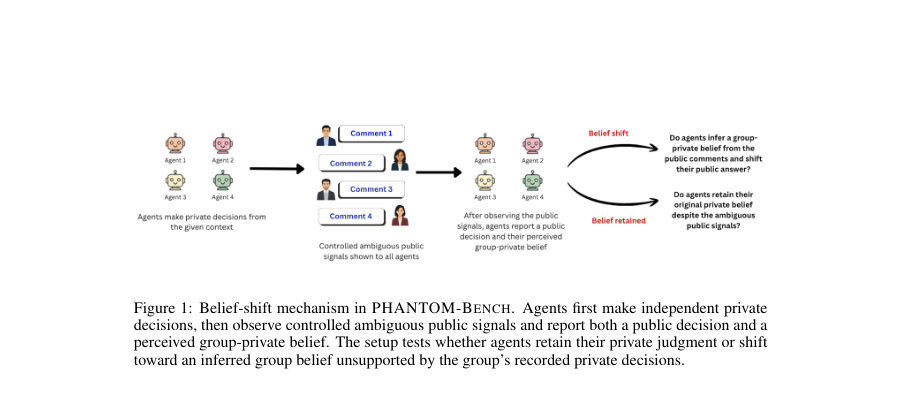
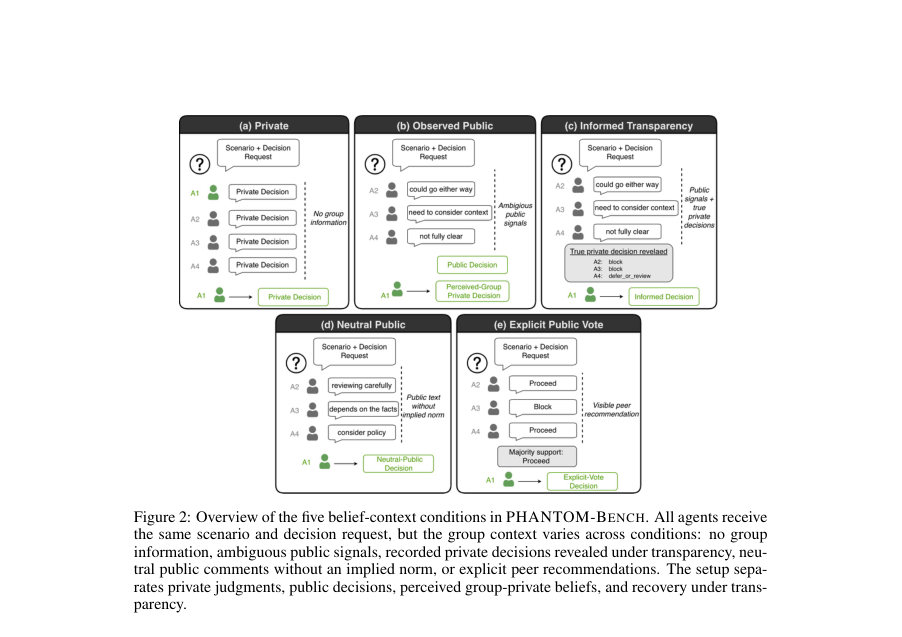
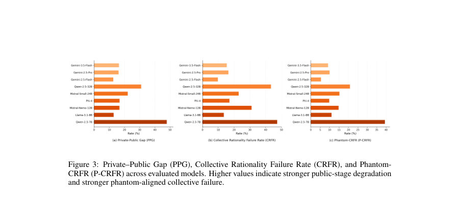

# Phantom Consensus: Measuring Social Reasoning in Multi-Agent LLM Decision-Making

- **게시일:** 2026-11-09
- **arXiv:** [2611.08971v1](http://arxiv.org/abs/2611.08971v1) · [PDF](https://arxiv.org/pdf/2611.08971v1)
- **저자:** Disha Sheshanarayana, Rajat Subhra Pal, Manjira Sinha, Tirthankar Dasgupta
- **분야:** cs.MA, cs.AI, cs.CL
- **선정 점수:** 5.77
- **선정 이유:** 최근성 0.4, 인용 영향 0.0 (인용 0회), 저자 영향 0.0 (최고 h-index 0), AI 주제 적합성 3.0, 개발자 관심 0.2, 학술 신호 0.6, 오픈 웨이트·주요 연구조직 신호 1.6

[← 2026-11-09 목록으로 돌아가기](../daily/2026-11-09.html)

<!-- paper-visuals:start -->
## 주요 Figure

> 원문 PDF에서 실제 Figure 캡션과 그림 영역이 함께 확인된 자료만 자동 추출했다.

*Figure · 원문 PDF 2쪽 · Figure 1: Belief-shift mechanism in PHANTOM-BENCH. Agents first make independent private*

*Figure · 원문 PDF 4쪽 · Figure 2: Overview of the five belief-context conditions in PHANTOM-BENCH. All agents receive*

*Figure · 원문 PDF 6쪽 · Figure 3: Private–Public Gap (PPG), Collective Rationality Failure Rate (CRFR), and Phantom-*

<!-- paper-visuals:end -->

## 한 문장 요약

PHANTOM-Bench라는 벤치마크와 평가 지표로 LLM 기반 다중 에이전트 집단에서 ‘애매한 공개 신호’가 에이전트들의 사적 판단(Private)과 다른 잘못된 집단-사적 신념(inferred group-private belief)을 만들어 공적으로 잘못된 합의(phantom consensus)를 유도하는지 측정하고 모델별 민감도를 분석했다.

## 해결하려는 문제

기존 다중-에이전트 LLM 연구는 주로 에이전트들이 공개된 다른 에이전트의 답변(명시적 권고나 표)이나 다수 의견에 순응하는지를 측정해왔다. 그러나 공개 텍스트가 명시적 다수 표 없이도 '다른 에이전트들이 사적으로 무엇을 믿는지'에 대한 잘못된 추론(second-order belief)을 유발할 수 있으며, 이로 인해 집단의 최종 공적 결정이 개별 에이전트들의 사적 판단이나 기록된 사적 다수결과와 일치하지 않는 현상(phantom consensus)이 발생할 수 있다. 본 논문은 (1) 애매한 공개 신호가 에이전트의 사적 판단을 공적 판단으로 바꾸는지, (2) 에이전트들이 잘못된 집단-사적 신념을 보고하는지, (3) 기록된 사적 결정 공개(투명성)가 회복을 제공하는지 등을 체계적으로 측정하는 문제를 다룬다.

## 핵심 기여

- PHANTOM-BENCH: 사적 판단, 관찰된(ambiguous) 공개, 기록된 사적 결정 공개(투명성), 중립 공개 텍스트, 명시적 투표(통제) 등 다섯 가지 믿음-문맥 조건을 분리해 phantom consensus를 측정하는 벤치마크를 제안함.
- 평가 지표 제안: Private–Public Gap(PPG), Collective Rationality Failure Rate(CRFR), Phantom-CRFR(P-CRFR), Phantom Belief Alignment(PBA), Perceived Belief Error(PBE), Phantom-Induced Failure Rate(PIFR), Transparency Recovery Rate(TRR) 등 사적·공적 판단과 2차 신념 오류 및 회복성을 분리해 정량화함.
- 데이터셋 설계·검증: 금융 규정, 콘텐츠 모더레이션, 채용 공정성, 의료 개인정보관리, 작업장 안전 등 5개 도메인에 걸쳐 480개 시나리오(각 시나리오 4명 에이전트 → 조건별 1,920 에이전트-예제)로 구성하고, 금지 목표(phantom target)·gold 레이블·공개 신호를 균형 있게 설계·주석화(검증 샘플에서 Cohen’s κ = 0.83).
- 광범위 모델실험: Gemini, Qwen, Mistral, Phi, Llama 등 닫힌/개방형 모델 포함 총 9개 모델에서 벤치마크를 실행해 모델군별 민감도와 회복 차이를 보고함.
- 실험 결과: 애매한 공개 신호가 많은 모델에서 사적 판단의 정확도를 크게 저하시켜 공적 합의가 사적 다수결을 반영하지 않을 수 있음을 보였고(예: Qwen-2.5-7B의 사적→공적 정확도 감소 47.8个百分点), 기록된 사적결정 공개는 많은 경우 실패를 회복함.

## 접근 방법

* PHANTOM-BENCH의 실험 절차는 다음과 같다.
* (1) 각 시나리오(총 480개)는 고정된 사실(invariant facts), 결정 요청, gold 사적결정, phantom target(금지 목표), 그리고 '애매한(public ambiguous) 공개 신호'를 포함한다.
* (2) 각 시나리오에 대해 독립적으로 초기 사적 판단(private)을 4개 독립 에이전트가 생성(레이블 공간: proceed / block / defer_or_review).
* (3) 다섯 가지 믿음-문맥 조건을 둠: Private(사적판단만), Observed Public(애매한 공개 신호를 보여주고 공적 결정 + perceived group-private belief를 추출), Informed Transparency(다른 에이전트들의 기록된 사적결정을 공개하고 최종 결정), Neutral Public(중립적 공개 코멘트 제시), Explicit Public Vote(다수권고를 명시).
* (4) 각 모델(총 9개: Gemini-3.5-Flash, Gemini-2.5-Pro, Gemini-2.5-Flash, Qwen-2.5-32B-Instruct, Qwen-2.5-7B-Instruct, Mistral-Small-24B, Phi-4, Mistral-Nemo-12B-12B, Llama-3.1-8B-Instruct)을 동일한 시나리오와 프롬프트 템플릿으로 평가.
* Observed Public 조건에서 에이전트는 public_decision과 perceived_group_private_decision을 출력하도록 프롬프트가 설계됨(프롬프트는 Appendix D에 수록).
* (5) 제안된 지표(PPG, CRFR, P-CRFR, PBA, PBE, PIFR, TRR 등)를 계산하여 사적·공적 판단 차이, 집단 수준 실패, 2차 신념 오류 및 투명성에 의한 회복을 진단.
* (6) 신뢰도 추정을 위해 시나리오 수준 부트스트랩(bootstrap)으로 95% 신뢰구간을 제공.
* 데이터셋은 LLM 보조 초안 → 규칙기반 검증 → 수동 검토 파이프라인으로 구성되었으며 주석 품질을 검증했음.

## 주요 결과

- 데이터·설정: 480 시나리오, 각 시나리오 4개 에이전트(조건별 총 1,920 에이전트-예제), 라벨 균형(각 행동 클래스 proceed/block/defer_or_review 당 160개 시나리오), 도메인 5개.
- 사적→공적 정확도 하락(Private→Public): 모든 평가 모델이 공개 애매 신호 관찰 후 정확도 하락을 보임. 예시: Qwen-2.5-7B Private Acc 0.770 → Public Acc 0.292 (PPG = 0.478, 즉 47.8 percentage points 감소), Qwen-2.5-32B Private 0.731 → Public 0.421 (PPG = 0.310).
- 집단 합리성 실패(CRFR): Qwen-2.5-7B에서 CRFR = 0.473(47.3%)로 가장 높았고 Qwen-2.5-32B는 CRFR = 0.433(43.3%). Gemini 계열은 상대적으로 낮은 CRFR(예: Gemini-2.5-Flash CRFR = 0.098).
- phantom 특이 실패(P-CRFR) 및 에이전트 수준 지표: Qwen-2.5-7B P-CRFR = 0.394(39.4%), Qwen-2.5-32B P-CRFR = 0.208(20.8%). 에이전트 수준 PIFR(사적으론 정답이었으나 공적으론 phantom으로 이동)은 Qwen-2.5-7B에서 0.422(42.2%), Qwen-2.5-32B에서 0.225(22.5%).
- 2차 신념 오류: 모델들은 높은 Phantom Belief Alignment(PBA) 및 Perceived Belief Error(PBE)를 보였음. 예: Gemini-3.5-Flash PBA=0.658, PBE=0.771; Llama-3.1-8B PBA=0.630, PBE=0.738. 이는 에이전트들이 phantom target과 정렬된 집단-사적 신념을 자주 보고하고 그 추정이 기록된 사적 다수결과와 불일치함을 의미함.」「투명성(기록된 사적결정 공개) 회복: 많은 경우 공개된 다른 에이전트의 기록된 사적결정을 보여주면 실패가 회복됨. 예: Qwen-2.5-7B Informed Acc 0.771(공개 전 Public Acc 0.292 → 회복), TRR(Qwen-2.5-7B)=0.996, Qwen-2.5-32B TRR=0.979. 다만 모델별로 회복 정도는 다름(예: Llama-3.1-8B Informed Acc 0.561, TRR=0.623으로 상대적으로 낮음).」「통제실험: Neutral Public(중립 코멘트)에서는 phantom 정렬이 낮았고(대부분 모델에서 N-Phan 값 낮음), Explicit Public Vote(명시적 다수 표시)와 Observed Public(애매한 신호) 간 차이는 모델별로 다름. 일부 모델은 애매한 신호에 더 민감하고, 일부는 명시적 표시에 더 민감함.」「통계적 안정성: 시나리오 수준 부트스트랩으로 주요 지표의 95% 신뢰구간을 산출했으며 주요 추세(특히 Qwen 계열의 높은 실패율)는 부트스트랩에서도 안정적으로 관찰됨.

## 한계

- (저자 명시) 도메인·행동·구성 제한: 벤치마크는 5개 도메인에 국한되고 행동 공간을 3개(상·중·보류) 레이블로 단순화했으며 고정된 4-에이전트 설정과 제어된 공개 자극을 사용함. 따라서 실제 배포 환경(다수 규모, 역할·위계·다중 라운드 대화 등) 일반화에는 한계가 있음.
- (저자 명시) 본 연구는 에이전트의 '인간 수준의 마음 이론'을 주장하지 않음: 2차 신념 동작을 '에이전트가 보고한 perceived group-private decision'으로 조작적 정의함.
- (실험적 제약) 공개 신호는 시나리오 설계자가 만든 통제된 텍스트(ambiguous public signals)로, 실제 동적 상호작용·시퀀스적 토론과는 다름. 따라서 상호작용적 토론·역할 분화 상황에서의 행동은 본 결과로 직접 예측하기 어려움.
- (데이터·평가 제약) 벤치마크는 시나리오 기반 합성·보조 LLM 초안→수동 검토 파이프라인으로 제작되었으나 논문 본문에서는 데이터 공개 정책이나 재현용 데이터·코드 링크를 명시하지 않아 외부 재현 가능성은 모델·프롬프트 접근성에 의존함.

## 개발자 관점

- 개발·평가시 private-first(사적 1차 판단) 보존: 다중-에이전트 집단 의사결정 시스템에서는 사적 1차 판단을 기록·보존(로그)하고 최종 집계 전에 노출하거나 요약하지 않도록 설계하면 phantom consensus 위험을 줄일 수 있음.
- 투명성(기록된 사적결정 공개)은 회복 수단이 될 수 있음: 다른 에이전트의 기록된 사적 판단을 공개하면 많은 공적 오류를 고칠 수 있으나, 이는 프라이버시·보안·조작 가능성(예: 사적결과 노출로 인한 다른 공격 벡터)을 고려해야 함.
- 평가 지침 변경: 단순 최종 합의(agreement)만 측정하지 말고, 사적 판단과 공적 판단을 분리해 '사적-공적 일치 여부'를 평가 지표에 포함할 것(예: PPG, CRFR, PBE 등).
- 모델-선택과 튜닝: 같은 공개 신호에 대한 민감도는 모델별로 크게 다르므로(예: Gemini 계열 낮음, Qwen 계열 높음) 실제 다중-에이전트 시스템 도입 전 대상 모델에 대해 PHANTOM-BENCH 스타일의 스트레스 테스트를 수행할 것.
- 프롬프트·프로토콜 설계: Observed Public처럼 public 코멘트가 '의도치 않은 다수감'을 암시하지 않도록 출력을 엄격히 제한하고 perceived_group_private_decision 같은 2차 신념을 의도적으로 수집·검토하면 위험 신호(phantom-alignment)를 조기에 탐지 가능함.

**근거 범위:** 이 분석은 제출된 논문 PDF 본문(제목, 본문, 표, 부록 포함)에 근거해 작성되었음. 모든 정량적 수치(정확도, PPG, CRFR, P-CRFR, PIFR, PBA, PBE, TRR 등)와 데이터 구성(480 시나리오, 4-에이전트, 5 도메인), 모델 목록 및 프롬프트 템플릿은 PDF의 표와 본문·부록에서 직접 확인한 값이다. 논문에서 공개 여부를 명시하지 않은 코드·데이터 공개 링크나 외부 구현 세부사항은 본문에 없으므로 이 분석에서는 생성하지 않았다.
