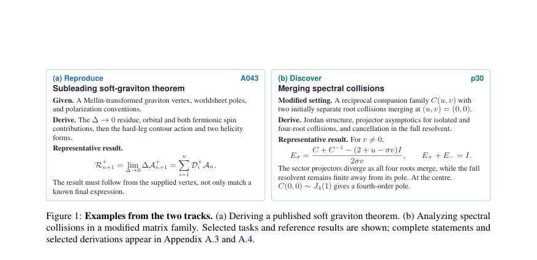
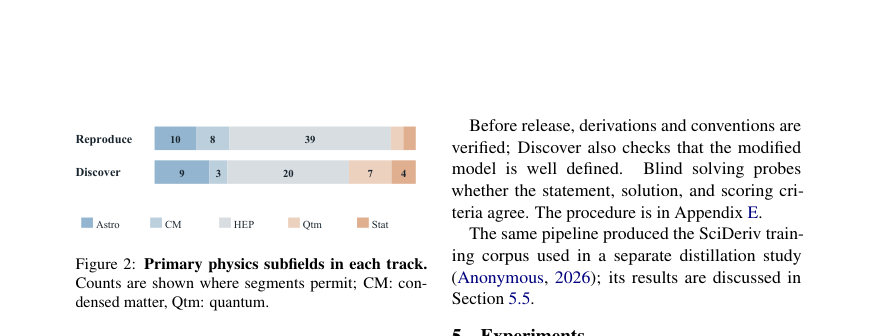
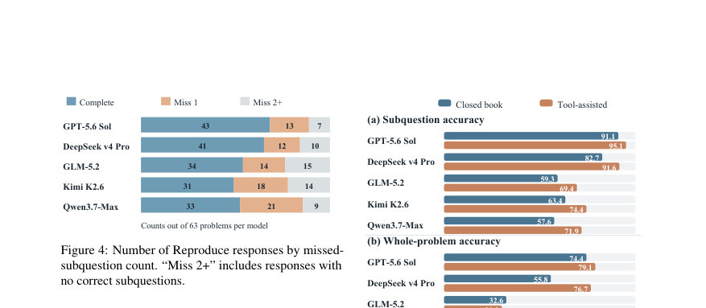

# PHYRD: A Living Benchmark for Reproducing and Extending Theoretical Physics Research

- **게시일:** 2026-10-26
- **arXiv:** [2610.32575v1](http://arxiv.org/abs/2610.32575v1) · [PDF](https://arxiv.org/pdf/2610.32575v1)
- **저자:** Qituan Zhang, Guo Chen, Linfeng Zhang, Wenlong Zhang
- **분야:** cs.CL
- **선정 점수:** 5.59
- **선정 이유:** 최근성 0.4, 인용 영향 0.0 (인용 0회), 저자 영향 0.0 (최고 h-index 0), AI 주제 적합성 2.1, 개발자 관심 0.0, 학술 신호 0.6, 오픈 웨이트·주요 연구조직 신호 2.5

[← 2026-10-26 목록으로 돌아가기](../daily/2026-10-26.html)

<!-- paper-visuals:start -->
## 주요 Figure

> 원문 PDF에서 실제 Figure 캡션과 그림 영역이 함께 확인된 자료만 자동 추출했다.

*Figure · 원문 PDF 3쪽 · Figure 1: Examples from the two tracks. (a) Deriving a published soft graviton theorem. (b) Analyzing spectral*

*Figure · 원문 PDF 4쪽 · Figure 2: Primary physics subfields in each track.*

*Figure · 원문 PDF 5쪽 · Figure 4: Number of Reproduce responses by missed-*

<!-- paper-visuals:end -->

## 한 문장 요약

PHYRD는 FormulaForest로 구성한 수식·전제 의존 그래프를 기반으로 이론물리 연구 수준의 재현(Reproduce)과 변형(Discover) 문제를 평가하는 'living' 벤치마크와 이를 위한 데이터·검증·평가 파이프라인을 제시한다.

## 해결하려는 문제

기존 수학·물리 벤치마크들은 경쟁형 문제나 정적 질문·답변, 또는 코드 실행 중심 평가에 치우쳐 있어 이론물리 연구에서 요구되는 '출처 조건(conventions 및 applicability) 검증', '변경된 이론적 조건 아래에서의(정리·관계의) 유효성 재검토', 그리고 외부 도구(기호 계산·검색)를 결합한 에이전트적 연구 흐름을 충분히 평가하지 못한다. 또한 고정된 문제집합은 시간이 흐르며 구분력이 떨어지고 공개 자료로 인한 학습 오염 위험이 있다. 본 논문은 이러한 한계를 보완해 (1) 출처 논문으로부터의 엄밀한 유도 재현과 (2) 원 가정의 일부를 변경한 뒤의 귀결(Discover)을 모두 평가하는 벤치마크와 그 구성·검증 파이프라인을 제안한다.

## 핵심 기여

- PHYRD: 63개의 Reproduce 문제(279개 공개 하위질문)와 43개의 Discover 문제(225개 공개 하위질문)를 포함한 지속적 확장이 가능한 이론물리 벤치마크 컬렉션을 제안하고 공개 규격(문제 명세, 참조 해답, 하위질문 수준 루브릭, 버전화)을 정의했다.
- FormulaForest: 논문 내 수식·정의·전제의 의존 관계를 그래프로 표현하고(식·전제 노드, 유도·특수화 간선, 적용 조건), 이를 바탕으로 문제 진술·참조 해답·채점 기준을 자동·반자동으로 구성·검증하는 파이프라인을 고안·적용했다.
- 도구 기반 Discover 평가 및 오류 분석: 닫힌 책(closed-book)과 도구(심볼릭 계산·검색) 보조 설정에서 5개 모델(GPT-5.6 Sol, DeepSeek v4 Pro, GLM-5.2, Kimi K2.6, Qwen3.7-Max)을 평가하고, 부분정답(하위질문) 대비 전체문제 완전성(whole-problem) 간 괴리, 도구 사용으로 인한 계산 오류 감소와 개념적 오류 지속 등의 실증적 관찰을 제공했다.
- 합성 학습 데이터(SciDeriv) 활용 실험: FormulaForest의 Reproduce 파이프라인에서 생성한 17,577개 프롬프트(10,000 conclusion-assessment, 7,577 conclusion-reconstruction)를 이용한 교사-학생 온-정책(distillation) 실험을 보고하고, ESCD 등 목표함수가 FrontierScience/Olympiad와 PHYRD-40에서 성능 개선을 보였음을 제시했다.
- 평가·운영 설계 세부사항 공개: 하위질문(binary) 채점, SAcc(문제별 하위질문 평균)와 WAcc(모든 하위질문 정답 시만 카운트) 등 평가 지표, 도구 환경(제한된 python 환경·SymPy/NumPy/mpmath·arXiv 검색·실행 시간·토큰 제한), 블라인드 솔빙과 버전화·재검증 절차를 명시했다.

## 접근 방법

* 주요 접근은 FormulaForest를 중심으로 한 문제 구성·검증 파이프라인과 두 트랙(Reproduce, Discover) 평가로 요약된다.
* FormulaForest는 출처 논문에서 식·정의·전제 노드를 추출하고, 유도·특수화 간선과 적용조건을 연결한 그래프 Gs = (Vs, Es, Πs)를 구성한다.
* Reproduce는 출처에서 요구되는 공식을 유도하는 데 필요한 전제들을 모아 공개 진술문(statement), 하위질문·루브릭, 참조 해답(reference derivation)을 만든다.
* Discover는 출처 모델 H와 전제 C에 변환 T를 적용해 변경된 모델 (eH, eC)을 정의한 뒤(연산자·대칭·경계조건·계수 변경 등), 어떤 원래 주장이 유지되는지 또는 새로운 유도가 필요한지를 기록한다.
* 모든 참조 유도는 출처 검증, 해석적 검토, 가능한 경우 계산적 확인을 거친다.
* 평가 절차: 각 공개 하위질문은 이진 채점(완전성 요구), SAcc(문제별 하위질문 비율 평균), WAcc(문제의 모든 하위질문 정답 비율)으로 집계한다.
* Discover는 닫힌 책과 도구 보조(제한된 python + 심볼릭, arXiv 검색, 실행시간/토큰 제한) 두 설정으로 평가한다.
* 도구 환경은 별도 CPU/실행시간 제한(예: 40초 CPU, 60초 경과시간), 최대 도구 호출·턴 수, 토큰 제한 등으로 통제되며 모델별로 요청 파라미터(토큰 한도·사고 예산 등)가 상이하다.
* 추가로 FormulaForest에서 생성한 SciDeriv 프롬프트(17,577개)를 이용해 온-정책 증류(BPM, ESCD)를 실험했다.

## 주요 결과

- 데이터셋 규모: 전체 106문제(63 Reproduce, 43 Discover), 공개 하위질문 총 504개(Reproduce 279, Discover 225).
- Reproduce(닫힌 책) 평가(63문제): 하위질문 정확도(SAcc) 모델별 범위 79.66% (Kimi) ~ 88.33% (GPT-5.6 Sol). 전체문제 완전성(WAcc) 범위 49.21% (Kimi) ~ 68.25% (GPT-5.6 Sol). 315개 응답 중 182건이 완전 정답, 130건이 일부 정답, 3건은 전부 오답. 불완전 응답의 상당수가 한 하위질문만 놓친 경우(78/133)로 집계되어 SAcc와 WAcc 간 큰 차이를 설명한다.
- Discover(같은 43문제) 닫힌 책 vs 도구 보조 비교: 닫힌 책 WAcc 범위 모델별 18.60% (Qwen) ~ 74.42% (GPT-5.6 Sol). 도구 보조 시 WAcc은 GPT 79.07%, DeepSeek 76.74%, GLM 30.23%, Kimi 37.21%, Qwen 39.53%로, DeepSeek와 Qwen은 도구 사용으로 whole-problem 완전성에서 각각 20.93 퍼센트포인트 향상(순증가)을 보였다. SAcc 측면에서는 도구 보조로 계산 오류가 크게 감소했으며(쌍응답 209개에서 계산 오류는 123→67로 감소), 개념적 오류는 절대 수가 거의 변하지 않아(70→75) 남은 실패 원인이 개념·논증적 결함임을 시사했다.
- 오류 분석(수치): Reproduce의 주된 실패 유형은 모델별 차이가 있었음(예: GPT는 '불완전·미제시 논증'이 많고, GLM은 계산 오류 비중이 높음). Discover 쌍응답(도구 사용 전후, 모델별로 37~43문제)에서 계산 오류 감소가 도구 보조 성능 개선의 주된 원인이며, 개념적 오류는 도구로도 잘 개선되지 않았다.
- 합성 데이터(SciDeriv) 기반 증류 결과: FormulaForest Reproduce 파이프라인으로 생성한 17,577 프롬프트를 이용, ESCD(이벤트-완성형(distillation))가 BPM 대비 성능 우위. 예: Qwen 교사(397B) → 30B 학생에서 PHYRD-40 평균 점수 43.0 → 49.6, Olympiad-100(FrontierScience 부분집합) 48.0 → 51.0. Kimi(1T)→Qwen-35B 학생 쌍에서는 ESCD가 PHYRD-40에서 74.3, Olympiad-100에서 72.0을 달성했고(논문은 Qwen-35B-A3B의 FrontierScience 정확도 61%→72% 개선을 언급), ESCD가 합성 유도 과제의 하위-상향 성능 향상에 기여함을 보였다.

## 한계

- 저자가 명시한 한계: PHYRD의 불균형한 하위 분야(예: Reproduce에서 HEP가 많은 비중을 차지함)는 분야별 비교를 제한한다. 또한 모델이 학습 중에 공개된 관련 결과를 이미 본 경우(데이터 오염)가 있을 수 있다.
- 본문에서 확인되는 실험적 제약(저자가 구분하여 서술): 도구 보조 평가는 모델별로 상이한 상호작용·계산 예산·토큰 한도와 수집 절차(예: GPT의 대화 인터페이스 수집 방식 vs API 모델) 때문에 도구 접근 자체의 독립적 효과를 완전히 분리하지 못한다. 도구 환경은 제한된 python 환경과 시간·토큰 제약을 갖고 있어 대규모 계산 재현과 동등하지 않다.
- 평가·채점 제약: 하위질문은 이진 채점(전부 맞아야 1점)으로 부분점수 체계가 없어 섬세한 부분 성능 차이를 포착하지 못할 수 있다. 또한 수치적 검증은 가족 전체 성질을 증명하지 못하고 반례·수치 확인만 가능하다.

## 개발자 관점

- 문제 재현을 위해서는 문제 진술(statement), 상세 참조 해답(reference derivation), 하위질문 수준의 채점 루브릭을 함께 제공해야 하며(본 논문 방식), 이 세 요소는 블라인드 솔빙 테스트를 거쳐 정합성을 확인해야 한다.
- 수식·전제의 의존 관계를 명시적으로 관리(FormulaForest의 그래프 표현)하면 참조 해답의 빈틈 식별, 변경된 가정의 영향 평가(Discover), 자동 생성 합성 데이터 생산에 유리하다. 이 구조를 버전관리·해시(문제·해답·검토 기록)로 묶어 'living' 벤치마크의 추적가능성을 보장한 점은 구현 시 따라야 할 모범 사례다.
- 도구 보조 평가는 계산 오류를 크게 줄이지만 개념적·논리적 결함(전제 오용·누락된 유도)은 여전하므로 실제 연구 지원 시스템에서는 '전제·적용조건의 명시적 검증' 및 정리(lemma) 수준의 형식적 검사, 또는 인간-검토 루프를 병행해야 한다.
- 벤치마크·평가 구현 세부: 도구 환경(심볼릭 라이브러리, 제한된 실행시간, 토큰·턴 제한), 요청 파라미터(토큰 한도·사고 예산)와 수집 방식이 결과에 영향이 크므로 실험 재현 시 동일한 환경·파라미터를 엄격히 기록·재현해야 한다.
- 합성 데이터 활용: FormulaForest에서 생성한 SciDeriv 같은 구조화된 유도 프롬프트는 온-정책 증류에 유용하며, ESCD 등 목표함수는 실전 벤치마크에서 성능을 끌어올릴 수 있다. 다만 교사-학생 구성, 초기화(SFT 유무), 모델 크기/쌍 등에 따라 이득 크기가 달라지므로 실험 재현 시 이들을 문서화해야 한다.

**근거 범위:** 이 분석은 제공된 논문 PDF 본문(페이지 1–26 및 부록 내용)을 근거로 작성했습니다. 수치는 본문과 도표(본문의 표·그림·부록 표)에 명시된 값만을 사용했으며, 수집·도구 환경의 정확한 내부 동작(예: 모델 내부 사고 예산의 실제 적용량) 등 본문에 상세히 기술되지 않은 구현 세부사항은 추정하지 않았습니다.
