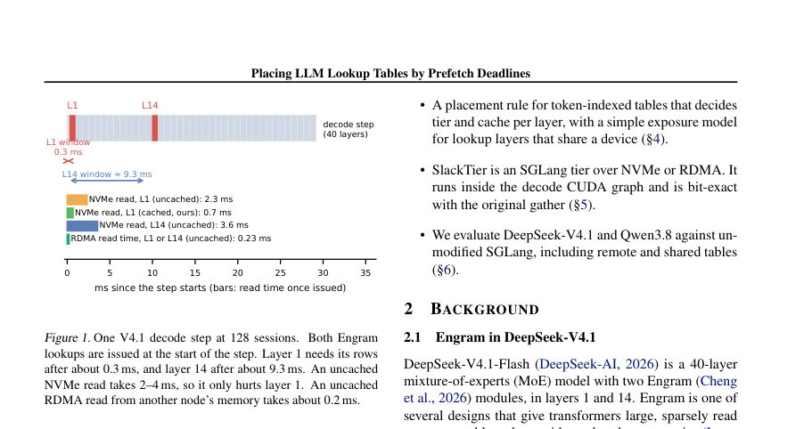
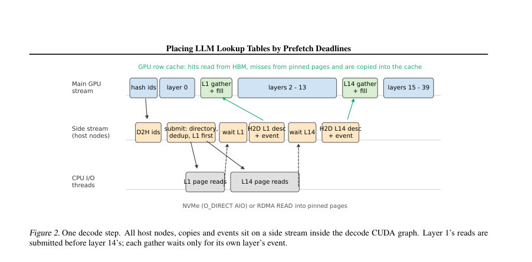
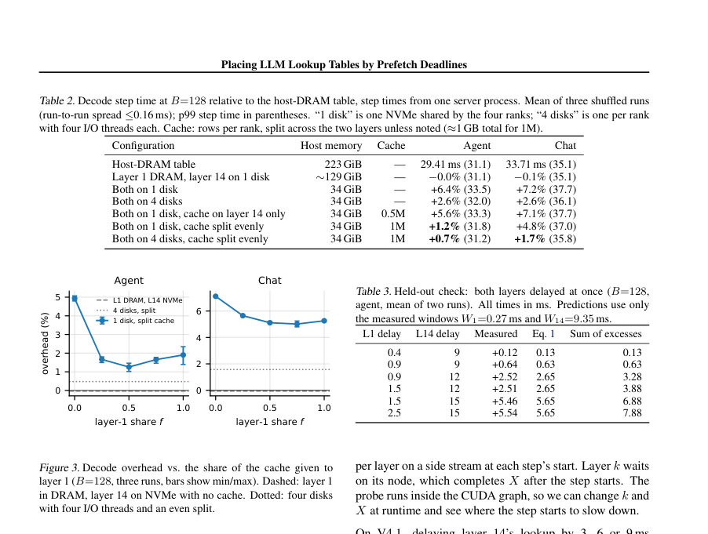

# Placing LLM Lookup Tables by Per-Layer Prefetch Deadlines

- **게시일:** 2026-11-11
- **arXiv:** [2611.13413v1](http://arxiv.org/abs/2611.13413v1) · [PDF](https://arxiv.org/pdf/2611.13413v1)
- **저자:** Wen Huang, Jack Liu
- **분야:** cs.DC, cs.AI, cs.LG
- **선정 점수:** 6.20
- **선정 이유:** 최근성 0.9, 인용 영향 0.0 (인용 0회), 저자 영향 0.0 (최고 h-index 0), AI 주제 적합성 3.0, 개발자 관심 0.5, 학술 신호 0.3, 오픈 웨이트·주요 연구조직 신호 1.6

[← 2026-11-11 목록으로 돌아가기](../daily/2026-11-11.html)

<!-- paper-visuals:start -->
## 주요 Figure

> 원문 PDF에서 실제 Figure 캡션과 그림 영역이 함께 확인된 자료만 자동 추출했다.

*Figure · 원문 PDF 2쪽 · Figure 1. One V4.1 decode step at 128 sessions. Both Engram*

*Figure · 원문 PDF 5쪽 · Figure 2. One decode step. All host nodes, copies and events sit on a side stream inside the decode CUDA graph. Layer 1’s reads are*

*Figure · 원문 PDF 6쪽 · Figure 3. Decode overhead vs. the share of the cache given to*

<!-- paper-visuals:end -->

## 한 문장 요약

입력 토큰으로 결정되는 대형 언어모델(LLM) 조회 테이블의 '레이어별 프리페치 데드라인(윈도우)'을 측정하고, 이를 기반으로 각 레이어별로 테이블을 NVMe/DRAM/RDMA에 배치하고 소량의 GPU 행 캐시를 분할하는 SlackTier를 제안해 메모리 사용을 크게 줄이면서 디코드 지연을 거의 유지한다.

## 해결하려는 문제

DeepSeek‑V4.1 등 최신 모델은 수백 기가바이트 규모의 토큰 인덱스 기반 조회 테이블(예: Engram)을 사용해 HBM에 적합하지 않으므로 현재 대부분 호스트 DRAM에 두고 PCIe로 매 스텝 가져와 서비스한다. 이 방식은 호스트 메모리 사용량이 매우 커(예: 4×H200에서 서비스 프로세스의 223 GiB 중 테이블이 190 GiB 차지) 노드 당 메모리 제약을 초래하거나 모델 로딩 실패를 낳는다. 단순히 NVMe로 옮기면 배치 부하에서 디코드가 느려지는데(예: 1 디스크에서 6–7% 지연), 기존의 '핫-로우 캐시만으로 해결' 접근은 레이어별로 다른 '프리페치 윈도우'를 고려하지 않아 비효율적이다. 연구 질문은 각 테이블(또는 테이블의 레이어)을 어떤 스토리지 티어에 놓고 GPU 캐시를 어떻게 분배하면 호스트 메모리를 크게 줄이면서 디코드 지연을 허용 가능한 수준으로 유지할 수 있는지이다.

## 핵심 기여

- 여러 모델과 플랫폼(H200 노드의 DeepSeek‑V4.1, Qwen3.8 등)에서 레이어별 프리페치 윈도우를 직접 측정하고, 엔그램(Engram) 접근 패턴과 세션 내 재사용을 정량화함(예: 1M‑row LRU가 에이전트 룩업의 74%를 히트).
- 레이어별 '제로-스톨(zero-stall)' 조건을 확장해 다계층(heterogeneous) 티어와 디스크 공유(컨텐션)를 고려한 노출(exposure) 모델을 제시하고, 측정된 읽기 시간으로 디코드 슬로다운을 예측함(RMSE 0.22 ms, R2=0.93).
- SlackTier 구현: 모든 룩업을 스텝 시작시에 발행하고(레이어 1 우선), 작은 GPU 행 캐시를 레이어별 윈도우에 따라 분할하는 SGLang 기반 테이블 티어 구현(Decode CUDA 그래프 내 실행, 원래 gather와 비트-일치).
- 실험적 평가: 두 Engram 테이블을 NVMe(4 디스크)로 옮기고도 에이전트·챗 재플레이에서 출력 토큰당 평균 시간이 최대 1.4% 증가하는 수준으로 유지하며 호스트 메모리를 212→34 GiB로 감소시킴. RDMA로 원격 노드 메모리에서 읽으면 캐시가 불필요함을 보임.
- 실무적 적용성: 레이어별 윈도우와 읽기 시간만 측정하면 새로운 테이블·하드웨어에 대해 배치 결정을 내릴 수 있음을 보이고, 절약된 호스트 메모리를 KV 캐시로 재할당하면 KV 제약 워크로드에서 처리량/TTFT가 크게 개선됨(예: 중앙값 처리량 +36%, p90 TTFT 38→24 s).

## 접근 방법

* 핵심 아이디어는 '레이어가 테이블을 필요로 하는 시점까지의 계산 여유(프리페치 윈도우, Wℓ)'와 실제 읽기 지연(Tℓ)을 비교해 각 레이어별로 테이블을 어떤 티어에 둘지(호스트 DRAM, NVMe, 원격 RDMA) 결정하고, GPU 행 캐시를 윈도우가 짧한 레이어에 우선적으로 분배하는 것이다.
* 구체적 구성요소는 다음과 같다: (1) 프리페치 윈도우 측정 프로브—디코더 레이어 훅을 통해 스텝 시작부터 지연을 주고 스텝 지연이 통계적 노이즈를 넘는 최초 지점에서 윈도우 산정, (2) 노출(exposure) 모델(Eq.1)—CPU 인덱스 해석 시간 s, 레이어별 읽기 지연 Tℓ, 공유 디스크로 인한 순차 대기(d1,d14) 및 고정 비용 κ를 통해 스텝 당 총 노출 ∆를 계산, (3) 캐시 할당 모델—GPU 캐시 예산 C를 레이어별 miss-page 곡선 Pℓ(c)에 따라 분할 f 로 최적화(실험적 곡선 사용), (4) SlackTier 구현—SGLang 내에 약 900줄 C/300줄 Python 코드로 구현, 각 TP rank가 디스크에 연속적으로 테이블 저장, 스텝 시작 시 모든 룩업을 발행(레이어1 우선), CPU 디렉토리(레이어별 row→slot, CLOCK 교체)로 중복 제거 및 I/O 리스트 구성, O_DIRECT raw block NVMe 또는 원격 RDMA로 4 KiB 페이지 단위 읽기, Triton kernel을 통해 비트-일치 gather 및 캐시 채움.
* 모든 호스트 노드·카피·이벤트는 디코드 CUDA 그래프의 사이드 스트림에 들어가서 런타임 그래프 재연과 오버헤드 최소화를 보장한다.

## 주요 결과

- 프리페치 윈도우: DeepSeek‑V4.1의 Engram 레이어1 윈도우 W1 ≈ 0.27–0.3 ms, 레이어14 W14 ≈ 9.3 ms(약 30× 차이). (프로브 측정)
- 읽기 지연 예시: NVMe uncached L1 read ≈ 2.3 ms, L14 uncached ≈ 3.6 ms; RDMA uncached ≈ 0.21–0.25 ms. (Figure 1, §6.8)
- 메모리 절감: SGLang의 호스트 테이블(기본)에서 서비스 프로세스 RSS가 223 GiB였으나 SlackTier로 NVMe(4 디스크) 사용 시 34 GiB로 감소(대부분 테이블 제거).
- 디코드 오버헤드(스텝 타임): 표준(Host-DRAM) 대비 주요 측정값(128 세션): 두 테이블을 1 디스크로만 옮겼을 때 +6.4% (agent) / +7.2% (chat); 동일 캐시(1M rows per rank) 를 레이어14에만 둔 경우 +5.6%/+7.1%; 같은 1M 캐시를 레이어 간 절반씩 나눈 경우 +1.2% (agent) / +4.8% (chat); 4 디스크 + 1M split에서는 +0.7% (agent) / +1.7% (chat). (Table 2)
- 모델 예측 성능: 측정된 윈도우와 런 초기 값 하나로 보정해 NVMe·RDMA·8–256 세션의 174개 실험에 대해 디코드 슬로다운 예측 RMSE = 0.22 ms, R2 = 0.93. (§4.1, §6.3, Table 3 검증 사례 포함). 또한 파라미터 피팅 시 in-sample R2 = 0.96, RMSE 0.14 ms로 W1 약 0.6 ms로 추정(그러나 직접 프로브로 W1≈0.27 ms를 사용). (§4.1, §6.3).   

## 한계

- 저자가 명시한 한계: (1) 방법은 '입력 토큰에만 의존해 미리 알 수 있는 인덱스'를 가진 테이블에 적용된다(Engram/토큰 인덱스형 테이블). 밀집 행렬 가중치나 전문가(expert) 파라미터처럼 런타임 활성화에 따라 인덱스가 결정되는 항목에는 적용 불가. (2) 새로운 하드웨어/테이블에 적용하려면 각 레이어의 프리페치 윈도우와 목표 부하에서의 읽기 시간 및 테이블의 miss 곡선을 측정해야 한다고 명시함.
- 본문에서 확인되는 제약: (a) 평가가 주로 4×H200 TP4/EP4 환경에서 수행되었고(다른 플랫폼 일부는 probe로 측정), 일부 공유 디스크 시나리오는 에뮬레이션으로 처리함(§6.8에서 에뮬레이션 설명). (b) unified‑memory 장치(예: GB10/DGX Spark)에서는 레이어 윈도우가 더 넓어지고(예: GB10에서 약 0.94 ms/레이어) 다른 배치 결정을 요구할 수 있음—범용성은 추가 측정 필요. (c) SlackTier의 CPU 디렉토리 처리 비용(스텝 당 80–160 µs at B=128)과 페이지 디스크 I/O 스케줄링은 구현 복잡도를 증가시킴.
- 추가 실험 범위 제약: 비교군(예: 파일백엔드/OS page-cache)의 일부 설정은 에뮬레이션·제한된 하드웨어에서 평가되어 실제 배포환경별 차이가 있을 수 있음.

## 개발자 관점

- 재현성·구현: SlackTier는 SGLang 0.5.22에 패치 방식으로 약 900줄 C/300줄 Python으로 구현되며, 모든 호스트 노드·카피·이벤트를 디코드 CUDA 그래프의 사이드 스트림에 넣어 그래프 재연을 유지해야 런타임 오버헤드를 낮출 수 있다. 구현 시 GPU 캐시(슬롯당 264 B로 256 B+8 B로 저장)와 CPU 디렉토리(row→slot, 4 B/row) 설계가 필요하다(디렉토리 처리 시간 80–160 µs/스텝).
- 운영 설정: 실무에서 1M rows per rank(노드당 약 1 GB) 규모의 GPU 캐시와 4개의 NVMe 디스크(각 rank에 하나)를 사용한 '절반씩 분할' 기본 설정이 안전한 출발점이며, 온라인 힐클라이밍 컨트롤러로 f를 조정해도 큰 이득이 없다. 레이어1 우선 I/O 제출과 스텝 내 중복 제거(페이지/행 수준)로 성능을 개선할 수 있다.
- 배포·비용: NVMe로 테이블을 옮기면 호스트 DRAM 필요량을 크게 줄여(예: 223→34 GiB) 동일한 노드에서 더 많은 인스턴스 또는 더 큰 KV 캐시 등으로 메모리를 재할당할 수 있어 전체 시스템 효율과 비용 이점이 크다. 대형 테이블 확장 시 디렉토리(4 B/row) 비용만 늘어나 NVMe 배치는 확장성이 좋다(본문의 수치 예시 참조).
- 원격·공유 리소스: RDMA로 다른 노드의 메모리를 읽으면 읽기 지연이 NVMe보다 훨씬 짧아(약 0.21–0.25 ms) GPU 캐시가 불필요할 수 있으며, 한 카피로 두 인스턴스가 동시 사용 가능해 저장복제 비용을 줄일 수 있다. 반대로 여러 인스턴스가 하나의 디스크를 공유하면 컨텐션으로 성능이 급격히 악화되므로(예: 4 인스턴스 공유시 uncached 구성 에이전트 +23%) 주의해야 한다.
- 품질·안정성: 옵션으로 'lossy skipping'(학습 데이터에서 절대 보지 못한 행을 0으로 처리)을 제공하며 에이전트 텍스트 NLL과 일부 벤치마크 변화가 작게 보고됨(예: agent NLL 변경 −0.007 ~ −0.009), 따라서 품질에 민감한 배포에서는 기본 비활성화하고 검증 후 사용 권장.

**근거 범위:** 이 분석은 제공된 논문 PDF 본문을 바탕으로 작성했다. 본문에 직접 명시된 수치와 문장을 우선 사용했으며(예: 윈도우, 읽기 시간, 메모리·지연 수치, 표와 그림의 값), 일부 시스템 구체항(예: 정확한 하드웨어 드라이버 설정)이나 외부 배포 사례의 세부적 구현은 본문에 충분히 기술되지 않아 포함하지 않았다. 또한 몇몇 공유-디스크 실험은 에뮬레이션으로 처리되었음을 본문에서 확인했으며, 다른 하드웨어/환경에서는 추가 측정이 필요하다.
