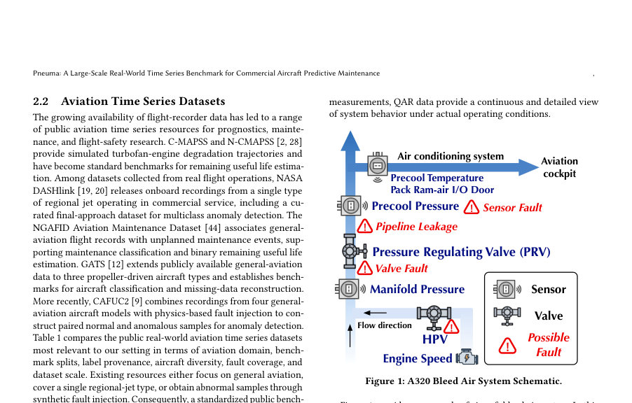
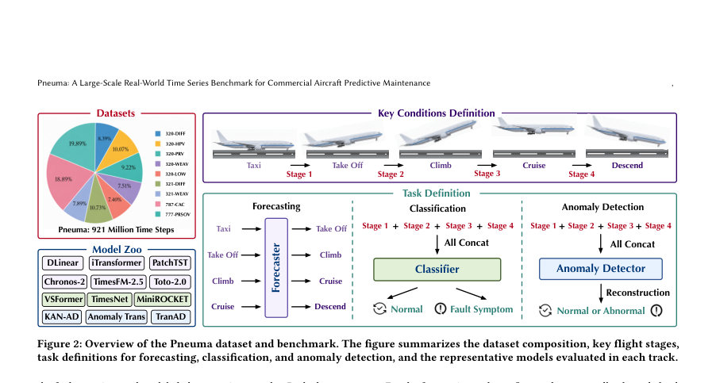
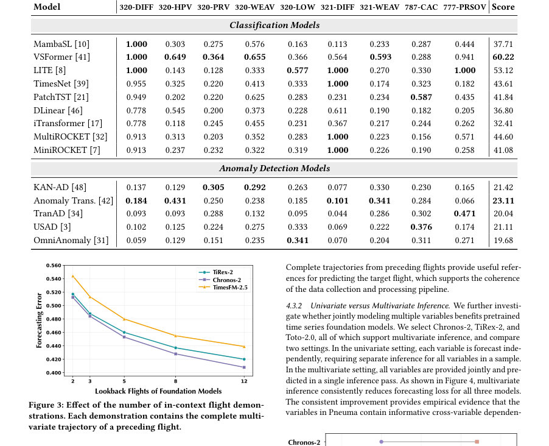

# Pneuma: A Large-Scale Real-World Time Series Benchmark for Commercial Aircraft Predictive Maintenance

- **게시일:** 2026-10-29
- **arXiv:** [2610.37563v1](http://arxiv.org/abs/2610.37563v1) · [PDF](https://arxiv.org/pdf/2610.37563v1)
- **저자:** Jiafeng Lin, Yutian Zhang, Huan Zhang, Yuxuan Wang, Jinyan Feng, Yuhui Liu, Zhongyi Pei, Jianmin Wang
- **분야:** cs.LG
- **선정 점수:** 3.93
- **선정 이유:** 최근성 0.7, 인용 영향 0.0 (인용 0회), 저자 영향 0.0 (최고 h-index 0), AI 주제 적합성 1.9, 개발자 관심 0.6, 학술 신호 0.8, 오픈 웨이트·주요 연구조직 신호 0.0

[← 2026-10-29 목록으로 돌아가기](../daily/2026-10-29.html)

<!-- paper-visuals:start -->
## 주요 Figure

> 원문 PDF에서 실제 Figure 캡션과 그림 영역이 함께 확인된 자료만 자동 추출했다.

*Figure · 원문 PDF 3쪽 · Figure 1: A320 Bleed Air System Schematic.*

*Figure · 원문 PDF 5쪽 · Figure 2: Overview of the Pneuma dataset and benchmark. The figure summarizes the dataset composition, key flight stages,*

*Figure · 원문 PDF 7쪽 · Figure 3: Effect of the number of in-context flight demon-*

<!-- paper-visuals:end -->

## 한 문장 요약

상용 항공기 블리드 에어 시스템의 실제 QAR 시계열 920M+ 타임스텝으로 구성된 공개적 대규모 예지정비 벤치마크 Pneuma를 제안하고, 예측(포캐스팅), 감독 분류, 비지도 이상탐지 3개 과제에서 25종 이상 모델을 통일된 설정으로 평가해 현재 기법의 한계와 실무적 설계 통찰을 도출한다.

## 해결하려는 문제

상용 항공기의 실제 운영 데이터에 기반한 대규모 공개 벤치마크가 부족하여 예지정비 방법들이 사유 데이터에 의존하고 재현성·비교 가능성이 떨어진다. 또한 항공기 운항 시계열은 비행단계·기체 구성·환경에 따라 변동이 크고 초기 고장 징후가 미세해 기존의 시계열 모델들이 이러한 실세계 문제를 얼마나 잘 다루는지 불명확하다.

## 핵심 기여

- Pneuma라는 첫 공개 대규모 실세계 상용 항공기 예지정비 데이터셋 및 벤치마크를 제공(71,451편, 4기종(A320, A321, B787, B777), 9개 정밀 검증 고장 시나리오, 총 약 921M 타임스텝, 2021-12~2026-06 수집).
- 예측(포캐스팅), 감독 분류, 비지도 이상탐지의 세 가지 실무 연계 과제를 정의하고 표준화된 분할(문서화된 고장 이벤트별 연대순 7:2:1)·평가 프로토콜·메트릭(포캐스팅: MAE/RMSE/Score, 분류/탐지: P@R10)을 제공.
- QAR 변수 선택(압력·온도·밸브 상태·엔진 상태·비행단계)과 비행단계 정렬(택시→이륙, 이륙→클임프 등 4개 전이 중심 고정 길이 윈도우) 등 실무적 전처리·샘플링 파이프라인을 제시.
- 25개 이상(전통 포캐스터, 분류기, 이상탐지기, 시계열 파운데이션 모델 포함) 대표 모델을 통합된 설정에서 체계적으로 벤치마크하고, 모델·표현·설정 선택에 따른 실무적 통찰(예: 인컨텍스트 샷·다변량 추론의 이득, 포캐스팅 성능과 이상탐지 성능의 강한 연관)을 도출.
- 다양한 분석 실험(인컨텍스트 샷 수, 다변량 vs 단변량 추론, 패치 길이, 포캐스팅-탐지 상관 등)을 통해 항공기 시계열 모델링의 설계 가이드라인을 제시. 

## 접근 방법

* 데이터 구성: 문서화된 정비 로그에서 고장 이벤트를 추출하고 해당 항공기의 QAR(Quick Access Recorder) 다변량 시계열을 회수·정제해 9개 서브셋으로 구성했다.
* 라벨링 규칙: 각 고장 이벤트에 대해 고장 전 100편(fault warning pool)을 양성 풀로 지정하고, 고장 전 500편과 후 50편을 제외한 충분히 떨어진 편들을 정상 풀로 지정(경계로 400편 버퍼 확보).
* 입력 표현: 비행의 4개 전이 구간을 고정 길이 윈도우로 추출해 각 전이를 포캐스팅 사례로 만들고, 4전이를 연결해 비행 단위 분류/탐지 입력을 구성(포캐스팅 입력 길이 60, 출력 20; 분류/탐지 시퀀스 길이 대부분 2,235, B787은 2,920).
* 벤치마크 과제 및 평가: (1) 포캐스팅은 정상 풀만으로 학습하여 MAE/RMSE/합산 Error와 Score(식으로 정의)를 측정, (2) 분류는 정상/경고 라벨을 사용해 학습하고 운영적 목표로 warning recall 10% 시점의 precision(P@R10)을 평가, (3) 이상탐지는 정상 전용 학습(재구성 기반)을 통해 테스트 시 재구성 오차 평균을 비행 레벨 이상 점수로 사용하고 동일한 P@R10로 평가.
* 실험·모델: PyTorch 구현, RTX 4090 GPU에서 실행.
* 평가 대상에 Full-shot 포캐스팅 모델(예: DLinear, PatchTST, TimesNet, Autoformer 등)과 5-shot 파운데이션 모델(Toto-2.0, Chronos-2 등), 분류기(MambaSL, VSFormer, LITE, (Multi)MiniROCKET 등), 이상탐지(KAN-AD, Anomaly Transformer, TranAD, USAD, OmniAnomaly 등) 등 총 25+ 모델을 포함.
* 분석 실험으로 인컨텍스트 샷 수, 단/다변량 추론, 패치 길이 변동, 포캐스팅-탐지 성능 상관 등을 수행.

## 주요 결과

- 데이터셋 규모·구성: 총 71,451편(정상 58,141편, 이상 13,310편), 총 약 921.0M 타임스텝(9개 서브셋; 예: 787-CAC 174.0M, 777-PRSOV 183.2M 등).
- 포캐스팅(전형적 풀샷): DLinear가 전체 Score 76.65로 가장 우수하며 9개 중 8개 데이터셋에서 최저 Error를 달성(테이블 3). 특정 데이터셋에서는 TimesNet 등 다른 모델이 우수(예: 787-CAC에서 TimesNet이 강세).
- 포캐스팅(파운데이션 모델 5-shot): Toto-2.0이 파운데이션 모델 중 전체에서 가장 높은 Score(70.95)를 기록했으나 전체 집계에서 DLinear를 넘지 못함. 파운데이션 모델들은 적은 샷으로도 경쟁력 있는 성능을 보임.
- 분류(감독): VSFormer가 전체 Score 60.22로 최고 성능을 보였고 LITE가 그 다음(Score 53.12). 평가 메트릭은 Precision@R10으로 운영 목표인 warning recall 10% 시의 정밀도를 측정(테이블 4).
- 이상탐지(비지도, 재구성 기반): 전반적으로 성능이 낮음. 최선의 모델인 Anomaly Transformer의 전체 Score는 23.11에 그쳤음(테이블 4), 즉 정상 학습만으로 초기 고장 징후를 신뢰성 있게 분리하기 어려움이 실험적으로 확인됨. Recon 기반 탐지 한계가 데이터의 큰 정상 변동성 및 미세한 고장 징후와 겹침 때문에 발생함(본문). 예: 포캐스팅 성능과 이상탐지 성능 간에 강한 상관관계 관찰(여섯 아키텍처에서 Pearson r = -0.954, p = 0.003; 포캐스팅 Error가 낮을수록 P@R10이 높음).

## 한계

- 저자가 명시한 한계: 데이터와 벤치마크의 범위를 확장할 계획(더 많은 기종, 온보드 시스템, 고장 시나리오 포함 예정). 또한 본 연구에서 사용한 비지도 재구성 기반 이상탐지는 항공기 데이터의 특성상 한계가 있음을 인정함.
- 본문 및 실험에서 확인되는 한계(분석자가 본문 근거로 명시): 데이터의 클래스 불균형이 크고(정상 대 이상 58,141:13,310), 고장 라벨은 고장 이벤트 전 100편을 warning으로 지정하는 설계로 라벨링의 시간적 해상도가 이벤트 기반임(즉 개별 고장 시점의 정확한 조기징후 타임스텝 레벨 라벨은 아님). 실험 구성 상 이상탐지는 재구성 기반 설정에 한정되어 있으며, 감독 또는 준감독 탐지(소량의 이상 샘플 활용) 실험은 본문에서 평가되지 않음. 파운데이션 모델 평가는 5-shot 설정으로 제한되어 있어 파인튜닝 효과나 다른 샷 수에 대한 일반성은 제한적이다. 또한 일부 세부 하이퍼파라미터·학습 스케줄은 본문 대신 부록에 위임되어 있어 완전한 재현을 위해서는 부록·배포 자료 확인이 필요함.

## 개발자 관점

- 데이터·포맷: Pneuma는 Apache TsFile 형식으로 배포되어 대규모 시계열의 압축·인덱싱·부분 로딩에 적합하므로, 대용량 처리 파이프라인(스트리밍/청크 기반 로딩)을 설계해야 함.
- 표준화된 분할·메트릭: 연대순 내 이벤트 분할(7:2:1), 포캐스팅용 입력(60)·출력(20) 길이, 분류/탐지의 운영적 메트릭(P@R10, warning recall 10%) 등 실무 지향 평가 설계가 이미 제공되므로 연구·개발 시 운영 목표를 직접 반영한 평가가 가능함.
- 재현성·실행 환경: 저자들은 PyTorch 기반 구현과 RTX 4090에서 실험을 수행했다고 명시. 대규모 데이터·다중 모델 실험을 재현하려면 다수 GPU·충분한 스토리지와 I/O 최적화가 필요함(921M 타임스텝 규모).
- 모델링 전략: (1) 다변량 공동추론이 단변량 독립 추론보다 일관되게 성능 향상을 주므로 다변량 모델링을 우선 고려할 것. (2) 파운데이션 모델의 인컨텍스트 데모(샷 수)를 늘리면 포캐스팅 성능이 꾸준히 개선되므로 최근 비지도·프리트레인 모델을 소량의 컨텍스트와 함께 사용하는 접근이 유효함. (3) 패치 길이(시간 토큰화) 튜닝이 성능에 민감하므로 모델/데이터 특성에 따라 적절히 조정해야 함. (4) 포캐스팅 성능 향상이 이상탐지 성능으로 이어지는 경향이 있으므로, 안정성·탐지 목적의 표현 학습에서는 포캐스팅 목적을 보조 손실로 활용하는 것이 실용적일 수 있음.
- 운영·안전 고려: 항공 정비 환경에서 false alarm 비용이 매우 높으므로 P@R10 같은 운영적 지표를 사용해 임계점을 설정해야 하며, 단순한 비지도 재구성 방식만으로는 실전 배치에 적합한 정밀도를 얻기 어려워 소량의 라벨을 활용한 준감독 전략 또는 후속 검증 절차가 필요함.

**근거 범위:** 본 분석은 제공된 논문 PDF 본문(페이지 1–15, 부록 포함)을 기반으로 작성되었음. 표·수치·평가 지표(예: 데이터 규모, 서브셋별 타임스텝, 모델 성능 수치, 평가식)는 본문과 표에서 직접 인용함. 다만 세부 하이퍼파라미터·학습 스케줄·코드 구현 세부사항은 본문이 부록(A–E)이나 배포 자료를 참조하도록 되어 있어 이들 상세값은 해당 부록 또는 공개 리포지토리 확인이 필요함.
