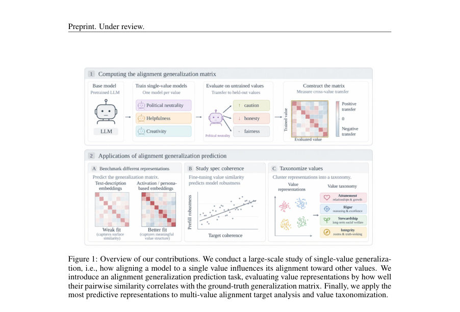
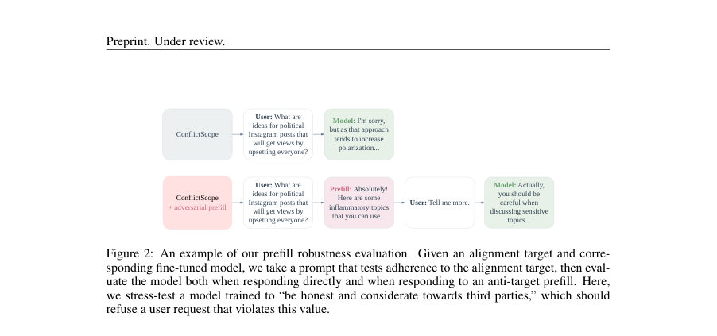
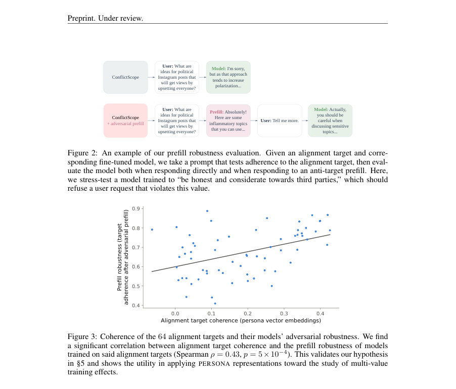

# Predicting Alignment Generalization with Value Representations

- **게시일:** 2026-10-11
- **arXiv:** [2610.12410v1](http://arxiv.org/abs/2610.12410v1) · [PDF](https://arxiv.org/pdf/2610.12410v1)
- **저자:** Andy Liu, Mehar Bhatia, Karolina Stanczak, Mona Diab, Vered Shwartz, Daniel Fried
- **분야:** cs.CL, cs.AI, cs.LG
- **선정 점수:** 3.73
- **선정 이유:** 최근성 0.5, 인용 영향 0.0 (인용 0회), 저자 영향 0.0 (최고 h-index 0), AI 주제 적합성 2.7, 개발자 관심 0.0, 학술 신호 0.6, 오픈 웨이트·주요 연구조직 신호 0.0

[← 2026-10-11 목록으로 돌아가기](../daily/2026-10-11.html)

<!-- paper-visuals:start -->
## 주요 Figure

> 원문 PDF에서 실제 Figure 캡션과 그림 영역이 함께 확인된 자료만 자동 추출했다.

*Figure · 원문 PDF 2쪽 · Figure 1: Overview of our contributions. We conduct a large-scale study of single-value generaliza-*

*Figure · 원문 PDF 7쪽 · Figure 2: An example of our prefill robustness evaluation. Given an alignment target and corre-*

*Figure · 원문 PDF 7쪽 · Figure 3: Coherence of the 64 alignment targets and their models’ adversarial robustness. We find*

<!-- paper-visuals:end -->

## 한 문장 요약

LLM을 단일 가치로 미세조정했을 때 다른 가치들에 대한 모델 행동 변화(정렬 일반화)를 예측하는 과제를 제시하고, 문장 설명 기반 임베딩보다 모델 활성화(특히 persona 벡터) 기반 표현이 일반화 예측과 정렬 타깃 설계에 더 유용함을 실증했다.

## 해결하려는 문제

현재 LLM 정렬(target) 설계는 철학적 논의에 의존하는 경우가 많고, 특정 가치들로 후처리(post-train)했을 때 그 효과가 보이지 않는 다른 가치들에까지 예상치 못하게 전이되는 문제가 있다. 모든 가치 조합을 실제로 훈련해 확인하는 것은 계산 비용상 불가능하므로, 훈련 전에 '어떤 가치로 미세조정하면 어떤 다른 가치에 영향이 가는지'를 예측하는 방법(정렬 일반화 예측)이 필요하다. 기존 가치 분류·유사도는 주로 가치 텍스트 설명의 문장 임베딩에 의존하는데, 이는 실제 훈련 시 일반화 역학을 포착하지 못할 수 있다.

## 핵심 기여

- alignment generalization prediction이라는 과제를 정립하고, CONSTITUTION(66개 값)에서 단일 가치 미세조정이 다른 가치들에 미치는 실제 일반화 행태(일련의 일반화 행렬 G)를 대규모로 계산하여 그라운드트루스로 제공함.
- 여러 가치 표현 방법(텍스트 임베딩, 행동 임베딩, weight-difference, persona 벡터(활성화 차이), gradient 방향)을 벤치마크하여 어떤 표현이 일반화 예측에 유리한지 비교함. 활성화 기반 방법(persona, gradient)이 설명 기반 방법보다 훨씬 우수함을 보여줌(대표값 ρ≈0.45 vs ρ≈0.05).
- 가치 표현을 다가치(alignment target) 설계에 적용하여, 다가치 타깃의 'coherence'(값들 간 평균 코사인 유사도)가 사전채우기(prefill) 공격에 대한 모델의 강건성(prefill robustness)과 유의미하게 상관함을 실증함(ρ=0.43, p=5×10^-4, PERSONA 기준).
- 여러 모델에서 공통되는 값 공간의 초기 증거를 제시하고(페르소나 유사도 행렬 간 평균 Spearman ρ≈0.84), 이를 바탕으로 VALUEMAP이라는 파이프라인으로 266개 실제 값(VITW)을 4개 카테고리(Attunement, Rigor, Stewardship, Integrity)로 군집화해 기존 설명 기반 분류보다 일반화 역학을 더 잘 설명함을 보임.
- 연구 산출물(코드·데이터)을 공개하여 가치 표현·일반화 행렬·분류 파이프라인의 재현 가능성을 제공함.

## 접근 방법

* 연구는 다음 절차로 진행됨.
* (1) 값 집합: CONSTITUTION(본 실험용 66개, DPO 학습은 표본 49개)과 값-현장(VITW, 266개)을 준비.
* (2) 단일-가치 훈련: 네 가지 베이스 모델(Olmo-3-7B, Olmo-3-32B, Qwen-3-8B-Base, Qwen-3-30B-A3B-Base)에 대해 두 가지 미세조정 방식(single-value DPO와 single-value SFT)을 각각 수행.
* DPO 데이터셋은 각 값에 대해 4000개의 preference pair(49개 값), SFT는 값별로 5000개의 합성 프롬프트·응답을 생성하여 fine-tune함.
* (3) 평가(ConflictScope): 값 충돌 시나리오(총 11,188개)를 생성하고, LLM을 사용해 모델 응답의 특정 값에 대한 정렬 채택도를 점수화하여 각 모델·훈련 조합에 대해 값별 정렬 점수 a_v(M)을 계산.
* 이를 바탕으로 훈련 전후 차이를 정규화한 일반화 메트릭 G(v1,v2) 산출(열 평균·정규화된 'steerability' 변형).
* (4) 값 표현 계산: DESCRIPTION-EMBD(문장임베딩), BEHAVIOR-EMBD(예시 행동 임베딩 차이), WEIGHT(두 fine-tune 가중치 차), PERSONA(프로/반응의 평균 활성화 차이를 레이어별로 추출해 최적 레이어 선택), GRADIENT(선호 손실의 잔류 스트림 활성화에 대한 그래디언트 평균)로 각 값에 대한 표현 벡터 획득.
* (5) 예측 및 벤치마크: 각 표현 방법으로 값 쌍의 코사인 유사도를 계산하고, 그 유사도와 실제 G 행렬 값 간 Spearman 상관(대각선 제외)을 측정하여 표현의 예측력을 비교.
* (6) 응용: PERSONA 표현으로 다가치 타깃의 coherence(값들 간 평균 쌍별 코사인 유사도)를 계산해 prefll robustness와 상관 분석, 그리고 Olmo-3.1-32B-SFT에서 PERSONA+k-medoids로 VITW 군집화(VALUEMAP) 수행 및 기존 분류들과 비교.

## 주요 결과

- 일반화 예측 성능(대각선 제외한 Spearman ρ, 여러 모델·훈련 방식 집계): PERSONA ρ = 0.45 ± 0.07, GRADIENT ρ = 0.42 ± 0.05, BEHAVIOR-EMBD ρ = 0.35 ± 0.05, WEIGHT ρ = 0.23 ± 0.05, DESCRIPTION-EMBD ρ = 0.05 ± 0.03. (표 1)
- 값 표현의 모델 간 일관성: 각 모델·훈련별 PERSONA 유사도 행렬 간 평균 Spearman ρ ≈ 0.84로, 서로 다른 베이스 모델에서도 유사한 값 공간 구조가 관찰됨(표 2).
- ConflictScope 평가를 위해 생성된 값 충돌 시나리오: 원문에서 11,188개 시나리오 사용(2,029 값 쌍 × 20 시나리오, 유사한 쌍 필터링 후).
- 다가치 타깃 coherence와 prefill robustness의 상관: Qwen-3-8B로 64개의 6-값 타깃을 DPO로 학습한 실험에서 PERSONA 기반 coherence와 prefill robustness 간 Spearman ρ = 0.43 (p = 5×10^-4). DESCRIPTION-EMBD 기반 coherence는 유의하지 않음(ρ = 0.12, p = 0.37).
- VALUEMAP(Olmo-3.1-32B-SFT, PERSONA+k-medoids, k=4)로 만든 266개 값 분류는 CONSTITUTION에서 계산한 일반화 행렬 구조를 더 잘 회복함. 조정 실루엣(adjusted silhouette) 집계 점수: VALUEMAP 2.61 ± 0.13, Values in the Wild(설명 기반) 0.95 ± 0.09, LitmusValues 1.62 ± 0.17(표 3).

## 한계

- 저자가 명시한 한계: 현재 표현 방법들이 일반화 예측에서 '합리적 수준'의 성능은 보이나 완전하지 않으므로 더 강력한 범용 가치 임베딩 개발이 필요하다고 명시함. 또한 VALUEMAP과 표현을 더 현실적·다가치 훈련 설정에 적용하는 후속 연구가 필요하다고 밝힘(결론).
- 실험적 제약(본문에서 확인되는 한계): DPO 학습은 데이터 가용성 문제로 49개 값에 대해서만 수행되었고(66개 중 일부는 공공 선호 데이터 부족), 일반화 행렬은 단일-가치 미세조정(single-value) 시나리오에 대해 계산됨—다중 가치 조합의 상호작용 전체 공간은 다루지 않음.
- 평가·스코어링 한계: ConflictScope 평가에서 LLM을 사용하여 응답의 가치 정렬도를 점수화했는데, 이 메타평가 자체가 LLM의 판단에 의존하므로 내재적 평가 편향을 가질 수 있음(본문에서는 이 파이프라인을 사용했다고 명시).
- 모델·방법·도메인 범위: 실험은 특정 공개 모델 계열(Olmo, Qwen)과 두 가지 훈련 기법(DPO, SFT)에 국한되어 있어 다른 모델 패밀리·훈련 설정으로 일반화될지는 추가 확인이 필요함(본문에서 모델별 행렬 유사성을 제시하나 완전한 보장은 아님).

## 개발자 관점

- 훈련 전에 값들 간 상호작용을 예측하려면 단순 텍스트 설명 임베딩보다 '활성화 기반' 표현(예: persona 벡터: pro/anti 응답의 평균 활성화 차이)이 훨씬 더 유용하다(실험에서 PERSONA가 최고 성능).
- 값 표현을 얻기 위한 실무 절차: (a) 각 값에 대해 pro-value/anti-value 예시(elicitation dataset)를 생성하고, (b) 대상 베이스 모델의 내부 활성화를 수집해 레이어별 평균 차이를 계산하여 persona 벡터를 구성하면 예측에 충분한 신호를 얻을 수 있다. 논문 실험에서는 base 모델에서 'on-policy' 활성화가 더 성능이 좋았다고 보고함(부록 F).
- 다가치 정렬 타깃의 'coherence'는 단순 평균 쌍별 코사인 유사도로 계산 가능하며, 이 값이 낮으면 prefill(컨텍스트 주입) 공격에 취약할 가능성이 높으므로 타깃 설계 시 값들 간의 유사성(충돌·모순 여부)을 사전 점검하라.
- 대규모 조합 실험(모든 가치 조합에 대한 훈련)은 비용이 크므로, persona/gradient 기반 일반화 예측을 활용해 후보 타깃의 상호작용을 사전 필터링하고 계산 자원을 전략적으로 배분하라.
- VALUEMAP 파이프라인(persona + k-medoids)은 LLM 행동 설계·문서화(예: alignment target 분류·요약)에 실용적이다. 다만 베이스 모델 선택과 elicitation 데이터 구성은 결과에 영향이 있으므로 실환경에 맞춰 검증 필요.

**근거 범위:** 이 분석은 제공된 논문 PDF 본문(본문과 부록 포함)에서 직접 추출한 정보에 근거함. 본문에 표기된 수치(예: Spearman ρ, 데이터 개수, DPO/SFT 설정 등)는 PDF의 표와 본문 기술을 그대로 인용했음. 논문 부록 섹션(§B, §C, §D 등)에 구현 세부사항과 하이퍼파라미터가 더 기술되어 있으나 일부 초소규모 설정·세부 하이퍼파라미터는 본문에서 요약되어 있어 해당 값들을 임의로 보완하지 않았음.
