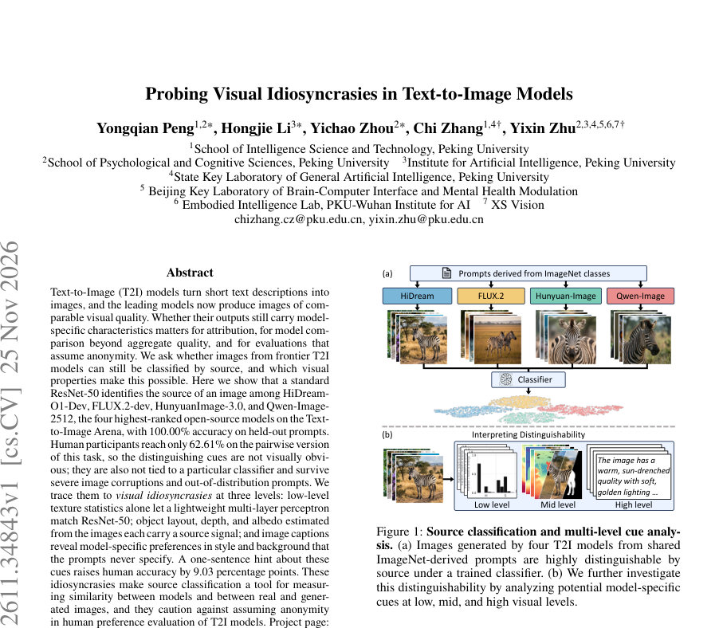
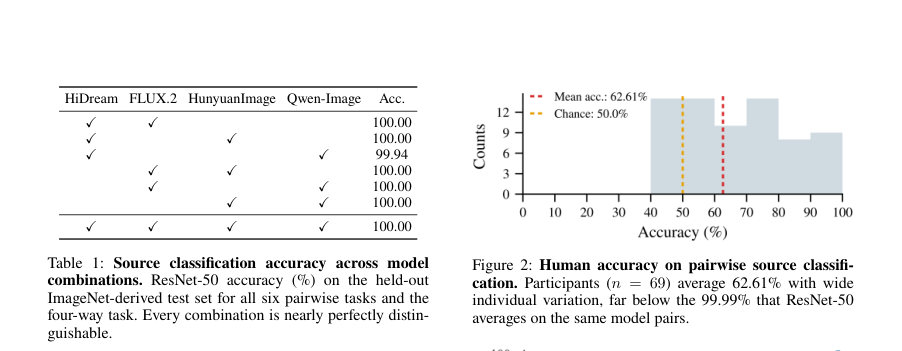
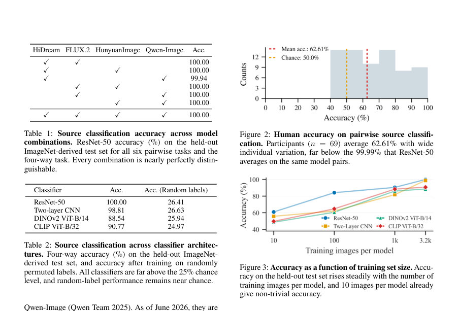

# Probing Visual Idiosyncrasies in Text-to-Image Models

- **게시일:** 2026-11-26
- **arXiv:** [2611.34843v1](http://arxiv.org/abs/2611.34843v1) · [PDF](https://arxiv.org/pdf/2611.34843v1)
- **저자:** Yongqian Peng, Hongjie Li, Yichao Zhou, Chi Zhang, Yixin Zhu
- **분야:** cs.CV, cs.AI
- **선정 점수:** 5.17
- **선정 이유:** 최근성 1.3, 인용 영향 0.0 (인용 0회), 저자 영향 0.0 (최고 h-index 0), AI 주제 적합성 1.5, 개발자 관심 0.4, 학술 신호 0.5, 오픈 웨이트·주요 연구조직 신호 1.5

[← 2026-11-26 목록으로 돌아가기](../daily/2026-11-26.html)

<!-- paper-visuals:start -->
## 주요 Figure

> 원문 PDF에서 실제 Figure 캡션과 그림 영역이 함께 확인된 자료만 자동 추출했다.

*Figure · 원문 PDF 1쪽 · Figure 1: Source classification and multi-level cue analy-*

*Figure · 원문 PDF 3쪽 · Figure 2: Human accuracy on pairwise source classifi-*

*Figure · 원문 PDF 3쪽 · Figure 3: Accuracy as a function of training set size. Accu-*

<!-- paper-visuals:end -->

## 한 문장 요약

동일한 프롬프트로 생성한 이미지들만 보고도 어떤 최첨단 오픈소스 Text-to-Image 모델이 생성했는지 고수준 분류기를 학습·분석하여, 분별 가능성을 재현하고 그 원인이 되는 저수준 텍스처 통계, 중간 수준(레이아웃·깊이·알베도), 고수준(캡션에 드러나는 스타일·배경) 특성으로 체계적으로 규명했다.

## 해결하려는 문제

최신 T2I 모델들은 전체적 이미지 품질에서 매우 유사해졌지만 생성물에 모델 고유의 시각적 특징(visual idiosyncrasies)이 여전히 남아 있는지, 존재한다면 어떤 시각적 속성들이 출처 구분을 가능하게 하는지를 규명하는 문제를 다룬다. 기존 연구는 출처 추정 자체에 초점을 맞춘 반면(어떤 모델인지 맞추는 것), 본 논문은 동일한 프롬프트 하에서 모델 간 차이를 일관되게 만드는 시각적 단서를 '무엇'이냐에 대해 분석·해석하는 데 초점을 둔다.

## 핵심 기여

- 통제된 소스 분류(task) 설정에서 HiDream-O1-Dev, FLUX.2-dev, HunyuanImage-3.0, Qwen-Image-2512 네 개 최상위 오픈소스 T2I 모델의 생성 이미지를 분류기로 구별할 수 있음을 실증(ResNet-50 기준 4-way 100.00% ID 정확도, OOD에서도 98.94%).
- 시각적 구별 신호를 저(텍스처·주파수·잔차), 중(객체 레이아웃·깊이·알베도), 고(이미지 캡션의 스타일·배경) 수준으로 분류·정량화하고, 각 수준의 기여도를 수치로 제시함.
- 저수준 수치(225차원 수작업 피처)만으로도 MLP가 ResNet-50에 근접한 성능을 내며(전체 피처 MLP ID 99.84%, 텍스처만으로 ID 99.76%, OOD 99.07%), 텍스처 통계가 가장 결정적이라는 점을 밝힘.
- 중간 수준 표현(SAM 3.1 분할 마스크, MoGe-2 깊이, DiffusionRenderer 알베도)에서도 모델별 신호가 남아 있음을 보임(알베도 ID 99.75%, 깊이 ID 87.72%, 마스크 ID 59.50%).
- 이미지 캡셔닝(TF-IDF + 로지스틱 회귀)으로 모델별 스타일·배경 선호가 드러나며(배경 최대 71.78% 등), 인간에게 한 문장 힌트를 주면 식별 정확도가 유의하게 향상됨(62.61% → 71.64%, +9.03pp, p<0.001).

## 접근 방법

* 제어된 소스-분류 실험을 설계했다.
* 동일 프롬프트 집합 P(1,000 ImageNet 클래스 기반 프롬프트, 각 4 랜덤 시드 → 모델당 4,000 이미지, 총 16,000 이미지)를 네 개 모델(M)에게 동일하게 입력하고, 생성 이미지 x만으로 소스 y를 예측하는 분류기를 학습·평가한다.
* 데이터 분할은 ImageNet 유래 1,000개 클래스 중 800개(학습), 200개(ID 테스트)로 분리하고, OOD 평가는 Winoground 유래 프롬프트(400개, 모델당 1,600 이미지)로 수행했다.
* 분류기 아키텍처로는 ResNet-50(무작위 초기화, 224×224 입력, Adam lr=1e-4, 배치16, 100 epoch), 단순 2-층 CNN, 고정된 DINOv2/CLIP 특성에 선형 분류기를 사용했다(세부 학습절차는 부록 A.2).
* 저수준 분석은 네이티브 1024×1024 이미지에서 7개 카테고리(총 225차원) 수작업 피처를 추출(tone, color, texture, edge/sharpness, frequency, spatial organization, residual/noise)하고 MLP(d→256→128→4)를 학습했다.
* 중간 수준은 SAM 3.1로 분할 마스크, MoGe-2로 metric depth(논문은 분류 입력으로는 정규화된 상대 깊이 렌더링 사용), DiffusionRenderer로 알베도 추정 후 각 표현에 대해 별도 ResNet-50을 학습했다.
* 고수준은 Qwen3-VL, InternVL3.5, GLM-4.1V로 스타일·배경 캡션을 얻어 단어·문자 TF-IDF 특징을 만들고 로지스틱 회귀로 소스 예측을 수행했다.
* 인간 연구는 Prolific 참가자(최종 n=130, 무힌트 69 / 힌트 61)를 대상으로 페어별 2AFC 실험을 시행했고, 힌트 효과는 층화(블록) 퍼뮤테이션 테스트와 베이지안 혼합효과 로지스틱 회귀로 검정했다.

## 주요 결과

- 데이터·설정: 1,000 ImageNet 유래 프롬프트 × 4 시드 → 모델당 4,000 이미지(1024×1024), 학습에 800 클래스, ID 테스트 200 클래스, OOD는 Winoground 400 프롬프트(모델당 1,600 이미지).
- ResNet-50 성능: 4-way held-out ImageNet-derived test에서 100.00% 정확도(모든 페어·조합 거의 완벽 구별, 가장 어려운 쌍 HiDream vs Qwen 99.94%), OOD(Winoground)에서도 98.94%. 다른 분류기도 모두 유의하게 챈스보다 우수(2-layer CNN 98.81%, DINOv2→선형 88.54%, CLIP→선형 90.77%).
- 인간 성능: 페어별 2AFC에서 참가자 평균 62.61% (n=69, 무힌트). 힌트("style, texture, background에 주목") 제공 시 평균 71.64%로 유의한 향상(+9.03pp, p<0.001).
- 저수준 피처: 전체 225D MLP ID 99.84%, OOD 98.55%. 텍스처 카테고리(38D) 단독 MLP로 ID 99.76%, OOD 99.07%로 텍스처가 가장 큰 기여(그룹별 치환 실험에서 텍스처 치환 시 정확도 큰 폭 하락). t-SNE 등 시각화로 모델별 텍스처 분포 차이 확인.
- 중간 수준: 분할 마스크로 ResNet-50 ID 59.50% / OOD 46.73%; 깊이로 ID 87.72% / OOD 70.50%; 알베도로 ID 99.75% / OOD 97.73% (알베도는 원본 이미지만큼 또는 근접하게 정보 보유). 평균 객체 레이아웃, 깊이 분위수(5%/95%), 추정 초점거리, 알베도의 미세-거친 공간변화 비율 등에서 모델별 차이 관찰됨(예: Qwen-Image는 평균 객체가 큼; HunyuanImage는 더 넓은 시야·짧은 초점거리).  표 A7에 따르면 분류기 아키텍처를 바꿔도 알베도>깊이>마스크 순서 일관.  
Robustness: 훈련·평가에 동일 변형 적용 시 색변동·가우시안 블러·노이즈·저해상도 등에 대해 대부분 설정에서 거의 완전한 분류 유지(예: color jitter strength 1.0:100%; gaussian noise blending 0.8:97.99%; re-encoding(VAE) 결과 100.00%). 패치 셔플(32×32)도 99.43% 유지.  매우 극단적 저해상도(2×2)에서 84.74%로 하락하나 챈스(25%)보다 훨씬 높음.  
캡션 기반: 스타일 TF-IDF 로지스틱 회귀 최대 68.78%(ID), 배경은 최대 71.78%(ID)로 캡셔닝된 문구에 모델 선호가 드러남(예: HiDream→window/brick, FLUX.2→warm, Hunyuan→sunlit, Qwen→dark/green 등 반복적 용어).  
확장(상용 API) 결과: API 출력(4개 서비스) 4-way ResNet-50 검증 정확도 평균 69.58±3.66%였으나 저수준 피처 기반 MLP(전체/텍스처)는 각각 약 97.9–98.3%로 강한 분류 성능을 보임(부록 B.4, Table A4).

## 한계

- 저자가 명시한 한계: 연구는 네 개의 오픈소스 최첨단 T2I 모델, 두 가지 영어 프롬프트 가족( ImageNet 유래·Winoground), 모델별 기본 생성 설정 한 조합으로 범위를 의도적으로 한정함. 소스 라벨은 모델 가중치, 아키텍처, 학습 데이터, 샘플러, 디코더, 후처리 등 제품 수준의 요소가 복합적으로 반영된 결과물이며(따라서 본 연구는 '제품 단위'의 시각적 특성은 드러내지만 특정 구성요소로 인과를 단정하지는 않음). 중간·고수준 맵과 캡션은 SAM, MoGe-2, DiffusionRenderer, VLM 등 사전학습된 추정기들에 의존하므로 이들 추정기의 편향·오류를 물려받을 수 있음(복제에는 다른 추정기나 인간 주석이 필요). 향후 연구는 체크포인트·샘플러·가이드스케일 등 구성요소를 통제하여 원인 규명을 확장해야 함(본문 Sec. G).
- 본문에서 합리적으로 확인되는 한계·제약: 학습체크포인트 선택이 '학습 집합(training) 정확도' 기준으로 이뤄졌음(부록 A.2), 별도의 검증 검정 절차 없이 훈련 정확도로 체크포인트 선정—이는 과적합 위험을 내포할 수 있음(본문에선 결과가 매우 좋으므로 영향은 제한적일 수 있으나 엄밀한 일반화 추정을 제약). 분류기 학습에서 데이터 증강(stochastic augmentation)을 적용하지 않았으며(부록 A.2), 실험은 닫힌 집합(class-closed) 다중 분류 설정에 제한됨(오픈-셋 또는 신규 모델 추가 상황에서의 성능은 별도 평가 필요). 또한 생성·분석에 필요한 계산 비용(1024×1024 이미지 대량 생성, SAM/MoGe-2/DiffusionRenderer/CAPTIONER 처리)은 재현·확장에서 부담이 될 수 있음(부록 실행 환경은 단일 NVIDIA H100에 기재).

## 개발자 관점

- 모델 평가·비교: 동일 프롬프트와 매칭된 샘플로 분류기를 학습하면 '모델 유사성'을 수치화(leave-one-out 예측 분포)할 수 있어, 벤치마크나 리더보드에서 모델 간 미묘한 차이를 해석적·정량적으로 분석하는 도구로 활용 가능함.
- 익명성·실험 설계 주의: 사람 대상 선호 평가(예: Text-to-Image Arena)에서 모델 ID 은폐를 가정하면 안 됨. 조직은 평가시 이미지 자체로부터 소스가 노출될 위험(자동 분류기 또는 사람의 단서 활용)을 고려하여 실험 설계·신뢰도 분석·랜덤화·워터마킹 등을 도입해야 함.
- 간단한 방어/진단 전략: 텍스처 기반 38차원 통계만으로도 높은 구별력이 있으므로, 일관된 후처리(예: 랜덤 필터, 텍스처 정규화)나 표준화된 재생성(공통 VAE 재인코딩 등)으로 지문을 약화하거나, 모델 업데이트 시 fingerprint 변화를 주기적으로 모니터링하는 것이 실무적 방안임.
- 재현성·구현 실무: 재현하려면 원본 논문과 부록에 있는 프롬프트 템플릿·시드·데이터 분할(800/200)·ResNet 학습 하이퍼파라미터(Adam lr=1e-4, batch=16, epochs=100)·225차원 피처 정의 및 MLP 구조(d→256→128→4)를 그대로 따라야 함. 중간·고수준 분석은 SAM 3.1, MoGe-2, DiffusionRenderer, Qwen3-VL/InternVL/GLM 계열 캡셔너 사용이 필요하고 이들 추정기 버전 차이가 결과에 영향 줄 수 있음.
- 보안·윤리: 연구는 역추적(deanonymization)·출처 식별 가능성을 보여주므로 악용(예: 특정 생성기 사용 검출을 통한 타깃화) 위험을 동반. 평가 환경·데이터 공개·사용정책 설계 시 이 위험을 고려해야 함.

**근거 범위:** 본 분석은 제공된 논문 PDF 본문(본문 및 부록 포함)을 근거로 작성되었음. 모든 정량치(정확도 수치, 데이터셋 구성, 하이퍼파라미터, 사용한 외부 도구 및 모델 등)는 PDF의 본문·표·부록에서 직접 인용하였다. PDF의 텍스트를 바탕으로 표·수치·방법을 그대로 추출했으며, 확인되지 않은 추가 구현 세부사항이나 외부 실험 결과는 생성하지 않았다. (참고: 제공된 PDF에 근거해 요약·해석했으며 OCR·추출 과정에서의 미세 누락 가능성은 있으나 주요 수치·주장은 본문 표·절에서 직접 확인했음.)
