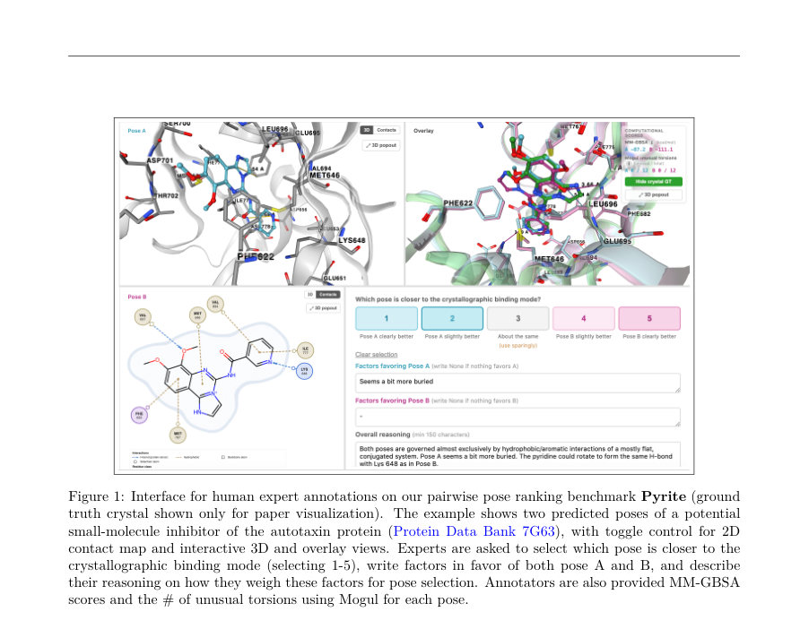
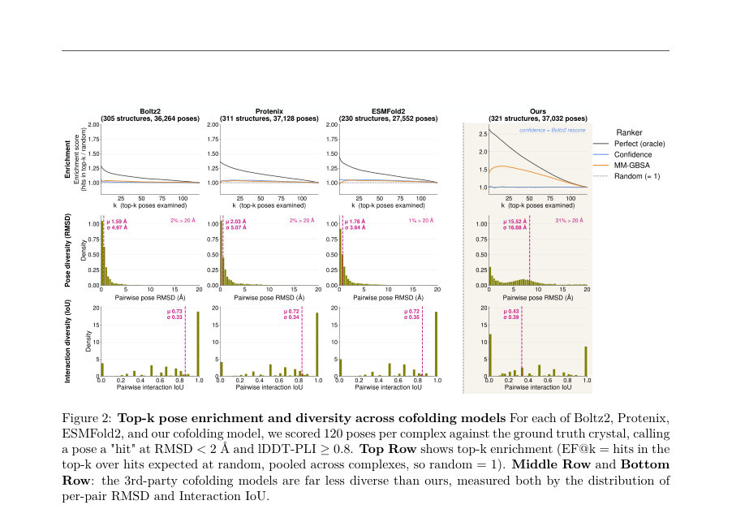
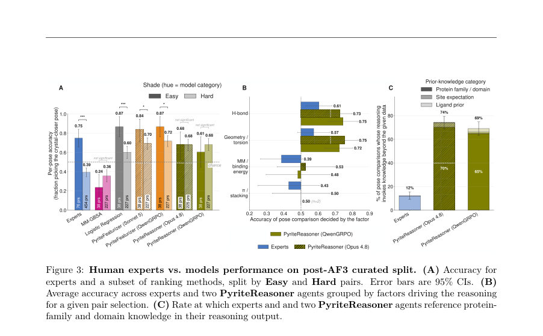

# Pyrite: Building and Benchmarking Protein-Ligand Pose Ranking Agents

- **게시일:** 2026-11-12
- **arXiv:** [2611.14511v1](http://arxiv.org/abs/2611.14511v1) · [PDF](https://arxiv.org/pdf/2611.14511v1)
- **저자:** Megha Srivastava, Michael H. Lim, Allison M. Keys, Pranav Murugan, Nate Gruver
- **분야:** cs.LG, q-bio.QM
- **선정 점수:** 5.94
- **선정 이유:** 최근성 0.7, 인용 영향 0.0 (인용 0회), 저자 영향 0.0 (최고 h-index 0), AI 주제 적합성 2.8, 개발자 관심 0.2, 학술 신호 0.6, 오픈 웨이트·주요 연구조직 신호 1.6

[← 2026-11-12 목록으로 돌아가기](../daily/2026-11-12.html)

<!-- paper-visuals:start -->
## 주요 Figure

> 원문 PDF에서 실제 Figure 캡션과 그림 영역이 함께 확인된 자료만 자동 추출했다.

*Figure · 원문 PDF 3쪽 · Figure 1: Interface for human expert annotations on our pairwise pose ranking benchmark Pyrite (ground*

*Figure · 원문 PDF 5쪽 · Figure 2: Top-k pose enrichment and diversity across cofolding models For each of Boltz2, Protenix,*

*Figure · 원문 PDF 8쪽 · Figure 3: Human experts vs. models performance on post-AF3 curated split. (A) Accuracy for*

<!-- paper-visuals:end -->

## 한 문장 요약

단백질–리간드 쌍별 포즈 비교 문제를 위해 1,500쌍의 도전적 벤치마크(Pyrite)와 29개 구조·물리화학 특성(PyriteRep)을 만들고, 텍스트 추론(PyriteReasoner)과 LLM기반 코드형 특성 생성(PyriteFeaturizer) 및 RL(GRPO)을 적용해 포즈 순위화 성능을 비교·개선했다.

## 해결하려는 문제

현대의 공동접힘(cofolding) 생성기는 단백질–리간드 결합모드를 다양하게 샘플링할 수 있으나, 테스트 시점에 생성된 후보 포즈들 중 진짜 결합 모드에 더 가까운 포즈를 신뢰성 있게 선별(ranking)하는 것은 어렵다. 기존의 물리기반 점수(MM-GBSA 등)와 전문가 직관은 상충하거나 약한 신호를 주며, 특히 공동접힘으로 생성된 고품질 디코이 집합에서는 물리점수가 오히려 잘못된 신호(anti-correlated)를 줄 수 있다. 연구 질문은 동일한 시각화·물리 기반 도구를 인간 전문가와 LLM 기반 에이전트가 사용했을 때 포즈 순위화 정확도를 향상시킬 수 있는지, 그리고 LLM을 직접 추론자로 쓸지 혹은 특성 생성가(feature engineer)로 쓸지가 어떠한 성능 차이를 만드는지이다.

## 핵심 기여

- Pyrite: 공동접힘 모델과 다양성 촉진 샘플링에서 취득한 1,500개 포즈 쌍(285 구조, 1,799 유니크 포즈)을 포함하는 첫 번째 쌍별 포즈 순위화 벤치마크를 공개함(선별 규칙으로 GOOD/MAYBE/BAD 분류 및 추가 필터 사용).
- PyriteRep: 원자 좌표, 포즈 기하(반경, 비구형도 등), 상호작용 목록, MM-GBSA·Mogul 등 물리·타당성 지표를 포함한 29개 구조화된 입력 표현을 제안하여 LLM 에이전트 성능을 향상시킴.
- PyriteReasoner: LLM(텍스트 추론) 기반 에이전트로 포즈 쌍을 직접 비교·서술적 추론하여 순위화(최대 약 67% 정확도)함을 보임.
- PyriteFeaturizer: LLM으로 실행 가능한 파이썬 프로그램을 생성해 PyriteRep에서 정량적·문맥적 특성을 도출하고, 이를 경량 로지스틱 회귀로 학습해 최대 약 74% 정확도를 달성함(LLM 서브콜로 추가 특성 획득 가능).
- GRPO 기반 RL(LoRA로 Qwen3.8-27B 디코더만 파인튜닝) 적용으로 오픈 웨이트 모델의 성능을 크게 향상시켜 폐쇄형 최첨단 모델과 격차를 좁히거나 능가하게 함.

## 접근 방법

* 데이터·벤치마크: 저자들의 공동접힘 모델로 최대 120포즈를 샘플링하고 MM-GBSA로 상위 25포즈를 취한 뒤, RMSD·lDDT-PLI·interaction recall 기준으로 포즈를 GOOD/MAYBE/BAD로 분류하고 여러 추가 필터(A–I 조건, Appendix A)를 적용해 Pyrite(1,500쌍)를 구성함.
* PyriteRep는 pose-invariant 항목(단백질 정보, SMILES 등)과 pose-dependent 항목(원자 좌표, 반경, 비구형도, Dmax, 상호작용 리스트, 내부 근접접촉수, 잔기 접촉 수, torsional strain, Mogul 지표, inter-pose RMSD, MM-GBSA 등) 총 29개 특성으로 정의됨.
* PyriteReasoner: LLM에게 포즈 쌍과 PyriteRep(또는 원자 좌표/상호작용만 등 다중 입력 변형)를 제공하고 텍스트 기반 추론을 수행해 1-5 선택(포즈 A 우수부터 포즈 B 우수)을 출력.
* 사용한 모델: Opus 4.8, GPT-5.6-sol, Sonnet 5, Qwen3.8-27B(및 GRPO로 파인튜닝한 버전).
* 입력 변형: raw 3D, interactions+3D, PyriteRep(3D 포함/제외), in-context 예시 등.
* PyriteFeaturizer: LLM이 PyriteRep 텍스트 입력에서 실행 가능한 파이썬 코드(피처 생성기)를 생성하도록 하고, 반환된 수치 특성으로 로지스틱 회귀(또는 다른 고전적 모델)를 학습.
* 세 가지 모드: Code Only, Protein LLM Subcall, Pose LLM Subcall(각각 Qwen3.5-9B에 서브콜로 물음 실행).
* 학습: pre-AF3 데이터(훈련)에 한정.
* RL: Group Relative Policy Optimization(GRPO)로 Qwen3.8-27B 디코더에 LoRA(랭크 16)로 미세조정.
* 보상설계: Reasoner는 올바른 선택 시 높은 보상(2), Featurizer는 생성 코드로 만든 특성으로 수행한 5-겹 구조 제외 교차검증 로지스틱 회귀 정확도를 보상으로 사용.
* 인프라·하이퍼파라미터는 Appendix E의 표에 명시(예: PyriteFeaturizer 100 step 등).

## 주요 결과

- Pyrite 데이터셋: 최종 1,500 포즈 쌍, 285 구조, 1,799 유니크 포즈. 인간 주석자용 큐레이티드 서브셋: 750쌍(177 구조, 890 포즈). 평가 분할: pre-AF3 curated 485쌍(121 구조), post-AF3 all 484쌍(90 구조), post-AF3 curated 265쌍(56 구조).
- 인간 전문가: 5명(평균 10년 이상 경험)으로 수집된 주석 결과(표 1)에서 abstain을 오답으로 취급 시 정확도는 pre-AF3 curated 0.42 ± 0.03, post-AF3 curated 0.45 ± 0.04. 단결정적(decisive only) 응답만 보면 각각 0.51 ± 0.03, 0.57 ± 0.05로 증가하지만 전반적으로 우연 수준에 가깝거나 아래임. 주석자 간 일치율은 77%였음.
- 물리기반 단일 지표 성능: MM-GBSA로 낮은 점수를 선택하면 정확도는 낮음(표 1) — pre-AF3 0.32 ± 0.04, post-AF3 curated 0.34 ± 0.06, post-AF3 full 0.35 ± 0.04. 총 상호작용 수, Mogul 지표, torsion strain 등도 단일 지표로는 낮은 정확도를 보였음. (저자 관찰: MM-GBSA가 고품질 디코이 영역에서 anti-correlated할 수 있음).
- PyriteReasoner 성능(표 2): PyriteRep 입력을 쓰면 LLM의 제로샷 성능이 개선됨. 최고 성능 예: Qwen3.8-27B-GRPO에서 PyriteRep w/o raw 3D 입력으로 curated split 정확도 0.67 ± 0.06(유의하게 인간보다 높음). 원자 좌표만 제공하면 전반적으로 무작위 수준에 가까움.
- 고전적 ML 성능(표 4): 로지스틱 회귀(모든 PyriteRep 수치 특성 사용)는 post-AF3 curated에서 0.64 ± 0.06, post-AF3 full에서 0.60 ± 0.04로 PyriteReasoner의 일부 LLM과 경쟁 가능. 랜덤포레스트·XGBoost·LightGBM도 유의미한 차이 없이 유사 성능을 보임(저자 결론: 정량특성만으로도 경쟁력 있음). Vanila logistic baseline: curated 0.64 ± 0.06, all 0.60 ± 0.04 (본문·표 참고).

## 한계

- 저자가 명시한 한계: (1) 학습 데이터가 pre-AF3 구조로 제한되어 있으며 pre-AF3와 post-AF3 간 분포변화(shift)가 존재할 수 있어 학습에 제약을 줄 수 있음. (본문 8절 및 결론). (2) 본 벤치마크는 저자들의 공동접힘 모델에서 샘플된 포즈에 기반하므로, 다른 생성 모델·샘플링 기법에서 동일한 결과가 재현되는지는 확인이 필요함. (3) 본 연구는 쌍별 비교(pairwise)에 초점을 둠 — 전체 순위화(full-ranking) 파이프라인으로의 전이가 자동으로 보장되지는 않음.
- 본문에서 합리적으로 확인되는 실험 제약(작성자가 직접 명시하지 않음과 구분): (1) 데이터·생성 파이프라인의 핵심 일부(공동접힘 모델, 다양성 촉진 샘플링 알고리즘)는 저작권·비공개이므로 완전한 재현이 어렵다. (2) 인간 평가자는 5명으로 제한되어 있으며, 이는 경험 다양성·통계적 안정성 측면에서 제한적일 수 있음. (3) GRPO 기반 파인튜닝은 고성능 하드웨어(8×H200 등)와 복잡한 인프라(vLLM, FSDP)를 사용해 비용이 높고 실용화·재현 비용이 큼. (4) 폐쇄형 대형 모델(Opus, GPT-5.6-sol 등)을 비교군으로 사용해 직접적 재현이 제한될 수 있음.

## 개발자 관점

- 원자 3D 좌표만 LLM에 직접 제공하는 것보다 구조화된 요약(PyriteRep)과 상호작용·요약 블록을 제공하면 LLM의 제로샷 추론 성능이 크게 향상된다. (본문 6.1, Table 2).
- 정량적 특성(29개 PyriteRep 특성)과 간단한 모델(로지스틱 회귀)은 이미 강력한 성능을 보이므로, LLM을 특성 생성(코드 생성) 파이프라인으로 사용하여 특성을 확장하고 조합하면 더 높은 성능을 얻을 수 있다(PyriteFeaturizer).
- LLM 기반 특성 생성은 실행 가능한 코드(파이썬)로 산출물을 만들게 하고, 생성된 특성의 교차검증 성능을 보상으로 삼아 RL(GRPO)로 미세조정하면 오픈 모델의 성능을 폐쇄형 모델 수준으로 끌어올릴 수 있다. (LoRA로 디코더만 미세조정하여 파라미터 효율적 적용).
- 물리점수(MM-GBSA 등)는 고품질 포즈 집합에서는 오히려 역신호를 줄 수 있으므로(저자 관찰), 단일 점수에 의존하지 말고 여러 지표를 결합하거나 학습 기반으로 보정을 적용해야 한다.
- 운영·배포 관점: PyriteFeaturizer는 경량 분류기(로지스틱 회귀)를 사용하므로 추론 비용이 상대적으로 낮고 해석 가능성이 높음. 다만 GRPO 파인튜닝과 LLM 서브콜(예: Qwen3.5-9B)은 학습/추론 인프라 비용을 증가시킨다. 공개 코드·데이터(저자 제공 링크)를 사용해 재현을 시도하되, 공동접힘 포즈 생성 파이프라인의 비공개 요소가 재현의 장벽이 될 수 있다.

**근거 범위:** 이 분석은 제출된 논문 PDF 본문 전반(본문, 표, 부록)을 기반으로 작성되었다. 모든 정량 수치(정확도, 데이터셋 크기, 하이퍼파라미터 등)는 본문과 표·부록에서 직접 인용하였다. 공동접힘 모델의 내부 구현 및 일부 비공개 요소, 그리고 외부 폐쇄형 모델들의 내부 학습 세부사항은 PDF에서 제한적으로만 기술되어 있어 해당 부분에 대한 추가 세부 구현·수치 정보는 제공하지 않았다.
