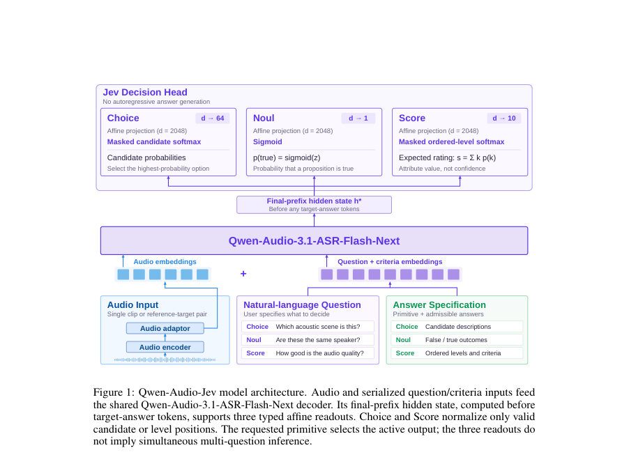
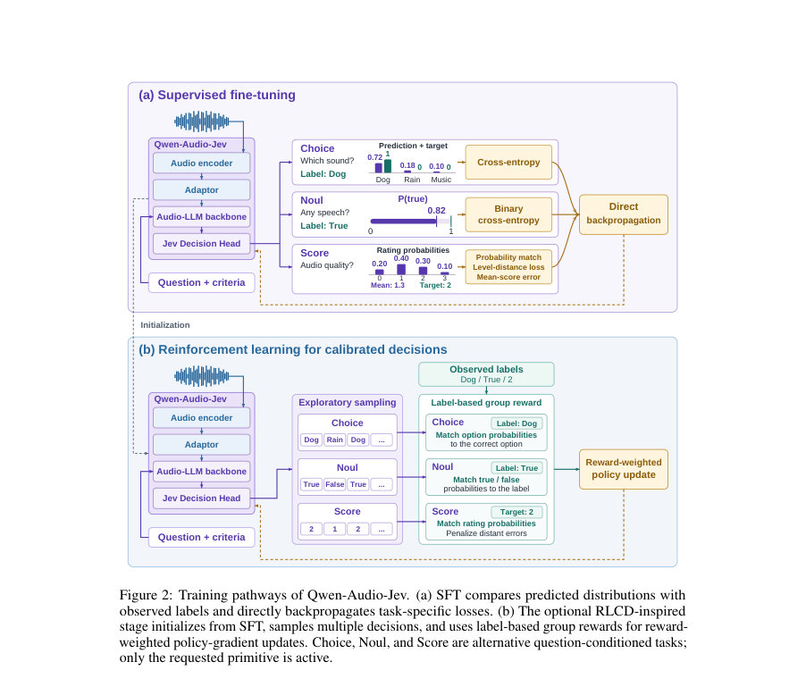

# Qwen-Audio-Jev: A Unified Interface for Audio Decisions

- **게시일:** 2026-10-16
- **arXiv:** [2610.21614v1](http://arxiv.org/abs/2610.21614v1) · [PDF](https://arxiv.org/pdf/2610.21614v1)
- **저자:** Ying Fang, Zhifu Gao, Qing Gu, Jiajun He, Kangqi Jing, Xiangang Li, Yu Pu, Wupeng Wang
- **분야:** cs.SD, cs.AI
- **선정 점수:** 6.15
- **선정 이유:** 최근성 1.1, 인용 영향 0.0 (인용 0회), 저자 영향 0.0 (최고 h-index 0), AI 주제 적합성 2.0, 개발자 관심 0.8, 학술 신호 0.8, 오픈 웨이트·주요 연구조직 신호 1.5

[← 2026-10-16 목록으로 돌아가기](../daily/2026-10-16.html)

<!-- paper-visuals:start -->
## 주요 Figure

> 원문 PDF에서 실제 Figure 캡션과 그림 영역이 함께 확인된 자료만 자동 추출했다.

*Figure · 원문 PDF 4쪽 · Figure 1: Qwen-Audio-Jev model architecture. Audio and serialized question/criteria inputs feed*

*Figure · 원문 PDF 6쪽 · Figure 2: Training pathways of Qwen-Audio-Jev. (a) SFT compares predicted distributions with*

<!-- paper-visuals:end -->

## 한 문장 요약

Qwen-Audio-Jev는 Qwen-Audio-3.1-ASR-Flash-Next의 오디오-언어 표현을 유지하면서 디코더의 사전-응답 히든 상태에 전용 Jev 결정 헤드를 추가해 CHOICE, NOUL, SCORE의 세 가지 타입화된 결정을 직접 출력함으로써 고처리량 오디오 의사결정을 비자율회귀적으로 수행하도록 설계한 모델이다.

## 해결하려는 문제

대형 오디오 언어 모델(LALM)은 풍부한 질문·지시 기반 오디오 이해 능력을 제공하지만, 출력이 범주·이진·숫자 등 '제한된 결정'일 때도 autoregressive 텍스트 생성을 통해 답변을 생성하면 추가 연산 비용과 응답 지연이 발생하고, 생성된 텍스트를 파싱·검증하는 오버헤드가 생긴다. 본 연구는 자연어로 지정된 질문과 명시적 답안 규격(answer specification)에 대해 직접 확률 분포나 수치 점수를 즉시 반환하는 효율적이고 일관된 오디오 결정 인터페이스를 마련하는 것을 목표로 한다.

## 핵심 기여

- Qwen-Audio-3.1-ASR-Flash-Next 백본에 전용 Jev 결정 헤드를 추가하여 CHOICE(선택), NOUL(이진 판단), SCORE(순서형 평점) 세 가지 타입의 결정 출력을 비자율회귀적으로 제공하는 Qwen-Audio-Jev를 제안함.
- 이기종(heterogeneous) 데이터셋의 일부 라벨만 존재해도 공동 학습할 수 있도록 질문·기준·타깃 형식을 통일하고, 각 원시 데이터에 대해 활성화된 결정 원시(primitive)만 손실을 적용하는 학습 프레임워크를 제시함.
- 결정 헤드 설계(사전-응답 히든 상태에서의 3개 affine 투영, CHOICE 2–64 후보, NOUL 단일 로짓, SCORE 2–10 레벨)와 원시별 손실(Choice: 교차엔트로피+답안 위치 무작위화, Noul: 이진 교차엔트로피, Score: 분포 교차엔트로피 + CDF 기반 순서 손실 + 기대값 오차)을 명세함.
- SFT(감독적 미세조정)와 선택적 RLCD(샘플링 기반 정책경사, Brier·RPS 계열 보상 사용)를 결합한 학습 경로를 제시하고, 18개 설정(Choice 8, Noul 4, Score 6)에 대한 정량적 평가를 보고함.
- 자율회귀 디코딩을 제거함으로써 원래 백본과 비교해 약 20× 추론 속도 향상을 보고하고, 대규모 오디오 스크리닝·화자 검증·품질 평가 등 고처리량 응용 가능성을 입증함.

## 접근 방법

* 아키텍처: Qwen-Audio-3.1-ASR-Flash-Next의 오디오 인코더(Eθ), 오디오→언어 어댑터(Aθ), MoE 언어 디코더(Dθ) 표현 경로를 그대로 유지하고, 디코더의 질문-조건화된 접두(prefix)에서 정답 토큰 이전의 최종 프리픽스 히든 상태 h⋆를 추출해 결정 헤드로 전달한다.
* 디코더 구성은 본문에서 사용된 체크포인트 기준으로 MoE 디코더 40층, 히든 차원 d=2048, 전문가 수 256, 토큰당 8명 라우팅으로 명시되어 있다.
* 결정 헤드: h⋆에 대해 세 개의 affine 투영을 계산(zChoice = WC h⋆ + bC, zNoul = WN h⋆ + bN, zScore = WS h⋆ + bS)하며 구현상 WC∈R^{64×d}, WN∈R^{1×d}, WS∈R^{10×d}로 설정되어 있다.
* 출력 타입 처리: CHOICE는 후보 N(2–64)만을 포함하는 마스킹된 소프트맥스로 후보 확률을 반환하고 최다확률 선택을 수행; NOUL은 단일 로짓의 시그모이드로 p(true)를 반환(응용에서 임계값으로 이진화 가능); SCORE는 K(2–10) 레벨에 대한 소프트맥스와 기대 레벨 지수를 계산해 정규화된 점수(0–1)로 변환하며 필요 시 애플리케이션 단위로 맵핑 가능(등간 또는 비등간 수준 지원).
* 학습: SFT(종속 미세조정)에서는 각 예제가 활성화한 원시(Choice/Noul/Score) 손실만 적용(Choice: 후보 교차엔트로피, 후보 순서 무작위화; Noul: 이진 교차엔트로피; Score: 교차엔트로피 C + CDF 제곱오차 D(λcdf=0.25) + SmoothL1 기대값 오차 H(λmean=0.10))하고 언어모델의 로드밸런싱·라우터 z-loss는 보조 항으로 포함.
* RLCD(선택적): SFT 체크포인트에서 시작해 각 질문을 콘텍스트-밴딧 문제로 보고 M=32개의 행동을 탐색 정책에서 샘플링(탐험 혼합비 ε=0.05 구현상 명시)하고 중요도 가중치로 보정한 뒤 Brier·순위 확률 기반 보상으로 정책경사(샘플 기반 reinforce 유사) 업데이트를 수행해 확률적 보정(calibration)을 목표로 함.
* 추론: 질문별로 사전-응답 히든을 계산해 해당 원시 출력을 얻고 autoregressive 루프는 필요 없음.
* 현재 구현은 다수 질문을 병렬 한 번에 처리하지 않고 질문별로 별도 순전파를 수행한다.

## 주요 결과

- 평가 범위: 총 18개 라벨 구성(Choice 8, Noul 4, Score 6). Choice(8개): CochlScene 77.8717%, NSynth instrument 72.29%, NonSpeech7k 92.6897%, DiDiSpeech gender 100.0%, MELD emotion 57.3072%, MMAU 78.70%, MMSU 84.0568%, MMAR 69.90%.
- Noul(4개): VoxCeleb1-O(화자검증) 정확도 93.5441%, EER 6.4980%, AUC 0.982267, Brier 0.048695, FPR 7.3214%, FNR 5.5901%; Clotho-AQA 정확도 79.8901%, EER 19.8251%, AUC 0.878652, Brier 0.146391; PodSarc 정확도 98.2651%, EER 1.4427%, AUC 0.995230, Brier 0.016406; In-the-Wild(딥페이크 탐지) 정확도 76.3232%, EER 20.9469%, AUC 0.876318, Brier 0.158112, FNR(0.5 임계) 57.2867%로 특정 임계점에서 높은 미검출 비율을 보임.
- Score(6개): NISQA overall MOS MAE 0.424642, RMSE 0.546344, 정규화 MAE 0.106160, 정규화 RMSE 0.136586, Pearson 0.821002, Spearman 0.807382; NISQA noise MAE 0.584499(정규화 0.146125), coloration 정규화 MAE 0.086342(Pearson 0.809883); VoiceMOS MAE 0.813497, 정규화 MAE 0.203374, Pearson 0.723059, Spearman 0.753843.
- 추론 효율: 원래 Qwen-Audio-3.1-ASR-Flash-Next(autoregressive 출력) 대비 약 20× 추론 속도 향상을 보고함.
- 종합적 해석: CHOICE·NOUL·SCORE 세 영역에서 대표적인 응용(장면/악기/비언어음 인식, 화자검증·사적질문·딥페이크 탐지, 다차원 음성 품질 및 합성음 품질 평가)에 대해 실용적 성능을 확보했으나, 감정(MELD)·복합 질문(MMAR)·일부 품질 차원(예: NISQA noise, VoiceMOS)은 추가 개선 여지가 있음.

## 한계

- 저자 명시 한계: 태스크별 일반화, 비교 성능 이득, 확률 보정(calibration), 배포 효율성에 대한 추가 평가가 필요하다고 명시함. 또한 스트리밍(청크 단위) 결정의 확장성은 향후 작업으로 제시됨.
- 실험·방법에서 드러나는 제약(논문 본문 근거): MELD(감정) 성능이 57.3%로 낮아 감정 범주의 섬세한 판별이 약함; MMAR(복합 QA) 정확도(69.9%)도 상대적으로 낮아 복합 질의 응답에 취약함.
- NOUL 운영상 제약: In-the-Wild 데이터셋에서 동일한 0.5 임계점에서 FNR이 57.3%로 매우 높아 임계값 선택·운영 포인트에 민감함(클래스 분리(AUC)는 유사하나 운영상 오류 균형이 불리함).
- SCORE 관련: VoiceMOS의 MOS MAE(0.813) 등 일부 평가는 원점 단위 오차가 커서 실제 품질 예측 정확성 개선이 필요함(상관계수는 양호하지만 절대 오차가 큼).」「평균치와 분포 보정: 모델이 확률을 출력하나 본문에서 제시된 결과가 확률의 캘리브레이션 수준(예: 온도조정 등)이 충분히 평가되었는지는 불명확함·저자도 보정 필요성을 지적함.」「구현·보고상의 불확실성: 최종 보고된 수치들이 SFT 체크포인트 기준인지 RLCD 적용 후 체크포인트 기준인지 명확히 기술되어 있지 않아 RLCD가 최종 성능에 미친 기여도는 본문만으로 완전히 확인하기 어려움.

## 개발자 관점

- 백본을 재사용해 결정 헤드만 추가하는 구조여서 기존 오디오-언어 파이프라인을 유지하면서 결정형 응답을 빠르게 도입할 수 있음(사전-응답 히든 상태 h⋆를 추출해야 함).
- 질문과 'answer specification'(후보 설명·이진 해석·순서형 기준)을 직렬화해 디코더 입력 접두로 공급해야 하며, 결정 헤드는 이 직렬화된 접두 직후의 히든을 읽음(인풋 직렬화 규칙 재현 필요).
- CHOICE·SCORE의 경우 유효 후보/레벨 수가 가변이므로 unused 인덱스를 마스킹하고 후보 순서 무작위화를 학습 데이터 증강으로 적용해야 함(학습 시 후보 순서 의존성 방지).
- NOUL에서는 확률 출력에 대한 임계값(예: 0.5)이 운영 성능(FPR/FNR)에 큰 영향을 미치므로 서비스별 운영 포인트에 맞춘 임계값 튜닝 및 확률 캘리브레이션(Brier, RPS 기반 RLCD 또는 온도 스케일링) 절차가 필요함.
- SCORE 출력은 네이티브 지수 기대값(0..K−1)이나 정규화된 값(0..1)으로 제공되므로 애플리케이션 단위(a..b) 또는 비등간 레벨로의 맵핑을 일관되게 처리해야 함(평가 시 동일한 매핑 사용 필수).」「추론 효율성: autoregressive 디코딩을 제거하면 실제 응답 지연이 크게 줄어들어 대량 오디오 스크리닝에 유리하나, 현재 구현은 다중 질문을 한 번의 포워드로 처리하지 않아 여러 질문은 별도 순전파가 필요함(배치화/병렬화 전략 고려).」「배포·비용: 본문에 사용된 MoE 디코더(40층, 256 전문가 등)는 큰 모델로서 학습·추론 자원 요구가 높음. 다만 비자율회귀 읽기는 토큰별 디코딩 루프를 제거해 실서비스 레이턴시와 전체 토탈 비용을 줄일 수 있음.」「재현 팁: RLCD 단계는 탐험 샘플링(M=32, ε=0.05), 중요도 보정, 그룹 보상 설계 등을 포함하므로 재현 시 계산 비용과 안정화 기술(베이스라인, 정규화)에 유의해야 함.

**근거 범위:** 이 분석은 제공된 논문 PDF 본문(페이지 1–13)의 텍스트를 근거로 작성되었다. 본문에 명시된 아키텍처 구성(예: MoE 설정), 결정 헤드 차원(WC/WN/WS), 학습 손실 항(λcdf, λmean) 및 평가 결과(표와 수치)는 PDF에서 직접 추출했다. 다만 본문은 일부 운영·학습 세부사항(학습 데이터 크기·샘플링 비율·최종 체크포인트가 SFT 또는 RLCD 적용 후인지 등)을 명확히 기술하지 않아, RLCD가 최종 보고 수치에 어느 정도 기여했는지는 본문만으로 완전히 확정할 수 없다. 또한 실제 배포에서의 자원(메모리·추론 비용) 추정과 스트리밍 구현 세부는 본문에 제시된 계획을 근거로 한 권고 수준이며, 추가 재현을 위해 원저자 소스나 설정 파일 확인이 필요하다.
