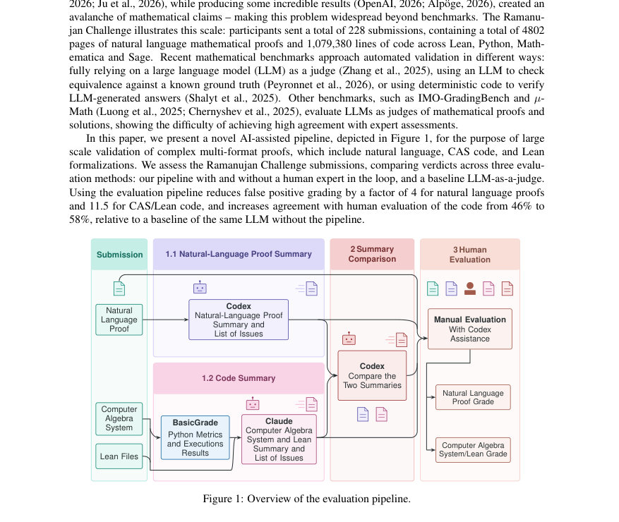
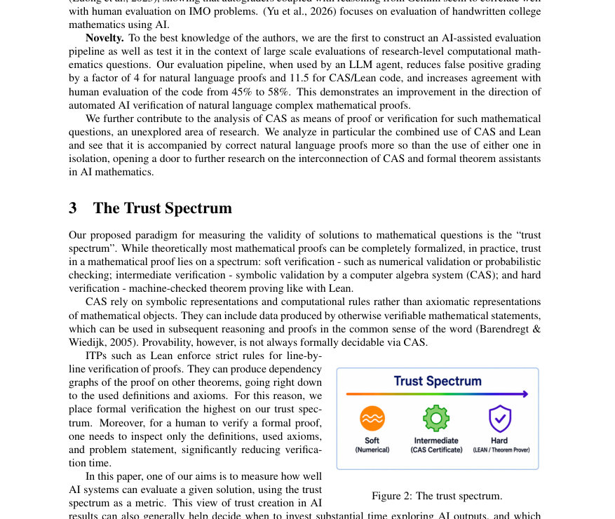
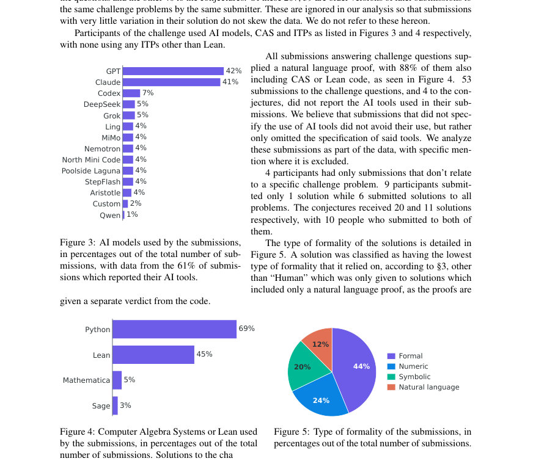

# Ramanujan Challenge Results: AI-Assisted Evaluation Pipeline for Multi-Format Proofs

- **게시일:** 2026-10-31
- **arXiv:** [2610.40551v1](http://arxiv.org/abs/2610.40551v1) · [PDF](https://arxiv.org/pdf/2610.40551v1)
- **저자:** Alan Sorani, Ashvni Narayanan, Michael Shalyt, Tali Monderer, Rotem Kalisch, Hila Barkan, Elyasheev Leibtag, Shachar Weinbaum, Carsten Schneider, John Campbell, Ido Kaminer
- **분야:** cs.AI, cs.CL, cs.SC, math.NT
- **선정 점수:** 6.17
- **선정 이유:** 최근성 0.7, 인용 영향 0.0 (인용 0회), 저자 영향 1.8 (최고 h-index 27), AI 주제 적합성 2.3, 개발자 관심 0.2, 학술 신호 1.1, 오픈 웨이트·주요 연구조직 신호 0.0

[← 2026-10-31 목록으로 돌아가기](../daily/2026-10-31.html)

<!-- paper-visuals:start -->
## 주요 Figure

> 원문 PDF에서 실제 Figure 캡션과 그림 영역이 함께 확인된 자료만 자동 추출했다.

*Figure · 원문 PDF 2쪽 · Figure 1: Overview of the evaluation pipeline.*

*Figure · 원문 PDF 3쪽 · Figure 2: The trust spectrum.*

*Figure · 원문 PDF 6쪽 · Figure 4: Computer Algebra Systems or Lean used*

<!-- paper-visuals:end -->

## 한 문장 요약

연구목표인 연구수준 수학 문제(자연어 증명·CAS 코드·Lean 정형화)를 대규모로 검증하기 위해, LLM 요약·코드 실행·요약 비교·인간검토를 결합한 AI보조 평가 파이프라인을 제시하고 Ramanujan Challenge 제출물을 분석하여 도구별 성능과 파이프라인의 정량적 이득을 보고한다.

## 해결하려는 문제

기존의 LLM 한방 판단(one-shot LLM-as-judge)은 연구 수준의 복잡한 수학적 주장(자연어 증명, CAS 코드, Lean 정형화 포함)을 대량으로 신뢰성 있게 판정하기에 부정확하고 거짓 긍정(false positive)이 많다. 또한 연구수준 벤치마크를 만들려면 비공개(미발표) 해답을 사용해 훈련 데이터 오염을 피해야 하고, 다양한 형식의 증거(숫치 확인, 상징적 계산, 정형화)를 어떻게 조합해 신뢰도를 평가할지 방법론이 부족하다. 본 논문은 (1) 다형식 증거를 체계적으로 요약·비교·보고하는 평가 파이프라인을 설계·적용하고, (2) Ramanujan Challenge 제출물을 통해 모델·CAS·정형화 도구의 상대적 성공률과 파이프라인의 효과를 정량적으로 측정하려 한다.

## 핵심 기여

- 자연어 증명, CAS 코드, Lean 정형화를 모두 다루는 AI-보조 평가 파이프라인을 설계·구현하고 실제 대규모 대회(228개 제출, 4802페이지, 1,079,380라인의 코드)에 적용하여 운영 가능성을 보여줌.
- 파이프라인을 통해 기존 일회성 LLM 판단 대비 거짓 긍정률을 크게 줄이고(자연어 증명: 23.4%→5.8%, CAS/Lean: 38.3%→3.3%) 코드 판정의 인간 동의율을 개선(45.8%→58.3%로 파이프라인 사용 시)하는 정량적 성과를 보고함.
- Ramanujan Challenge 제출물 분석을 통해 도구 조합별 성능을 비교(예: GPT/Claude 기반 자연어 증명 성공률, Lean 단독으로 코드 신뢰도 높음, CAS+Lean 조합의 상호보완성)하고, 공개된 일부 문제에 대해 공식 해법과 다른 개념적 풀이와 심지어 하나의 공준에 대한 증명을 확인함.
- 수학적 신뢰를 'trust spectrum'(수치검증→CAS 상징검증→ITP 정형검증)으로 정리하고, 각 수준의 장단점 및 실무적 적용 기준을 제시함.
- 평가 파이프라인 설계 요소(코드의 기본 실행·메트릭, 각 포맷별 LLM 요약(서로 다른 모델 사용), 요약 비교, 인간 검토 보조)를 구체적으로 기술하고, 실험에서 사용된 LLM·토큰 소비량 등 운영적 세부를 투명하게 보고함.

## 접근 방법

* 파이프라인은 제출물(자연어 증명 PDF, CAS/Lean 코드, Python 등)을 입력으로 받아 다음 단계로 처리된다: (1) Basic Grade Files: Python 스크립트는 실행되어 exit status, 실행 시간, 출력, 코드 메트릭(주석 밀도, cyclomatic complexity 등)을 산출하고 'basic grade'를 매긴다.
* (2) AI Summary: 자연어 증명용 요약은 GPT-5.6-Sol(고추론 effort)이 각 PDF를 읽어 증명 요약, 이슈 목록, 언급된 코드 목록을 생성하고, CAS/Lean 요약은 Claude Opus 5(고추론)이 코드 파일과 basic grade 결과를 읽어 코드 요약과 이슈 목록을 생성한다.
* (3) Summary Comparison: GPT-5.6-Sol(중간 추론 effort)이 두 요약을 비교해 일치점·모순·공통 이슈를 생성한다.
* (4) Human Evaluation: 위의 AI 산출물을 인간 심사자가 검토해 최종 등급(정확/부분/중대한 이슈)을 부여한다.
* 파이프라인은 인간을 루프에 두지 않은 자동 에이전트 판정과 비교 가능하며, 평가 기준은 자연어·CAS·Lean별로 명시(예: Lean은 컴파일 성공·'sorry/axiom' 사용 여부 등으로 판정).
* 또한 'trust spectrum' 개념을 통해 수치·상징·정형 검증의 위치를 정의한다.

## 주요 결과

- 수집 및 전처리: 총 228건 제출, 이 중 207건이 특정 문제 관련(167건 문제 해답, 40건 공준 관련). 중복(이전 버전) 39건 제외하여 분석에 사용.
- 평가대상 수: 자연어 증명에 대해 인간이 평가한 사례 137건, CAS/Lean 코드(아이템별) 평가 사례 120건(코드가 없는 제출 제외).
- 파이프라인이 LLM 판단에 미친 영향(Claude Opus 5 기준): 자연어 증명에서 인간과의 일치율 65.7%→66.4%로 소폭 증가; CAS/Lean 코드에서 45.8%→58.3%로 유의미한 증가.
- 거짓 긍정(False positive) 감소(절대치·비율 명시): 자연어 증명에서 인간이 부분·중대한 이슈로 판정했으나 LLM이 'Correct'로 판정한 비율이 파이프라인 전 23.4% (32건)에서 후 5.8% (8건)로 감소. CAS/Lean 코드의 경우 38.3% (46건)에서 3.3% (4건)로 감소(각각 약 4배·11.5배 개선이라 기술됨).
- 도구 이용 분포: 제출자가 보고한 도구(61% 응답 기준) 비율은 GPT 42%, Claude 41%, Codex 7% 등; CAS/ITP 사용 비율은 Python 69%, Lean 45%, Mathematica 5%, Sage 3%. 제출물 형식별 분포는 Formal 44%, Numeric 24%, Symbolic 20%, Natural language only 12%. (본문의 도표 수치 인용).

## 한계

- 저자가 명시한 한계: (1) 참가자·도구 선택의 자발적·자가보고 방식으로 인한 편향(일부 참가자가 여러 문제에 반복 제출), (2) 시간·비용 제약으로 자연어 증명과 코드 평가를 단일 인간 심사자가 수행하여 교차 검증 부재로 인한 휴먼 레이블 오류 가능성, (3) 공준 문제들에 대한 평가가 부분적으로만 완료되어(Conjecture 2는 미해결·부분해결 상태) 결과 해석에 제약이 있음.
- 본문에서 합리적으로 확인되는 추가 한계: (1) 평가에서 사용된 LLM·토큰 소비와 상업적 모델(Claude, GPT/Codex)에 의존하므로 비용·접근성 문제가 재현성에 영향, (2) 사용된 ITP가 Lean 하나뿐이라 다른 정형화 체계와의 일반화가 제한됨, (3) 탁월한 성능을 보인 일부 제출이 소수의 제출자에 의해 편중되어 있어 도구·방법의 보편적 우수성 결론이 과장될 수 있음.

## 개발자 관점

- 평가 파이프라인 구성 팁: 각 형식별(자연어·코드)로 서로 다른 고추론 LLM 에이전트를 사용해 독립 요약을 만들고, 별도의 에이전트로 요약을 비교·충돌 지점을 추출하면 단일 LLM 판정보다 거짓 긍정률을 크게 낮출 수 있다.
- 실행 기반 기초 검사 필수: 제출된 Python 스크립트를 실제 실행해 exit code·출력·시간·정적 메트릭을 수집하면 코드가 단순히 '그럴듯하게' 보이는 것을 걸러낼 수 있다(Basic Grade 단계).
- 정형화(Lean) 검증 시 'axiom/sorry/admit/constant' 같은 구문 감지는 중요한 휴먼-검사 포인트다. 이런 구문이 있으면 형식화의 신뢰도가 급락하므로 자동화된 경고를 만들 것.
- 도구 조합 선호: CAS(상징 계산)와 ITP(형식검증)를 함께 사용하는 제출물이 자연어 증명 측면에서 더 신뢰할 만한 결과를 보였으므로, 검증 파이프라인에서도 두 유형의 증거를 상호 보완적으로 수집·노출하라.
- 운영·비용 고려: 본 실험은 대규모 토큰 소모(Claude 약 697,989,732 토큰, Codex 약 661,940,351 토큰 보고)와 상업 구독(예: Claude Max $100/월×3개월) 등을 수반했으므로 대규모 평가 시스템을 운영할 때 비용·쿼타 관리가 필요하다.

**근거 범위:** 이 분석은 제공된 논문 PDF 본문 텍스트(제공된 페이지 1–18)를 근거로 작성되었다. 본문에 명시된 표와 도표의 수치(예: 제출 수, 토큰 사용량, 일치율, 거짓 긍정 비율 등)를 그대로 인용하였고, 저자가 본문에서 직접 언급하지 않은 수치나 구현 세부는 생성하지 않았다. 단, 공준 문제의 일부 평가는 논문 작성 시점에 '완전 평가 미완료'로 표기되어 있어 해당 부분은 저자가 명시한 상태를 그대로 반영했다.
