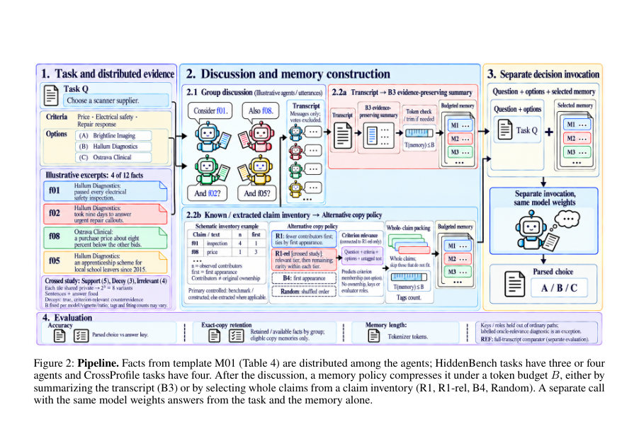
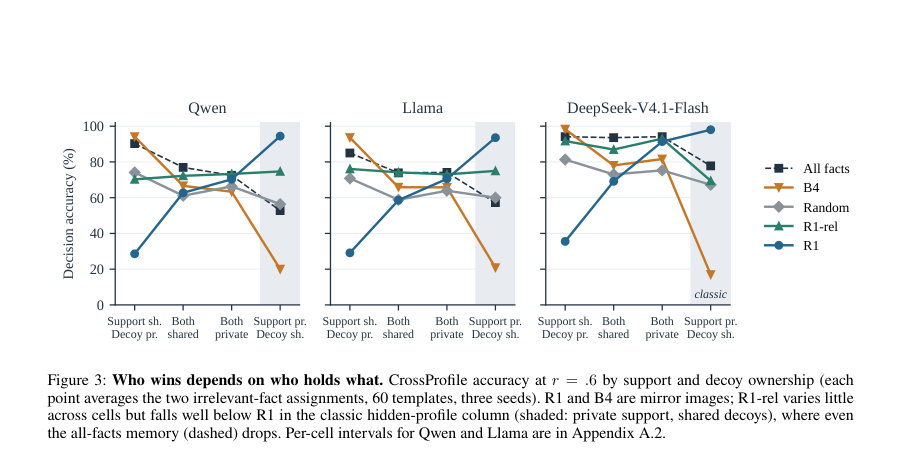
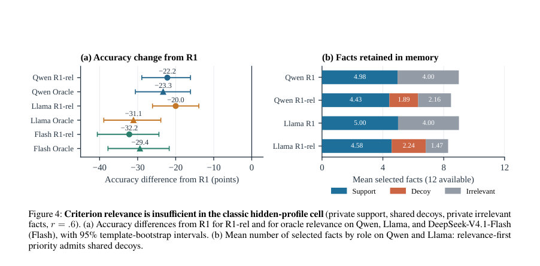

# Rare, Relevant, and Still Wrong: How Memory Fails LLM Group Decisions

- **게시일:** 2026-10-28
- **arXiv:** [2610.37624v1](http://arxiv.org/abs/2610.37624v1) · [PDF](https://arxiv.org/pdf/2610.37624v1)
- **저자:** Anouar Imel, Imad Charradi, Abderrahman Sghir, Khalil El Khammar
- **분야:** cs.AI, cs.CL, cs.MA, cs.SI
- **선정 점수:** 7.23
- **선정 이유:** 최근성 1.4, 인용 영향 0.0 (인용 0회), 저자 영향 0.0 (최고 h-index 0), AI 주제 적합성 2.3, 개발자 관심 0.2, 학술 신호 0.9, 오픈 웨이트·주요 연구조직 신호 2.5

[← 2026-10-28 목록으로 돌아가기](../daily/2026-10-28.html)

<!-- paper-visuals:start -->
## 주요 Figure

> 원문 PDF에서 실제 Figure 캡션과 그림 영역이 함께 확인된 자료만 자동 추출했다.

*Figure · 원문 PDF 3쪽 · Figure 2: Pipeline. Facts from template M01 (Table 4) are distributed among the agents; HiddenBench tasks have three or four*

*Figure · 원문 PDF 5쪽 · Figure 3: Who wins depends on who holds what. CrossProfile accuracy at r = .6 by support and decoy ownership (each*

*Figure · 원문 PDF 6쪽 · Figure 4: Criterion relevance is insufficient in the classic hidden-profile cell (private support, shared decoys, private irrelevant*

<!-- paper-visuals:end -->

## 한 문장 요약

LLM 그룹 토론을 짧은 메모리로 압축할 때 어떤 증거를 남겨야 할지를 CrossProfile 벤치마크(소유권을 교차한 480개 과제)로 진단하고, '가장 희귀한 주장(rarest-first)'과 '결정 기준에 관련 있는 주장(relevance-first)'이라는 두 단순한 휴리스틱이 각각 예측가능한 실패를 보이며, 의사결정 모델이 출처 태그에 따라 사회적 증거 효과를 보이는 문제를 규명한다.

## 해결하려는 문제

기존 메모리 설계는 토론에서 중요한 정보를 압축해야 하는데, 어떤 기준으로 어떤 주장을 보존할지(희귀성 우선 vs. 관련성 우선)가 명확하지 않다. 특히 hidden-profile 설정에서는 사실의 보유자 수(전파성)와 그 사실의 의사결정 기여도(유용성)가 혼동되어, 단순한 보존 규칙이 잘못된 결정을 초래할 수 있다. 본문은 메모리가 어떤 증거 균형을 남기는지, 그리고 최종 결정 모델이 그 증거를 어떻게 해석하는지를 분리해 진단하려는 연구 질문을 다룬다.

## 핵심 기여

- CrossProfile: 지원(support), 미끼(decoy), 무관(irrelevant) 사실의 소유권(공유/개인)을 교차해 동일한 사실 텍스트로 8가지 변형을 만들고 자동 검증된 정답키를 제공하는 진단 벤치마크(주 템플릿 60개 → 파생 과제 480개).
- 두 가지 직관적 메모리 휴리스틱(rarest-first, relevance-first)과 증거보존 요약(B3), 첫언급(B4), 무작위(Random) 등을 비교해, 휴리스틱들이 예측 가능한 소유권 셀에서 실패함을 보인 실험 결과(오픈 모델 Qwen2.5-7B, Llama-3.1-8B 및 호스티드 DeepSeek 모델).
- 결정 모델의 '사회적 증거(social proof)' 효과 규명: 같은 사실을 모두 포함한 메모리라도 발화자(보유자) 태그가 있으면 다수의 보유자가 표기된 사실에 과도한 가중치를 두어 잘못된 결정을 유도함(태그 제거/무작위 재할당으로 정확도 개선).
- 자연 토론 실험에서 증거가 토론 단계에서 이미 유실되는 현상 관찰: 전체 전사를 제공하는 것이 빈 메모리보다도 성능이 낮아져, 병목이 메모리 이후가 아니라 토론 자체에 있음을 시사.

## 접근 방법

* 논문 본문 기준으로 정리한 접근 방법은 다음과 같다.
* 벤치마크: CrossProfile은 60개 메인 템플릿(12개 도메인 각 5개)으로 구성되며, 각 템플릿은 4명의 에이전트, 3개 선택지, 총 12개 사실(지원 5, 미끼 3, 무관 4)을 갖는다.
* 각 사실군(support/decoy/irrelevant)은 공유(shared) 또는 개인(private)로 독립 결정되어 2^3=8 소유권 변형이 생성된다.
* 정답키는 사실 역할에 따라 자동 계산·검증된다.
* 토론과 메모리 파이프라인: 각 템플릿에서 에이전트가 할당된 사실을 모두 발화하는 통제된 토론과, 벤치마크의 자연 토론(초기 투표·두 라운드 메시지·최종 투표)을 모두 사용한다.
* 토론 후 별도 결정 호출이 동일한 모델 가중치로 메모리(또는 전사)를 입력받아 결정을 내린다.
* 메모리 정책: (i) R1(rarest-first) — 기여자 수가 적은 주장 우선, (ii) R1-rel — 기준 관련성으로 1·2차 티어를 만든 뒤 R1 정렬, (iii) B4 — 첫등장(first-mention) 우선, (iv) Random, (v) B3 — 증거 보존 요약(모델에게 사실·조건·불확실성·이견을 유지하라 지시).
* 복사 정책은 전체 주장 인벤토리에서 전체 라인을 추가하는 방식이며 토큰 예산(B)은 모델 토크나이저로 각 템플릿의 모든 사실(발화자 태그 포함)을 기준으로 r ∈ {0.4,0.6,0.8} 비율로 산정한다.
* 선택된 라인에는 실제 태그가 포함된다.
* 평가: 정확도는 템플릿·변형·시드 단위로 부트스트랩(10,000) 신뢰구간과 사전 규정된 대비(H1–H3 등)를 사용해 통계적으로 비교.
* 호스티드 모델(DeepSeek)과 토론-프롬프트 변형도 실험함.

## 주요 결과

- CrossProfile 전체 평균(예산 r=0.6)에서 R1(rarest-first)은 Qwen 64.0%, Llama 63.0%로 Random(64.5%·63.4%)과 거의 동일해 평균상 이득이 없음(테이블 2).
- 그러나 소유권 셀별로 성능이 크게 달라짐: 지원이 개인(private)이고 미끼(decoy)가 공유(shared)인 전형적 hidden-profile 셀에서는 R1이 매우 우수(예: 90–97%), 반대로 지원이 공유이고 미끼가 개인이면 R1이 크게 악화(약 18–40%)하여 B4(첫등장)가 우수함(그리드 및 Table 7/9, Figure 3, Figure 8).
- 사전대비 H1(미끼 소유에 따른 R1의 B4 대비 이득)는 r=0.6에서 Qwen +64.6 포인트[60.3,69.0], Llama +62.6[56.8,68.2]로 매우 큼(Holm p < .001). 즉 R1의 장점은 누가 미끼를 가지냐에 달린 '도박'임.
- 관련성 우선(R1-rel)은 전체 평균에서 높은 편이나 고전적 셀(개인 지원 + 공유 미끼)에서는 대규모 손실을 보임: R1-rel은 R1 대비 Qwen −22.2 포인트, Llama −20.0 포인트; 오라클(평가자 라벨) 기반 완전한 관련성 필터도 동일 셀에서 R1 대비 Qwen −23.3, Llama −31.1 포인트를 보여, 관련성은 미끼(decoy)를 구분하지 못함(그림 4).
- 메모리가 남긴 증거의 '순증거(net lead)'가 정확도를 설명함: 보존된 사실들 사이에서 정답 옵션의 순이득이 커질수록 결정 정확도가 단조 증가(예: 리드 −2에서 정확도 10–13% → 리드 +4 이상에서 96% 수준). 정책 자체는 남긴 증거의 균형을 통해서만 영향력을 행사함(섹션 5.3). 

- 결정 모델의 속성(보유자 태그): 모든 사실을 포함한(all-facts) 메모리에서 보유자 태그를 제거하면 전형적 셀의 정확도가 Qwen에서 +14.4 포인트, Llama에서 +13.3 포인트, DeepSeek-Flash에서 +24.4 포인트 개선되어(태그가 없거나 태그를 무작위 재할당해도 개선) 모델이 다수 보유자 태그를 가진 사실에 과도한 신뢰를 부여함을 보였음(그림 5). 

- HiddenBench 통제실험: 통제된 HiddenBench(개인 지원이 정답을 지지하는 기존 설정)에서는 R1이 B3보다 큰 이득을 보였음(예: Qwen +29.2 포인트, Llama +26.7 포인트, Table 1·15). 이 경우 R1의 이득은 '공유된 잘못된 사실을 버림' 덕분임(교란요인 분리 필요). 

- 자연 토론: 자연 대화에서는 전사(REF)가 빈 메모리보다 정확도가 낮음(Qwen REF 22.1% vs Empty 33.8%; Llama REF 33.8% vs Empty 36.9%; DeepSeek-Flash REF 25.6% vs Empty 35.9%, Table 3). 즉 증거가 토론 단계에서 누락되어 메모리 정책 전에 소실됨. 또한 'evidence-first' 프롬프트(요약 전 증거 명시 지시)는 Llama에서 REF 정확도를 큰 폭으로 개선(약 +30.8 포인트), Qwen에서는 변화 없음(부록 A.4).

## 한계

- 저자가 명시한 한계: (i) CrossProfile은 진단적 설계로, 실제 자연적 토론이나 그룹 크기 변화(논문은 고정 4명)를 다양화하지 않음—따라서 그룹 크기나 더 복잡한 상호작용에 따른 일반화는 불확실함(본문 Related Work에 명시). (ii) 소유자 태그는 과제에서 '할당된' 태그이며 독립적 관찰이 아니므로 현실 관찰과 차이가 있을 수 있음(본문에서 저자도 구분하여 논의).
- 본 실험범위에서 드러나는 제약(논문 본문에서 합리적으로 확인되는 한계): (i) 호스티드 모델(DeepSeek) 실험은 일부 템플릿·조건에서만 수행되어 모든 결과가 모든 모델군에 일반화되지 않을 수 있음(부록 A.6). (ii) 자연 토론의 증거 유실 진단은 해당 벤치마크와 토론 프롬프트에 의존하므로 다른 토론 설계에서는 다른 병목이 나타날 수 있음(부록 A.4에서 프롬프트 민감도 관찰). (iii) B3(요약) 출력은 단어·토큰 제한·잘림(truncation)에 민감하며, 실제 배포 환경의 메모리 예산·토크나이저에 따라 결과가 달라질 수 있음.

## 개발자 관점

- 메모리 정책은 '희귀성'이나 '주제 관련성' 그 자체를 목표로 삼기보다, 메모리가 남긴 증거들 간의 '순증거(net lead)'—즉 정답 옵션과 경쟁 옵션 사이의 균형—을 직접 최적화하도록 설계해야 함. 단순한 관련성 필터는 미끼(decoy)를 걸러내지 못함.
- 결정 대상 모델에 '발화자 수'나 '보유자 태그'를 그대로 제시하면 모델이 이를 신뢰 집단증거로 해석해 오히려 오도될 수 있으므로, 소스 독립성이 보장되지 않는 한 발화자 수를 신뢰도로 사용하지 말 것. 실무적 대책: 태그 제거, 익명화 또는 태그 재할당(무작위화) 옵션을 검토.
- 토론 단계에서의 증거 유통(agents가 개인 사실을 실제로 명시하는지)이 핵심 병목임. 설계상 에이전트에 'evidence-first' 지시를 강제하거나 사실 진술을 표준화하면 메모리 이후 단계에서의 손실을 줄일 수 있음(논문에서 Llama에 대해 큰 개선 관찰).
- 재현을 위해 필요한 구현 세부: 토크나이저 기반 예산 산정(Btm(r) 정의), 복사 기반 정책(R1, B4, Random)에 사용되는 정렬 기준(기여자 수, 첫등장), R1-rel의 필터(결정 기준 관련성 판단은 태그 없이 수행), 요약 정책(B3)은 단어수→토큰으로 변환 후 잘림 처리. 논문은 vLLM, fp16, 8,192 토큰 컨텍스트, 시드(17,42,91) 등의 실험 세팅을 구체 제공(부록 A.7).
- 평가·검증 시나리오: 메모리 평가에서는 누가 어떤 증거를 갖고 있는지를 교차시키는 실험(ownership crossing)을 포함해야 하며, '모든 사실(all-facts)'·'빈 메모리(empty)'·'오라클 관련성' 등 참조 조건을 함께 측정하면 메모리 정책의 실제 역할을 분리할 수 있음(논문 방법론과 대조 대비 H1–H3).

**근거 범위:** 이 분석은 제공된 논문 PDF 본문(주요 텍스트 본문과 부록)에서 직접 추출한 내용과 표·그림의 수치에 근거해 작성되었습니다. 표와 부록(A.1–A.7)의 값(예: H1–H3 대비, 정확도 수치, 보존 비율, 자연 토론 결과 등)을 본문 그대로 인용했으며, 해석은 본문 설명에 기초했습니다. 본문에 없는 추가 구현·하드웨어 비용 수치나 미기재 세부사항은 기입하지 않았습니다. (참고: 일부 표 항목의 기호·부호 표기는 본문·표를 그대로 인용했으며, 그 의미 해석은 본문 서술을 따랐습니다.)
