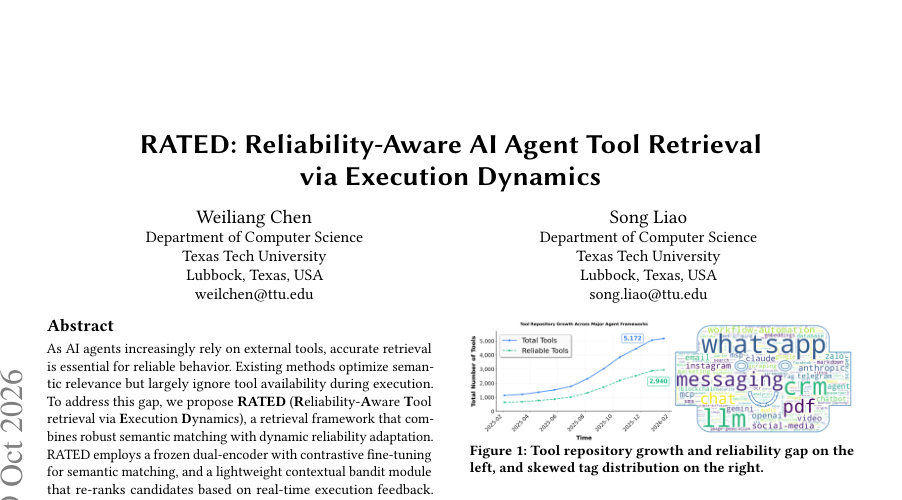
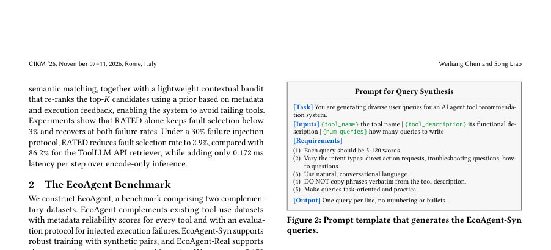
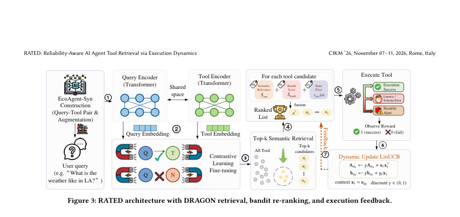

# RATED: Reliability-Aware AI Agent Tool Retrieval via Execution Dynamics

- **게시일:** 2026-10-12
- **arXiv:** [2610.13889v1](http://arxiv.org/abs/2610.13889v1) · [PDF](https://arxiv.org/pdf/2610.13889v1)
- **저자:** Weiliang Chen, Song Liao
- **분야:** cs.AI, cs.IR
- **선정 점수:** 5.17
- **선정 이유:** 최근성 0.5, 인용 영향 0.0 (인용 0회), 저자 영향 0.0 (최고 h-index 0), AI 주제 적합성 2.7, 개발자 관심 1.1, 학술 신호 0.9, 오픈 웨이트·주요 연구조직 신호 0.0

[← 2026-10-12 목록으로 돌아가기](../daily/2026-10-12.html)

<!-- paper-visuals:start -->
## 주요 Figure

> 원문 PDF에서 실제 Figure 캡션과 그림 영역이 함께 확인된 자료만 자동 추출했다.

*Figure · 원문 PDF 1쪽 · Figure 1: Tool repository growth and reliability gap on the*

*Figure · 원문 PDF 2쪽 · Figure 2: Prompt template that generates the EcoAgent-Syn*

*Figure · 원문 PDF 3쪽 · Figure 3: RATED architecture with DRAGON retrieval, bandit re-ranking, and execution feedback.*

<!-- paper-visuals:end -->

## 한 문장 요약

AI 에이전트의 도구 저장소에서 런타임 실패를 피하기 위해 대조적 미세조정된 쌍-인코더로 의미적 후보를 추출하고, 경량의 할인 LinUCB 기반 컨텍스트 강화 밴드를 통해 실행 피드백으로 후보를 재정렬하는 RATED 프레임워크를 제안한다.

## 해결하려는 문제

기존 도구 검색 방법은 주로 의미적 관련성(semantic relevance)을 최적화하지만, 실제 에이전트 운영 환경에서는 도구의 런타임 가용성(예: API 아웃리지, 인증/스키마 오류 등)이 시간에 따라 변하며 의미적으로 적절한 도구라도 실행 실패로 이어질 수 있다. 따라서 단일 정적 순위기(retriever)만으로는 실패를 회피하거나 신속히 적응하는 데 한계가 있고, 배치 기반 정책 업데이트(예: GRPO)는 개별 실행 결과에 즉시 반응하지 못한다. 연구 질문은 의미적 검색 성능을 유지하면서 실행 중 발생하는 도구 실패에 빠르게 적응해 실패 선택률을 낮추는 효율적인 방법을 설계할 수 있는가이다.

## 핵심 기여

- RATED: 의미적 매칭을 담당하는 대조학습으로 미세조정된 고정 쌍-인코더(DRAGON 기반)와, 실행 피드백으로 상위 후보를 재정렬하는 경량의 할인(discounted) LinUCB 컨텍스트 밴드를 결합한 신뢰도 인지 도구 검색 파이프라인을 제안했다.
- EcoAgent 벤치마크를 구축하여 5,172개의 실제 도구 정의와 메타데이터 기반의 자동 신뢰도 점수, 69,501개의 합성 질의(EcoAgent-Syn) 및 6,379개의 실제 질의와 9,946개의 검증된 질의–도구 쌍(EcoAgent-Real)을 제공해 오프라인 검색과 동적 신뢰도 평가를 가능하게 했다.
- 대조(contrastive) 미세조정으로 의미적 검색 성능을 향상시키고(특히 EcoAgent-Syn에서 성능 우수), 실행 기반 할인 LinUCB 재정렬을 통해 30% 실패율 시에도 고정 정적 검색기 대비 큰 폭으로 장애 선택률을 낮추는 실험적 성과를 제시했다.
- 실시간 환경에서 즉시 적응할 수 있도록 설계해 재학습 없이도 온라인으로 도구별 선호를 갱신하며, 인코딩 기반 추론에 대해 평균 추가 지연이 0.172 ms로 매우 작은 오버헤드를 유지함을 보였다.
- 다양한 비교 실험(정적/밀집/교차-인코더 검색기, 헬스체크 블랙리스트, 재시도, 배치 GRPO 유사 방법 등)과 하이퍼파라미터 민감도 분석을 통해 설계 선택의 타당성을 검증했다.

## 접근 방법

* RATED는 두 단계로 구성된다.
* 첫째, 의미 지각 모듈은 DRAGON 계열의 쿼리 인코더 f_Q와 도구 인코더 f_T로 이루어진 쌍-인코더를 사용하며, EcoAgent-Syn에서 인-배치 InfoNCE(대조) 손실로 미세조정한 후 배포 시 고정(frozen)한다.
* 쿼리 q_t에 대해 모든 도구를 점수화하고 상위 K(논문에서는 K=10)를 S_sem(x_q, e_a)=e_q^T e_a로 반환한다.
* 둘째, 신뢰도 인지 재정렬 모듈은 각 후보에 대해 메타데이터 기반의 정적 prior r_static(a) (이름-설명 일관성, 출처 신뢰도, 문서 품질로 구성)를 초기화하고, 실행 결과(선택된 도구에서만 관측되는 이진 보상 y_t)를 이용해 도구별 선형 모델을 유지하는 할인 LinUCB를 적용한다.
* 각 도구 a는 A_a(대각화된 공분산)와 b_a 벡터를 유지하고 ˆθ_a = A_a^{-1} b_a로 추정한다.
* 밴드트 점수는 ˆθ_a^T x_t + α sqrt(x_t^T A_a^{-1} x_t)이고, 최종 점수는 S_final = w1 * S_sem + w2 * S_bandit + w3 * r_static로 가중융합하여 상위 도구를 선택한다.
* 실행 후 관측 y_t로 A_a와 b_a를 A_a ← γ A_a + x_t x_t^T, b_a ← γ b_a + y_t x_t 방식으로 할인(감쇠) 업데이트한다.
* 학습·추론 하이퍼파라미터로는 DRAGON 미세조정: 1 epoch, batch 8, lr=1e−5, warmup 1000, τ=0.05, max_len=256; 밴드잇: α=0.1, γ=0.95, warm-up pairs=2000, 대각 업데이트(시간 복잡도 O(d)); 융합 가중치(w1,w2,w3)=(0.75,0.15,0.10) 등을 사용했다.
* 새로운 도구는 인코딩만으로 추가 가능하며 인코더 재훈련은 필요치 않다.

## 주요 결과

- EcoAgent 벤치마크 구성: 5,172개 실제 도구, EcoAgent-Syn은 69,501개의 고유 합성 질의, 70,122개의 긍정 쌍 및 140,244개의 부정 쌍을 포함. EcoAgent-Real은 6,379개 고유 질의와 9,946개의 검증된 질의–도구 쌍을 포함한다.
- 오프라인 검색 성능 (표 1): EcoAgent-Real에서 RATED(Full) MRR=0.618, Recall@1=0.516, Recall@5=0.740로 동일 벤치의 ToolLLM API retriever(MRR=0.406, Recall@1=0.222, Recall@5=0.409)에 비해 MRR 기준 상대 52.2% 향상(논문 서술). 다만 RATED(Full)은 OpenAI Ada-002 및 SPLADE-v3보다 낮은 성능을 보인다고 명시됨.
- 동적 신뢰성 평가(도구 실패 주입, 표 2): 30% 실패 주입 시 RATED(Full)은 Post-Fail SR=82.1%, FSR(결함 도구 선택률)=2.9% 및 AS(회복 속도)=0(논문 표기), 반면 ToolLLM API retriever는 Post-Fail SR=10.5%, FSR=86.2%로 매우 높은 결함 선택률을 보였다. 20% 실패 주입에서는 RATED(Full) Post-Fail SR=83.4%, FSR=2.5%, AS=1,603으로 보고되었다.
- 비교 관찰: 정적 검색기 및 일부 재랭킹 방법은 결함 도구 선택률(FSR)이 높고 온라인으로 회복하지 못하는 반면(‘Failed’로 표기), 헬스체크 블랙리스트는 낮은 FSR을 달성하지만 회복 단계가 매우 느리다. RATED(Full)은 RATED(w/o Feedback) 및 Global MAB 변형보다 낮은 FSR과 높은 Post-Fail SR를 기록해 의미적 검색과 온라인 신뢰도 적응의 분리를 옳게 정당화한다.
- 효율성(표 3): 단일 RTX 5070(12GB)에서 배치 크기 1 기준 DRAGON 인코딩만의 평균 대기시간은 3.223 ms, RATED(Full) 평균 3.395 ms로 인코딩 전용에 비해 평균 오버헤드 +0.172 ms, P95 4.391 ms로 매우 작은 추가 지연을 보였다. 반면 배치 GRPO 유사 방법은 평균 17.839 ms로 훨씬 큰 비용을 요구했다.

## 한계

- 저자가 명시한 한계: 새로 추가된 도구에 대한 콜드스타트 경로 평가와 RATED를 실제 라이브 에이전트 런타임에서 검증하는 작업은 향후 연구로 남겨두었다(본문 결론).
- 본문에서 합리적으로 확인되는 제약: 동적 평가에서 사용한 실패 주입은 고정된 실패 집합(주파수 기반 샘플링 후 상위 10% 제외하고 다음 ρN을 실패로 설정)으로 시뮬레이션된 지속적 아웃리지이며, 이는 실제 운용에서 발생하는 다양한 장애 유형(간헐적 실패, 지연, 부분적 응답성 저하 등)을 완전히 대변하지 못할 수 있다(실험 프로토콜 섹션에 명시).
- EcoAgent의 도구 신뢰도 레이블은 수동 평가가 아닌 메타데이터 신호(이름-설명 일관성, 출처 가중치, 문서 품질)를 가중합해 자동 산출하므로(Section 2, 3.3), 사람이 매긴 상세한 실행 가능성 라벨을 대체하지 못할 수 있고 자동 점수의 한계가 결과에 영향 줄 수 있다.
- 오프라인 검증 파이프라인은 Gemma-3-1b와 GTE-Large 같은 모델을 사용한 자동화 및 소규모(200건) 인간 확인으로 구성되어 있으며, 완전한 수동 라벨링에 비해 일부 오류(논문은 검증 샘플에서 94% 일치)를 포함할 가능성이 있다.

## 개발자 관점

- 재현성: 코드와 데이터셋을 공개(논문 초록 및 본문)하였고, DRAGON 쌍-인코더를 EcoAgent-Syn으로 대조 미세조정한 뒤 배포 시 고정하면 새로운 도구는 문서 인코딩만으로 즉시 추가 가능하다(인코더 재훈련 불필요).
- 구현 세부사항: 온라인 재정렬은 도구별로 대각화된 A_a와 b_a만 유지하므로 메모리·계산 부담이 낮고 점수 계산은 O(d)이며, 밴드잇 하이퍼파라미터(α=0.1, γ=0.95, warm-up=2000) 및 융합 가중치(w1=0.75,w2=0.15,w3=0.10)를 검증된 기본값으로 사용하면 된다.
- 배포·지연 고려사항: RATED(Full)는 인코딩 기반 추론에 대해 평균 추가 지연 0.172 ms로 실시간 에이전트 루프에 적용 가능하므로(단일 GPU 환경에서 측정), 높은 빈도·저지연 애플리케이션에 적합하다. 반면 배치 기반 정책 동기화 방식(GRPO 유사)은 주기적 동기화 비용이 크다(평균 +14.616 ms 보고).
- 데이터·라벨링 비용: EcoAgent-Syn은 Gemma-3-1b로 합성 질의를 생성하고 하드 네거티브를 포함해 대조 학습용 데이터를 확보했으며, 실환경 라벨링 비용을 절감하려면 유사한 자동화 파이프라인(LLM 검증 + 샘플 휴먼 검토)을 고려할 수 있다.
- 안전성·운영 관점: 메타데이터 기반 정적 prior과 온라인 밴드잇 업데이트를 결합하면 새로운 실패 패턴에 빠르게 적응할 수 있으나, 밴드잇은 선택된 후보에 대해서만 피드백을 얻는 부분관찰(partial feedback) 구조이므로 탐색 정책과 초반 warm-up 데이터가 부족하면 초기 성능 저하가 발생할 수 있다(논문에서 warm-up 2,000 쌍 사용).

**근거 범위:** 논문 PDF 본문 기반 분석. 본 분석은 제공된 PDF의 본문(6페이지 전부)에서 직접 확인한 내용만을 사용했으며, 초록은 보조로 참고했다. 표 및 본문에 명시된 수치(예: 데이터셋 크기, MRR, FSR, 지연 값, 하이퍼파라미터 등)는 모두 PDF 내 표와 본문에서 발췌했다. PDF에서 직접적으로 서술되지 않은 구현 세부(예: 정확한 코드 경로, 런타임 환경의 네트워크 조건 등)는 포함하지 않았다.
