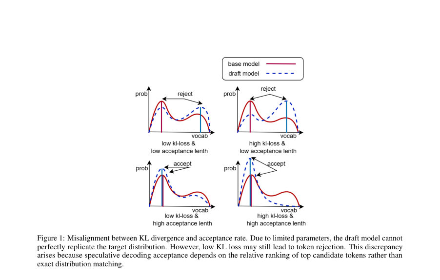
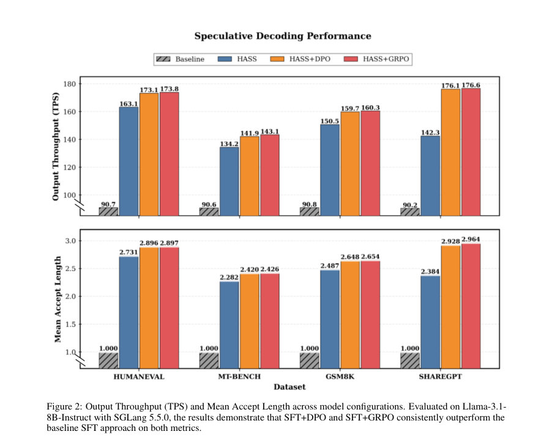
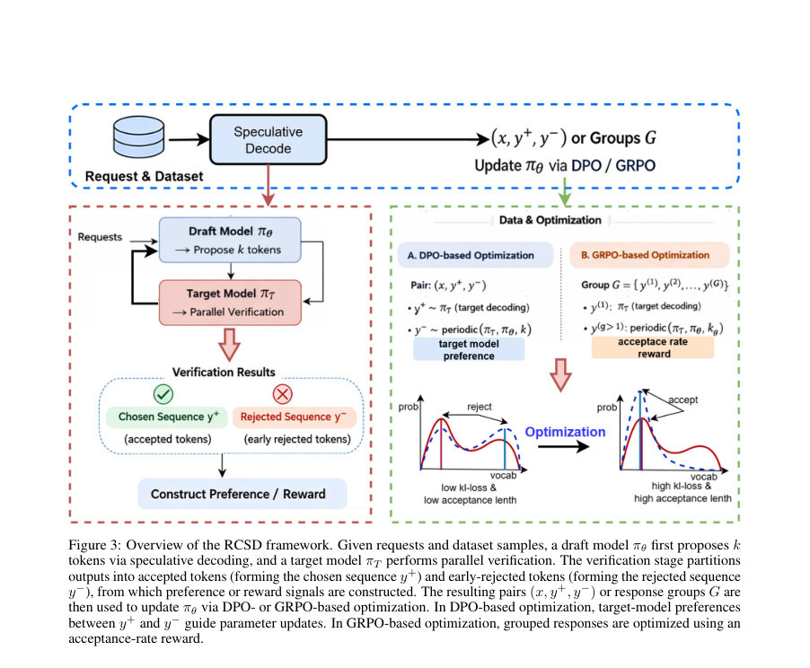

# RCSD: Reinforcement and Continual Learning for Domain-Specific Speculative Decoding

- **게시일:** 2026-10-22
- **arXiv:** [2610.29527v1](http://arxiv.org/abs/2610.29527v1) · [PDF](https://arxiv.org/pdf/2610.29527v1)
- **저자:** Mingkang Liu, Weiming Meng, Peipei Jiao, Jiawei Zhang, Tianyuan Liu, Junyan Li, Lichen Pang
- **분야:** cs.CL
- **선정 점수:** 4.56
- **선정 이유:** 최근성 1.1, 인용 영향 0.0 (인용 0회), 저자 영향 0.0 (최고 h-index 0), AI 주제 적합성 2.9, 개발자 관심 0.2, 학술 신호 0.3, 오픈 웨이트·주요 연구조직 신호 0.0

[← 2026-10-22 목록으로 돌아가기](../daily/2026-10-22.html)

<!-- paper-visuals:start -->
## 주요 Figure

> 원문 PDF에서 실제 Figure 캡션과 그림 영역이 함께 확인된 자료만 자동 추출했다.

*Figure · 원문 PDF 2쪽 · Figure 1: Misalignment between KL divergence and acceptance rate. Due to limited parameters, the draft model cannot*

*Figure · 원문 PDF 3쪽 · Figure 2: Output Throughput (TPS) and Mean Accept Length across model configurations. Evaluated on Llama-3.1-*

*Figure · 원문 PDF 4쪽 · Figure 3: Overview of the RCSD framework. Given requests and dataset samples, a draft model πθ first proposes k*

<!-- paper-visuals:end -->

## 한 문장 요약

작은 초안 모델을 대상 모델의 검증 피드백(수락/거부)을 이용한 선호 최적화(DPO, GRPO)로 학습하여 추측적 디코딩의 수락 길이(acceptance length)를 직접 최대화하는 RCSD 프레임워크를 제안한다.

## 해결하려는 문제

기존의 초안 모델 훈련은 대상 모델의 전체 출력 분포를 소프트 라벨로 모방하도록 강제하는 지식 증류(앞쪽 KL 최소화)에 기반한다. 이 방식은 저확률(고엔트로피) 영역까지 용량을 할당하게 만들어 실제로는 수락 여부를 결정하는 상위 k개의 상대적 순위를 잘 맞추지 못해 수락률을 저하시킬 수 있다. 논문은 분포 일치(distribution matching) 목표와 추측적 디코딩 시스템 수준 목표(수락된 토큰 수/수락 길이 최대화) 간의 불일치를 해결하는 것을 연구 문제로 제시한다.

## 핵심 기여

- RCSD( Reinforcement & Continual Learning for Speculative Decoding)라는 훈련 프레임워크를 제안하여 초안 모델 학습 목표를 시스템 성능(수락 길이)로 직접 정렬함.
- 추측적 디코딩 과정에서 자연스럽게 얻어지는 수락(sequence y+)과 조기 거부(sequence y−) 샘플을 이용해 암묵적 선호 쌍을 구성하고 이를 DPO(Direct Preference Optimization)로 최적화하는 방법을 제시함.
- 여러 추측 경로를 이용해 그룹 단위의 상대적 품질 신호를 보상으로 사용하는 GRPO(Group-wise Relative Policy Optimization)를 도입해 더 안정적이고 효과적인 학습을 달성함.
- 대상 모델이 생성한 토큰에 대해서는 손실을 마스킹해 대상 모델과 이미 정렬된 토큰을 과도하게 벌주지 않도록 하는 손실 처리(마스킹)를 설계함.
- Qwen3-1.7B와 Llama-3.1-8B에서의 실험으로 HASS(기본 distillation) 대비 수락 길이를 평균 35–40% 개선하고 실무 워크로드에서 1.2–1.35× 엔드투엔드 추론 속도 향상을 보고함.

## 접근 방법

* RCSD는 추측적 디코딩(예: Eagle 프레임워크)에서 대상 모델 M_target과 초안 모델 π_θ를 사용해 학습 데이터를 구성한다.
* 추정 과정에서 병렬 검증으로 나뉘는 출력의 수락된 토큰들(y+)과 조기 거부된 토큰들(y−)을 이용해 선호 신호를 만든다.
* 두 가지 학습 방식이 제안된다.
* (1) DPO 기반: 대상 모델에서 샘플한 y+를 '선택된(choosen)' 시퀀스로, 대상과 초안을 주기적으로 교체해 생성한 y−를 '거부된' 시퀀스로 간주하여 로그 확률 비(r_θ) 차이를 sigmoid로 최적화한다.
* 훈련 시 참조 모델 π_ref를 고정하여 로그-비교 항(∆πθ − ∆πref)을 사용한다.
* (2) GRPO 기반: 여러 개의 그룹 G(예: spec_step1..k, chosen)를 구성하고 각 그룹 별로 대상 모델의 로그확률과 수락률을 정규화한 보상 s_g를 계산하여, 확률비 r_θ(y(g))에 보상 가중치를 곱한 클립된 형태의 손실과 per-token KL 정규화를 결합해 최적화한다.
* 공통 구현 세부로는 후행(프롬프트 이후) 토큰에 대해서만 로그확률을 계산하고, 대상 모델이 생성한 토큰은 손실 계산에서 마스킹해 과도한 페널티를 방지하는 정책이 있다.
* 훈련 데이터 생성은 대상·초안 모델의 주기적 번갈아 생성(예: 대상 1 token, 초안 k token)으로 이루어진다.
* 실험 설정은 Qwen3-1.7B 및 Llama-3.1-8B를 90% ShareGPT로 학습하고, 평가에 GSM8K, HumanEval, MT-Bench, 남은 10% ShareGPT를 사용하며, 추측 단계(step) 3–6에 대해 비교했다.

## 주요 결과

- Qwen3-1.7B(평균 over 4 datasets)에서 추측 Step 6의 평균 수락 길이(acceptance length)는 HASS 2.26, HASS+DPO 2.97, HASS+GRPO 3.00으로 보고됨.
- Llama-3.1-8B에서도 전반적으로 GRPO가 최상 또는 동률 성능을 보였으며, 테이블별로 예: ShareGPT Step 6에서 HASS 2.672, HASS+DPO 3.779, HASS+GRPO 3.828과 같은 큰 향상을 보임(테이블에 상세 수치 제시).
- 저자 주장에 따르면 RCSD는 HASS 대비 평균 수락 길이를 35–40% 개선했고, 실제적 워크로드(예: ShareGPT 기반)에서 엔드투엔드 추론 속도를 1.2–1.35× 가속했다고 보고함.
- 논문에서는 '생성 품질을 훼손하지 않음(without compromising generation quality)'을 명시적으로 주장함(정성적/정량적 품질 지표의 상세 비교는 본문에 제한적으로 제시됨).

## 한계

- 저자가 명시한 한계: 초안 모델은 대상 모델보다 파라미터가 훨씬 작아 대상 분포를 완전히 복제(확률값까지)할 수 없으며, 따라서 분포 일치 목표는 현실적으로 달성 불가능하다고 저자 스스로 지적함.
- 본 논문에서 실험적으로 확인되는 제약(본문 근거): 실험은 Qwen3-1.7B와 Llama-3.1-8B 두 모델 계열 및 ShareGPT, GSM8K, HumanEval, MT-Bench 등으로 제한되어 있어 다른 모델 규모(더 작거나 더 큼), 다른 도메인 데이터셋, 또는 더 넓은 하드웨어/배포 환경에서의 일반화성은 본문에서 검증되지 않음.
- 실험은 추측 단계(step) 3–6 범위에서 수행되었으며, 더 긴 추측 호라이즌이나 다른 추측 전략(예: Medusa의 multi-head 등)과의 결합 효과는 본문에서 다루어지지 않음.
- 훈련에 DPO/GRPO와 참조 모델 및 마스킹을 포함함으로써 학습 파이프라인 복잡도와 추가 학습 비용이 발생하는데, 해당 추가 비용 및 수렴 안정성에 대한 상세한 분석은 본문에 충분히 제시되어 있지 않음.

## 개발자 관점

- 재현성: 논문은 알고리즘(알고리즘 의사코드), 참조 모델 π_ref 사용, 후행 토큰만 계산 및 대상 생성 토큰 마스킹 등 구현 세부를 본문에 명시하고 있으며, 저자가 GitHub 리포지터리 공개를 예고해 코드 기반 재현이 가능할 것으로 보임(본문에 깃허브 링크 표기).
- 데이터/생성 파이프라인: DPO용 데이터는 대상에서 샘플된 y+와 대상/초안 교대로 생성된 y−로 구성되고, GRPO는 여러 spec_step 그룹의 시퀀스를 함께 수집해야 하므로 추측 시뮬레이션(대상·초안 혼성 생성)을 대량으로 수행할 인프라가 필요함.
- 손실 설계: 대상이 생성한 토큰을 마스킹해 손실에서 제외하는 처리는 핵심 구현 포인트이므로, 동일한 마스킹 패턴을 선택적으로 일관되게 적용해야 실험 결과의 일관성이 유지됨.
- 배포·운영: RCSD로 학습된 초안 모델이 수락 길이를 늘리면 동일한 검증 대상 모델을 유지한 상태에서 추론 처리량(TPS)을 실질적으로 올릴 수 있으므로 실서비스 레이턴시·비용 절감에 기여할 가능성이 높다. 다만 배치 내 균일한 추측 하이퍼파라미터(엔진 제약) 때문에 배포 환경에서 하이퍼파라미터 튜닝과 통합 검증이 필요함.
- 비용·안전성: RL/선호 최적화는 추가 훈련 비용과 잠재적 불안정성을 수반하므로, 생산 시스템 도입시 학습 비용-이득(속도 향상 대비) 분석과 대상 모델의 편향·오류가 초안 모델로 강화되지 않도록 품질 모니터링이 필요함.

**근거 범위:** 이 분석은 제공된 논문 PDF 본문(페이지 1–9)의 텍스트를 근거로 작성되었다. 본문에 제시된 테이블(표 1–2)의 수치, 결론에 언급된 평균 개선 비율(35–40%)과 엔드투엔드 속도향상(1.2–1.35×)을 근거로 요약했다. 하드웨어 구성, 세부 하이퍼파라미터, 통계적 유의성, 일부 품질 지표의 구체적 수치 및 전체 학습/추론 비용에 관한 정보는 PDF 본문에서 제한적으로만 제공되어 상세 수치는 확인되지 않는다.
