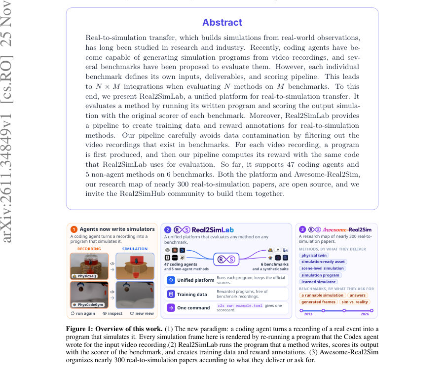
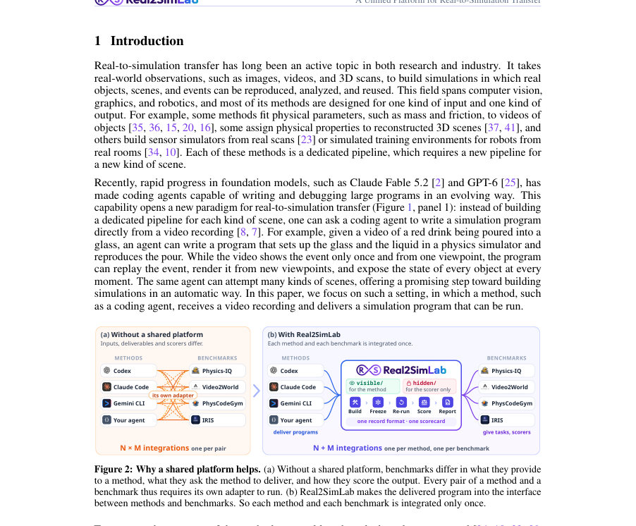
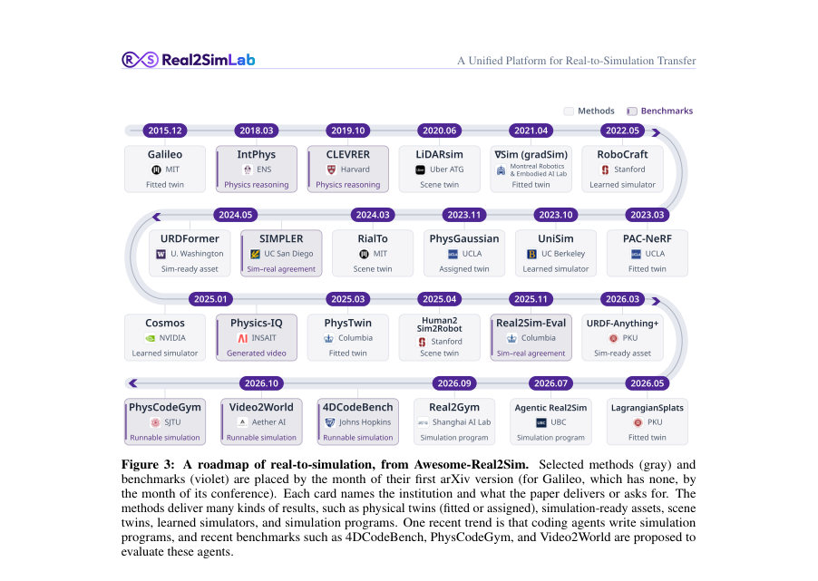

# Real2SimLab: A Unified Platform for Real-to-Simulation Transfer

- **게시일:** 2026-11-27
- **arXiv:** [2611.34849v1](http://arxiv.org/abs/2611.34849v1) · [PDF](https://arxiv.org/pdf/2611.34849v1)
- **저자:** Yongchang Zhang, Jie Huang, Yunhe Ni, Ningyu Zhou, Guangyu Zhao, Ruixun Liu, Rui Huang, Yidi Wu, TianZe Zhang, Zixiang Jiang, Xiang Li, Kevin Shen, Yiwu Zhong
- **분야:** cs.RO, cs.CV
- **선정 점수:** 4.16
- **선정 이유:** 최근성 0.7, 인용 영향 0.0 (인용 0회), 저자 영향 0.0 (최고 h-index 0), AI 주제 적합성 1.8, 개발자 관심 0.9, 학술 신호 0.8, 오픈 웨이트·주요 연구조직 신호 0.0

[← 2026-11-27 목록으로 돌아가기](../daily/2026-11-27.html)

<!-- paper-visuals:start -->
## 주요 Figure

> 원문 PDF에서 실제 Figure 캡션과 그림 영역이 함께 확인된 자료만 자동 추출했다.

*Figure · 원문 PDF 1쪽 · Figure 1: Overview of this work. (1) The new paradigm: a coding agent turns a recording of a real event into a*

*Figure · 원문 PDF 2쪽 · Figure 2: Why a shared platform helps. (a) Without a shared platform, benchmarks differ in what they provide*

*Figure · 원문 PDF 5쪽 · Figure 3: A roadmap of real-to-simulation, from Awesome-Real2Sim. Selected methods (gray) and*

<!-- paper-visuals:end -->

## 한 문장 요약

비디오 녹화 등 실제 관찰에서 시뮬레이션 프로그램을 자동 생성하는 방법들을 통합적으로 평가하고, 오염을 방지한 훈련 데이터 및 보상 주석을 생성하는 플랫폼 Real2SimLab을 설계·구현했다.

## 해결하려는 문제

기존에는 각 벤치마크가 입력, 산출물, 채점 파이프라인을 제각각 정의하여 N개의 방법을 M개의 벤치마크에 평가하려면 N×M개의 어댑터 통합이 필요했다. 또한 평가용 영상 데이터가 여러 데이터셋에 중복으로 포함될 수 있어 훈련 데이터 오염(contamination)이 발생하기 쉬우며, 코딩 에이전트가 생성한 시뮬레이션 프로그램을 일관되게 재실행·채점하기 위한 표준화된 플랫폼이 부족했다.

## 핵심 기여

- 프로그램을 공통 인터페이스로 삼아 방법과 벤치마크를 연결하는 통합 평가 플랫폼 Real2SimLab을 제안하여 N×M 통합을 N+M 통합으로 줄였다.
- 평가와 동일한 채점 코드로 프로그램의 재실행 결과에 대해 보상(reward)을 계산하는 파이프라인을 제공하고, 평가용 녹화 영상과 겹치는 훈련 샘플을 필터링하여 데이터 오염을 방지했다.
- 현존하는 6개 벤치마크(Physics-IQ, Video2World, 4DCodeBench, PhysCodeGym, PhySimCode, IRIS)와 자체 합성 스위트를 어댑터로 연결하고, 47개 코딩 에이전트와 5개 비에이전트 방식(method)을 지원하는 오픈소스 생태계를 구축했다.
- 평가 기록과 스코어를 표준화된 레코드와 스코어카드로 보고하며, 재현성·세션 일관성 검사, 샌드박스 기반 빌드·재실행, 공식 채점기 유지(가능한 경우)를 통해 신뢰도를 높였다.
- Awesome-Real2Sim이라는 분야 지도(약 300편의 관련 논문)를 공개하여 연구자들이 비교 대상을 선택하기 쉽도록 했다.

## 접근 방법

* 구조 개요: 플랫폼은 (1) 벤치마크-와 방법-별 어댑터를 각각 한 번만 작성하도록 설계되어, 방법은 'deliverable'로 프로그램을 제출하고 벤치마크는 해당 프로그램의 출력을 채점한다.
* 작업(task) 포맷: 각 task 디렉터리는 metadata와 visible/ (방법에 노출되는 입력) 및 hidden/ (채점기만 접근하는 레퍼런스)를 포함한다.
* 방법 호출 및 제출: 방법-어댑터는 visible/만을 전달받아 하나의 deliverable(주로 solution/run.py 형태의 시뮬레이션 프로그램 또는 벤치마크 고유 산출물 규약)을 반환한다.
* 빌드와 샌드박스: 에이전트는 런타임 이미지(container)에서 격리된 워크스페이스로 실행되며 네트워크는 모델 API 등 제한된 목적만 허용한다.
* 프리즈·재실행: 제출된 deliverable은 '동결(freeze)'되어 지문(fingerprint)을 부여한 뒤 오프라인의 읽기 전용 환경에서 재실행되어 채점 대상이 된다.
* 검사: 세션-일관성(원래 세션 출력과 재실행 출력 일치) 및 재현성(같은 랜덤시드로 재실행 시 동일 출력) 검사를 수행한다.
* 채점 프로토콜: 가능하면 각 벤치마크의 공식 채점기를 그대로 사용(native protocol).
* 공식 채점기가 프로그램 출력에 적용되지 않는 경우(예: IRIS, 합성 스위트 등)에는 재현성 프로토콜을 사용하여 숨겨진 레퍼런스 궤적과 비교하고 reproduction skill = 1 - e/estatic으로 헤드라인 점수를 계산한다.
* 훈련 데이터 파이프라인: 사용자의 녹화·합성 장면·(벤치마크가 허용하는) 공개 트레이닝 스플릿을 task 형식으로 만들고, 평가용 task와의 중복을 프레임 썸네일 비교(여러 시간 오프셋에서, 리사이즈·클립·재인코딩에도 강건)로 검사해 겹치는 항목은 제외한 뒤 각 방법이 생성한 프로그램을 동일한 채점 코드로 재실행·채점하여 보상을 부착한다.
* 확장성: 백엔드(bubblewrap, Docker, local), 벤치마크·방법·메트릭·스코어러 등 플러그인화로 외부 확장을 지원하며 Harbor 프레임워크와 브리지로 기존 에이전트들을 연결한다.

## 주요 결과

- 플랫폼이 47개의 코딩 에이전트와 5개의 비에이전트 방식을 지원하며 6개의 기존 벤치마크와 자체 합성 스위트를 어댑터로 연결했다(문서 기반 진술).
- 합성 스위트는 다섯 현상(탄력 튕김 공, 감쇠 진자, 미끄러지는 블록, 항력 있는 투사체, 두 공의 충돌)을 포함하며 생성자가 해당 데이터를 만든 프로그램으로 재현했을 때 reproduction skill이 1을 달성했다.
- 벤치마크 어댑터 검증: Physics-IQ 어댑터는 동일한 비디오에 대해 공식 파이프라인과 같은 점수를 보고했고, Video2World 패키지(예: Push-T)들은 원래 보고된 점수를 재현했다.
- 데이터 오염(중복 검사) 성능: 합성 평가 비디오의 복사본 40건 중 36건을 검출했고, 놓친 사례는 가장 심하게 압축된 것들이었다. 또한 실제 데이터에서 PhysCodeGym이 Physics-IQ에서 재사용한 27개의 클립을 모두 찾아냈다.
- 평가 파이프라인은 세션 출력 대신 동결된 재실행 출력을 채점하는 옵션(rerun variant)을 제공하여 세션 의존성을 분리하고, 실패(샌드박스/채점기 오류)는 인프라 오류로 기록·통계에서 제외하도록 설계되었다.

## 한계

- 저자가 명시한 한계: 본 논문은 플랫폼 설계와 구현에 초점을 맞추며, 연결된 방법들(에이전트들)의 체계적 비교는 향후 작업으로 남겨두었다.
- 저자가 명시한 한계: 실험적 훈련(플랫폼이 제공하는 데이터·보상으로 모델을 fine-tune/강화학습하는 것)은 아직 수행하지 않았다고 명시했다.
- 범위 제한(저자가 밝힘): '정답만 요구하는' 벤치마크(answers-only)는 시뮬레이션 실행 대상이 아니므로 플랫폼의 범위에서 제외되며, 로봇 정책 평가 벤치마크(예: SIMPLER)는 보완적 영역으로 남아 있다.
- 검출 한계: 오버랩(중복) 검사에서 매우 고압축 사례는 탐지하지 못하는 등 데이터 오염 차단이 완벽하지 않다(실험에서 가장 심하게 압축된 복사본을 놓침).

## 개발자 관점

- 방법-벤치마크 통합 비용을 줄이려면 '프로그램'을 공통 인터페이스로 삼아 N+M 통합 구조를 택하라(각 방법과 벤치마크를 한 번씩 어댑터화).
- 평가 신뢰도를 위해 제출물을 동결(freeze)하고 지문을 검증한 뒤 읽기 전용 환경에서 재실행하여 그 출력만을 채점하라. 재실행 불일치는 세션 환경 의존성이나 허용 불가 동작을 드러낸다.
- 샌드박스 실행(예: Docker, bubblewrap)과 네트워크 제한(모델 API 접근만 허용), 로그의 적절한 익명화 및 자격증명 주입 정책은 보안·재현성 확보에 중요하다.
- 훈련 데이터 생성 시 평가용 녹화와의 중복을 방지하기 위해 움직임이 있는 프레임에서 축소 썸네일을 만들어 여러 시간 오프셋에서 비교하는 방법이 실용적이다. 다만 고압축 사례는 놓칠 수 있으니 보수적 임계값 설정을 고려하라.
- 가능하다면 벤치마크의 공식 채점기를 그대로 유지(native protocol)하되, 공식 채점기가 프로그램 출력에 적용되지 않으면(reproduction protocol) 숨겨진 궤적과의 거리 기반 skill(1 - e/estatic)을 사용해 비교하라. 또한 인프라 실패는 점수 대신 별도 코드로 기록하고 통계에서 제외하는 정책이 바람직하다.

**근거 범위:** 이 분석은 제공된 논문 PDF 본문(페이지 1–13)에 근거해 작성되었다. 본문에 명시된 수치(예: 47 에이전트, 5 비에이전트, 6 벤치마크, 합성 스위트의 5 현상 등) 및 실험적 검사 결과(합성 복사본 36/40 검출, PhysCodeGym의 27 클립 검출)는 PDF 텍스트에서 직접 인용하였다. 플랫폼의 내부 구현 세부(예: 특정 컨테이너 이미지 설정, 성능 오버헤드 수치, 개별 에이전트별 점수)는 본문에 구체 수치로 제시되지 않아 포함하지 않았다.
