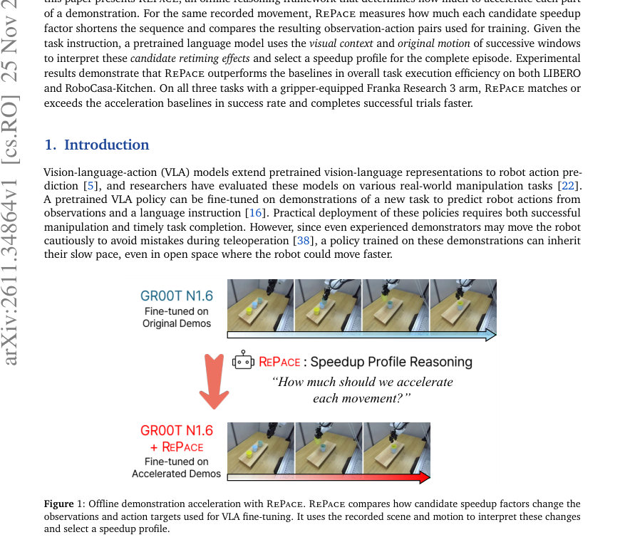
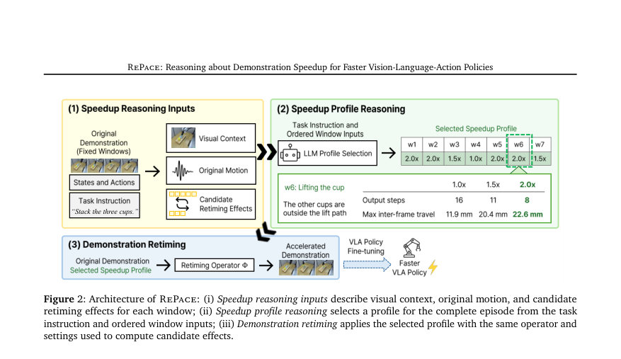
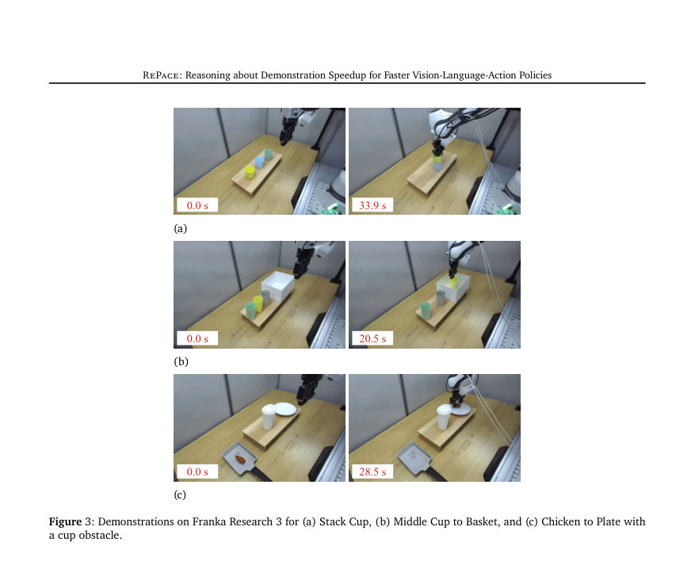

# RePace: Reasoning about Demonstration Speedup for Faster Vision-Language-Action Policies

- **게시일:** 2026-11-28
- **arXiv:** [2611.34864v1](http://arxiv.org/abs/2611.34864v1) · [PDF](https://arxiv.org/pdf/2611.34864v1)
- **저자:** Insup Lee, Hojin Jeon, Sunguk Shin, Seoungbin Bae, Taekwan Kim, Jinwoo Shin, Dongsu Han
- **분야:** cs.RO, cs.AI
- **선정 점수:** 3.56
- **선정 이유:** 최근성 0.5, 인용 영향 0.0 (인용 0회), 저자 영향 0.0 (최고 h-index 0), AI 주제 적합성 2.5, 개발자 관심 0.3, 학술 신호 0.3, 오픈 웨이트·주요 연구조직 신호 0.0

[← 2026-11-28 목록으로 돌아가기](../daily/2026-11-28.html)

<!-- paper-visuals:start -->
## 주요 Figure

> 원문 PDF에서 실제 Figure 캡션과 그림 영역이 함께 확인된 자료만 자동 추출했다.

*Figure · 원문 PDF 1쪽 · Figure 1: Offline demonstration acceleration with RePace. RePace compares how candidate speedup factors change the*

*Figure · 원문 PDF 4쪽 · Figure 2: Architecture of RePace: (i) Speedup reasoning inputs describe visual context, original motion, and candidate*

*Figure · 원문 PDF 7쪽 · Figure 3: Demonstrations on Franka Research 3 for (a) Stack Cup, (b) Middle Cup to Basket, and (c) Chicken to Plate with*

<!-- paper-visuals:end -->

## 한 문장 요약

RePace는 기록된 시연을 여러 후보 속도(예: 2.0, 1.5, 1.0)로 사전 재타이밍(retiming)했을 때 훈련 데이터(관찰-명령 쌍)가 어떻게 변하는지를 계량적으로 측정하고, 시각 문맥과 원본 운동 정보를 함께 제공하여 대형 언어모델(LLM)이 에피소드 전체에 대한 창(window)별 속도 프로필을 판단하도록 해 VLA(vision-language-action) 정책의 실행 속도를 높이는 오프라인 시연 가속 프레임워크이다.

## 해결하려는 문제

해결하려는 문제와 기존 한계:
- 문제: 사람 원격조작 데모에서 정책이 시연자의 느린 움직임 속도를 그대로 학습해 실행이 느려지는 현상(느린 페이스 상속). 따라서 시연을 미리 가속해 정책을 빠르게 만드는 것이 목표이다.
- 기존 방법 한계: 기존의 오프라인 가속법들은 (예) 세그먼트 수준으로 정해진 속도 배율을 할당하거나( DemoSpeedup, VOLT ) 엔트로피·비전 기반으로 '어디를' 느리게 할지 결정했으나, 동일 세그먼트 내부에서도 '운반(steady) 동작'과 '정밀 정렬(alignment)'이 섞일 수 있어 단일 속도 배율이 과도하거나 세부 관찰을 누락할 위험이 있음.
- 연구 질문: 정책 미세조정 전에 서로 다른 후보 속도들이 동일 기록 운동에서 훈련 데이터(관찰·명령)에 어떤 변화를 초래하는지 비교·해석하여, 장면과 운동 문맥을 고려해 창별로 얼마나 가속할지 결정할 수 있는가?
(위 내용은 본문 섹션 1 및 2의 문제 제기와 도전 과제(Challenge 1–3)에 근거함.)

## 핵심 기여

- 오프라인 데모 가속을 위해 각 창(window)별로 후보 속도들이 훈련 데이터에 미치는 변화를 계량화하고(출력 단계 수, 추가로 절약되는 단계, 클립 전후 최대 명령 피크, 연속 관측 사이의 최대 경로 길이 등) 이를 입력으로 사용하는 새로운 입력 집합을 정의함(visual context, original motion, candidate retiming effects).
- 프리트레인된 LLM(Qwen3.8-27B)을 사용해 에피소드 전체의 창 순서를 고려하여 창별 속도 프로파일을 선택하는 방법(RePace) 제안 — LLM은 추가 학습 없이 지시문(instruction)과 정형화된 입력을 받아 선택 및 근거(증거)를 반환함.
- 정확한 재타이밍 연산자 Φ와 고정된 창 경계, 그리퍼 전이 보존과 손가락(파지) 모션에 대한 압축 상한(캡, 1.5) 등 구체적 규칙을 정의하고 이를 실제로 활용해 가속된 데모 집합을 구성한 후 VLA 정책을 미세조정함.
- 시뮬레이션(LIBERO, RoboCasa-Kitchen) 및 실제 로봇(Franka Research 3)에서 기존 균등 가속(Uniform), DemoSpeedup, VOLT 등과 비교해 실행 효율(Effective Speedup) 및 성공률·완료시간 관점에서 RePace의 유리함을 입증함.
- 세 가지 입력(시각 문맥, 원본 운동, 후보 재타이밍 효과)의 기여를 제거·비교하는 소거(ablation)를 통해 후보 측정치와 시각 문맥이 속도 선택과 최종 성능에 미치는 영향을 분석함.

## 접근 방법

* 접근 방법(아키텍처·알고리즘·학습·추론 절차):
* 문제 설정: 각 데모 τ = {(o_t, q_t, a_t)}_{t=1..T}을 고정된 순서의 비중첩 창 W_1..W_W로 분할하고, 각 창에 후보 속도 집합 ℛ(실험에서 {2.0,1.5,1.0}) 중 하나를 할당해 재타이밍 연산자 Φ로 그룹핑하여 가속된 데모 τ̃ = Φ(τ, r)를 생성한다.
* 재타이밍 시 그리퍼 전이(transition)는 새 구간 시작점으로 하고, 손가락(파지) 운동 구간은 압축 상한을 둠(캡=1.5).
* (본문 3.1, 3.5)
* 세 가지 창별 입력(x_w): (1) visual context v_w — VLM(Qwen3-VL-32B-Instruct-FP8)이 창내 프레임을 분석해 대상·목적지 배치, 장애물, route_clearance(open/tight/unknown), visibility 등을 기술함; (2) original motion m_w — 기록된 엔드이펙터 변위·경로길이·속도, 각속도·각 경로 길이, 손가락 개폐 등 계량치; (3) candidate retiming effects e_w(r) — 각 후보 r에 대해 Φ를 적용했을 때의 출력 단계 수 n_w(r), 상위 후보와 비교한 추가 절약 단계, 재타이밍 후 명령 피크(클립 전후), 연속 선택 관측 사이의 최대 이동 거리·각도(G_p,G_R), 그리퍼 매핑 등(본문 3.3, Appendix A.3).
* 속도 프로파일 선택(f_LLM): 프리트레인된 LLM(실험에서 Qwen3.8-27B, BF16, temperature=0, thinking disabled)을 사용해 전체 에피소드 입력(지시문 ℓ 및 x_1..x_W)과 selection instruction ℐ를 토대로 창별 속도 r=(r_1..r_W)와 각 선택에 대한 간단한 근거 E를 반환한다.
* 선택 규칙: 기본적으로 높은 후보(2.0)에서 시작해 필요한 경우 1.5→1.0을 순차 고려하며, 유사한 증거라면 더 많은 단계를 제거하는 후보를 선호하고, 동일 출력(identical-output)일 경우 낮은 명목값(더 느린)을 선택함(본문 3.4, Alg.1, Appendix A.4).
* 데모 재타이밍 및 정책 미세조정: 선정된 r을 Φ로 적용해 가속 데모 집합을 만들고 GR00T N1.6 기반 VLA 정책(사전학습 체크포인트 동일)을 동일한 옵티마이저/설정으로 미세조정(시뮬레이션: LIBERO 20k 업데이트, RoboCasa 60k; Franka: 각 과제별 30k).
* 평가시는 성공률(SR), 성공 시 평균 완료시간(Time), 그리고 Effective Speedup(ES)를 사용함(본문 3.5, 4.1).

## 주요 결과

- 데이터셋·설정: LIBERO — 1,693 데모(40 tasks, Spatial/Object/Goal/Long suites), 평가 2,000 trials; RoboCasa-Kitchen — 7,200 데모(24 tasks), 평가 1,200 trials; Franka real robot — 3 tasks, 각 40 데모 수집, 평가 32 trials/조건. (본문 4.1 및 Fig.3)
- LIBERO(표 2): RePace는 전체(Overall)에서 성공률 SR=92.45%, 평균 성공시 완료시간 Time=96.0(제어 스텝), 전체 ES=1.257로 네 가지 가속 방법 중 전체 ES 최고(Original은 ES=1.000 기준). 구체적으로 Original 대비 평균 성공 완료시간을 151.0→96.0로 36.4% 단축했으며 성공률은 97.45%→92.45%로 5.13% 감소함. 특히 Spatial/Goal suite에서는 ES 각각 1.366, 1.322, RePace는 가속된 정책들 중 성공률 최고(예: Spatial SR=96.0). (본문 4.2.1, Table 2)
- RoboCasa-Kitchen(표 3): RePace 전체 SR=64.4%, Time=213.5, ES=1.015으로 네 가지 가속 중 유일하게 전체 ES>1을 달성. Pick-and-Place 그룹에서는 성공률이 48.0%→41.2%로 떨어졌지만 성공한 경우 단계 수는 376.5→245.7로 약 34.7% 감소. (본문 4.2.1, Table 3)
- Franka 실제 로봇(표 4): 세 과제 모두에서 RePace는 Uniform/DemoSpeedup/VOLT보다 성공한 시도들의 평균 완료시간이 더 짧음(예: Stack Cup: Original SR 71.9% Time 41.6s → RePace SR 68.8% Time 21.4s). RePace는 대부분의 실험에서 다른 가속법과 비교해 성공률을 맞추거나 초과하면서 성공 시 완료시간을 단축함. (본문 4.2.2, Table 4)
- 소거 연구(표 5): 후보 재타이밍 효과를 제거하면(=w/o candidate effects) 압축 비(compression) 1.718→1.682, 전체 SR 92.45%→90.40%, 전체 ES 1.257→1.142로 성능 저하. 시각 문맥을 제거하면 전체 SR 92.45%→91.30%, ES 1.257→1.243로 일부 성능 저하. 따라서 후보 측정치와 시각 문맥 모두 선택 품질에 기여함. (본문 4.3, Table 5)
- 추가 분석: 창별로 후보를 비교할 때 출력 단계 수 변화, 명령 피크 증가, 연속 관측 사이 최대 경로 길이 등 수치(예: 데모 650의 w7에서 Output steps: 1.0→16, 1.5→11, 2.0→8; Command peak m/s: 0.986→1.592→1.821; Max path length mm:13.2→22.5→25.2)가 선택 근거로 사용됨. (Appendix D.2, Table 10)

## 한계

- 저자가 명시한 한계(본문 4.4, 결론):
- 고정된 창(window) 경계 제약: 하나의 창에 운반(transport)과 정렬(alignment)이 혼합되면 창 내부에서 단일 속도 배율을 적용해야 하므로 적절한 분할이 어렵다. 저자들은 창 경계와 속도를 함께 선택하는 향후 과제를 제안함.
- 속도 가속 시 다단계 작업(Long suite)에서 위치 오차가 이후 동작에 누적되어 성공률 하락 가능성 — Long suite에서 모든 가속법이 Original보다 성공률이 낮아짐(본문 4.2.1).

실험·범위에서 합리적으로 확인되는 제약(본문 데이터와 실험 설정에 근거):
- LLM 기반 선택은 프롬프트·입력 형식·토큰 제한 및 모델 응답 형식(JSON 검사에 의존) 등 구현 세부에 민감하며, 본 방법은 Qwen 계열 모델과 구체적 추출/지시 규칙에 의존함(부록 C.1, A.5). 이는 다른 LLM이나 다른 지시문으로 재현 시 결과 차이를 초래할 수 있음.
- 재타이밍 연산자 Φ와 명령 클리핑, 손가락 모션 캡, 그리퍼 전이 규칙 등 구현 세부를 정확히 맞춰야 동일한 출력이 생성됨(본문 3.5, Appendix B).
- developer_takeaways([

## 개발자 관점

- 재현·구현 관련: 정확한 재타이밍 연산자 Φ(그리퍼 전이에서 새 구간 시작, 손가락 모션 압축 상한 1.5 적용, 구간 내 명령 합산 후 클립 규칙 등)를 본문·부록의 규칙대로 고정해야 실험 결과와 일치함(본문 3.5, Appendix B).
- LLM 사용과 입력 준비: 속도 프로파일 선택기는 훈련되지 않은(추가 학습 없음) 프리트레인 LLM에 지시문과 정형화된 창 입력(x_w)을 주고 JSON 형태 응답을 검증하는 방식이다. 따라서 프롬프트·출력 스키마 검증 로직과 토큰 한계(예: context limit 49,152/65,536 토큰)를 구현해야 함(부록 C.1, A.5).
- 비용·계산: 실험은 대형 VLM(시각 문맥 추출용 Qwen3-VL-32B)과 LLM(Qwen3.8-27B) 추론, 그리고 GR00T N1.6 기반 정책의 수만 회 미세조정(예: LIBERO 20k, RoboCasa 60k 업데이트)을 요구하므로 계산 자원과 LLM 추론 비용이 높은 편임(본문 4.1, C.2, C.6).
- 배포·운영: RePace의 장점은 배포 시 별도의 속도선택 모듈이 필요하지 않다는 점(가속된 데모로 미리 정책을 미세조정함). 다만 오프라인으로 합성된 행동이 컨트롤러·물리적 한계를 넘지 않도록 재타이밍 시 명령 피크(clipping) 및 로우레벨 controller limit을 주의해야 함(본문 3.3, 3.5, Appendix B).
- 안전성: 재타이밍으로 인한 명령 병합은 단일 제어 스텝의 요구 이동량(명령 피크)을 증가시킬 수 있어 실제 로봇에서는 클리핑·피크 관찰(Franka에서는 클립 전 피크도 제공) 및 충분한 물리적 여유(clearance) 검토가 필수. 배포 전 시뮬레이션 기반 검증과 보수적 제한(예: Franka에서 실로 적용한 1.5× 제한)을 권장함(본문 3.3, B.1, C.6).

**근거 범위:** 이 분석은 제공된 논문 PDF 본문(본문, 표, 알고리즘, 부록 포함)의 텍스트에서 직접 추출·요약한 내용에 기반함. 표의 수치(성공률, 완료시간, ES 등), 구현 규칙(재타이밍 연산자 Φ, 손가락 모션 캡, 후보 집합 등), 사용한 모델명과 학습·평가 설정 등은 PDF 본문에 명시된 값을 그대로 인용함. 다만 프롬프트의 전체 텍스트, 모델 세부 하이퍼파라미터(예: LLM 내부 파라미터 튜닝 여부), 일부 낮은 수준의 구현 코드(세부 파라미터 파일)는 PDF에 포함되지 않거나 요약되어 있어 재현 시 부가적인 세부 구현이 필요할 수 있음.
