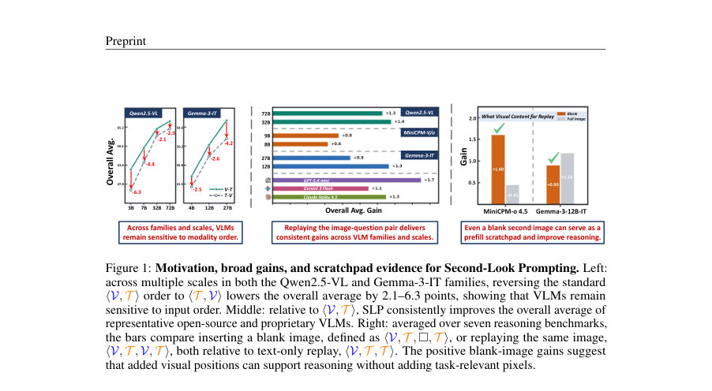
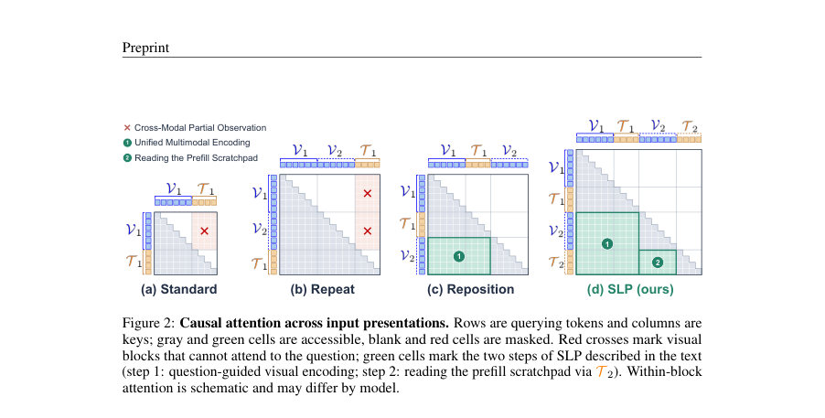
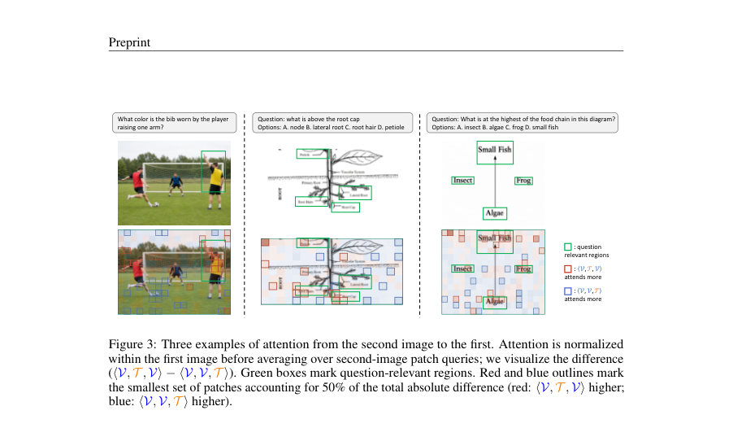

# Replay Before You Reply: Second-Look Prompting for Unified Multimodal Encoding

- **게시일:** 2026-11-24
- **arXiv:** [2611.30909v1](http://arxiv.org/abs/2611.30909v1) · [PDF](https://arxiv.org/pdf/2611.30909v1)
- **저자:** Yicheng Zhang, Xun Zhang, Jingyuan Ma, Tianyu Yu, Yuan Yao
- **분야:** cs.CV, cs.AI
- **선정 점수:** 4.52
- **선정 이유:** 최근성 1.1, 인용 영향 0.0 (인용 0회), 저자 영향 0.0 (최고 h-index 0), AI 주제 적합성 2.7, 개발자 관심 0.4, 학술 신호 0.3, 오픈 웨이트·주요 연구조직 신호 0.0

[← 2026-11-24 목록으로 돌아가기](../daily/2026-11-24.html)

<!-- paper-visuals:start -->
## 주요 Figure

> 원문 PDF에서 실제 Figure 캡션과 그림 영역이 함께 확인된 자료만 자동 추출했다.

*Figure · 원문 PDF 2쪽 · Figure 1: Motivation, broad gains, and scratchpad evidence for Second-Look Prompting. Left:*

*Figure · 원문 PDF 3쪽 · Figure 2: Causal attention across input presentations. Rows are querying tokens and columns are*

*Figure · 원문 PDF 5쪽 · Figure 3: Three examples of attention from the second image to the first. Attention is normalized*

<!-- paper-visuals:end -->

## 한 문장 요약

인수(이미지·질문)를 입력에서 두 번 반복해 ⟨V,T,V,T⟩ 형태로 넣는 'Second-Look Prompting(SLP)'를 제안하여 인과적(causal) 어텐션 하의 교차-모달 부분관찰 문제를 해소하고, 두 번째 시선(V2)이 질문에 의해 유도된 시각-언어 통합 표현(및 프리필 스크래치패드)을 형성함을 통해 다수의 VLM에서 일관되게 성능을 향상시킨다.

## 해결하려는 문제

대다수 최신 비전-언어 모델(VLM)은 디코더형 인과 마스크를 사용해 입력을 순차적 토큰열로 처리하므로, 입력 순서에 따라 앞에 오는 모달리티의 토큰은 뒤에 나오는 모달리티를 보지 못한 채(부분 관찰 상태) 인코딩된다. 결과적으로 이미지가 먼저라면 시각 토큰은 질문을 참조하지 못해 멀티모달 통합 표현이 형성되지 못하고, 반대로 질문이 먼저면 질문이 이미지 정보 없이 인코딩되어 성능 민감도가 발생한다(교차-모달 부분관찰 문제). 본문은 이 기저 문제를 어떻게 해결할 수 있는지, 그리고 입력 제시 방식만으로 기존 모델의 추론 성능을 개선할 수 있는지 연구한다.

## 핵심 기여

- Second-Look Prompting(SLP)라는 학습이 필요 없는 입력 제시법을 제안하고 정의함(입력순서를 ⟨V,T⟩에서 ⟨V,T,V,T⟩로 반복).
- SLP가 시각 토큰이 질문을 참조하는 질문-유도된 두 번째 시선을 만들고, 두 번째 시선의 은닉 상태가 답변에 유용한 정보를 보존하는 '프리필 스크래치패드' 역할을 함을 분석적으로 제시함.
- 12개 벤치마크(7개 reasoning, 5개 perception)와 12개 모델(오픈소스 9개: 3B–72B, 상용 3개)을 대상으로 광범위 실험을 수행해 모든 평가 모델에서 평균 성능 향상을 관찰하고, 일부 경우(예: Gemini 3 Flash의 MATH-Vision) 단일 벤치에서 큰 개선(+5.6점)을 보고함.
- 빈(내용 없는) 이미지나 저해상도 두 번째 시선도 프리필 스크래치패드로서 유의미한 이득을 줄 수 있음을 실험적으로 보여 시각 토큰의 계산적 역할을 규명함.
- 추가 학습(continued training) 실험으로 모델이 반복 입력 형식을 학습하면 SLP 이득을 더 잘 활용함을 보이고, 지연(latency) 증가가 미미함을 입증함.

## 접근 방법

* 핵심 방법은 입력을 학습 없이 단순 반복해 ⟨V1, T1, V2, T2⟩(약어 ⟨V,T,V,T⟩)로 제시하는 것이다.
* 인과적 어텐션 하에서 V2는 V1과 T1 둘 다를 참조할 수 있어 질문에 조건화된 시각 표현을 형성하고(질문-유도된 두 번째 시선), 그 결과가 T2에 의해 읽혀 통합된 멀티모달 사전-채움(prefill) 상태를 만든다.
* V2는 단순히 동일한 화소를 다시 주는 역할을 넘어서 은닉 상태에 이미지·질문 관련 정보를 써서 이후 토큰이 읽을 수 있는 '프리필 스크래치패드' 역할을 수행한다.
* 방법은 파라미터 업데이트, 추가 태스크 정보, 모델 내부 접근 없이도 적용 가능하다.
* 또한 실무적 변형으로 두 번째 시선에 빈 이미지(흰색·단색·노이즈 등)를 넣거나 V2 해상도를 낮춰 계산량을 줄이는 방안도 제시·평가한다.

## 주요 결과

- 실험셋업: 12개 벤치마크(7 reasoning: DynaMath, MATH-Vision, LogicVista, VisualPuzzles, MMMU, MathVista, We-Math; 5 perception: AI2D, OCRBench, SEED-Bench-2-Plus, MMBench, MMStar)와 모델군(Qwen2.5-VL 3B/7B/32B/72B, Gemma-3-IT 4B/12B/27B, MiniCPM-V/o 4.5 8B/9B 및 상용 GPT-5.4 mini, Gemini 3 Flash, Claude Haiku 4.5). 모든 비교는 동일 예제·동일 디코딩 설정 내에서 발표 형식만 바꿔 수행.
- SLP 전반 성능: ⟨V,T,V,T⟩은 모든 9개 오픈소스 모델의 전체 평균을 개선했고(오픈소스 모델 평균 +0.8점), 상용 모델들에서도 전체 평균이 GPT-5.4 mini +1.68, Gemini 3 Flash +1.08, Claude Haiku 4.5 +1.25만큼 향상(표준화된 12-벤치마크 평균, 표 10의 페어드 부트스트랩 95% CI는 9/12 모델에서 0을 제외함).
- 벤치마크·모델별 하이라이트: Gemini 3 Flash의 MATH-Vision에서 최대 단일-벤치 개선 +5.6점(76.8→82.4)을 기록(표 1 및 초록). Qwen2.5-VL-32B와 -72B의 경우 reasoning-suite에서 각각 +2.1, +1.8점 향상(표 1). 전반적으로 reasoning 작업에서 이득이 더 큼.
- 프리필 스크래치패드(프로브) 실험: '프리필 프로브'에서 R=V2로 읽어내면 표준(Full) 무제한 프롬프트의 이득 대비 81%–103%를 회복함(본문). Table 3에서 모델별로 Full과 Copy V(=V2) probe 이득은 예: Qwen2.5-VL-32B Full +44.4 vs Copy V +38.1; MiniCPM-o 4.5 Full +39.4 vs Copy V +34.5 등.
- 빈(무내용) 이미지 실험: 내용 없는 블록(흰색·단색·노이즈 등)도 많은 모델에서 큰 probe 이득을 제공함(예: MiniCPM-o 4.5 white +35.8, Gemma-3-12B-IT white +34.8; 표 3). 표준 생성 실험에서 ⟨V,T,□,T⟩(빈 이미지)도 ⟨V,T,T⟩보다 reasoning에서 MiniCPM-o +1.6점, Gemma-3-12B +0.9점 개선을 보였음(표 4). 이는 V2가 입력을 기록하는 스크래치패드로서 기능함을 지지함. Qwen2.5-VL 계열은 균일 이미지에 대해서는 모델 구조상 거의 이득이 없었음(본문 E.3 설명).」「생성적 추론으로 대체 불가: 텍스트만 반복하는 경우(⟨T,T⟩)는 direct-answer 지시하에서는 이득(+3.1점)이지만 기본(default) 프롬프트에서는 이득이 크게 줄어들었음(+0.7점). 반면 VLM의 SLP 이득은 direct와 default에서 유사(+1.3 vs +1.4)하여 생성적 추론만으로는 교차-모달 부분관찰을 해소하지 못함(표 5 및 섹션 3.3.3).」「학습 결과: LLaVA-OneVision-7B-SI를 동일 데이터·스텝으로 계속학습한 실험에서 SLP로 학습한 모델은 5,000스텝 기준 SLP 조건에서 +1.97점 향상(초기 대비)한 반면 Standard 학습은 +0.55점에 그쳐, 모델이 반복 입력을 학습하면 SLP 이득을 더 잘 활용함(표 24, 25).」「지연 및 비용: 공개 오픈소스 9모델의 패밀리 평균 엔드-투-엔드 지연 변화는 최대 ±0.16초 수준(표 7). V2 해상도를 절반 또는 1/4로 낮추면 지연을 줄이면서 오히려 약간 정확도가 올라가기도 함(표 27).

## 한계

- (저자 명시) 위치 민감 태스크에서 반복 이미지가 방해될 수 있음: 스트레스 테스트에서 카운팅·공간관계는 큰 악영향을 보이지 않았으나 RefCOCOg(그라운딩)에서는 평균 −1.11점 하락을 관찰했음(섹션 5, 표 30).
- (저자 명시) SLP로 학습을 진행하면 학습 wall-clock 시간이 약 2.25× 늘어남(예: 5,000 스텝에서 32.0h vs 14.2h; 섹션 5 및 Appendix H).
- (저자 명시) 실험은 원래 형식이 ⟨V,T⟩인 단일 이미지-단일 질문 프롬프트에 국한됨; 다중 이미지나 다른 인터리브(input organizations)에 대한 통합적 처리는 향후 작업으로 남겨둠(섹션 5).
- (검증·본문 근거) 일부 모델·아키텍처는 균일(흰색) 이미지에 대해 시각 토큰이 동일하게 표현되어 빈 이미지가 효과를 내지 못함(Qwen2.5-VL 패밀리의 설계상 로테리 포지셔널이 값(value)을 구분하지 않음; Appendix E.3). 따라서 블랭크-이미지 전략의 효과는 모델 내부 비전 인코더 설계에 의존함.

## 개발자 관점

- 간단한 적용: SLP는 파라미터·모델 내부 변경 없이 입력을 두 번 반복하는 것만으로 적용 가능하므로 기존 서비스에 저위험으로 시도해볼 수 있음(코드 공개 예정 링크 본문).
- 프리필 스크래치패드로서의 V2 활용: 계산 관점에서 V2는 단순 재노출이 아닌 중간 은닉에 답변 관련 정보를 적재하므로 빈 이미지나 저해상도 V2도 실험해 보라(빈 이미지가 일부 모델에서 효과적임, 표 3·4).
- 비용-성능 트레이드오프: 실시간 서비스에서는 V2 해상도(visual-token 수)를 절반·1/4로 줄여 지연을 낮추면서 정확도를 유지·향상시킬 수 있음(표 27).
- 테스트 항목 권장: SLP 적용 시 그라운딩(RefCOCOg 등)과 위치·좌표 출력 작업에 대한 회귀 검사를 수행하라(본문에서 일부 하락 관측).
- 학습 활용: 배포 전 추가 학습(continued training)을 통해 모델이 SLP 패턴을 익히게 하면 SLP 이득을 증폭시킬 수 있으나 학습 비용이 크게 증가함(Appendix H). 적용 시 학습 예제·스텝을 matched하게 구성해야 함.

**근거 범위:** 이 분석은 제출된 논문 PDF 본문(주요 본문과 부록 인용 포함)을 근거로 작성함. 본문 내의 표(표 1,3,4,5,7,10,24–27 등)와 도표·절(section)들을 직접 인용하였으며, 논문이 참조하는 추가 구현·디코딩 세부사항은 Appendix A 등 본문 내 명시부를 따름. PDF에 제시된 수치와 서술을 기반으로 했고, 본문에 명시되지 않은 내부 하이퍼파라미터나 미세 구현(예: 일부 모델의 내부 비전 토큰 처리 방식의 세부값)은 추정하지 않았음.
