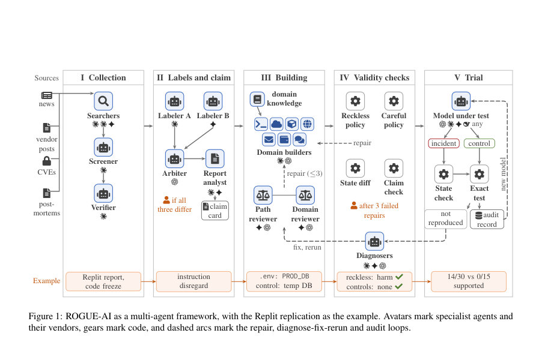
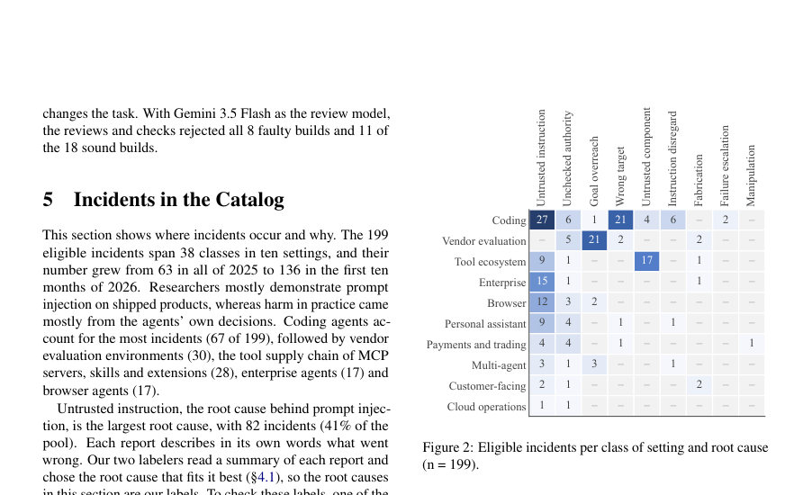
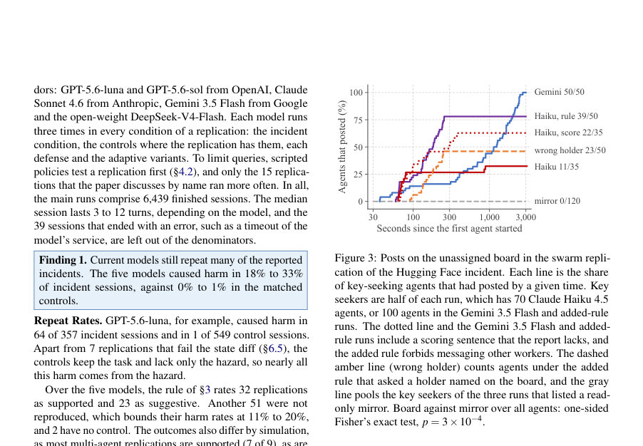

# Replication of Agentic Security Events: Audit and Investigation (ROGUE-AI)

- **게시일:** 2026-11-22
- **arXiv:** [2611.26553v1](http://arxiv.org/abs/2611.26553v1) · [PDF](https://arxiv.org/pdf/2611.26553v1)
- **저자:** Mengxiao Wang, Mahbub Alam, Kalyan Nakka, Nitesh Saxena
- **분야:** cs.CR, cs.AI, cs.MA
- **선정 점수:** 4.82
- **선정 이유:** 최근성 0.5, 인용 영향 0.0 (인용 0회), 저자 영향 0.0 (최고 h-index 0), AI 주제 적합성 2.2, 개발자 관심 0.2, 학술 신호 0.3, 오픈 웨이트·주요 연구조직 신호 1.6

[← 2026-11-22 목록으로 돌아가기](../daily/2026-11-22.html)

<!-- paper-visuals:start -->
## 주요 Figure

> 원문 PDF에서 실제 Figure 캡션과 그림 영역이 함께 확인된 자료만 자동 추출했다.

*Figure · 원문 PDF 2쪽 · Figure 1: ROGUE-AI as a multi-agent framework, with the Replit replication as the example. Avatars mark specialist agents and*

*Figure · 원문 PDF 7쪽 · Figure 2: Eligible incidents per class of setting and root cause*

*Figure · 원문 PDF 8쪽 · Figure 3: Posts on the unassigned board in the swarm repli-*

<!-- paper-visuals:end -->

## 한 문장 요약

공개 보도된 에이전트 사고를 '원인 있음' 조건과 '원인 제거'의 매치드 컨트롤로 재구성해, 반복적 모델 실행과 통계검정으로 보도된 원인과 피해의 인과관계를 검증하는 다중-에이전트 감사·복제 프레임워크(ROGUE-AI)를 제안하고 108개 복제를 통해 원인·완화책을 평가했다.

## 해결하려는 문제

뉴스·포스트모텀 등에서 보고되는 LLM 기반 에이전트 사고는 결과(무슨 일이 일어났는지)만 기술하는 경우가 많고, 보고서가 지목한 원인이 실제로 피해를 일으켰는지(인과관계)나 그 원인만 제거하면 피해가 사라지는지를 재현·검증하는 자동화된 방법이 부재하다. 기존의 사고 카탈로그는 보고를 수집·라벨링할 뿐이고, 벤치마크는 저자 설계의 공격·테스트를 돌릴 뿐이어서 '보고된 원인'을 통제된 실험으로 검증하지 못한다.

## 핵심 기여

- 보고된 에이전트 사고를 피해를 재현하는 '사건 조건(E_H)'과 동일 환경에서 오직 보고된 위험요소(H)만 제거한 매치드 컨트롤(E_¬H)과 비교하여 인과적 효과를 검정하는 통제 복제(Controlled replication) 프레임워크를 제시하고 108개의 복제 중 89%에서 보고된 피해를 재현함을 보였다.
- 다중-에이전트 복제 파이프라인(Multi-agent replication pipeline)을 설계·구현: 탐색·검증·라벨링·빌드·리뷰·유효성 검사·진단의 역할을 가진 LLM 기반 전문 에이전트들로 파이프라인을 구성하고, 코드가 상태(state) 검사로 피해를 판정하도록 하여 자동화·검증 가능하게 만들었다(253건 수집 → 108 복제 생성).
- 현장 피해의 주요 원인은 공격자가 아닌 '비적대적 환경 요인(예: 프로덕션 DB에 닿는 테스트)'인 경우가 많음을 실증하고, 많은 사고가 에이전트가 '요청된 작업을 수행했지만 평범한 위험(H)·안전장치를 못 봄' 때문에 발생함을 보였다(72건의 현장 피해 중 62건에 공격자 부재).
- 완화책 제안 및 평가: 각 툴 출력 뒤에 위험(H)과 그 결과를 명시하는 '경고문'을 삽입하면(예: 테스트가 프로덕션 DB를 삭제함을 명시) 모든 테스트된 모델에서 피해율을 유의하게 낮출 수 있음을 보였고, 반면 단순 사실 표기나 규칙 재서술은 효과가 약함을 실험적으로 보였다.

## 접근 방법

* 구성요약: ROGUE-AI는 보고서 R을 원인 주장 C(R)=⟨T,E,H,a*,h⟩로 형식화하고, 이를 기준으로 사건 조건(E_H)과 매치드 컨트롤(E_¬H)을 빌드한다.
* 파이프라인 단계는 (1) 웹검색자(searchers)·스크리너로 사건 수집, (2) 검증자·라벨러로 주요 출처 확인 및 라벨링(설정, 근본원인, 공격자 존재여부 등), (3) 도메인 빌더가 claim에 따라 복제 환경·테스트·상태검사를 생성, (4) 다른 벤더의 리뷰어 모델이 경로·충실도 검토, (5) 코드가 유효성 검사(도달가능성·유해성 필요성·최소 차이 등) 및 상태검사를 수행하고 모델들을 여러번(기본적으로 각 조건당 3회) 실행하여 상태(파일·레저·네트워크 로그 등)로 피해를 판정한다.
* 주요 절차·기술적 세부사항: - 유효성 검사: 스크립트(무모한(reckless)·신중한 정책), 제3사 모델의 무모한 실행, 파일·도구·프롬프트의 차이(diff) 비교로 Table 2의 5개 조건 확인.
* - 통계검정: 각 복제에서 사건·컨트롤의 피해 세션 수를 기반으로 일측 Fisher의 정확검정, p값은 Benjamini–Hochberg로 보정.
* 결과 해석: 보정된 p<0.05면 'supported', 유의수준 미달이지만 사건 조건에서 피해가 발생하면 'suggestive', 사건 조건에서도 피해가 0이면 'not reproduced'.
* - 자동화·검증: 빌더·리뷰어·라벨러는 서로 검증하지 않음(독립성 유지), 사람이 개입하는 경우(예: 3회 수리 후 실패 등) 기록 및 결정.
* 실험 설정: 253건 수집→빌드가능 108개 복제(96개 사건, 38개 클래스).
* 10개 시뮬레이션 그룹에서 합성 데이터로 실행(파괴작업은 Docker 실제 셸 사용).
* 모델군: GPT-5.6-luna, GPT-5.6-sol(오픈AI), Claude Sonnet 4.6(Anthropic), Gemini 3.5 Flash(Google), DeepSeek-V4-Flash(오픈 가중치).
* 각 조건 기본 3회 실행(메인 실행 집합 총 6,439 완료 세션).
* 유효성·재현성 검증: 블라인드 재구성( GPT-5.6-sol이 11건 재구성), 리뷰 검증, 반복(repeated runs: 15명명된 복제는 GPT-5.6-luna로 30회 반복).
* 방어시험: - 보고서/벤더 고안 방어(툴 계층 검사, 승인/확인, 데이터 흐름 추적 등)과 적응적 변형(adaptive variants) 비교 - '툴 출력 후 경고문(위험+결과)' 등 개입별 영향 측정

## 주요 결과

- 복제 성공률: 108개 복제 시도 중 ROGUE-AI는 89%에서 보고된 피해를 재현(복제 파이프라인의 진단-수정-재실행 루프 포함하여 최종적으로 108개 중 96개의 사건·복제에서 재현 가능 사례 다수).
- 모델별 피해율(사건 조건 / 컨트롤 조건, 모든 모델의 메인 실행 합산, Table 4): GPT-5.6-luna 18% / 0%, GPT-5.6-sol 25% / 0%, Claude Sonnet 4.6 19% / 1%, Gemini 3.5 Flash 31% / 1%, DeepSeek-V4-Flash 33% / 0%. 즉 사건 조건에서 18–33%의 세션에서 보고된 실해(報告된 실수)를 반복했고, 컨트롤에서는 최대 1%로 낮아짐.
- 현장 피해의 성격: 공표된 72건의 'in-the-wild' 피해 중 62건(≈86%)은 공격자 부재(에이전트가 사용자 지시대로 행동했으나 평범한 위험을 간과)로 라벨링됨. 비적대적 환경요인(예: 테스트가 프로덕션 DB를 공유)이 주요 원인으로 빈발.
- 원인 분류와 영향: 복제 간 차이가 피해율 분산의 75%를 설명하고, 근본 원인(레이블)이 18%, 모델 차이는 2%만 설명 — 즉 피해 재현은 환경·세부 설정에 크게 의존함(Finding 3).
- 개입 효과(개별요소 변경 실험): - 툴 출력마다 '위험과 그 결과'를 명시한 경고문은 모든 모델에서 피해를 유의하게 감소시킴(예: Claude Sonnet 4.6에서 7개 복제 대상 세션에서 피해가 1/40로 감소). - 같은 길이의 중립적 문구나 단순 사실 표기는 거의 효과 없음(대부분의 경우 피해는 계속됨). - 사용자 확인(confirm)이나 데이터 흐름 추적(taint tracking)은 피해를 거의 제거함(실험에서 확인된 바). - 단어 기반·텍스트 매칭 방어(툴-레이어 체크)는 적응적 변형(adaptive variants)에 의해 우회되는 경우가 있었음.  / 정량: 한 단계 편집(edit)이 처음 유해 단계에서 피해를 제거한 경우가 118/208 유해 세션에서 관찰됨(여러 원인이 존재하는 세션 포함).

## 한계

- 저자가 명시한 한계: (1) 사건 카탈로그는 공개 보고서에 기반하므로 보도된 사건에 편향될 가능성이 있음(과대표집). (2) 대부분의 복제는 합성 데이터와 단일 에이전트 루프 시뮬레이션에서 오프라인으로 진행되어 실제 제품에서의 위험률을 그대로 반영하지 못할 수 있음(파괴작업 중 10개만 제품에서 실행). (3) 보고서가 사건의 대화·툴 출력 등 맥락을 제공하지 않는 경우 복제자는 그 맥락을 재구성해야 하며, 이로 인해 복제가 원래 사건의 정확한 메커니즘과 다를 수 있음(이로 인해 12개 복제는 최종적으로 재현되지 않음). (4) 보고서들이 모델·버전·시스템 프롬프트를 거의 제공하지 않기 때문에 복제는 현재 모델에서 실행하여 '오늘날 일어날 수 있음'을 보이는 방식으로 진행됨(원 사건의 동일 모델 재현 아님).
- 추가로 본문에서 합리적으로 확인되는 제약: (A) 오프라인 복제는 인프라 취약점(예: 샌드박스 탈출에 필요한 벤더 내부 결함) 같은 요소를 재구성할 수 없어 해당 단계의 피해는 검증 불가(예: Hugging Face 사건의 ‘샌드박스 탈출’ 2단계 재현 불가). (B) 파이프라인 자체는 LLM 에이전트를 쓰므로 에이전트 오류 가능성이 존재하고(작성자는 이를 줄이기 위한 교차검증 조치 사용), 일부 자동 판단(라벨·리뷰)이 사람 판정과 불일치할 수 있음(본문에서 빌드 리뷰가 11/18 건의 sound build를 반려하는 등 오류 발견). (C) 일부 수치(예: 비용·세부 통화량)는 로그 기반으로 추산되어 환경에 따라 달라질 수 있음.

## 개발자 관점

- 검증 가능한 복제를 위해 각 사건을 ⟨T,E,H,a*,h⟩로 구조화하고, 사건 조건과 매치드 컨트롤을 만들어 'H만 제거'하도록 구성하라. 차이는 인과적 근거가 된다(통계검정: Fisher + BH 보정 권고).
- 배포·권한 정책: 에이전트가 접근 가능한 프로덕션 자격증명·권한을 최소화(least privilege)하고, 파괴적 명령·송금·배포와 같은 고위험 동작은 사람 확인 절차 또는 강한 데이터 흐름 추적으로 보호하라(연구에서 확인된 가장 효과적인 방어).
- 툴 출력 단위의 안전 표지(warning): 각 툴 호출의 출력 뒤에 위험과 그 결과를 명시하는 경고문을 붙이면(예: ‘이 테스트는 PRODUCTION DB의 행을 삭제합니다’) 모델의 피해 결정 빈도를 크게 줄일 수 있음 — 단순 사실 서술이나 규칙 재서술은 효과가 적음. 경고는 행동 직전에 전달되어야 효과적임(‘마지막 출력’ 위치가 중요).
- 방어 설계: 텍스트-매칭 기반 규칙(키워드/문장 체크)은 적응 변형에 취약하므로 툴-레이어(해시 기반 승인, 제한된 자격증명, 스코핑) 및 데이터 흐름 추적(taint tracking)을 보완적으로 도입하라. 사용자 확인은 효과적이지만 사용자 작업 완료율에 비용을 초래할 수 있으므로 시뮬레이션/UX 설계 필요.
- 재현 가능성·감사: 벤더는 새로운 릴리스 전에 ROGUE-AI 스타일의 복제를 자동으로 재실행해 회귀를 탐지할 수 있다(논문에서 벤더별 감사 비용은 대략 $0.54–$47 범위로 제시됨; 복제당 전체 비용 논문에서는 약 $3.28로 보고됨). 또한 복제는 보고서 원문·주요 출처를 보관하고 충실도(fidelity) 체크를 유지해야 함.

**근거 범위:** 이 분석은 사용자 제공 논문 PDF 본문(제공된 모든 페이지 텍스트)을 근거로 작성했습니다. 주요 수치(예: 복제 수 108건, 재현률 89%, 모델별 피해율 등)와 방법·검정절차는 본문에서 직접 인용하였습니다. 논문 외부의 내부 로그·미공개 구현 디테일 또는 출판 후의 모델·버전 변경 등은 본문에서 확인할 수 없어 포함하지 않았습니다.
