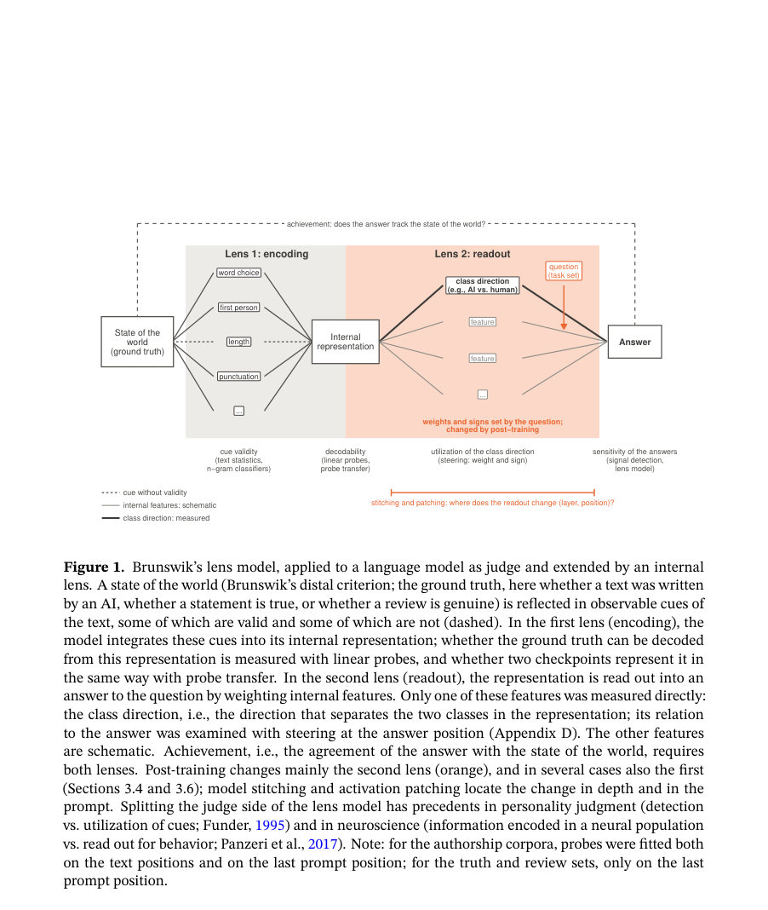
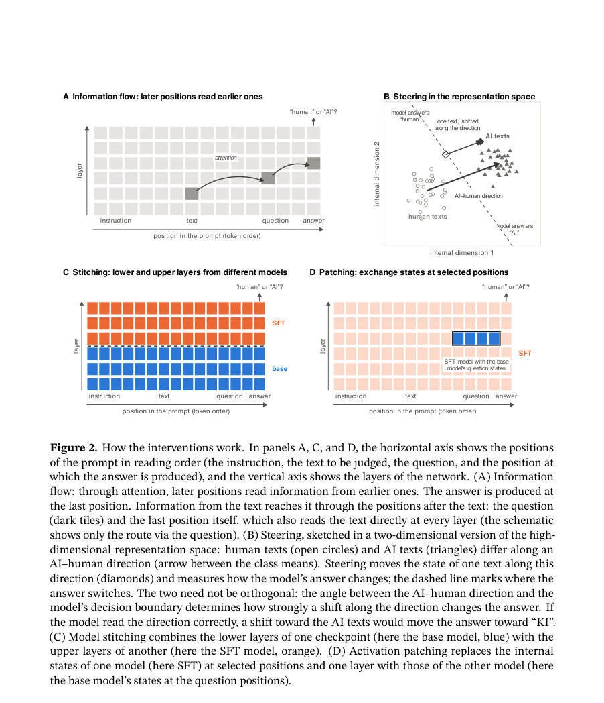
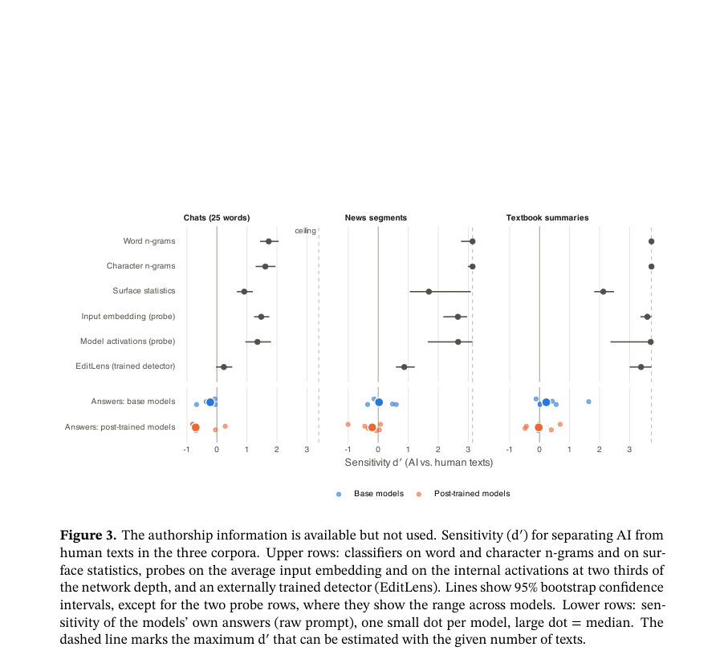

# Represented but misread: Post-training changes how language models read out what they represent

- **게시일:** 2026-11-22
- **arXiv:** [2611.26584v1](http://arxiv.org/abs/2611.26584v1) · [PDF](https://arxiv.org/pdf/2611.26584v1)
- **저자:** Jochen Laubrock
- **분야:** cs.CL, cs.LG
- **선정 점수:** 4.47
- **선정 이유:** 최근성 0.5, 인용 영향 0.0 (인용 0회), 저자 영향 0.0 (최고 h-index 0), AI 주제 적합성 1.5, 개발자 관심 0.0, 학술 신호 0.3, 오픈 웨이트·주요 연구조직 신호 2.2

[← 2026-11-22 목록으로 돌아가기](../daily/2026-11-22.html)

<!-- paper-visuals:start -->
## 주요 Figure

> 원문 PDF에서 실제 Figure 캡션과 그림 영역이 함께 확인된 자료만 자동 추출했다.

*Figure · 원문 PDF 4쪽 · Figure 1. Brunswik’s lens model, applied to a language model as judge and extended by an internal*

*Figure · 원문 PDF 5쪽 · Figure 2. How the interventions work. In panels A, C, and D, the horizontal axis shows the positions*

*Figure · 원문 PDF 18쪽 · Figure 3. The authorship information is available but not used. Sensitivity (d′) for separating AI from*

<!-- paper-visuals:end -->

## 한 문장 요약

저자는 여러 오픈 가중치 언어모델의 사후학습(post-training)이 입력 텍스트에 대한 정보의 내부 표현은 그대로 둔 채(또는 소폭 변경) 그 표현을 답변으로 읽어내는 방식(readout)을 바꿀 수 있음을, 선형 probe, 신호탐지 이론, 모델 스티칭/패칭 등으로 규명한다.

## 해결하려는 문제

사후학습(예: SFT, DPO 등)이 언어모델에 새로운 지식을 추가하는지, 아니면 이미 표현된 정보를 단지 답변 형태로 표현하는 방식만 바꾸는지(즉, 표현(encoding)과 판별(readout)의 차이)를 규명하는 문제. 기존 연구는 부분적 증거(프롬프트·예시로 동작 복제 등)를 보였으나, '정답이 알려진 판단'(authorship, truth)에서 표현의 존재 여부와 답변의 이용 방식을 분리해 단계별로(체크포인트별) 어디에서 어떻게 바뀌는지 정밀하게 밝히는 연구가 부족했다.

## 핵심 기여

- 저자·공개 데이터 기반의 두 가지 판단(비공개 독일어 저자판단 코퍼스 3종과 공개된 참/거짓 문장 셋)을 대상으로, 선형 probe와 모델의 직접 답변을 신호탐지 이론(AUC→d′, 기준 c)으로 비교해 '표현은 있으나 답변이 다르게 읽는다'는 현상을 체계적으로 보고함.
- 여섯 개의 오픈 가중치 베이스 모델과 각 모델의 사후학습(checkpoint 단계 포함)을 비교하여, 사후학습이 답변의 민감도(d′)를 평균적으로 낮춘다는 정량적 결과(평균 Δd′ 등)를 제시함.
- 체크포인트 간 모델 스티칭(stitching)과 활성화 패칭(activation patching)을 결합해, 판별(readout) 변경이 주로 어느 깊이(layer)와 프롬프트 위치(텍스트 토큰 vs. 질문·답변 위치)에 의해 전달되는지 규명함. 여러 경우에서 변화는 SFT 단계에서 발생했고, 초기(early) 레이어 가중치와 질문/답변 이후(position-after-text) 상태가 주요 매개였음.
- 사후학습이 반대 방향으로 작용한 사례(부정문에서의 진리 판단): 선형 probe는 거의 천장(ceiling)에서 진리 정보를 디코딩했지만 베이스 모델의 답변이 이를 사용하지 못한 경우가 있었고, 사후학습이 답변을 '수리(repair)'하여 성능을 올린 사례를 제시함.
- 작은 수(2,000개)의 정확 라벨링 예시를 추가한 훈련 실험에서 읽어내는 방향(readout direction)이 소량의 훈련 신호로 쉽게 정해질 수 있음을 보임(뉴스·교과서 코퍼스에서 개선, 채팅 코퍼스에서는 반전 등).

## 접근 방법

* 저자는 다음 절차로 실험·분석을 수행함: (1) 자료: 세 종류의 비공개 독일어 저자판단 코퍼스(학생 채팅, 지역신문 분절, 교과서 요약)와 공개된 진리 판정 문장셋(참·거짓, 부정 포함), 검증용 리뷰 데이터 등을 사용.
* (2) 모델: Gemma 3(4B/12B), Qwen3(8B), OLMo2/3(7B 계열), Apertus(1.5 8B) 등 6개 베이스와 각 최종(post-trained) 체크포인트 및 일부 중간 단계(SFT, DPO, RL 등)를 비교.
* (3) 판정 수집: 프롬프트로 '이 텍스트는 인간/AI 중 어느 쪽?' 또는 '이 문장은 참인가?' 등을 묻고, 모델의 다음 단어 확률에서 두 정답(예: 'KI' vs 'Mensch')의 로그확률 차이 dv = log P(KI) − log P(Mensch)를 의사결정 연속변수로 사용(답변 순서 반전으로 위치효과 제거).
* (4) 평가지표: ROC→AUC를 d′로 치환해 민감도 측정, 기준(c)로 응답 바이어스 측정.
* (5) 표현 가시화: 각 레이어·위치의 residual stream에서 선형 표준화+PCA+L2-정규화 로지스틱 회귀(선형 probe)를 10-fold 그룹 교차검증으로 학습해 d′ 측정.
* (6) 기저선: 문자/단어 n-gram TF-IDF, 표면 통계, 평균 입력임베딩, 외부 검출기(EditLens)와 비교.
* (7) 간섭·인과분석: (a) Steering — 마지막 토큰 위치의 residual에 클래스 평균 차이 방향을 더하고 답변 변화를 측정; (b) Model stitching — 한 체크포인트의 낮은 레이어와 다른 체크포인트의 높은 레이어 결합으로 깊이별 변화 위치 탐지; (c) Activation patching — 특정 레이어에서 기부자(donor)의 residual을 질문/텍스트/답변 위치별로 교체하여 변화 전달 위치 판단.
* (8) 소수샷 실험: 2, 8, 16개의 레이블 예시를 맥락에 포함하여 성능 변화를 측정.
* 통계적 추정은 그룹화된 부트스트랩(소스 그룹 단위)을 사용하고, 다중비교 보정(Holm, BH)을 적용.

## 주요 결과

- 전반 결과 요약: 선형 probe는 대부분의 경우 텍스트에서 저자(또는 진리) 정보를 잘 디코딩했으나 모델의 직접 답변은 이를 충분히 사용하지 않았고, 사후학습은 평균적으로 답변의 민감도를 낮춤. 논문 본문에서 보고한 평균값은 '모델 계열 평균 Δd′ = −0.34'와 '세 프롬프트 평균 Δd′ = −0.29'임.
- 저자판단(세 코퍼스) 특성: probe는 텍스트 또는 마지막 위치에서 높은 d′를 보였고(예: 여러 체크포인트에서 probe d′는 텍스트 분류에 대해 높게 나타남), 단순한 단어 n-gram 분류기도 계급을 잘 분리한 반면 모델 답변의 d′은 낮거나 심지어 음수(역순)인 경우가 빈번했음(특히 일부 모델·코퍼스 조합에서 답변이 텍스트를 역으로 주문함).
- 개별 유의미한 d′ 감소(교과서 요약에서 특히 두드러짐): Holm 보정 내에서 유의한 감소를 보인 비교는 Gemma 3 12B Δd′ = −0.95, Qwen3 Δd′ = −0.57, Gemma 3 4B Δd′ = −0.50, Apertus Δd′ = −0.47, OLMo 2 Δd′ = −0.32(모두 교과서 요약 기준), 그리고 Qwen3의 신문 세그먼트 Δd′ = −0.65 등(본문의 Table·G 섹션). 다만 효과는 모델·텍스트 유형마다 다르게 나타나며 항상 동일한 방향은 아님.
- 기저율(base rate) 사용 변화: 베이스 모델들은 제시된 사전확률(예: AI 20%→80%)에 대해 로그오즈를 이상적 관찰자만큼 이동시키지 않았으나, 대부분의 사후학습 모델은 더 크게 이동하는 경향을 보였음(예: 본문 Table F에선 일부 최종 모델이 ln-오즈 변화(2.77 nats)에 비해 2~4배 이상의 평균 shift를 보인 케이스가 보고됨; Gemma 3 12B final shift ≈ 10.93 nats → 비율 ≈ 3.94 등).
- 위치·단계별 전달(스티칭·패칭 결과): OLMo 2와 Apertus 같이 단계별 체크포인트가 공개된 모델에서는 변화가 주로 감독형 미세조정(SFT) 단계에서 발생했고, 모델 스티칭은 변화에 기여하는 가중치가 초기 레이어에 있음을 시사함. 활성화 패칭을 레이어별로 수행한 결과 mid-depth(중간층) 이상에서는 '텍스트 이후 위치'(질문·답변 위치)의 internal state가 체크포인트 간 변화를 전달했고, 중간층 이하에서는 텍스트 위치의 표현이 일부 기여(한 모델에서 강하게 기여)함(본문의 Figure S1·H1 등). 요약: readout 변화는 질문·답변 위치의 가중치·상태 재배치로 주로 전달됨.  

(수치 예: layer별 패칭에서 'question positions'가 전체 차이를 전달하여 recipient의 d′ 를 donor 쪽으로 상당 부분 이동시킨 사례들이 보고됨; 본문 Table H1 및 Figure 5 참조).  

## 한계

- 저자가 명시한 한계: 핵심 저자판단 코퍼스(학생 채팅, 지역신문, 교과서 요약)는 공유 불가(저작권·참여자 동의 문제)하여 재현성 측면 제약이 있음. 이를 보완하기 위해 공개된 '참/거짓 문장' 셋을 추가로 분석함.
- 저자가 명시한 한계: 일부 분석에서 결과가 결정적이지 않음(예: 속인 리뷰(deceptive reviews) 과제에서는 사후학습 효과가 작고 방향이 모델마다 달라 localization·steering 결과가 덜 설명적).
- 실험 범위에서 확인되는 제약(분석가 판단): 효과는 모델·코퍼스·프롬프트에 따라 일관되지 않아 일반화에 주의가 필요함(어떤 모델에서는 민감도 감소, 어떤 모델·과제에서는 개선 또는 무변화).
- 실험적·방법론적 제약: 선형 probe는 '디코딩 가능성'을 측정하지만 probe의 성능 자체가 모델 내부 표현의 모든 차원을 포착하지 못하거나 프리프로세싱(PCA 등) 선택에 민감할 수 있음. 또한 패칭·스티칭 실험은 체크포인트가 동일 아키텍처에서 파생된 경우에 적절하며, 다른 아키텍처·더 큰 모델에선 다른 거동이 있을 수 있음.

## 개발자 관점

- 내부 표현(probe 수준)을 점검하면 모델이 실제로 정보를 보유하는지 확인할 수 있으나, 이는 모델의 '말하는 것'과 다를 수 있으므로 배포 전 핵심 판단(task)에 대해 probe-vs-answer 검사를 권장함.
- 사후학습은 모델의 '정직성(honesty)'과 응답 민감도에 영향을 줄 수 있다. 작은 수의 정확 라벨(예: 2,000건)만으로도 readout 방향이 바뀌므로, fine-tuning/SFT 데이터의 라벨 품질과 대표성에 각별히 주의해야 함.
- 문제의 원인을 찾기 위해서는 레이어·프롬프트 위치별(텍스트 토큰 vs 질문·답변 토큰) 활성화 교체(patching)와 스티칭을 도입해 변경이 전달되는 깊이와 위치를 진단하라. 본 논문은 중간층 이상에서는 '텍스트 이후 위치'가 핵심 전달 경로임을 보고함.
- 배포·감시: 모델이 내부적으로는 정보를 갖고 있으나 답변에서 이를 반대로 쓰거나 무시하는 경우(역순 ordering)가 발생할 수 있으므로, 신뢰성 요구 환경에서는 probe 기반 모니터링·정합성 검사(answers vs probes)와 소량 라벨링을 통한 readout 보정(workflow)을 설계하라.
- 재현·운영 비용: 스티칭·패칭·레이어 스윕 등 진단 절차는 계산비용이 크며(여러 레이어·포지션에 대해 donor/recipient 실행 필요), GPU(예: V100 vs A100)·정밀도 차이에 따른 결과 차이를 확인할 필요가 있음. 운영환경 검증에 충분한 리소스를 배정하라.

**근거 범위:** 이 분석은 제공된 논문 PDF 본문 텍스트에 근거해 작성되었음. 본문 내 표·그림·부록(예: Table G, Table F, Figure 5, Supplementary 등)에 명시된 수치와 절차를 직접 인용했으며, 비공개 코퍼스의 구체적 내용(본문은 접근 불가)을 저자가 밝힌 범위 내에서만 기술함. 부가 코드·데이터(프로젝트 저장소)나 일부 세부 구현(예: 하이퍼파라미터 세부값)은 PDF에 완전 기술되어 있지 않아 본문에 명시된 정보 외의 수치는 생성하지 않았음.
