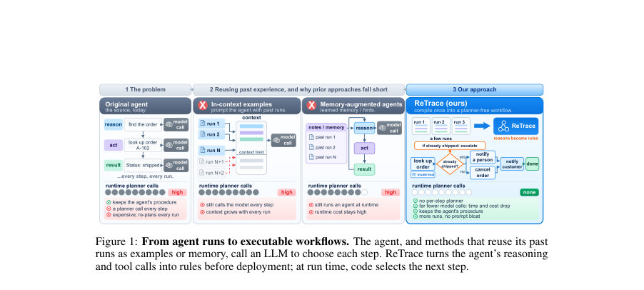
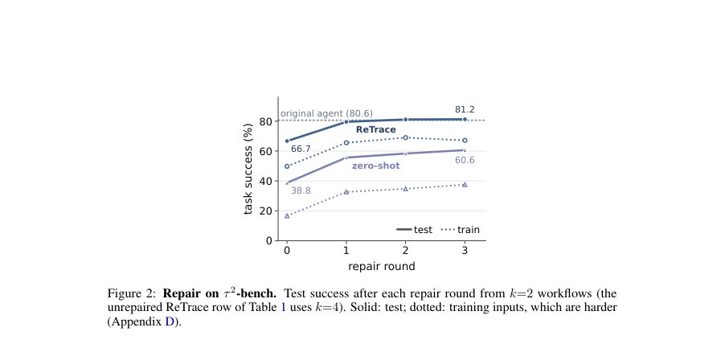
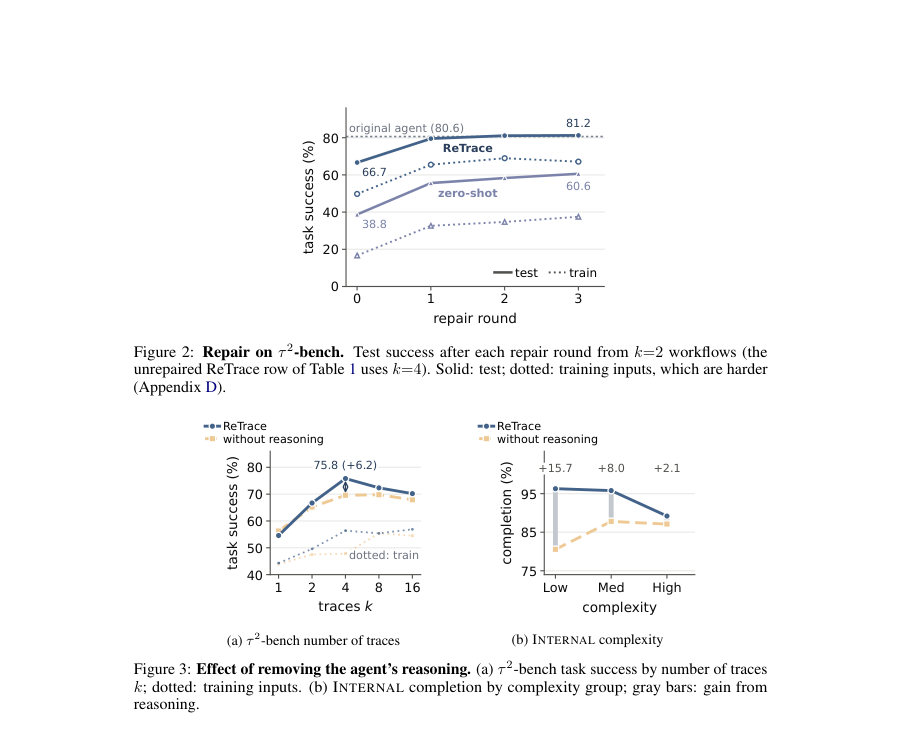

# ReTrace: Distilling Tool-Using Agents into Planner-Free Workflows

- **게시일:** 2026-11-12
- **arXiv:** [2611.14492v1](http://arxiv.org/abs/2611.14492v1) · [PDF](https://arxiv.org/pdf/2611.14492v1)
- **저자:** Kaiyuan Hou, Yang Ping Kuo, Indranil Bhattacharya, Rohith Nama, Arushi Gupta, Carlos D. Castillo, Prathap Ramachandra, Xiaofan Jiang, Francesco Carbone
- **분야:** cs.AI, cs.LG, cs.MA
- **선정 점수:** 4.84
- **선정 이유:** 최근성 0.7, 인용 영향 0.0 (인용 0회), 저자 영향 0.0 (최고 h-index 0), AI 주제 적합성 3.0, 개발자 관심 0.8, 학술 신호 0.3, 오픈 웨이트·주요 연구조직 신호 0.0

[← 2026-11-12 목록으로 돌아가기](../daily/2026-11-12.html)

<!-- paper-visuals:start -->
## 주요 Figure

> 원문 PDF에서 실제 Figure 캡션과 그림 영역이 함께 확인된 자료만 자동 추출했다.

*Figure · 원문 PDF 2쪽 · Figure 1: From agent runs to executable workflows. The agent, and methods that reuse its past*

*Figure · 원문 PDF 7쪽 · Figure 2: Repair on τ 2-bench. Test success after each repair round from k=2 workflows (the*

*Figure · 원문 PDF 7쪽 · Figure 3: Effect of removing the agent’s reasoning. (a) τ 2-bench task success by number of traces*

<!-- paper-visuals:end -->

## 한 문장 요약

에이전트가 따라 실행한 SOP와 그 실행 로그(추론 포함)를 받아, 추론에서 분리한 조건(guard)들을 규칙 문서로 병합하여 런타임에 LLM을 호출하지 않는(planner-free) 실행 가능한 워크플로우를 자동 생성하는 방법을 제시한다.

## 해결하려는 문제

비즈니스 표준 운영절차(SOP)를 LLM 에이전트가 그대로 따라 실행하면 매 실행마다 모델(플래너)을 호출하므로 대량 실행 시 지연과 비용이 크다. 기존 방식들은 과거 실행을 예시나 메모리로 재사용하거나 스킬로 추출해도 런타임에 모델이 여전히 단계 선택을 하는 경우가 많아 비용·대기시간 문제를 해결하지 못한다. 본 연구는 에이전트가 툴 호출과 함께 남기는 '추론(reasoning)'을 이용해, 어떤 조건에서 어떤 툴을 호출해야 하는지 규칙으로 회수하고 이를 플랫폼 독립적인 규칙 문서(IR)로 합쳐서 LLM 호출이 불필요한 워크플로우로 컴파일하는 것을 목표로 한다.

## 핵심 기여

- 에이전트의 단계별 '추론'과 툴 호출 기록을 결합해 각 행동의 전제 조건(guard), 행동(액션), 입력 출처를 추출하는 추출(Extraction) 방법을 제시함.
- 여러 실행(trace)을 요약·병합해 근거(citations)를 유지하는 중간 표현(IR) 형태의 규칙 문서를 구성하고, 그 문서를 대상으로 플랫폼별 코드(또는 타입화된 워크플로우 그래프)를 합성하는 파이프라인(ReTrace)을 제안함.
- IR 문서는 실행 근거를 규칙별로 연결하고 'unwitnessed'(로그에 없지만 추론이나 SOP에서 언급된 대안) 분기를 표기해 불충분한 분기를 식별하도록 설계함.
- 공개 벤치마크(τ2-bench, SOP-Bench)와 독점적 엔터프라이즈(INTERNAL) 데이터에서 규칙 기반 워크플로우가 에이전트 대비 실행 비용·지연을 크게 낮추면서(플래너 호출 제거) 성능(완료/성공률)을 대부분 근접하게 유지하는 것을 실증함.
- 워크플로우 실패를 대상으로 한 최대 3회 자동 수선(repair) 루프를 도입해 훈련 실패를 개선하고 성능을 회복시킬 수 있음을 보임.

## 접근 방법

* 입력: SOP 문서 P와 k개의 에이전트 실행 로그(trace) Tk.
* 각 trace의 단계 st는 (rt: 단계별 에이전트 추론, at: 호출한 툴, vt: 툴 입력, ot: 결과)를 기록한다.
* 출력: 런타임에 LLM을 호출하지 않는 실행 가능한 워크플로우 π(퍼블릭 벤치에서는 Python 코드, INTERNAL에서는 타입화된 그래프).
* 파이프라인은 세 단계로 구성된다.
* 1) Extraction: 각 단계별로 LLM을 호출해 zt=(gt, αt, at, vt, ωt)를 추출한다.
* 여기서 gt는 해당 액션의 관찰 가능한 전제조건(guard), αt는 의도된 행동, ωt는 각 입력의 출처(태스크 입력, 이전 결과, 상수 등)를 기록한다.
* 사례별 값은 변수화한다.
* 2) Aggregation: 각 trace를 SOP에 대조해 요약하고, 요약들을 병합하여 중간표현 IR = (χ, ⟨(g1,α1),...,(gm,αm)⟩)을 만든다.
* χ는 완료 검사(completion check), 규칙들은 순서 있는 결정 리스트(decision list)로 표현되며 각 규칙은 근거(trace step 또는 SOP 문구)와 함께 보존된다.
* 병합은 중복 통합, 입력의 값 전파 추적, 추론과 툴 기록 간 불일치 해결(불일치 시 SOP 우선 또는 제거 사유 기재)을 수행한다.
* 3) Synthesis: IR을 받아 목표 플랫폼 형식의 워크플로우 코드로 생성한다.
* 런타임 결정 로직은 χ가 참이면 중지, 아니면 순차적으로 가장 먼저 성립하는 gj을 찾아 해당 액션을 수행하도록 구현된다.
* 퍼블릭 벤치에서는 생성된 후보들을 정적·재실행 검사로 필터링(모델 호출으로 단계 선택하는 코드 차단)하고, 훈련 입력들에서 재실행하여 기록된 단계들을 가장 잘 재현하는 후보를 선택한다.
* 선택적 수선(repair)은 훈련 실패들에 대해 LLM이 코드를 수정하도록 하여 최대 3회 반복한다.
* 추가로 병합은 첫 8개 요약을 배치로 합치고 이후 증분적으로 추가하여 컨텍스트 폭주를 방지한다.

## 주요 결과

- τ2-bench(telecom 도메인, k=4 선택): ReTrace 워크플로우의 테스트 태스크 성공률 75.8% (빌드율 100%)로, 원본 에이전트 80.6%보다 약간 낮음. 실행 시간은 평균 1.3s per task로 원본 에이전트의 170s 대비 크게 단축(≈130×). ReTrace의 구성시 모델 호출은 한 번(구성 단계) 있지만 런타임에는 플래너 호출이 없음. ReTrace에 추론(reasoning)을 포함하면 k=4에서 추론 제거 대비 +6.2%p의 이득을 봄.
- τ2-bench 수선(Repair): k=2로 시작해 3회 수선 루프 적용 시 ReTrace가 테스트 성공률을 66.7%→81.2%로 향상시켜 원본 에이전트(80.6%)와 근접(구간 넓어 동등성 주장 불가). 제로-샷 수선은 38.8%→60.6%.
- SOP-Bench(8개 절차, k=16): ReTrace(무수선) 테스트 성공률 80.6%로 few-shot(83.6%)에 소폭 뒤짐. 수선 적용 시 ReTrace+repair는 87.8%로 상승(수선은 훈련 라벨을 피드백으로 사용), 원본 에이전트 85.5%. 런타임 시간: ReTrace 0.29s (무수선) / 0.40s (수선된) vs 에이전트 46.6s.
- INTERNAL(엔터프라이즈, 79 절차, k=3 traces): ReTrace 평균 완료율 93.8% (빌드 가능한 77개 절차 기준)로 원본 에이전트 96.8%보다 −3.0%p(신뢰구간 포함) 낮음. 단 비용은 절감: 평균 비용 per task $0.096로 원본의 $0.127 대비 24% 낮음. 중앙값 시간은 68s→37s(46% 감소)이나 평균 시간은 153s→163s로 증가(웹 자동화로 인한 장기 실패/재시도가 원인). 추론 포함 여부는 INTERNAL에서 완료율을 85.0%→93.8%로 +8.8%p 향상시킴.
- 추론의 효용: 에이전트가 남긴 단계별 추론은 로그에 없는 분기(UNWITNESSED branches)를 생성하여 IR에 포함시키며, τ2-bench에서 추론 제거 시 성능이 6.2%p 떨어짐. SOP-Bench의 단순 조회형 절차들에서는 추론의 이득이 작음(일부 경우 추론 제거가 소폭 유리).

## 한계

- 저자가 명시한 한계(논문 본문에서 직접 언급): ReTrace는 에이전트의 추론에 의존하므로 그 추론이 틀리거나 실제 행동 이유와 불일치할 수 있다. 생성된 코드가 로드되고 런타임에 플래너 호출을 하지 않는 것은 검증하지만, 회수된 조건들이 실제로 옳은지(조건이 액션 전에 성립하는지 등)는 보장하지 못한다. 평가 대상은 같은 절차의 새로운 입력으로 한정되며 SOP나 툴이 바뀌면 워크플로우를 재구성해야 한다. 불충분하거나 편향된(표본 편향) 트레이스는 복구 가능한 규칙의 범위를 제한한다. 엔터프라이즈의 플랫폼 보고 지표(완료율)가 실패를 완료로 표시할 수 있어 실제 성공률을 과대평가할 수 있다. 공개 평가 범위가 τ2-bench의 telecom 도메인과 SOP-Bench의 8개 도메인으로 제한된다. 집계(aggregation)는 SOP를 우선시해 트레이스와 모순되는 증거를 SOP에 따라 제거할 수 있다; 증거와 규칙 간 불일치 시 규칙을 수정하는 기능은 미래 작업으로 남아 있다.
- 추가로 본문에서 확인되는 제약(합리적 해석): 트레이스의 수와 길이에 민감하며, '풀(raw) 트레이스'를 많이 주면 생성기의 입력이 길어져 오히려 빌드율과 성능이 악화될 수 있음(τ2-bench에서 k 증가 시 성능 감소 및 빌드율 저하 관찰). 합성(생성) 단계의 모델 선택(synthesis model)이 결과에 큰 영향을 미치므로 생성 모델에 대한 검증·선택이 필요하다. 수선(repair)은 훈련 라벨을 활용할 때 성능을 크게 향상시키나, 그 피드백은 훈련 데이터에 의존하므로 실제 배포에서의 일반화는 별도 검증이 필요하다. 규칙 문서(IR)는 생성 모델에 의해 코드로 변환되므로 타입·입력 일관성 등 실행 안정성은 생성 모델 성능에 따라 달라진다.

## 개발자 관점

- 런타임 비용을 줄이려면 에이전트의 단계별 추론을 로그로 남기게 하고, 그 추론을 근거로 규칙을 추출해 한 번 컴파일된 워크플로우를 재사용하라.
- 생성(합성) 모델의 품질이 전체 성능에 큰 영향을 미치므로, 합성 단계에서 사용할 모델을 사전 검증하고 후보 코드를 재실행해 가장 기록을 잘 재현하는 것을 선택하라.
- 트레이스 설계: 긴 전체 트레이스를 많이 넣기보다 적은 수의 대표적·다양한 분기를 포함하는 트레이스를 선택하는 것이 유리하다(컨텍스트 폭주 회피). k(사용할 트레이스 수)는 교차검증으로 결정하되 비용(라이브 에이전트 실행 비용)을 고려해 소수(k≤4)를 우선 검토하라.
- 배포 전 검사: 생성된 코드는 정적 검사(파싱·허용된 라이브러리), 샌드박스 재실행(플래너 호출 차단), 훈련 입력 재실행(기록 재현도 비교) 등으로 검증하라. 생성 워크플로우가 툴 출력의 성공 여부를 올바르게 해석하는지(툴 결과 검사)를 별도로 확인하라.
- 수선(repair) 루프를 마련해 훈련 실패를 코드 수준에서 자동 수정할 수 있게 하되, 수선에 사용되는 피드백(라벨 등)의 출처와 품질을 엄격히 관리하라. 또한 규칙 문서(IR)는 플랫폼 독립적이게 설계해 최종 합성만 플랫폼별로 바꾸면 여러 오케스트레이션 시스템에 적용할 수 있도록 하라. 권한·안전: 추출된 규칙이 잘못된 행동이나 편향을 대량으로 반복할 수 있으므로 고위험 액션에는 휴먼 인-더-루프, 접근 제어, 감사(검증) 절차를 도입하라.

**근거 범위:** 분석은 제공된 논문 PDF 본문(본문 및 부록 포함)에 기초해 작성되었다. 모든 정량값(성능, 시간, 비용, k 등)은 논문의 표와 본문에서 직접 추출한 수치이다. 본문에 명시되지 않은 구현 세부사항이나 내부 플랫폼의 비공개 사항은 가정하지 않았으며, 일부 부가 추정치(예: 논문이 언급한 τ2-bench 기반의 건설 비용 추정)는 논문에 명시된 설명을 그대로 인용했음을 밝힌다.
