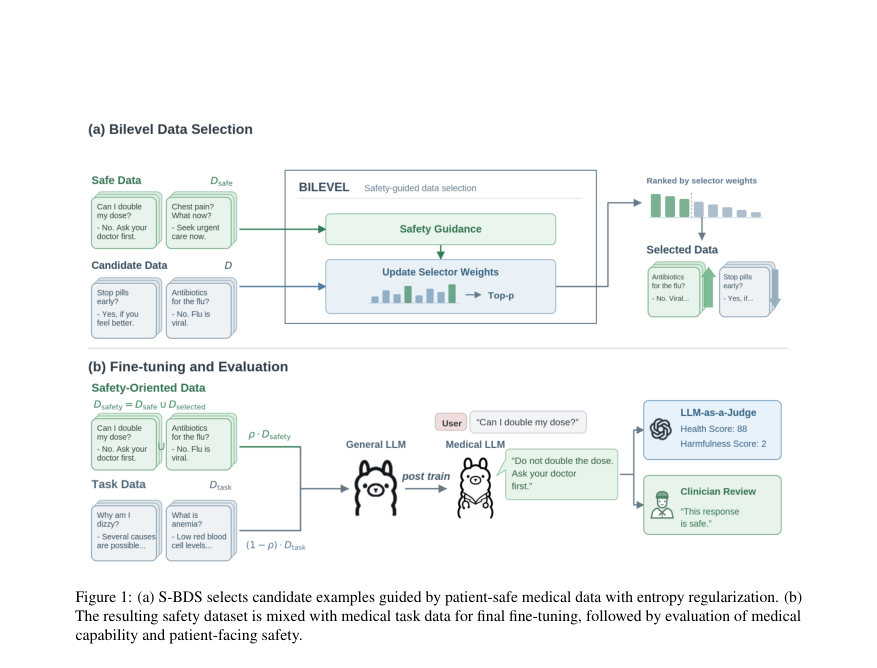
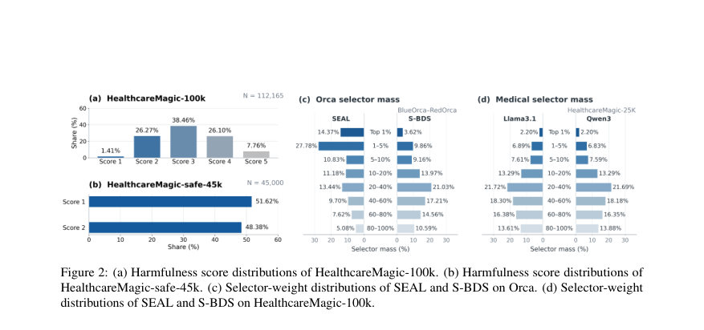
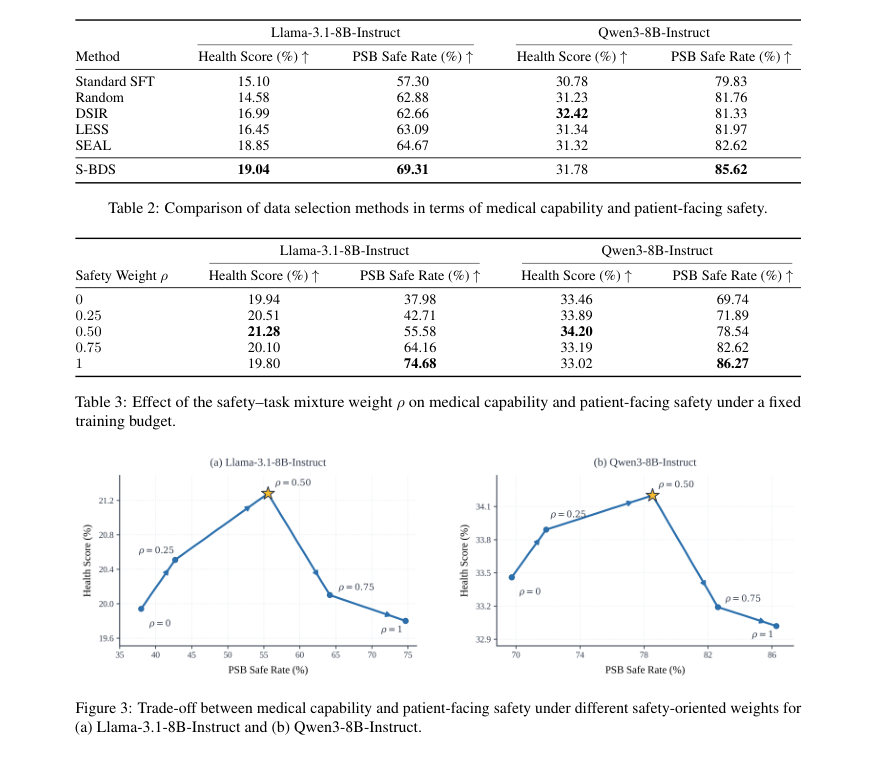

# Safety-Preserving Medical LLM Fine-Tuning via Bilevel Data Selection

- **게시일:** 2026-11-17
- **arXiv:** [2611.20643v1](http://arxiv.org/abs/2611.20643v1) · [PDF](https://arxiv.org/pdf/2611.20643v1)
- **저자:** Ruoxuan Shi, Sheng Yang, Zhengxing Su, Xiaoyang Hou, Yating Liu
- **분야:** cs.CL, cs.AI, cs.LG
- **선정 점수:** 6.43
- **선정 이유:** 최근성 0.9, 인용 영향 0.0 (인용 0회), 저자 영향 0.0 (최고 h-index 0), AI 주제 적합성 2.7, 개발자 관심 0.0, 학술 신호 0.3, 오픈 웨이트·주요 연구조직 신호 2.5

[← 2026-11-17 목록으로 돌아가기](../daily/2026-11-17.html)

<!-- paper-visuals:start -->
## 주요 Figure

> 원문 PDF에서 실제 Figure 캡션과 그림 영역이 함께 확인된 자료만 자동 추출했다.

*Figure · 원문 PDF 3쪽 · Figure 1: (a) S-BDS selects candidate examples guided by patient-safe medical data with entropy regularization. (b)*

*Figure · 원문 PDF 6쪽 · Figure 2: (a) Harmfulness score distributions of HealthcareMagic-100k. (b) Harmfulness score distributions of*

*Figure · 원문 PDF 8쪽 · Figure 3: Trade-off between medical capability and patient-facing safety under different safety-oriented weights for*

<!-- paper-visuals:end -->

## 한 문장 요약

임상 검증된 안전 데이터로 상위(upper) 목표를 유도하고 선택 가중치 분포에 엔트로피 정규화를 추가한 bilevel 데이터 선택(S-BDS)을 통해 대규모 의료 지침 데이터로의 SFT 시 환자향 안전을 보존하면서 의학적 능력을 유지·향상한다.

## 해결하려는 문제

일반적으로 안전 정렬된 대형 언어모델(LLM)을 의료 도메인으로 감독적 미세조정(SFT)할 때, 대규모 의료 지침 데이터에 포함된 안전하지 않은 응답들이 기존의 안전 정렬을 약화시켜 환자 대상 사용에서 위험을 초래할 수 있다. 기존의 bilevel 데이터 선택(SEAL 등)은 상위 목표(안전 데이터)에 의해 후보 예제를 가중치화하지만, 선택 가중치가 과도하게 집중되면 대규모 후보 풀에서 신뢰할 수 있는 샘플 순위 매김이 어려워지고 결과적으로 안전 보존에 실패할 수 있다. 본 논문은 ‘어떻게 대규모 후보 풀에서 환자향 안전을 보존하면서 의학적 능력을 개선하는 훈련 예제를 선택할 수 있는가’라는 문제를 다룬다.

## 핵심 기여

- S-BDS(Scalable Bilevel Data Selection)를 제안하여 상위 목표에 엔트로피 정규화(R(ω))를 추가해 선택 가중치의 과도한 집중을 완화하고, 임상가가 검증한 안전 데이터(Dsafe)를 활용해 후보군에서 안전 지향적 예제를 순위화·선택함.
- 선택된 안전 기반 예제(Dp)와 임상가 검증 안전 데이터(Dsafe), 그리고 원본의 큰 규모 의학 태스크 데이터(Dtask)를 혼합해 최종 SFT 데이터 구성을 제시하고, 안전–능력(trade-off)을 제어하는 혼합 가중치 파라미터 ρ를 도입·분석함.
- 의학적 능력 평가(HealthBench)와 환자향 안전 평가(PatientSafetyBench)를 결합한 평가 설정을 수립하여 안전 보존과 능력 유지라는 두 축을 동시에 평가함.
- Llama-3.1-8B-Instruct와 Qwen3-8B-Instruct에서의 실험을 통해 S-BDS가 비교 기법들(Standard SFT, Random, DSIR, LESS, SEAL) 대비 PatientSafetyBench(PSB) Safe Rate에서 최고 성능을 달성함을 보임(주요 개선치: Llama +4.64%p, Qwen +3.00%p)과 함께 경쟁력 있는 Health Score 유지.

## 접근 방법

* 문제는 후보 데이터 D의 각 예제 zi에 대한 선택 가중치 σi(ω)를 학습하는 bilevel 최적화로 공식화된다.
* 상위 문제는 임상가 검증 안전 데이터 Dsafe에서의 손실을 최소화하고(lower-level은 후보 데이터에 대한 가중합 손실), 선택 가중치의 과도한 집중을 막기 위해 정규화 항 R(ω)=Σ σi(ω)/N * log(σi(ω)/N) (정규화된 엔트로피 또는 KL 기반 문맥)을 상위 목적에 추가한다.
* 실제 최적화는 lower-level 최적해를 추적하는 대신 near-zero-loss 근사(하위 문제를 과대매개변수 모델이 거의 0의 경험적 손실로 적합할 수 있다는 가정)를 사용하여 계산 복잡도를 줄인다.
* 알고리즘(Algorithm 1)은 반복적으로 안전 데이터 샘플과 후보 샘플을 뽑아 모델 파라미터 θ를 (1−γ)·∇ℓ(Dsafe)+γ·σj(ω)∇ℓ(zj) 형태로 업데이트하고, 선택자 ω는 γ·ℓ(θ; zj)∇ωσj(ω)+λ∇ωR(ω)로 업데이트한다.
* 최종적으로 학습된 선택자 σ(ω*)로 후보 집합을 순위화해 상위 p 비율(Dp)을 선택하고, Dsafety = Dsafe ∪ Dp와 원래의 Dtask를 혼합(확률 ρ)하여 최종 SFT(LoRA 기반)를 수행한다.
* 주요 하이퍼파라미터로는 선택 비율 p=0.8, 분포 정규화 강도 λ=1, 페널티 γ 스케줄 {0,0.03,0.06}, 선택자 학습률 α=5e-3, 모델 학습률 β=1e-5, 선택 에폭 3, 최종 SFT 에폭 3 등이 사용되었다.

## 주요 결과

- 데이터 출처·구성: HealthCareMagic-100k에서 Dsafe(25K, GPT로 자동 수정 후 임상가 3회 교차 검토로 확정), D(25K: 20K 자동 수정, 5K 고위험 원본), Dtask(50K)로 구성.
- 선택 분포 집중도 제어: Orca 설정에서 SEAL은 상위 5%가 총 질량의 42.15%를 차지한 반면 S-BDS(λ=1)는 13.48%로 감소함. ESS/N은 SEAL 20.62% → S-BDS 78.25%, Hnorm은 0.9330 → 0.9903으로 개선됨. HealthcareMagic-25K 후보에서 S-BDS는 Hnorm>0.995, ESS/N>91%로 안정적 분포를 보임(본문 Table 1).
- 모델 성능(표준 실험, Table 2): Llama-3.1-8B-Instruct에서 S-BDS는 Health Score 19.04%와 PSB Safe Rate 69.31%를 기록했고, SEAL은 18.85% / 64.67%였다. Qwen3-8B-Instruct에서 S-BDS는 Health Score 31.78%와 PSB Safe Rate 85.62%를 기록했고, SEAL은 31.32% / 82.62%였다. 즉 PSB Safe Rate에서 Llama와 Qwen에서 각각 +4.64%p, +3.00%p 향상(본문 및 초록 수치).
- 기준선 대비: Standard SFT(전체 후보 사용)는 Llama Health 15.10% PSB 57.30%, Qwen Health 30.78% PSB 79.83%로 표준 SFT 대비 S-BDS는 안전성(PSB)에서 큰 개선을 보임(Table 2).
- 데이터 구성(ρ)에 따른 안전–능력 트레이드오프(Table 3): Llama에서 ρ 증가는 초반(0→0.5)에서 Health Score와 PSB Safe Rate 동시 개선(예: ρ=0.5 Health 21.28% PSB 55.58%)을 보였으나 ρ>0.5에서는 Health Score 하락과 PSB 추가 상승(ρ=1 Health 19.80% PSB 74.68%)이 관찰됨. Qwen은 ρ=0.5에서 Health 34.20% PSB 78.54%, ρ=1에서 PSB 86.27%로 안전성 증가와 능력 일부 손실을 확인함. 따라서 ρ는 명시적 안전·능력 균형 제어 파라미터로 기능함(Table 3).

## 한계

- 저자가 명시한 한계: 연구는 영어 단일 턴 환자향 의료 질의응답에 초점을 맞추었고, 데이터는 HealthCareMagic-100k 단일 소스에 기반한다. 따라서 다중턴 상담, 다국어, 장기적·임상적 기능(예: longitudinal care, 정보 추출) 등 현실적 상호작용 복잡성을 완전히 반영하지 못한다.
- 저자가 본문에서 사용한 근사적 방법의 한계(논리적 제약): 최적화에서 lower-level을 근사하기 위해 near-zero-loss 가정을 사용하며, 이는 하위 문제를 별도 모델로 정확히 풀지 않고 근사함을 의미한다. 이 가정은 실제 학습 동작·일반화에 영향을 줄 수 있다(본문 Appendix A).
- 평가 한계(본 논문 실험 범위에서 드러나는 제약): 환자향 안전 평가는 주로 LLM 판정자(GPT-4)를 사용하며, 비록 표본에 대해 임상가 검토를 통해 LLM 판정자와의 일치(88.8%, κ=0.73)를 보고했으나 LLM 판정자 의존성은 완전한 대체가 되지 않으며 특정 경우 신뢰도가 편차를 가질 수 있다(본문 E.2).
- 데이터·도메인 일반화 제약: 실험은 HealthCareMagic에서 구성한 통제된 후보 풀(25K/25K/50K)과 자동 수정/임상 검토 워크플로우에 기반하므로 다른 의료 코퍼스나 수집·수정 절차에 대해 동일한 이득이 보장되지 않는다(저자 언급).

## 개발자 관점

- 재현성·구현: 실험은 LoRA 기반 SFT를 사용(LoRA rank=16, alpha=16), 전역 배치 사이즈 64(마이크로 배치 1), 최대 시퀀스 길이 2048, BF16 정밀도, 최종 SFT 3 epochs로 수행되어 자원 제약 하에서도 실험 가능함(Table 4).
- 선택자 학습 설정: 선택 비율 p=0.8, 분포 정규화 λ=1, 페널티 γ 스케줄 {0,0.03,0.06}, 선택자 학습률 α=5e-3, 모델 학습률 β=1e-5, 선택 에폭 3를 사용한 설정이 본 논문에서 유의미한 결과를 냈음(본문 및 Table 4).
- 컴퓨팅 비용·복잡도: 본문 구현은 단일 NVIDIA RTX 5090(32GB)에서 실행 가능했으며, 전체 S-BDS 실행(선택자 학습+최종 SFT)은 Llama 기준 약 7.3 GPU-시간, Qwen 기준 약 8.4 GPU-시간 소요로 보고됨(B.section). 선택자 정규화 R(ω)는 소프트맥스 계산과 동일한 O(N) 연산 복잡도를 가지므로 대규모 후보 풀에도 메모리·시간 복잡도 측면에서 추가 부담이 크지 않음(Section 3.2).
- 데이터·안전 운영 권고: 환자향 안전 보존을 위해 임상가 검증된 소량의 '안전 앵커' Dsafe를 확보한 뒤 S-BDS로 후보 풀에서 안전 지향 예제를 확장하는 전략이 비용 대비 효율적임. 또한 최종 SFT에서 안전-태스크 혼합 가중치 ρ를 조절하면 안전과 능력 간의 명확한 trade-off를 제어할 수 있으므로 배포 목적에 맞게 ρ를 실험적으로 선정(예: 본 실험에서는 ρ≈0.5가 초기 개선에 유리함)해야 함.
- 배포 시 주의사항: S-BDS는 안전한 데이터 비중을 늘려 환자향 안전을 개선하지만 완전한 안전 보장을 제공하지 않으므로 배포 전 추가적인 임상 검토·레드팀·실운영 모니터링이 필요하다. 또한 근사적 lower-level 가정과 LLM 판정자 의존성으로 인해 예상치 못한 안전 결손이 발생할 수 있어 보수적 검증 절차 권장.

**근거 범위:** 이 분석은 제공된 논문 PDF 본문(본문, 표, 알고리즘, 부록)을 근거로 작성되었다. 본문에 명시된 수치(예: Table 1–4, Table 2–3의 성능 지표, 선택자/학습 하이퍼파라미터, 계산비용 등)를 직접 인용했다. 논문에서 상세히 기술되지 않거나 암시적으로 처리된 구현 세부사항(예: 내부 코드 최적화, 정확한 랜덤 시드 재현 등)은 추가 확인 없이 기술하지 않았다.
