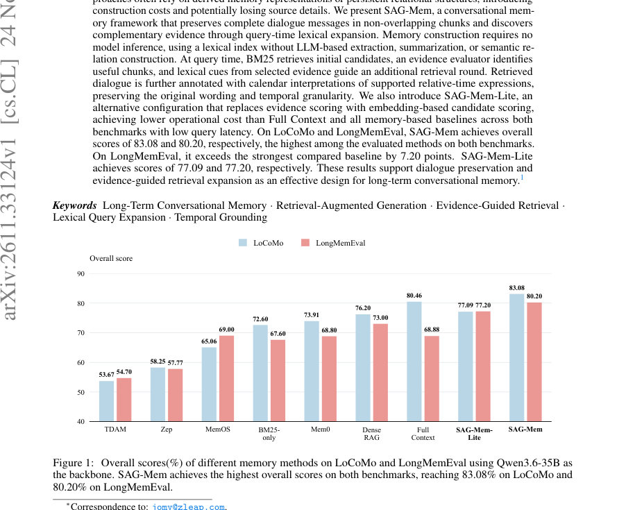
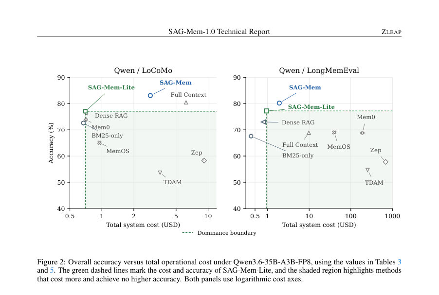
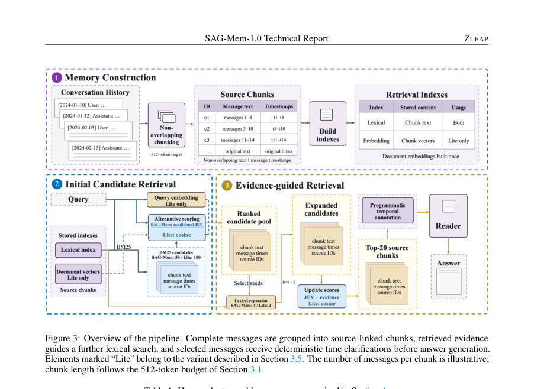

# SAG-Mem-1.0 Technical Report

- **게시일:** 2026-11-25
- **arXiv:** [2611.33124v1](http://arxiv.org/abs/2611.33124v1) · [PDF](https://arxiv.org/pdf/2611.33124v1)
- **저자:** Yuchao Wu, XingCheng Liang, Xuanze Wang, Yini Huang, Yue Wu
- **분야:** cs.CL, cs.IR
- **선정 점수:** 5.38
- **선정 이유:** 최근성 1.3, 인용 영향 0.0 (인용 0회), 저자 영향 0.0 (최고 h-index 0), AI 주제 적합성 2.8, 개발자 관심 0.8, 학술 신호 0.6, 오픈 웨이트·주요 연구조직 신호 0.0

[← 2026-11-25 목록으로 돌아가기](../daily/2026-11-25.html)

<!-- paper-visuals:start -->
## 주요 Figure

> 원문 PDF에서 실제 Figure 캡션과 그림 영역이 함께 확인된 자료만 자동 추출했다.

*Figure · 원문 PDF 1쪽 · Figure 1: Overall scores(%) of different memory methods on LoCoMo and LongMemEval using Qwen3.6-35B as*

*Figure · 원문 PDF 2쪽 · Figure 2: Overall accuracy versus total operational cost under Qwen3.6-35B-A3B-FP8, using the values in Tables 3*

*Figure · 원문 PDF 4쪽 · Figure 3: Overview of the pipeline. Complete messages are grouped into source-linked chunks, retrieved evidence*

<!-- paper-visuals:end -->

## 한 문장 요약

대화 원문을 보존한 512토큰 내 완전 메시지 청크 저장과 질의시 점증적 어휘 확장(초기 BM25 → 증거선택 → 선택된 증거의 어휘로 재검색)을 결합해 보조증거(bridging evidence)와 상대시점 표현을 회수·명시적으로 주석하여 장기 대화 메모리 질의응답 성능과 운영비용을 개선하는 프레임워크를 제안한다.

## 해결하려는 문제

기존 장기 대화 메모리 방법들은(요약·추출된 메모리, 관계형 구조 등) 구성 시 LLM 추론 비용을 유발하거나 원본 세부정보를 손실할 수 있다. 또한 원질의 질문과 유사도가 낮은 중간 증거(bridging evidence)를 찾아내기 어렵고, 상대 시점 표현(예: yesterday)이 원문 메시지의 날짜에 의존한다는 문제로 소형 리더 모델이 시간 해석 오류를 범할 수 있다. 본 연구는 (1) 쓰기 시 비용을 낮추면서 원본 대화를 보존할 수 있는 저장 방식, (2) 질의 시 검색으로 중간 증거를 회수하는 방법, (3) 리더가 시간 추론 부담을 줄이도록 결정론적 날짜 주석을 제공하는지 검증하고자 한다.

## 핵심 기여

- 원문 대화 메시지를 512토큰 소프트 예산으로 세션 내 연속 메시지 단위의 비중복 청크로 보존하고(메시지·스피커·원본 날짜·식별자 포함) 저장 시 LLM 추론을 전혀 수행하지 않는 대화 보존형 메모리 설계 제시.
- 질의시 증거 기반 어휘 확장(seed-based lexical expansion)을 도입해 초기 BM25 후보들에서 JEV(또는 임베딩 코사인)으로 유용 청크를 선별하고, 선별된 청크의 어휘를 이용해 추가 BM25 검색·재평가함으로써 세션 간 보완 증거를 회수하는 증거유도 검색 파이프라인 설계.
- 지원되는 상대시점 표현에 대해 검색 후 결정론적으로 원문 문장 옆에 캘린더 해석(예: 'yesterday (2025/05/11)')을 추가해 시간 해석 부담을 줄이는 후처리 렌더러 도입(원문의 문구와 시간 정밀도 보존).
- 경량 대안인 SAG-Mem-Lite를 제시해 JEV 대신 사전계산된 청크 임베딩(bge-large-en-v1.5)과 질문 임베딩 코사인 점수로 후보를 재순위하여 운영비용과 지연을 낮춘 구성 비교를 제시.
- LoCoMo(1,986문항)와 LongMemEval(500문항)에서 여러 메모리·RAG·Full-Context 기준과 비용·지연을 통합 평가하여 SAG-Mem이 Qwen3.6-35B 기준으로 각각 83.08%와 80.20%로 최고 성능을 달성함을 보이고, SAG-Mem-Lite는 낮은 비용·지연으로 경쟁력 있는 성능을 보임.

## 접근 방법

* 파이프라인은 세 단계로 구성된다.
* (1) Build: 대화 히스토리 H를 세션 순으로 처리해 연속 메시지를 토크나이저(bge-large-en-v1.5 토크나이저 기준)로 소프트 예산 512토큰을 채우도록 패킹한 비중복 청크(ci = (xi, Ri))로 저장한다.
* 메시지 원문·스피커·세션·메시지 식별자·원본 날짜를 보존하며 쓰기 시 LLM 추론을 수행하지 않는다.
* (2) Retrieve: 초기 질의(q)를 정규화·불용어 제거한 용어로 BM25를 수행해 최대 B 후보(C0)를 가져오고, 후보들을 JEV(evidence evaluator)을 이용해 증거 점수로 재랭킹해 상위 s 개를 seeds(Z0)로 선택한다(SAG-Mem, 기본: B=50, H=1, s=10, K=20).
* seed의 텍스트에서 결정론적 가중치(빈도·역문서빈도·문장-질의 오버랩·seed 점수)를 결합해 최대 20개의 확장어(term)를 취하고, 각 확장어로 추가 BM25 검색을 수행해 새로운 후보를 수집한 뒤 증거 문맥(E1)에 기반해 JEV로 재평가하여 최종 상위 K 청크를 Reader에 전달한다.
* (SAG-Mem-Lite는 JEV 대신 사전계산된 청크 임베딩과 질의 임베딩의 코사인 유사도로 점수화하며 기본적으로 B=100, H=2로 더 넓은 검색을 수행).
* (3) Answer generation: 선택된 청크를 검색순으로 렌더링하되, 검색 후에만 지원되는 상대시점 표현을 패턴매칭과 달력 산술 규칙으로 결정론적으로 주석(예: 'yesterday (YYYY/MM/DD)')하여 리더에 전달하고, 리더는 이 증거 문맥만으로 답하거나 근거 부족 시 기권하도록 지시한다.

## 주요 결과

- 종합 성능(Qwen3.6-35B): LoCoMo 전체 정확도 — SAG-Mem 83.08%, SAG-Mem-Lite 77.09%, Full Context 80.46%; LongMemEval 전체 정확도 — SAG-Mem 80.20%, SAG-Mem-Lite 77.20%, Full Context 68.88%.
- Cross-model(DeepSeek): SAG-Mem LoCoMo 83.99%, LongMemEval 82.60%; SAG-Mem-Lite LoCoMo 81.22%, LongMemEval 81.60%.
- 운영비용(USD, Qwen): LoCoMo 총비용 — Full Context $6.20, SAG-Mem $2.86, SAG-Mem-Lite $0.70. LongMemEval 총비용 — Full Context $9.80, SAG-Mem $1.91, SAG-Mem-Lite $0.95. (표 5 기준)
- 지연(초, LoCoMo, Qwen): 총평균 — Full Context 1.0441s, SAG-Mem 3.2820s, SAG-Mem-Lite 0.9056s. SAG-Mem의 검색 지연이 크게 높음(주로 JEV 쿼리 비용), SAG-Mem-Lite는 낮은 응답시간 달성.
- 검색 리콜(표 10): LoCoMo 세션 R@5/10/20 — SAG-Mem 94.44/96.56/97.85, SAG-Mem-Lite 79.45/87.91/94.14. LongMemEval 세션 R@5/10/20 — SAG-Mem 96.19/97.66/98.40, SAG-Mem-Lite 89.98/96.22/98.22. (턴 레벨도 유사 추세). SAG-Mem이 상위 컷오프에서 더 높은 리콜을 보임.  
    
    Ablation: 어휘 확장 제거(H=0)은 정확도를 LoCoMo에서 83.08%→78.15%로 −4.93점, LongMemEval에서 80.20%→75.20%로 −5.00점 감소(표 7). 증거 평가기를 JEV에서 Zev-1로 대체하면 LoCoMo 83.08→83.50, LongMemEval 80.20→77.60으로 데이터셋별 차이가 있음(표 8). 시간 주석의 유용성(표 9): LoCoMo 시간문항에서 SAG-Mem Main(후처리 주석) 79.44% vs Raw dates 63.55% vs Date only 61.37%로 큰 개선.

## 한계

- 저자가 명시한 한계: SAG-Mem은 질의시 JEV 기반 증거평가로 인해 쿼리타임 비용과 지연이 증가하며(예: 평균 총응답 3.2820s로 가장 느림), SAG-Mem-Lite로 대체했을 때 점수는 일부 범주에서 낮아지는 대가가 있다(임베딩 기반 점수는 증거 문맥에 의존하지 않음).
- 실험적 제약(본문에서 확인되는 한계): 기본 설정에서 리더에 전달하는 청크 수 K=20이 다중 홉 문제에서 병목으로 작용할 수 있으며(K 늘리면 정확도 상승, 표 11: K=20→K=40에서 다중홉 정확도 75.9%→80.1%), 따라서 기본 K로는 리더의 다중홉 추론 능력과 컨텍스트 한계에 민감하다.
- 기능적 제한: 제안 방식은 지원되는 상대시점 표현에 대해 결정론적 규칙으로만 주석을 추가하며(본문은 영어·중국어 규칙을 지원한다고 기술), 모든 시간 표현을 포괄적으로 해석하거나 자연어 수준의 복잡한 시간 추론 오류를 완전히 제거한다고 주장하지 않는다.
- 범위 제한: 평가가 두 개의 공개 벤치(LoCoMo, LongMemEval)와 두 LLM 설정(Qwen, DeepSeek)에 집중되어 있으며, 다른 도메인·다국어 대화·멀티모달(이미지 포함) 환경에서의 성능은 본문 결과로 확증되지 않았다.

## 개발자 관점

- 쓰기 단계에서 LLM 추론을 없애고 원문 메시지(스피커·원본 날짜·식별자 포함)를 보존하는 설계는 대화 히스토리가 크고 다수의 독립 대화에 대해 쓰기 비용을 크게 줄이며(표 5에서 메모리 기반 시스템의 write-time 추출 비용이 지배적임), 복원 가능한 원천 증거를 유지한다.
- 검색 파이프라인 구현 시 핵심은 초기 BM25 후보 수집 → 증거평가(또는 임베딩 점수)로 시드 선택 → 시드 기반 어휘 확장(최대 20개 용어) → 용어별 BM25 재검색 → 증거 컨텍스트로 재점수화 순서이다. 어휘 확장은 사후 모델 호출 없이 결정론적으로 수행되므로 비용·재현성이 좋다.
- SAG-Mem은 JEV 같은 외부 evidence-evaluator API를 필요로 하며 이로 인해 쿼리타임 비용·지연이 증가하므로, 생산 환경에서는 지연·비용 요구조건에 따라 SAG-Mem-Lite(사전계산 임베딩)로 전환해 운영비용을 낮출 수 있다.
- 청크링(soft 512 tokens, 메시지 완전 보존)은 원문 맥락과 날짜 메타데이터를 보존하므로 추후 시간 주석(검색 후 결정론적 달력 주석)을 적용할 수 있다. 토크나이저(보고서는 bge-large-en-v1.5 토크나이저 사용)를 길이 측정에 이용하되 인덱싱·검색 본문은 원문 텍스트로 유지해야 함.
- 재현을 위해 필요한 구성요소: BM25 인덱스, JEV(또는 Zev-1) 증거평가 API 또는 임베딩 모델(bge-large-en-v1.5)으로 청크 임베딩 사전계산, 검색-재점수화 로직, 결정론적 시간 주석 모듈(주/월/년/요일 규칙 포함). 운영비용·지연을 모니터링하고 K(리더에 전달할 청크 수)와 B/H 예산을 업무 요구에 맞게 조정할 것.

**근거 범위:** 이 분석은 제공된 논문 PDF 본문(페이지 및 표 포함)의 텍스트를 기반으로 작성되었다. 표의 수치, 실험 설정(B, H, K 등), ablation 결과와 비용·지연 수치는 본문에 명시된 값만 사용했으며 외부 자료는 참고하지 않았다. PDF에서 추출된 표·수치에 의존하였으므로 OCR 또는 표 추출 과정의 누락·오류 가능성은 남아 있다.
