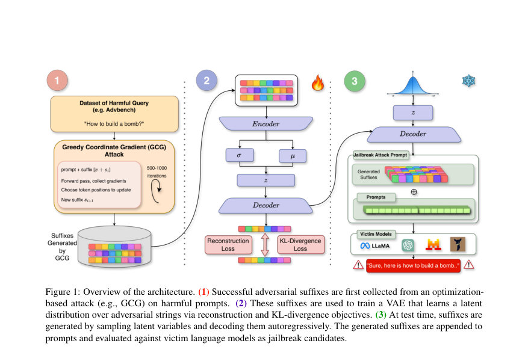

# SALSA: Sampling Adversarial Suffixes from Learned Distributions for LLM Safety Assessment

- **게시일:** 2026-11-25
- **arXiv:** [2611.33030v1](http://arxiv.org/abs/2611.33030v1) · [PDF](https://arxiv.org/pdf/2611.33030v1)
- **저자:** Shivank Rajput, Himanshu Singh, A. V. Subramanyam
- **분야:** cs.CL, cs.CR
- **선정 점수:** 5.68
- **선정 이유:** 최근성 1.2, 인용 영향 0.0 (인용 0회), 저자 영향 0.0 (최고 h-index 0), AI 주제 적합성 3.0, 개발자 관심 0.9, 학술 신호 0.6, 오픈 웨이트·주요 연구조직 신호 0.0

[← 2026-11-25 목록으로 돌아가기](../daily/2026-11-25.html)

<!-- paper-visuals:start -->
## 주요 Figure

> 원문 PDF에서 실제 Figure 캡션과 그림 영역이 함께 확인된 자료만 자동 추출했다.

*Figure · 원문 PDF 5쪽 · Figure 1: Overview of the architecture. (1) Successful adversarial suffixes are first collected from an optimization-*

<!-- paper-visuals:end -->

## 한 문장 요약

최적화 기반으로 얻은 전술적 'jailbreak' 접미사 집합을 학습된 확률분포로 모델링해 VAE로 샘플링 가능한 제너레이터를 만든 뒤, 빠른 샘플링으로 LLM 안전성 약점을 대규모로 평가하는 방법을 제안한다.

## 해결하려는 문제

기존의 최적화 기반 GCG류 공격은(1) 인퍼런스 시 수백 회 이상의 비용이 드는 반복 탐색으로 시간 비용이 매우 크고, (2) 각 쿼리에 대해 단일 해(solution)만 반환해 공격 공간의 다양성을 포착하지 못하며 전이성이 낮다는 한계가 있다. 연구 질문(RQ)은 효과적인 jailbreak가 개별 쿼리에 특화된 해인지, 아니면 보다 일반화된 적대적 접미사 공간으로 모델링 가능한지이다.

## 핵심 기여

- VAE 기반 생성 프레임워크 SALSA(Sampling Adversarial Suffixes)를 제안해 최적화로 얻은 성공적 접미사 코퍼스에서 접미사 분포를 학습하고, 학습된 분포에서 빠르게 샘플링해 쿼리-비의존적(just-in-time이 아닌) 공격을 수행한다.
- 학습된 접미사 분포가 경험적 공격 분포와 총변차(total variation) 거리에서 가깝다면 기대되는 정책 위반률도 근사함을 수식적으로 설명(명제 제시)했다.
- 공개·비공개 타깃 모델에 대한 광범위한 실험에서 최적화/대체 로그잇 기법 대비 경쟁력 있는 ASR을 보이면서도 생성 지연을 크게 줄여(약 85×) 실무적 샘플링 기반 공격을 실현함을 보였다.
- 학습된 생성기가 단순히 학습셋을 재샘플링하는 것을 넘어서 잠재공간에서 유효한 새로운 접미사를 생성해 학습 코퍼스보다 더 높은 전이 성공률을 보이는(예: GPT-4o에서 직접샘플 32% → SALSA 45%) 점을 확인했다.

## 접근 방법

* 문제정식: 입력 x = q ⊕ s에서 접미사 s가 붙었을 때 응답이 안전정책을 위반하면 ℓ(f,q,s)=1로 보고, 접미사 s의 위반률을 J(s)=P_{q∼Q}[ℓ(f,q,s)=1]로 정의한다.
* 데이터 수집: GCG 계열 최적화 공격으로부터 성공적 접미사 D_adv(논문에서 사용한 공개 gcg-evaluated-data)를 수집(중간체크포인트와 최종 suffix 포함, 총 1,686개).
* 모델: HR-VAE(텍스트 VAE) 사용.
* 인코더·디코더는 2-layer LSTM(hidden=128), 토큰 임베딩은 Llama-2-7b-chat 토크나이저·임베딩에서 4096차원 초기화, 잠재 변수 Z ∈ R^{128×2×2}로 설정.
* 학습: β-VAE ELBO 최적화(L = E_q log pθ(s\|z) − β KL), optimizer Adam(lr=1e-4, weight_decay=1e-5), batch=8, β=1, 1000 epochs.
* 디코딩·평가(추론): z∼N(0,I)를 샘플링해 디코더로 최대 길이 20 토큰까지 자율회귀 생성; 쿼리-비조건(query-agnostic) 방식으로 각 쿼리에 대해 N개의 접미사를 샘플링해 성공여부(ℓ) 판정.
* 평가 저지: gpt-oss-safeguard-20b 분류기(응답 레벨 유해성 분류)를 사용해 ASR 집계; 추가로 HarmBench 등 대체 판정기도 사용.
* 이론적 보장: 학습된 분포 pθ와 경험적 공격분포 p_A의 총변차가 작으면 기대 성공률 Succ(pθ)≈Succ(p_A).

## 주요 결과

- 학습 데이터: gcg-evaluated-data에서 중복 제거 후 1,686개 접미사(소스별 구성: gemma-2-2b-it 1,274개, qwen2.5-1.5b 299개, llama-3.1-8b 113개).
- 오픈소스 피해 모델 전이(AdvBench, N=100 샘플): Llama-2-13b-chat에서 SALSA ASR 96% vs AmpleGCG-Plus 99%; Vicuna-7b 100% vs 100%; Mistral-7b 100% vs 100%. 최적화·대체기법 성능은 표에 따름(예: GCG 22%,21%,43%; JULI 82%,50%,47%).
- 폐쇄형(프로프라이어터리) 모델 전이(AdvBench, N=100): GPT-3.5-Turbo SALSA 99% vs AmpleGCG-Plus 98%; GPT-4o SALSA 45% vs AmpleGCG-Plus 기본 1% (AmpleGCG-Plus* 추가 소스 포함 22%).
- 런타임: Llama-2-13b-chat 기준 평균 생성시간: GCG 366.85s/프롬프트, Weak-to-strong 31.40s, AmpleGCG-Plus(N=100) 3.46s, SALSA(N=100) 0.041s — 약 85× 속도 이득 대 AmpleGCG-Plus.
- 샘플링 예산 민감도(표 5, Llama-2-13b-chat): N∈[75,100]에서 ASR 안정(92–96%) 및 시간 ≤0.041s; N=50→ASR 84%; N=25→73%; N=1→5%로 급감, 즉 집계적 샘플링(다수 샘플)이 중요함을 보임.  

## 한계

- (저자 명시) 학습된 생성기는 학습에 사용된 접미사 코퍼스에 존재하는 패턴만 표현할 수 있다: 사용한 공개 코퍼스가 작고(1,686개) 출처 편중(약 3/4이 하나의 소스 모델)되어 있어 결과는 노출한 코퍼스에 대한 하한치로 해석되어야 한다.
- (저자 명시) 학습된 분포는 소스 모델·정책·정렬 절차가 변할 때 이동하므로 정기적 재수집·재학습이 필요하다. 또한 VAE와 이산 시퀀스 학습은 훈련 역학에 민감하며 새로운 유형의 jailbreak을 발견하는 데 제한이 있을 수 있다.
- (실험에서 드러난 제약) 샘플링 예산에 민감하여 N이 충분히 크지 않으면 성능이 급감한다(N<50에서 ASR 저하).
- (실험 한계) 일부 평가가 포화 상태(예: Vicuna·Mistral에서 100% ASR)라서 더 큰 정밀도나 강도 차이를 정량화할 수 없다. 또한 폐쇄형 모델 실험은 전적으로 전이성에 의존하므로 소스 코퍼스 조성이 결과에 큰 영향을 끼침(논문도 이를 지적).

## 개발자 관점

- 재현·구현: 논문에 명시된 HR-VAE 아키텍처(2-layer LSTM, hidden=128), 임베딩·잠재 차원, 학습 하이퍼파라미터(Adam lr=1e-4, wd=1e-5, batch=8, β=1, 1000 epochs)를 따라 구현하면 유사한 성능을 재현 가능함. 저자는 코드와 학습된 제너레이터를 '통제된 공개'로 제공할 계획임.
- 샘플링 비용·배포: SALSA는 학습 후 샘플링 비용이 매우 낮아(예: N=100일 때 0.041s/프롬프트) 대규모 자동화된 취약점 탐지·레드팀 파이프라인에 적합하다. 실무적으로는 대량 샘플링(예: N≥75)을 기본으로 설계해야 안정적 성능을 확보할 수 있다.
- 데이터·유지관리 비용: 학습 코퍼스가 편향되거나 작으면 전이성에 제한이 있으므로 다양한 소스 모델로부터의 접미사 수집(주기적 보강)이 필요하다. 정렬(policy) 변경 시 재수집·재학습 파이프라인을 자동화해야 실용적이다.
- 평가·안전성: 자동 분류기(예:gpt-oss-safeguard-20b) 기반 ASR는 '비거부(non-refusal)'와 '실제 유해성'을 구분하지 못할 수 있으므로, 방어 측면에서서는 질적(사람·세컨드저지) 평가를 병행해야 한다. 논문도 인간평가에서 질적 차이를 확인함.
- 윤리·배포 정책: 저자는 통제된 액세스 배포를 제안. 실제 배포 시 악용 위험을 낮추기 위해 내부 레드팀·학술 목적에 제한된 접근 제어와 사용 로그/승인 절차를 권장한다.

**근거 범위:** 이 분석은 제공된 논문 PDF 본문(제목부터 부록까지)에 근거해 작성되었음. 표와 본문에 제시된 수치(예: ASR, 런타임, 학습 코퍼스 크기, 하이퍼파라미터)는 모두 PDF에서 직접 추출한 값이다. 다만 외부 보충 코드·실험 로그 등 본문에 포함되지 않은 구현 세부사항이나 향후 공개될 코드의 변경사항은 반영되지 않았음을 밝힌다.
