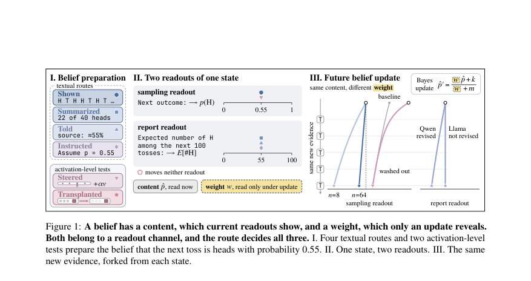
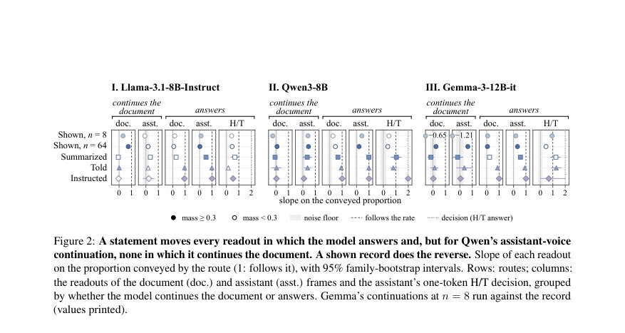
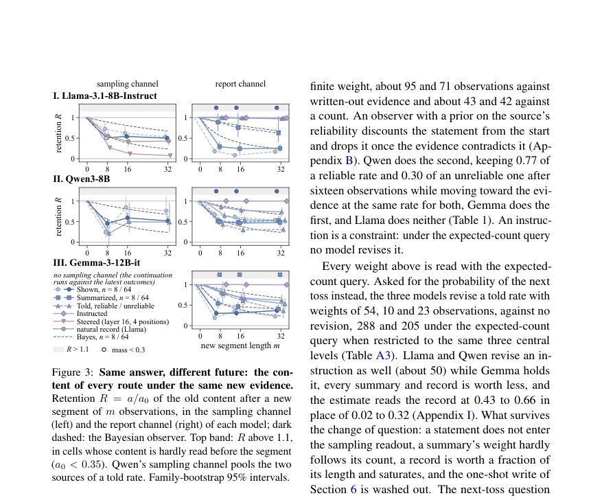

# Same Answer, Different Future: Matched Predictions Do Not Imply Matched Belief Updating in Language Models

- **게시일:** 2026-11-06
- **arXiv:** [2611.07913v1](http://arxiv.org/abs/2611.07913v1) · [PDF](https://arxiv.org/pdf/2611.07913v1)
- **저자:** Weihan Li, Junhao Wu, Xinlei Chen, Tianshi Zheng
- **분야:** cs.LG
- **선정 점수:** 5.17
- **선정 이유:** 최근성 1.1, 인용 영향 0.0 (인용 0회), 저자 영향 0.0 (최고 h-index 0), AI 주제 적합성 1.9, 개발자 관심 0.2, 학술 신호 0.3, 오픈 웨이트·주요 연구조직 신호 1.6

[← 2026-11-06 목록으로 돌아가기](../daily/2026-11-06.html)

<!-- paper-visuals:start -->
## 주요 Figure

> 원문 PDF에서 실제 Figure 캡션과 그림 영역이 함께 확인된 자료만 자동 추출했다.

*Figure · 원문 PDF 2쪽 · Figure 1: A belief has a content, which current readouts show, and a weight, which only an update reveals.*

*Figure · 원문 PDF 5쪽 · Figure 2: A statement moves every readout in which the model answers and, but for Qwen’s assistant-voice*

*Figure · 원문 PDF 6쪽 · Figure 3: Same answer, different future: the con-*

<!-- paper-visuals:end -->

## 한 문장 요약

언어모델의 동일한 현재 예측(확률적 출력)은 서로 다른 준비 경로를 통해 형성된 경우 이후 증거에 대한 업데이트(즉, 믿음의 '무게')가 일치하지 않음을, 베르누이 추정과 포크된 미래 실험을 통해 정량화하고 보여준다.

## 해결하려는 문제

언어모델은 관측 결과(시퀀스), 요약(카운트), 출처의 진술(말해진 확률), 명시적 지시(assume) 또는 활성화 간섭(steering, transplantation) 등 다양한 경로로 동일한 현재 확률적 예측을 보일 수 있다. 그러나 이러한 경로가 동일한 '믿음 상태'를 형성하는지, 특히 동일한 추가 증거가 주어졌을 때 동일하게 업데이트되는지(즉, 현재 예측의 일치가 이후 행동의 일치를 보장하는지)가 명확하지 않다. 기존 연구는 현재 예측 변화나 intervention 강도에 따른 반응을 다뤘지만, 서로 다른 준비 경로에서의 동적 등가성(동일한 추가 증거에 대한 응답 일치)은 미해결 문제로 남아 있다.

## 핵심 기여

- 포크된 미래(forked futures) 실험 설계를 사용해 '현재 예측의 일치'가 '이후 증거에 대한 동일한 업데이트'를 의미하지 않음을 보이는 새로운 평가 프로토콜(베르누이 추론에서의 교환율/유효증거중량 측정)을 제시했다.
- 네 가지 텍스트 경로(Shown: 관찰 시퀀스, Summarized: 카운트 요약, Told: 출처가 말한 확률, Instructed: 가정 지시)와 두 가지 활성화 수준 개입(Steered: 한 번의 쓰기, Transplanted: 잔차 복사)을 비교하는 체계적 실험을 수행했다.
- 두 가지 읽기(readout) 채널(continuation 기반의 sampling readout와 명시적 수치응답인 report readout)을 모두 측정하여, 어떤 입력 포맷이 어느 채널에 내용을 전달하는지를 규명했다(예: 시퀀스는 continuation을, 요약·진술은 명시적 추정치를 움직임).
- 각 경로에서 동일한 추가 증거를 붙였을 때의 '유효 증거 중량(effective evidence weight, 관측 몇 개에 해당하는가)'을 정량화하여 경로별로 중량이 크게 다름을 실증했다(요약은 표기된 샘플 수와 약하게 스케일, 시퀀스는 길이에 비해 부분적 영향 등).
- 활성화 쓰기(steering)가 자연스러운 기록(natural record)의 즉시 예측을 재현할 수 있으나, 첫 추가 증거 세그먼트에 의해 대부분 씻겨 나가며 '무게'를 재현하지 못함을 보였고, 지속적(persistent) 개입은 상수 오프셋을 만들어 업데이트에 지속 효과를 냄을 관찰했다.

## 접근 방법

* 실험은 베르누이 편향 추정 과제를 중심으로 설계됐다.
* 실험 절차 요약은 다음과 같다:
* 준비 경로: 네 가지 텍스트 경로(Shown: n∈{8,16,32,64}개의 관찰을 순서대로 제시, Summarized: k/n 로 요약된 카운트 제시, Told: 출처가 확률 s를 진술(출처 신뢰도 95% 또는 55% 포함), Instructed: 'assume p=s' 등 세기별 지시)와 활성화 수준 테스트(Steered: 특정 레이어·위치에 mean-difference 벡터를 더해 한 번만 개입하거나 persistent arm으로 지속적 개입, Transplanted: 긴 기록의 잔차(residual stream) 일부를 짧은 기록에 복사) 사용.
* 읽기(readout): 두 채널을 사용(1) sampling readout: 프롬프트 말미에서 문서를 계속하게 하여 다음 결과의 H/T 확률을 측정(문서 프레임/어시스턴트 프레임의 continuations 및 one-token H/T decision 포함), (2) report readout: "다음 100번 중 기대 H 개수" 등 정수 분포의 기댓값을 읽음.
* 네 가지 보고 쿼리(Q1–Q4)를 통해 보고 쿼리의 영향을 평가.
* 포크된 미래(forked futures): 캐시된 상태(s)에서 동일한 추가 증거 업데이트 u(새 증거 세그먼트 m∈{8,16,32}, 비율 κ∈{0.25,0.5,0.75} 등)를 붙여 각 읽기에서의 후속 예측을 측정.
* 선형 회귀 모델 p_post = c + a π + S κ를 적합해 기존 콘텐츠 기여 a(보존량)와 새 증거 민감도 S를 추정하고, 교환율 w = m a / S로 '구형 증거 몇 개와 동일한가'를 계산함(유지비 R = a/a0).
* 모델들: Llama-3.1-8B-Instruct, Qwen3-8B(비사고모드), Gemma-3-12B-it를 사용.
* 통계적 불확실성은 가족 단위(독립 생성된 기록·문구) 부트스트랩(2,000 재표본)으로 95% 구간을 산출.
* 여러 제어실험 포함: 복사 통제(copy control), 먼저 개수 세기(count, then estimate), 문장형 리스트·베어 스트림·분할 기록(segmented)·시뮬레이션 후 샘플(simulate then sample)·추론 블록(특히 Qwen에서) 등.

## 주요 결과

- 입력 포맷이 어느 채널에 내용을 전달할지 결정한다(요약·진술·지시는 주로 report readout(명시적 추정)를 움직이고, 관찰 시퀀스(Shown)는 sampling readout(continuation)를 움직임). 예: stated rate는 모든 모델·프레임에서 estimate에 대한 기울기가 적어도 0.87로 강하게 영향을 주며, 문서 continuation에는 거의 영향을 주지 않음(기울기 ≤0.13).
- 동일한 정보(예: 같은 비율)를 전달하더라도 경로별 유효 증거 중량(w)은 크게 다르다: Llama의 경우 Shown 기록은 m=16 새 세그먼트에 대해 n=8,16,32,64에서 각각 약 w = 5, 7, 14, 17 관측값에 해당하여 기록 길이에 따라 증가·포화하는 반면(Qwen은 모든 길이에서 약 3~7 관측값), Summarized(카운트)를 제시한 경우 n=8일 때 모델들에서 w는 약 21~71, n=64일 때 약 52~72로 요약에 표기된 샘플 수의 배수(예: 8배)만큼 스케일링하지 않음(즉, 요약의 무게는 약수십 관측값 수준에 머묾).
- 출처 진술(Told)은 모델마다 다르게 취급됨: Qwen은 신뢰 높은 출처를 16 관측 이후에도 약 0.77만큼 유지하고 신뢰 낮은 출처는 약 0.30만큼 유지(즉, 증거와 충돌하면 점차 버림), Gemma는 사전에서 할인(discount)하고, Llama는 초기에 거의 할인하지 않아 상당히 강하게 보유함. 지시(Instructed)는 expected-count 쿼리에서는 제약으로 취급되어 어떤 모델도 이를 수정하지 않음(무한대와 유사한 무게).
- 읽기 질문(elicitation)이 inferred weight에 큰 영향을 미친다. 본문에서 사용한 expected-count(Q1)와 next-toss(Q2) 등 다른 쿼리 사이에 동일한 준비 상태의 추정치 보존량이 수십배까지 달라짐(예: told rate가 Q1에서는 거의 수정되지 않으나 Q2에서는 유한한 무게로 수정됨).
- 활성화 쓰기(steering)는 자연 기록의 즉시 예측을 재현할 수 있으나 그 '무게'는 복제하지 못함: Llama에서 mean-difference 방향을 추가하면 자연 기록 간 차이의 92~109% 만큼 내용을 설치했지만(초기 콘텐츠 재현), 동일한 16개 관측의 새 세그먼트가 붙으면 그 설치된 내용은 최대 0.12만 보존된 반면 자연 기록은 약 0.42 보존되어(즉, 스티어링의 효과는 최초 추가 증거에 의해 대부분 씻겨 나감) 쓰기는 내용만 설치하고 무게는 재현하지 못함. 반면 persistent(지속적) 개입은 로그오즈의 상수 오프셋으로 남아 업데이트에 지속적 효과를 냄.

## 한계

- 저자가 명시한 제한: 본 연구는 베르누이(이항) 편향 추정의 단일 정량(동전 앞면 비율)에 대한 in-context 믿음만 다룸. 다항(multinomial), 복잡한 사전(prior), 파인튜닝·모델편집으로 파라미터에 설치된 믿음 등으로의 일반화는 미해결이다.
- 프롬프트 형식 의존성: 본문과 부록에서 프롬프트 레이아웃(문서 프레임 vs 어시스턴트 프레임, 베어 스트림 등)에 따라 결과가 달라짐을 보고함. 따라서 측정치는 특정 템플릿·토크나이제이션에 의존하며 보편적 상수는 아님.
- 읽기의 범위 의존성: report 채널에서 사용한 질의(Q1–Q4)에 따라 inferred weight가 수십 배 차이나므로 '하나의 교환율'이 모델 전체에 불변으로 존재한다는 가정은 성립하지 않음.
- 행동 수준의 국소화(behavioral localization): weight의 물리적(회로·위치) 근원을 본문 실험(steering, transplantation, hide/ablate)으로 일부 배제했지만 회로 수준의 해석과 attention이 어떻게 재독(reading)하는지에 대한 상세·인과적 설명은 남겨둠(추후 작업 필요).

## 개발자 관점

- 현재 출력(즉시 예측)이 특정 채널에서 일치한다고 해서 그 믿음이 이후 증거에 대해 동일하게 방어된다고 가정하면 안 된다. 신뢰성 평가·메모리 요약·지식 이식 평가 시 '업데이트 역학'을 반드시 테스트해야 한다(동일 추가 증거를 붙여 비교).
- 활성화 쓰기(한 번의 쓰기)는 즉시 원하는 답변을 설치할 수 있지만 추가 증거가 주어지면 그 효과가 쉽게 사라지므로(무게를 설치하지 못함) 지속적 편향 또는 프롬프트 수준의 보조 메커니즘이 필요하다. 편향 지속성이 요구되는 시스템에서는 one-shot steering에 의존하지 말 것.
- 메모리 압축(요약) 설계 시 단순히 요약된 비율만 저장하면 실제 에이전트가 그 요약을 '몇 개의 관찰값'으로 취급하는지(무게)를 잃을 수 있으므로, 장기 기억이나 경험 리플레이용 요약은 예측뿐 아니라 해당 요약의 '증거 중량' 정보를 함께 보존하는 방식으로 설계할 것(예: 실제 관측 수 또는 신뢰도 메타데이터 포함).
- 평가 관행: 확률적 믿음의 재현성을 평가할 때는 적어도 두 가지 읽기(continuation 기반 샘플링과 명시적 수치응답)를 모두 측정하고, 질의(elicitation) 문구를 바꿔 결과의 민감도를 확인하라. 또한 추가 증거를 붙이는 포크된 미래 실험을 도입해 '무게'를 정량화하라.
- 프롬프트·토크나이제이션·레이아웃 세부사항이 결과에 큰 영향을 미치므로 재현을 위해 원본 템플릿, 토크나이저 설정, 모델 리비전 정보를 정확히 기록·공개해야 함.

**근거 범위:** 본 분석은 제공된 논문 PDF 본문 전체(본문 및 부록)에 근거해 작성했습니다. 본문과 부록에서 보고된 수치(예: 교환율 w, 보존비 R, 특정 기울기와 수치)는 PDF에 명시된 값만을 인용했습니다. 부록의 추가 표·그림에 더 상세한 수치가 있으나, 본문에서 직접 인용된 값과 저자가 명시한 범위를 우선 반영했습니다. 표기되지 않은 세부 구현·하이퍼파라미터(예: 내부 수치 계산의 일부 보정값)는 본문에 명시되지 않아 포함하지 않았습니다.
