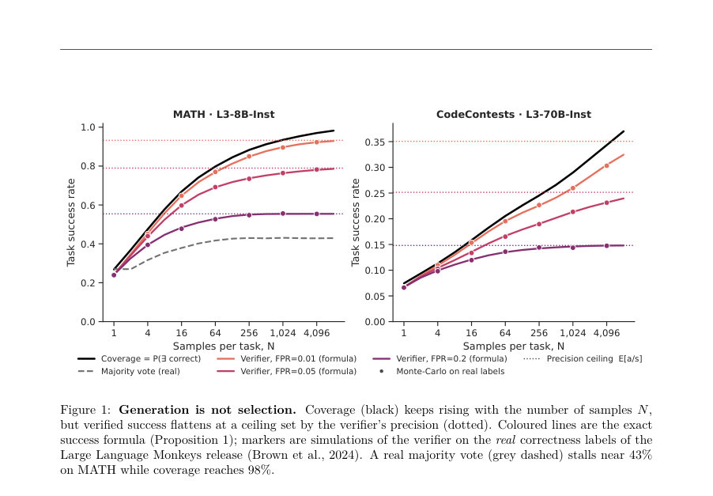
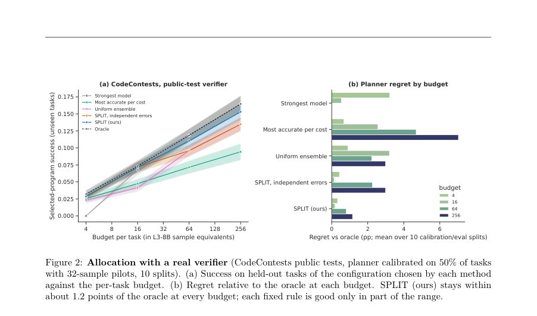
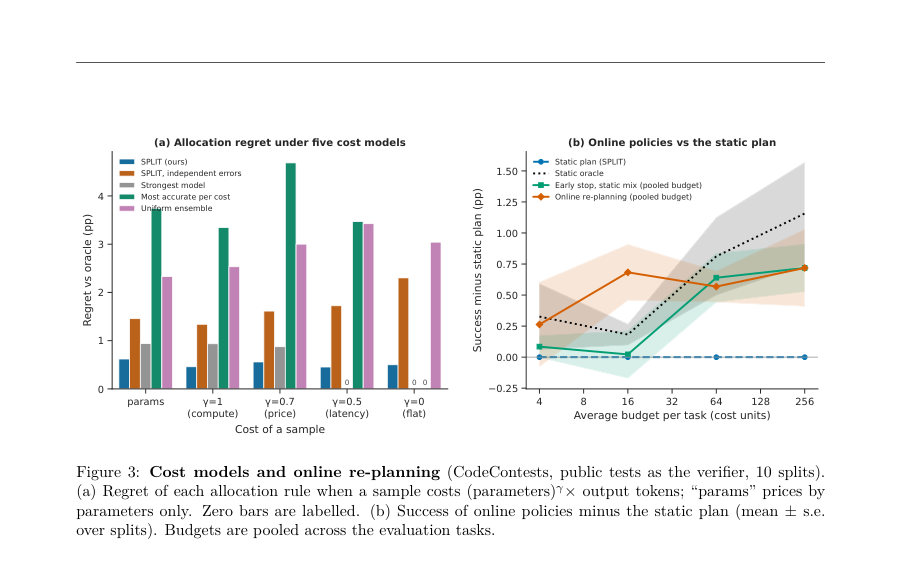

# Sample, Mix, or Verify? Allocating Test-Time Compute under Imperfect Verifiers

- **게시일:** 2026-10-19
- **arXiv:** [2610.23255v1](http://arxiv.org/abs/2610.23255v1) · [PDF](https://arxiv.org/pdf/2610.23255v1)
- **저자:** Srinivasan Iyengar
- **분야:** cs.LG, cs.CL
- **선정 점수:** 4.77
- **선정 이유:** 최근성 0.4, 인용 영향 0.0 (인용 0회), 저자 영향 0.0 (최고 h-index 0), AI 주제 적합성 3.0, 개발자 관심 1.1, 학술 신호 0.3, 오픈 웨이트·주요 연구조직 신호 0.0

[← 2026-10-19 목록으로 돌아가기](../daily/2026-10-19.html)

<!-- paper-visuals:start -->
## 주요 Figure

> 원문 PDF에서 실제 Figure 캡션과 그림 영역이 함께 확인된 자료만 자동 추출했다.

*Figure · 원문 PDF 3쪽 · Figure 1: Generation is not selection. Coverage (black) keeps rising with the number of samples N,*

*Figure · 원문 PDF 9쪽 · Figure 2: Allocation with a real verifier (CodeContests public tests, planner calibrated on 50% of tasks*

*Figure · 원문 PDF 10쪽 · Figure 3: Cost models and online re-planning (CodeContests, public tests as the verifier, 10 splits).*

<!-- paper-visuals:end -->

## 한 문장 요약

작은 라벨된 파일럿으로 검증자 오류·문제 난이도·생성기 간 상관을 추정해, 한정된 테스트 시점(추론) 예산을 샘플·혼합·검증에 최적으로 배분하는 SPLIT 방법을 제안한다.

## 해결하려는 문제

언어 모델/에이전트의 추론 시점 정확도를 높이기 위해 후보를 반복 생성하고 검증자를 통해 하나를 제출하는 관행은 'coverage(어떤 시도에서든 정답이 나올 확률)'는 샘플 수에 따라 예측 가능하게 증가시키지만, 실제 검증자는 오답을 받아들이고 정답을 거부하며 오류들이 서로 상관되어 있어(예: 동일한 그럴듯한 오답이 여러 판정자를 속임) 검증된 성공률은 포화할 수 있다. 따라서 제한된 예산에서 몇 회 샘플링할지, 어떤 모델을 섞을지, 검증에 얼마를 쓸지 등을 규칙적 경험칙이 아니라 파일럿 데이터로 결정하는 배분 문제가 필요하다(예: MATH에서 majority vote가 43%에서 멈추는 반면 coverage는 98%에 이르는 사례).

## 핵심 기여

- SPLIT: 파일럿으로 보정하는 테스트-타임 컴퓨트 배분기(샘플 수, 생성기 선택·혼합, 검증 호출 수·임계치 결정). 여러 설정에서 사후적 최적 배분과 0.02–0.8 퍼센트포인트 이내 성능을 달성함.
- 검증된 성공률에 대한 정확한 수식 유도(accept/reject와 top-score(argmax) 선택 두 경우), 이 수식은 과제 난이도 이질성, 생성기 간 공통 맹점(gaussian copula로 모델링), 반복 판정의 상관(후보 수준의 acceptance propensity) 등을 포함함(증명 포함).
- 실제 검증자들에서 관찰된 세 가지 메커니즘을 분석·재현: (i) 다수 판정 재호출이 정밀도를 낮출 수 있는 정확 조건, (ii) 판정자 정확도가 과제 난이도에 의존하면 풀링이 예측을 편향함, (iii) 생성기 성능이 높아질수록 고정 테스트의 오탐률(FPR)이 증가하는 현상(스코어드 검증기에서는 임계치 재보정으로 설명).
- 곡선 적합(power-law) 대비 파일럿·모형 기반 예측의 비교: 검증자가 성공을 캡(한계)할 때 장기 예측에서 SPLIT가 더 우수한 경우를 보고, 어디서 지는지 분석함.

## 접근 방법

* 핵심 아이디어는 성공확률을 P(success) = P(정답 후보가 존재) × P(그 후보가 선택됨 \| 존재)로 분해하고, 선택 확률을 명시적으로 모델링하는 것이다.
* 선택자별 수식: (1) uniform-among-accepted(accepted된 후보 중 균등 선택)에 대한 정확한 적분식(제1명제, Eq.(1))을 유도하고, 단일 생성기에서는 a/s(1−(1−s)^N) 꼴로 정밀도 천정을 보임; (2) argmax(검증 스코어 최고) 선택에 대해서는 연속/이산 스코어 분포를 이용한 식(제3명제)을 제시한다.
* 모델링 구성요소: 과제 난이도는 베타-이항(empirical Bayes) 또는 NPMLE(비모수 최대우도)로 추정하고, 생성기들 간의 per-task 성공률 결합분포는 Gaussian copula(파일럿의 쌍별 상관 ρ를 최대우도로 적합)로 모델링한다.
* 검증자는 per-task TPR(τ_t)과 FPR(f_t)을 갖게 하고, 반복 판정의 상관은 후보 수준의 acceptance propensity q를 도입하여 q∼Dc(정답 후보)/Dw(오답 후보), Dc/Dw를 베타 분포(평균 τ,f와 농도 κ)로 모델링함으로써 majority-of-k의 효과를 분석한다.
* 추정(파일럿→계획): 파일럿(통상 n=8–64, 기본값 32 샘플)에서 per-task 라벨과 판정 결과를 수집해 empirical Bayes로 하이퍼파라미터를 적합하고, copula에서 모의추출(본문: 약 2^12–2^14 드로우)로 과제 분포를 샘플해 계획 그리드(생성기 조합·혼합비·검증 호출수·임계치 등)를 평가하여 예산 제약 하에서 성공률을 최대화하는 구성을 반환한다.
* 수치평가 세부: 혼합 적분은 480-노드 로그-스페이스 사다리꼴 적분, copula 적분은 48×48 Gauss–Hermite를 사용한다고 본문에 명시되어 있다.
* 온라인 정책으로는 '첫 수락 시 해당 과제 중단'과 풀 예산 재배분을 통한 재계획을 제안·시뮬레이션함.

## 주요 결과

- 전 범위(수학·과학 QA·코드·소프트웨어 엔지니어링 에이전트)에서 7개 벤치마크, 26개 모델, 175개 에이전트 시스템, 6종의 실제/시뮬레이션 검증자를 사용한 평가에서 SPLIT 변형은 미리보지 않은 과제에서 사후적 최적 구성(hindsight-optimal)과 평균 0.02–0.8 퍼센트포인트 차이로 근접함(표 2, 3).
- 반면 모든 고정 규칙(가장 강한 모델, 균등 앙상블, 비용 대비 정확도 최고 등)은 적어도 한 설정에서 최소 2.5 포인트 이상 손실을 보였음(예: MATH에서 규칙 기반은 최대 ~12pp 손실).
- 검증자 재호출(majority-of-k)에 대한 이론·실험: 제2명제의 조건 Fk/Tk 비교로 '여러 판정자 호출이 정밀도 천정을 낮출 수 있음'을 보이며, 실제로 MATH-500에서는 k=1→9로 갈 때 오답 수락 배율이 ×1.052, 정답 수락 배율이 ×1.026으로 관찰되어(풀이: 많은 오답이 다수 판정자를 속김) 다수결이 천정을 낮추는 과제가 61% 존재함. 반면 GPQA에서는 다수결이 천정을 올려 N=4,16,64에서 각각 +1.2, +3.3, +4.8pp 개선을 보였음(표 5).
- 검증자 풀링의 편향: 판정자 정확도가 과제 난이도에 결합되어 있으면(예: GPQA에서 TPR/FPR과 난이도의 스피어만 상관 0.54/0.65) 풀링은 과대평가하며, 'empirical task population' 보정으로 이 편향을 제거하여 실제 관측치에 가깝게 예측함.
- 생성기 성능과 FPR 상관 재현: HumanEval+에서 17개 모델 대상 FPR과 pass@1의 스피어만 ρ=0.97(본문), MBPP+에서도 ρ=0.95로 Stroebl et al.의 관찰을 재현함(즉 더 강한 생성기가 고정 테스트를 더 자주 속김). 스코어드 검증기의 경우에는 생성기별로 임계치를 재보정하면 이 효과가 사라짐(캘리브레이션 효과).

## 한계

- 저자가 명시한 한계: SPLIT의 예측 우위는 모든 설정에서 크지 않음(시뮬레이션 검증자와 SWE-bench thresholds에서는 명확한 우위, 실제 테스트나 순수 coverage 예측에서는 이점이 작거나 없음).
- 저자가 명시한 한계: 동일 정책(same-policy) 장기간 롤아웃(한 에이전트에 대해 수십~수백 시도)의 공개 데이터가 부족하여, selection(검증된 선택) 성능의 장기 거동은 충분히 검증되지 않음(저자는 장기 실험 파이프라인을 공개했으나 실행 비용이 큼).
- 저자가 명시한 한계: 모든 추정은 파일럿이 배치 환경과 교환가능하다고 가정하므로(대표성 가정) 능력 drift(파일럿이 오래된 시스템일 때) 시 성능이 악화됨.
- 저자가 명시한 한계: 비용·지연 모델은 (parameters)^γ × output_tokens 형태의 단일 파라미터 γ로 단순화했고, 병렬 샘플링에 따른 지연/비용 모델링은 생략됨. 판정자 호출 비용은 한 세대 호출로 고정함(단순화). 또한 이론적 명제들은 후보들이 과제에 대해 조건부 독립이라는 가정 하에서 정확함; 후보들 사이의 의존(중복 답안 등)은 모델링하지 않아 큰 N에서 편향을 초래할 수 있음(본문).

## 개발자 관점

- 실무적으로는 작은 라벨된 파일럿(권장값 본문 예: 32 샘플; 실험에선 8–64 범위)을 수집해 SPLIT의 empirical Bayes 추정(베타-이항 또는 NPMLE 난이도, copula 상관, 판정자 TPR/FPR 및 후보 수준 propensity κ)을 적용하면 한정된 예산에서 샘플·검증·혼합 배분을 자동화할 수 있다.
- 판정자(검증기)는 생성기 교체 시 반드시 재측정할 것. 특히 고정 테스트나 일정 임계치가 있는 스코어드 검증기는 생성기 성능 향상에 따라 FPR이 상승할 수 있으며, 스코어드 검증기는 생성기별 캘리브레이션(임계치 재설정)을 통해 문제를 완화할 수 있다.
- 다수 판정자 재호출은 판정자들이 같은 맹점을 공유하면 해가 될 수 있으므로(예: MATH-500), 판정자 호출 수 k를 늘릴지 결정하려면 후보 수준의 판정자 자기상관(κ)과 판정자 분포를 파일럿으로 추정해야 한다.
- 혼합(ensemble) 가치는 생성기 간 실패의 상관에 크게 의존하므로(본문: copula ρ 추정 필요) 독립 가정은 이득을 과대평가하므로 copula 기반 상관 추정을 파일럿에서 수행할 것.
- 온라인 운영에서 '과제의 첫 수락 시 중단'과 풀 예산 재분배(early stop + pooled budget)는 실험에서 정적 계획을 복구하거나 상회하는 이득을 보였으므로(평균 +0.56pp) 실무 적용 시 간단한 온라인 규칙으로 비용 회수 가능함. 다만 실제 환경의 false-accept 위험(수락된 오답에 의해 과제가 종료되는 위험)을 고려해야 함(저자 언급).

**근거 범위:** 이 분석은 제공된 논문 PDF 본문(본문, 부록, 표와 그림 포함)에 근거해 작성되었음. 본문에 있는 모든 인용된 수치·명제·실험 설정을 직접 확인·인용했으며(예: 파일럿 크기 범위, 표 2·3의 평균 regret, MATH-500/GPQA 판정자 결과 등), 일부 수치 표기는 원문 표기(예: '212–214 Monte Carlo draws')이해에 약간의 해석 여지가 있어 본문 표기를 따랐음을 밝힌다. 전반적으로 본문 기반 정보에 대한 신뢰도는 높으나, 코드·데이터 재현(정밀 재현)은 저자가 공개할 코드와 실행환경을 통해 확인되어야 한다.
