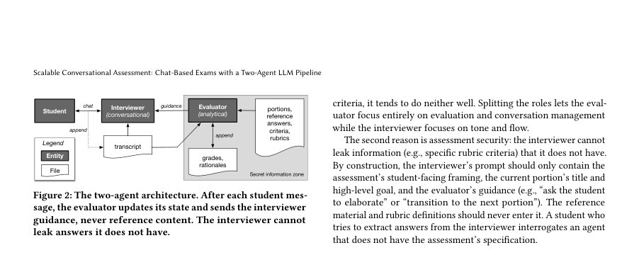

# Scalable Conversational Assessment: Chat-Based Exams with a Two-Agent LLM Pipeline

- **게시일:** 2026-11-15
- **arXiv:** [2611.17220v1](http://arxiv.org/abs/2611.17220v1) · [PDF](https://arxiv.org/pdf/2611.17220v1)
- **저자:** Geoffrey Challen, Craig Zilles
- **분야:** cs.CY, cs.AI
- **선정 점수:** 4.23
- **선정 이유:** 최근성 0.5, 인용 영향 0.0 (인용 0회), 저자 영향 0.0 (최고 h-index 0), AI 주제 적합성 3.0, 개발자 관심 0.2, 학술 신호 0.5, 오픈 웨이트·주요 연구조직 신호 0.0

[← 2026-11-15 목록으로 돌아가기](../daily/2026-11-15.html)

<!-- paper-visuals:start -->
## 주요 Figure

> 원문 PDF에서 실제 Figure 캡션과 그림 영역이 함께 확인된 자료만 자동 추출했다.

*Figure · 원문 PDF 3쪽 · Figure 2: The two-agent architecture. After each student mes-*

<!-- paper-visuals:end -->

## 한 문장 요약

대화형 채팅 시험을 위해 학생과 대화하는 인터뷰어 에이전트와 숨겨진 루브릭-추적 평가자 에이전트를 분리한 두-에이전트 파이프라인을 제안하고, 허구의 주제와 페르소나 기반 검증·교실 배포를 통해 실용성과 안전성 절차를 보여준다.

## 해결하려는 문제

구두·대화형 시험은 학생의 추론을 직접 확인하고 추후 질문으로 모호함을 해소할 수 있으나, 검사자 시간(확장성)과 사람 채점의 불일치(일관성) 때문에 대규모로 운영하기 어렵다. 또한 LLM 시대에는 학생이 AI에게 시험문제를 전달해 부정행위를 하는 위험이 있고, 자동 채점 시스템은 대화 중 유도(scaffolding)로 인해 학생 기여와 검사자 제공 정보를 구분하지 못할 수 있다.

## 핵심 기여

- 두-에이전트 아키텍처 제안: 학생과 직접 대화하는 인터뷰어(학생-가시)와 전체 목표와 루브릭을 알고 채점·대화관리를 하는 숨겨진 평가자(비가시)를 분리하여 정보 유출과 역할 혼란을 줄임.
- 스캐폴딩 인식을 포함한 부분(portion)-기반 루브릭과 세단계( not_started / partially_met / met ) 기준 및 최종 등급(E/S/N/U) 체계 설계로, 유도된 응답과 자발적 응답을 구별해 평가하도록 규정함.
- 허구 주제(Korvath Procedure)와 LLM 페르소나(정상/공격형)를 이용한 엔드투엔드 검증 하니스 도입으로, 사전학습 데이터 오염을 피하고 11개 페르소나에 대해 619개의 자동 검사로 회귀검사 수행.
- 소규모 교실 배포 및 기말(감독된) 시험 파일럿을 통해 실사용 데이터(41회 시도)로의 운영성·비용·감사 절차를 보고하고, 사후 재채점(audit)을 통해 운영 버그(상위 등급 관대함, 스캐폴딩 유출)를 발견하고 개선 방향을 제시함.
- 재현 가능성 관점의 실무 지침 제시: 페르소나 기반 회귀 테스트, 전체-전사 재검토(second-read)와 실시간 평가 분리, 감사-개선 루프 등 운영·안전성 절차를 구체화.

## 접근 방법

* 시스템은 두 개의 협력 에이전트로 구성된다.
* (1) 평가자(evaluator, 비가시)는 과제 설명, 참조답안, 세부 루브릭과 기준에 접근해 대화의 각 턴에서 구조화된 상태(JSON)를 갱신하고 기준별 채점( not_started / partially_met / met )과 전반 등급(E/S/N/U), 근거(rationale)를 생성한다.
* (2) 인터뷰어(interviewer, 학생-가시)는 평가자로부터 받은 '다음 행동에 대한 지침'만을 받아 학생과 자연어로 대화하며, 절대 참조 내용을 포함하지 않도록 제한된다.
* 각 학생 메시지마다 평가자가 전사 전체를 분석하고 인터뷰어에게 개방형 팔로업, 전환, 정지 등 지침을 보내며 평가자는 부분별 완료 판단(모든 기준 충족 혹은 더이상 채점 개선 기대 불가 시)에 따라 진행을 조절한다.
* 구현은 선언적 과제 파일(부분/기준/루브릭/등급 스케일)로 이루어지며, 생산 환경에서 GPT-5.2(Azure OpenAI)를 사용해 인터뷰어는 스트리밍 응답, 평가자는 구조화된 JSON 출력을 반환한다.
* 비용·토큰 예측과 동적 금지어(blocklist)로 참조 유출을 방지하는 자동 검사들을 통합했다.
* 검증은 허구 토픽(Korvath Procedure) 기반의 11개 페르소나(정상·공격형)를 GPT-4o로 구현해 엔드투엔드 대화를 시뮬레이션하고 619개의 자동 검사를 통해 회귀 테스트를 수행했다.

## 주요 결과

- 검증(시뮬레이션): 11개 페르소나에 대해 619개의 자동 검사를 수행했고(예: 기준이 충족될 때 충분한 근거 제시, 조기 진행 금지, 참조자료 유출 방지 등), 최종 검증 당시 페르소나별 기대 등급과 실제 등급이 일치(표 2).
- 허구 주제 사용의 필요성: 사전학습 데이터 때문에 페르소나가 실제 지식을 갖고 있을 수 있는 모형적 오류를 방지하기 위해 Korvath Procedure라는 허구 주제를 도입하여 페르소나가 정확히 의도된 지식 수준을 따르게 함.
- 교실 배포: 소규모(수강생 N=11) 세미나에서 세 과제에 대해 학생들이 총 41회 평가를 시도(이 중 1회는 최종 평가 호출 실패로 무등급), 배포된 시도의 중앙값 대화 시간은 과제별로 19~30분, 중앙값 학생 메시지 수는 7회.
- 토큰·비용: 중간에 토큰 텔레메트리를 추가한 19회 시도에서 중앙값 20개의 LLM 호출로 총 80,000 토큰을 사용했고, GPT-5.2 가격 기준으로 중앙값 비용은 $0.27, 평균 $0.31(논문 본문 수치).
- 배포 등급 분포(40건에 대한 등급): 20 E, 10 S, 5 N, 5 U. 한 건은 최종 평가 호출 실패로 등급 없음(총 41시도). 학생들은 평가 완료 후 즉시 등급과 피드백을 받음; 재채점 요청은 없었음(비학점 형식).

## 한계

- 저자 명시: 소규모 사례 보고서이다(한 기관, 한 교과목, 한 명의 강사이자 시스템 저자). 배포는 형성적·무학점 컨텍스트였으므로 학생 노력과 강사 검토에 영향을 미쳤을 수 있다.
- 저자 명시: AI 채점기 사이에 체계적 불일치가 존재함을 교차-모델 감사에서 확인했으며, 이 연구는 어느 쪽이 '정확'한지 결론내리지 못함(다양한 채점 관점의 범위만 보여줌).
- 저자 명시: 페르소나 하니스는 전형적(archetype) 페르소나를 테스트할 뿐이며 현실 학생 스펙트럼 전체를 대변하지 못함. 또한 학습 효과(assessment → learning 향상)는 측정하지 않음.
- 본문에서 확인되는 제한(추정·검증 가능한 제약): 생산 평가자가 점진적(per-turn) 채점 방식에서 스캐폴딩으로 유도된 학생 응답을 충분히 감산하지 않아 상위 등급(E)에 관대하게 채점하는 버그가 드러남(사후 재채점으로 확인). 이로 인해 전체-전사 재검토(second-read)가 필요함이 제안됨. 또한 비감독 환경에서는 학생이 질문을 외부 AI에 전달하는 부정행위 위험은 여전히 존재함.

## 개발자 관점

- 두-에이전트 분리(인터뷰어 vs 평가자)는 참조 유출 위험을 줄이고 대화 톤과 엄격한 루브릭 추적을 역할별로 최적화할 수 있으므로 재현 시 권장됨.
- 스캐폴딩 인식(rubric의 met/partially_met 경계)을 설계·검증하는 것이 핵심이다. 채점은 학생이 '자발적으로' 도입한 지식만 온전히 신용해야 하며, 상세한 추후질문으로 얻어진 답변은 감점(부분 충족)해야 함.
- 페르소나 기반 회귀 테스트(허구 주제 포함)를 CI처럼 운영하라. 생산 프롬프트나 모델 변경 시 페르소나 스윕으로 채점 규범이 변형되지 않았는지 반드시 확인해야 함.
- 운영상 실무: 평가자는 per-turn으로 대화를 관리하고 평가 상태를 유지하되, '최종 성적'은 세션 종료 후 전체 전사를 보는 두 번째 판독에서 산출·비교하도록 설계해 일관성 문제와 프롬프트 유출을 잡아내라.
- 시스템 구현 팁: 평가자는 구조화된 JSON 출력, 인터뷰어는 스트리밍 응답을 사용해 실시간성 확보. 동적 금지어(blocklist), 텔레메트리(호출수·토큰), 자동화된 회귀검사(예: 619개 체크)로 보안·회귀를 강화하라. 비용은 현재 수치로 한 회당 약 $0.27 중앙값이며 소규모 배포에서 실용적이다(논문 수치).

**근거 범위:** 이 분석은 제공된 논문 PDF 본문(페이지 1–7) 내용에 기반해 작성되었다. 본문에서 직접 확인 가능한 수치(예: N=11, 41시도, 11페르소나, 619검사, 토큰·비용 수치, 등급 분포, 재채점 일치율 등)만 사용했다. 프롬프트 원문, 전체 루브릭 파일, 시스템 코드와 같은 세부 구현은 본문에 완전 수록되어 있지 않아 존재 여부·정확한 텍스트는 확인 불가하며 해당 항목들은 명시적으로 만들지 않았다.
