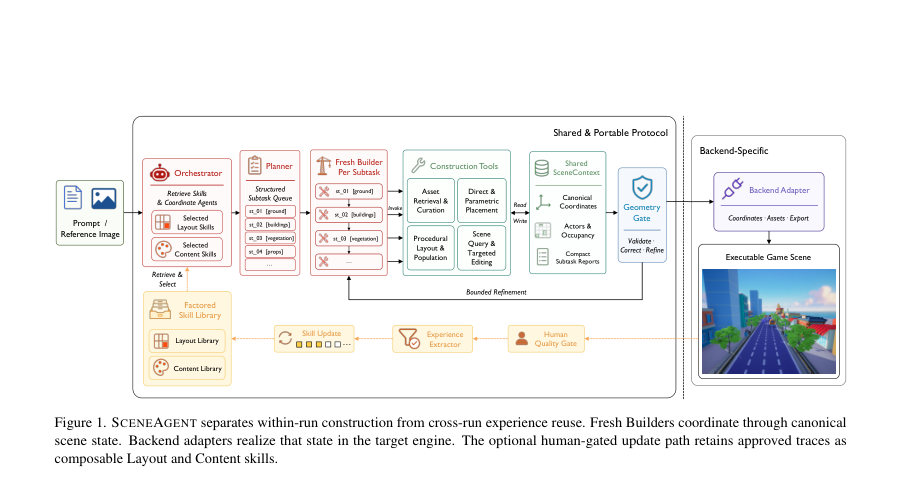
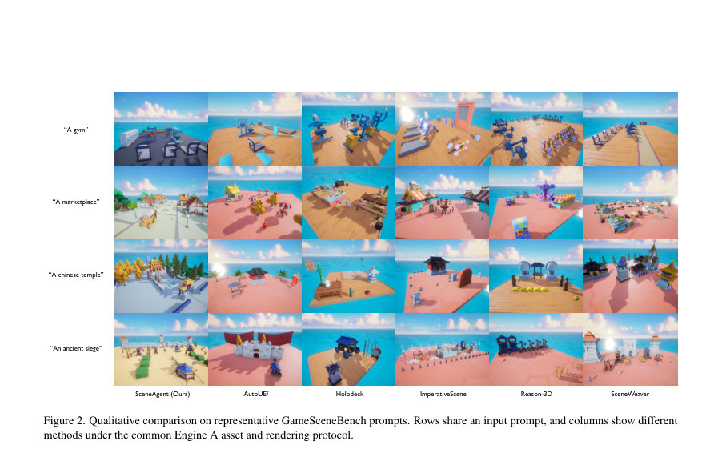
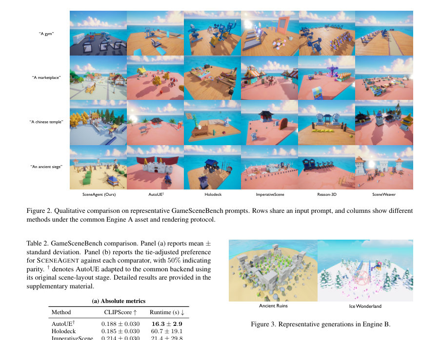

# SceneAgent: A Multi-Agent Framework for Portable Game Scene Generation

- **게시일:** 2026-11-16
- **arXiv:** [2611.17821v1](http://arxiv.org/abs/2611.17821v1) · [PDF](https://arxiv.org/pdf/2611.17821v1)
- **저자:** Xingyi Li, Jiahao Yang, Yiqin Zhu, Jingwen Ye, Yang Sun, Weidong Zhang
- **분야:** cs.CV, cs.AI
- **선정 점수:** 4.43
- **선정 이유:** 최근성 0.4, 인용 영향 0.0 (인용 0회), 저자 영향 0.0 (최고 h-index 0), AI 주제 적합성 3.0, 개발자 관심 0.6, 학술 신호 0.5, 오픈 웨이트·주요 연구조직 신호 0.0

[← 2026-11-16 목록으로 돌아가기](../daily/2026-11-16.html)

<!-- paper-visuals:start -->
## 주요 Figure

> 원문 PDF에서 실제 Figure 캡션과 그림 영역이 함께 확인된 자료만 자동 추출했다.

*Figure · 원문 PDF 3쪽 · Figure 1. SCENEAGENT separates within-run construction from cross-run experience reuse. Fresh Builders coordinate through canonical*

*Figure · 원문 PDF 6쪽 · Figure 2. Qualitative comparison on representative GameSceneBench prompts. Rows share an input prompt, and columns show different*

*Figure · 원문 PDF 6쪽 · Figure 3. Representative generations in Engine B.*

<!-- paper-visuals:end -->

## 한 문장 요약

게임 엔진 교체 시에도 설계·구성 프로세스와 축적된 경험을 재사용할 수 있도록, 공통의 정준 장면 상태(SceneContext), Planner–Builder 다중 에이전트 프로토콜, 그리고 자산 ID에 독립적인 Layout/Content 형식의 재사용 가능한 스킬 라이브러리를 결합한 SceneAgent 프레임워크를 제안한다.

## 해결하려는 문제

기존 LLM 기반 장면 생성 시스템은 최종 출력 파일만 교환하면 되는 수준을 넘어서, 계획(planning), 구성 도구(tooling), 실행 기록 및 자산 바인딩 등 백엔드(엔진) 특화 요소들이 남아 있어 다른 엔진으로 이식할 때 설계 의도와 재사용 가능한 경험이 유실된다. 본 연구는 '구성 포터빌리티(construction portability)'를 다루며, 장면 생성 과정과 세션 간/세대 간 재사용 가능한 공간·의미 지식을 백엔드 종속성에서 분리해 유지하는 것을 목표로 한다.

## 핵심 기여

- 정준 장면 상태(SceneContext)와 공통 툴 인터페이스·명시적 백엔드 경계를 결합한 구성-포터빌리티 설계 제안.
- Planner–Builder(오케스트레이터 포함) 프로토콜로 신선한 Builder 세션들이 구조화된 핸드오프와 압축된 완료 리포트를 통해 지속적 장면 상태를 조회·수정하도록 하는 다중 에이전트 실행 흐름 제안.
- 인간 승인된 생성 기록을 자산 ID에 독립적인 Layout 스킬(공간 조직)과 Content 스킬(의미·스타일)로 분해·저장·검색·재조합하는 사실화된 경험 라이브러리 설계.
- GameSceneBench 벤치마크(69개 프롬프트: 56개 야외, 13개 실내)와 공통 자산·렌더링·카메라 프로토콜 하에서의 비교 평가를 통해 다섯 개 기존 방법 대비 우수성(인간 선호 및 VLM 평가)을 실증.
- 백엔드 어댑터와 능력 래퍼를 통해 좌표·단위·자산 바인딩·내보내기를 분리함으로써 동일한 구성 프로토콜을 다른 엔진으로 재배포하는 실증적 데모.

## 접근 방법

* 핵심 구성 요소는 (1) SceneContext: 빌더 좌표계(정준 좌표계, X: 좌우, Y: 상하, Z: 전후)에 배우(actor)별 자산 참조·변환·바운딩박스·점유(occupancy)·서브태스크 provenance를 기록하고 장면 쿼리·검증을 제공하는 공통 상태 저장소; (2) Planner–Builder 프로토콜: Orchestrator가 레이아웃·콘텐츠 스킬을 검색해 Planner에 전달하고, Planner가 의미적 서브태스크(예: ground, buildings, vegetation, props 등) 큐를 생성한 뒤 각 서브태스크마다 새로운 Builder 세션을 띄워 작업 목표·공유 규약·관련 스킬·완료 리포트를 주고받음.
* 각 Builder는 SceneContext를 쿼리해 필요한 정보만 조회하고 툴(자산 검색·직접·관계 기반 배치·매개변수적 구조 생성·영역 채우기·지오메트리 검증 등)을 통해 장면을 수정하며, 서브태스크 종료 시 컴팩트 리포트를 반환한다.
* (3) 백엔드 경계: 어댑터가 좌표 축 변환, 단위 변환(예: 게임 유닛→미터), 쿼터니언 회전, 자산 바인딩 및 직렬화를 담당해 동일한 SceneContext를 서로 다른 엔진에 내보낼 수 있게 함.
* (4) 경험 팩터화: 인간 승인된 트레이스를 Layout 스킬(공간 규칙·토폴로지·제약, 자산 ID 없음), Content 스킬(역할·스타일·대체 규칙, 자산 바인딩 없음), 그리고 thin recipe(두 스킬을 결합하고 장면 고유 잔류 요구만 보존)로 분해해 인덱스화·검증·중복 제거 후 라이브러리에 저장.
* (5) 품질 게이트: 자동 지오메트리 진단(충돌·부적절 변환·밀도 이상 등)과 함께 인간 리뷰어가 최종 승인/거절을 결정하고 승인된 경우 경험 추출기가 스킬로 분해해 저장.
* 런타임·제약: Orchestrator 최대 30 라운드, Planner 50 라운드·40 툴콜, 각 Builder 40 라운드, 자동 정제 최대 3회 등으로 예산 제한.

## 주요 결과

- 데이터셋: GameSceneBench(69 프롬프트: 56 야외, 13 실내). 모든 방법은 동일한 자산 카탈로그, 렌더링 파이프라인, 카메라(4개 관측 + 탑다운 1개) 및 3번 독립 실행으로 평가.
- 정량 지표: CLIPScore는 CLIP ViT-L/14로 각 뷰별 점수를 평균(5뷰)한 뒤 3회 실행 평균을 취함. 런타임은 프롬프트 제출부터 장면 파일 완성까지의 실제 벽시계 시간(렌더링·VLM 평가·인간 평가 제외).
- 주요 비교(표 2(a)): SCENEAGENT의 평균 CLIPScore = 0.216 ± 0.034, 평균 런타임 = 203.2 ± 97.8초. (비교자들) AutoUE† 0.188 ± 0.030 / 16.3 ± 2.9 s, Holodeck 0.185 ± 0.030 / 60.7 ± 19.1 s, ImperativeScene 0.214 ± 0.030 / 21.4 ± 29.8 s, Reason-3D 0.196 ± 0.033 / 23.2 ± 11.4 s, SceneWeaver 0.193 ± 0.030 / 226.4 ± 140.0 s.
- VLM 및 인간 선호(표 2(b) 및 본문): SCENEAGENT은 다섯 개 baseline에 대해 텍스트 정렬(Alignment), 공간 타당성(Plausibility), 장면 완전성(Completeness) 각 차원에서 우위를 보였으며, 인간 평가에서 각 비교에 대한 tie-adjusted 선호율은 AutoUE† 89.4%, Holodeck 85.2%, ImperativeScene 78.2%, Reason-3D 81.2%, SceneWeaver 82.7%. 전체 인간 비교(1,860 판단)에서 SCENEAGENT은 76.9% 승리, 12.7% 동률, 10.3% 패배로 tie-adjusted 선호 83.3%를 기록함.
- 재사용 경험 라이브러리 절편화 실험(표 3): 라이브러리 크기별 CLIPScore 및 런타임: 0 스킬 0.211 ± 0.031 / 173.3 ± 56.4 s, 20 스킬 0.214 ± 0.032 / 190.8 ± 67.9 s, 50 스킬 0.216 ± 0.034 / 203.2 ± 97.8 s. 전체 라이브러리(50) 대 0 스킬 비교에서 정렬(Align) 선호 59.7%, 완전성(Comp) 63.8% 등으로 스킬이 정렬과 완전성 개선에 기여함을 보임(공간 타당성 개선은 일관되지 않음). 런타임은 스킬 접근에 따라 증가함을 보고함(173.3→203.2 s). (본 실험의 경험 라이브러리는 평가 전 고정됨).  
    
    Single- vs Multi-agent(표 4): 단일 에이전트 변형 CLIPScore 0.210 ± 0.032, 런타임 39.3 ± 24.2 s; 다중 에이전트(제안 방법) CLIPScore 0.216 ± 0.034, 런타임 203.2 ± 97.8 s. VLM 차원에서 다중 에이전트는 정렬(57.5%), 완전성(62.4%)에서 우위, 공간 타당성은 거의 근접(51.0%). 즉, 다중 에이전트는 완성도·정렬 개선을 가져오나 상당한 시간 비용을 수반함을 실증함. 
    
    교차 엔진·교차 LLM: 엔진 재배포(Engine B)에서는 어댑터·자산 DB·능력 래퍼만 교체하고 SceneContext·스킬·프로토콜을 재사용해 정성적 재타깃팅을 시연(정량 비교는 카탈로그 불일치로 수행하지 않음). LLM 교체 실험에서 Gemini 3.5 Flash의 CLIPScore는 0.220(DeepSeek 0.216)으로 약간 높았으나 런타임은 Gemini 374.8 s vs DeepSeek 203.2 s로 크게 느렸고, VLM 전체 선호는 양자 근접(예: Gemini 51.2% vs DeepSeek 48.9%)로 모델별 성능·속도 트레이드오프가 관찰됨.

## 한계

- 저자가 명시한 한계: 백엔드 포팅은 어댑터와 호환 자산이 필요하며(따라서 완전 자동 재타깃팅 불가), 교차 엔진 실험은 다른 카탈로그를 사용하므로 정량적 동등 비교가 아닌 정성적 재타깃팅 증명임.
- 저자가 명시한 한계: Fresh Builder 세션은 전체 실행 기록을 재생성하지 않지만 장면이 커질수록 컨텍스트 크기가 일정하다고 보장하지 않음.
- 저자가 명시한 한계: 다중 에이전트 오케스트레이션은 런타임 비용을 증가시키고, 인간 승인 기반 경험 업데이트는 확장성에 제약을 둠.
- 저자가 명시한 한계: 렌더된 뷰에서의 선호도와 지오메트리 검사는 물리적 안정성, 길찾기 가능성, 실제 게임 플레이 성공을 보장하지 않음(물리·내비게이션 검증 미포함).  
    
    본문·실험에서 드러나는 제한: 경험 라이브러리 이득은 정렬과 완전성에 집중되나 공간적 타당성 개선은 일관되지 않았고, 스킬 검색·조합 비용이 런타임을 더 증가시킴. 또한, 비교 실험에서 각 baseline을 공통 백엔드에 적응시켰으므로 원본 시스템의 네이티브 능력(예: 엔진 고유 편집기·온라인 자산 등)이 완전히 반영되지 않을 수 있음.

## 개발자 관점

- 구성 프로토콜(정준 좌표·SceneContext·툴 인터페이스)을 백엔드와 분리하면 동일한 '설계 의도'와 재사용 가능한 경험을 다른 엔진으로 이식 가능하므로, 엔진 전환·멀티플랫폼 배포에 유리하다.
- 백엔드 어댑터 패턴을 명시적으로 설계(좌표 축/단위 변환, 자산 ID 해석, 직렬화)하면 Builder 정책·스킬 라이브러리를 변경하지 않고도 엔진별 통합만 교체해 재사용할 수 있다.
- 경험 팩터화(레이아웃 vs 콘텐츠)는 재사용성과 조합성을 높이지만, 스킬 검색·적용 비용과 런타임 증가를 초래하므로 실시간·대규모 생산에서는 예산·캐싱 전략이 필요하다.
- 인간 품질 게이트는 스킬 라이브러리의 신뢰도를 보장하나 업데이트 처리량을 제한하므로 자동 검증(지오메트리·제약 검사)과 반자동 워크플로(예: 우선순위 기반 리뷰)가 필요하다.
- 재현을 위해 논문에서 사용한 주요 설정을 따른다: DeepSeek-V4-Flash(기본), Orchestrator 30 라운드, Planner 50 라운드·최대 40 툴콜, Builder 세션 40 라운드, 경험 라이브러리 고정 평가 등. 또한 공통 자산 카탈로그와 렌더링·카메라 규약을 확보해야 비교 가능하다.

**근거 범위:** 논문 PDF 본문(메인 텍스트 및 Supplementary 포함, 제공된 전체 페이지)을 근거로 작성한 분석이다. 본문에 명시된 수치(예: CLIPScore, 런타임, 선호율, 라운드·툴콜 예산)와 표·열거된 실험 설정만 사용했으며, 확인되지 않은 구현 세부사항이나 수치는 추가하지 않았다. 일부 정성적 엔진 재배포 결과은 저자가 밝힌 것처럼 서로 다른 자산 카탈로그로 인해 정량적 비교가 제한적임을 본문에서 확인했다.
