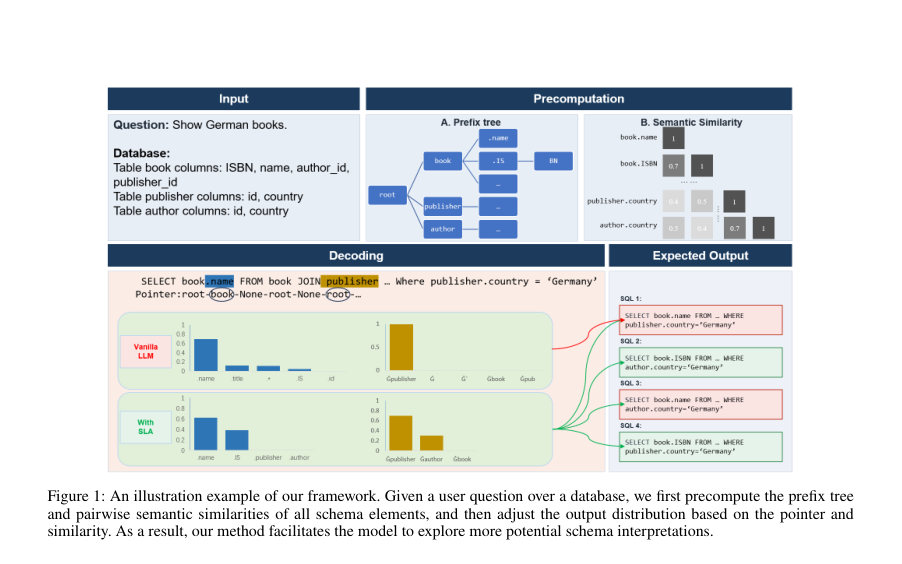
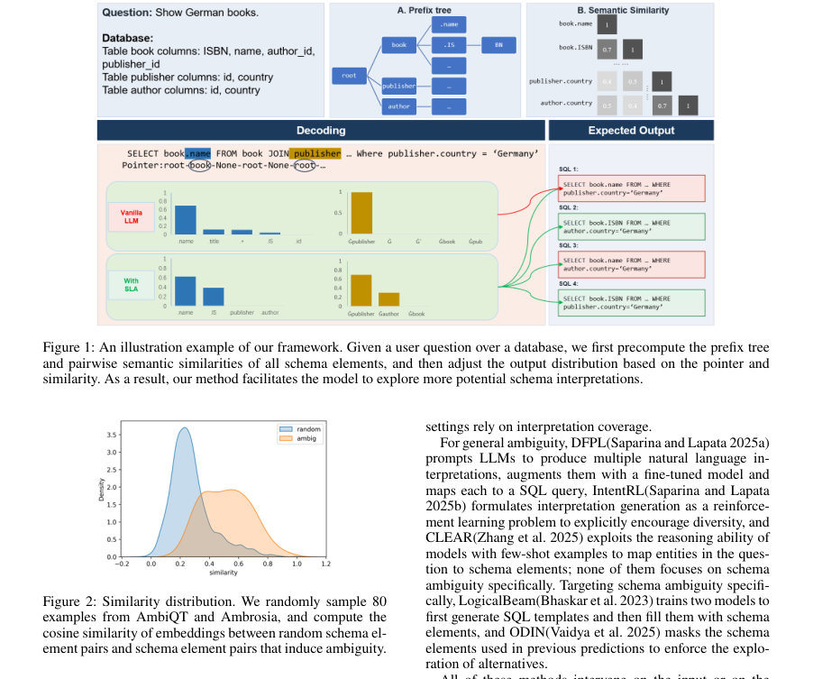
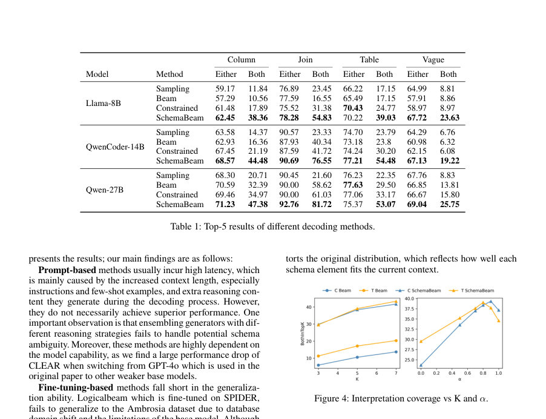

# Semantic-aware Decoding for Diverse Text-to-SQL under Schema Ambiguity

- **게시일:** 2026-11-24
- **arXiv:** [2611.30873v1](http://arxiv.org/abs/2611.30873v1) · [PDF](https://arxiv.org/pdf/2611.30873v1)
- **저자:** Yuxuan Jiang, Anna Mitsopoulou, Apostolos Koukouvinis, Yannis Velegrakis, Georgia Koutrika
- **분야:** cs.CL, cs.AI
- **선정 점수:** 4.51
- **선정 이유:** 최근성 1.1, 인용 영향 0.0 (인용 0회), 저자 영향 0.0 (최고 h-index 0), AI 주제 적합성 2.6, 개발자 관심 0.5, 학술 신호 0.3, 오픈 웨이트·주요 연구조직 신호 0.0

[← 2026-11-24 목록으로 돌아가기](../daily/2026-11-24.html)

<!-- paper-visuals:start -->
## 주요 Figure

> 원문 PDF에서 실제 Figure 캡션과 그림 영역이 함께 확인된 자료만 자동 추출했다.

*Figure · 원문 PDF 2쪽 · Figure 1: An illustration example of our framework. Given a user question over a database, we first precompute the prefix tree*

*Figure · 원문 PDF 2쪽 · Figure 2: Similarity distribution. We randomly sample 80*

*Figure · 원문 PDF 6쪽 · Figure 4: Interpretation coverage vs K and α.*

<!-- paper-visuals:end -->

## 한 문장 요약

스키마 요소 간 의미적 유사도를 이용해 토큰 로그릿을 조정하는 훈련 불필요한 디코딩 기법(SLA)을 제안하여 텍스트→SQL에서 스키마 모호성으로 인한 다양한 해석(interpretation coverage)을 효율적으로 향상시킨다.

## 해결하려는 문제

실제 텍스트→SQL 시스템은 질문이 여러 개의 합리적 스키마 요소(테이블·컬럼)로 해석될 수 있는 스키마 모호성에 자주 직면한다. 기존의 빔서치나 샘플링 같은 다양한 디코딩은 로그릿 분포가 한 토큰에 매우 편향되어 있어 서로 다른 의미적 해석을 포획하지 못하고, 최근 제안된 방법들은 추론 중심의 프롬프트 확장이나 과적합 가능한 태스크별 파인튜닝에 의존하여 높은 계산비용과 모델종속성이라는 한계를 가진다. 연구 질문은 '훈련이나 대규모 프롬프트 없이 디코딩 단계에서 분포를 수리하여 서로 다른 스키마 해석들을 top-k에 포함시킬 수 있는가?'이다.

## 핵심 기여

- Semantic-aware Logit Adjustment(SLA): 사전 계산된 스키마 요소 임베딩 유사도를 이용해 디코딩 시점에 토큰 로그릿을 조정함으로써 스키마 해석의 다양성을 촉진하는 훈련 불필요한 방법을 제안함.
- 토큰-레벨 접두사 트리 기반 추적기: 디코딩 중 현재 토큰이 스키마 요소 생성 중인지와 허용 가능한 다음 토큰 집합을 실시간으로 추적하는 토큰단위 prefix tree 포인터 메커니즘을 도입함.
- 유사도 정규화 및 집합 유사도 집계: 임베딩 간 코사인 유사도에 히스토그램 평준화를 적용해 모델 간 스케일 차이를 제거하고, 노드(토큰 접두사) 간 유사도는 각 대상 요소를 가장 유사한 기준 요소와 매칭한 뒤 평균하는 매치-후-평균 방식으로 계산함.
- SchemaBeam: SLA를 빔서치에 통합하고 관련 토큰 마스킹, AST 기반 출력 중복 제거 등을 추가하여 실제 해석 커버리지를 높이고 불필요한 문서/포맷 다양성을 줄인 실용적 디코딩 파이프라인을 제시함.
- 광범위한 실험적 검증: AmbiQT와 Ambrosia의 스키마 관련 모호성 설정에서 여러 베이스 모델(Llama3.1-8B, Qwen2.5-Coder-14B, Qwen3.6-27B)에 대해 SLA/SchemaBeam이 BothInTopK와 EitherInTopK를 일관되게 향상시키며, 1.1× 수준의 추론 지연으로 파인튜닝·프롬프트 기반 방법과 경쟁적 성능을 보여줌.

## 접근 방법

* 전체 워크플로우는 오프라인과 디코딩 시 단계로 나뉜다.
* 오프라인에서 모든 스키마 요소(테이블명, table.column)를 모델 토크나이저 기준으로 토큰화하여 토큰-레벨 접두사 트리(prefix tree)에 삽입하고, 각 요소를 문장임베딩 모델(예: all-MiniLM-L6-v2)로 임베딩한 뒤 모든 요소 쌍의 코사인 유사도를 계산하여 히스토그램 평준화로 [0,1]로 정규화한 유사도 행렬 S를 저장한다.
* 디코딩 중에는 접두사 트리 포인터를 유지해 현재 생성 중인 스키마 요소와 그 자식 토큰 집합 A를 식별한다.
* 포인터가 스키마 요소 내부(root 또는 inner node)일 때만 작동하며, 허용되지 않은 토큰은 -∞로 마스킹한다.
* 모델의 현재 선호 토큰 q(자식 집합 A 내에서 최고 로그릿)를 기준으로 각 후보 토큰 d에 대해 Cd(그 토큰 아래로 도달 가능한 실제 스키마 요소 집합)와 Cq(선호 토큰 아래 요소 집합) 간 유사도를 sim(Cq,Cd)= (1/\|Cd\|) Σ_{j∈Cd} max_{i∈Cq} S[i,j]로 계산한다.
* 보정량은 b_q(d)=λ·sim(Cq,Cd)이며 λ는 q와 2위 q'의 로그릿 격차의 α배(λ=α(z_q−z_q'))로 정해져 0<α<1로 설정하여 argmax가 변경되지 않도록 보장한다.
* SLA는 빔서치·샘플링 등 디코더와 호환되며, SchemaBeam은 SLA에 추가로 관련 토큰 마스킹과 AST 기반 출력 중복 제거, 필요 위치(SELECT/FROM/JOIN 테이블명, SELECT/WHERE/GROUP BY/HAVING/ORDER BY 컬럼 등)에만 적용하도록 제약을 둔다.
* 또한 COUNT 내부와 ON절 등은 제외한다.

## 주요 결과

- 평가 데이터 및 지표: AmbiQT(2948 예제; Column, Join, Table ambiguity)와 Ambrosia(373 vagueness 예제)를 사용하였고, 지표는 top-K(기본 K=5) 내의 EitherInTopK(적어도 하나 포함) 및 BothInTopK(두 해석 모두 포함)로 측정함.
- 대표적인 정량 결과(Top-5, Qwen2.5-Coder-14B 기준, Table 1): 빔서치 대비 SchemaBeam의 BothInTopK 상승 — Column: 16.36% → 44.48% (+28.12 pp), Join: 40.34% → 76.55% (+36.21 pp), Table: 23.80% → 54.48% (+30.68 pp), Vague(Ambrosia): 6.32% → 19.22% (+12.90 pp).
- 작동 모델 범위: 세 가지 베이스 모델(Llama-8B, QwenCoder-14B, Qwen-27B) 전반에서 BothInTopK가 모든 설정에서 일관되게 향상되었고, EitherInTopK도 대부분의 경우 개선되었음(예: Llama‑8B Column Either: Beam 57.29 → SchemaBeam 62.45).
- 효율성: SchemaBeam은 기본 빔서치 대비 약 1.1×(약 10%)의 추론 지연을 추가하였고, 프롬프트 기반 또는 테스트타임 확장 방법들(1.59–10.9×)보다 훨씬 효율적임(Table 2).
- 성분 분석: SLA 자체가 가장 큰 성능 기여를 하며, 접두사 기반 제약(Constrained beam)과 토큰 마스킹·AST 중복 제거도 추가적 이득을 제공함(Abalation, Table 3). 임베딩 모델 변경(all-mpnet-base-v2, Qwen3-Embedding-0.6B 등)은 정규화로 인해 민감도가 낮음.

## 한계

- 저자가 명시한 한계: (1) SLA는 토큰 보정을 통해 스키마 요소 선택 다양성을 촉진하지만 SQL 구조(클래스/서브쿼리 누락·중복 등)에서 발생하는 오류까지는 해결하지 못해 EitherInTopK가 항상 향상되지 않을 수 있음(본문, Sec.5.2). (2) 적용 위치를 제한(예: ON절과 COUNT 내부는 제외)하여 일부 조인 제약이나 COUNT 관련 정답의 순위가 낮아질 수 있음(본문 Sec.4.2 및 사례 연구). (3) 프롬프트·파인튜닝 기반 방법에 비해 성능은 경쟁적이지만, 일부 데이터셋·기법(예: LogicalBeam)이 도메인 전이에서 실패하는 것처럼 SLA도 평가한 두 벤치마크(AmbiQT, Ambrosia)에 주로 검증되었음.
- 본문 실험·설정에서 확인 가능한 제약(분석자가 본문에서 합리적으로 확인한 한계): (1) 데이터셋 범위 제한: 평가가 AmbiQT와 Ambrosia(주로 스키마 관련 모호성)에 국한되어 있어 자연어 수준의 애매함(attachment/scope 등 전반적 모호성)에 대한 일반화는 제한적임. (2) 임베딩 품질 의존성: 방법은 스키마 요소 임베딩의 의미적 구조에 의존하므로 임베딩 모델의 품질·토크나이저 정렬(tokenization alignment)에 따라 성능이 달라질 가능성이 있음(본문은 임베딩 모델을 교체해 실험했으나 전체 의존성은 존재). (3) 하이퍼파라미터 민감도: α 값에 따라 성능 변화가 있으며(실험에서 α≈0.8 근처에서 최고 성능), 매우 큰 α는 원본 분포를 과도하게 왜곡할 수 있음(Abalation). (4) 구현 의존성: 접두사 트리 및 토큰-레벨 포인터는 사용한 모델의 토크나이저와 정확히 일치해야 하므로 실전 재현에서 토크나이저 불일치가 문제될 수 있음.

## 개발자 관점

- 재현을 위해서는 데이터베이스별로 한 번만 수행되는 오프라인 단계가 필요: (1) 모델 토크나이저에 맞춰 모든 스키마 요소(table 및 table.column)를 토큰화하여 토큰-레벨 접두사 트리를 구성하고, (2) 선택한 문장임베딩 모델로 요소 임베딩을 계산해 코사인 유사도를 구하고 히스토그램 평준화로 정규화한 유사도 행렬 S를 저장해야 한다.
- 토크나이저 정렬의 중요성: 접두사 트리·포인터 로직은 토큰 경계에 민감하므로 베이스 LLM의 토크나이저와 동일한 토크나이저를 사용해 접두사 트리를 구성하고 토큰 단위 매칭을 구현해야 한다(특히 대문자·특수문자 분할 주의).
- 실시간 디코딩 구현: decoding 루프에서 포인터 상태를 매 스텝 갱신하고, 포인터가 root/inner node일 때만 children 집합 A로 다른 토큰을 -∞ 마스킹한 뒤 SLA 보정(λ=α(z_q−z_q'))을 적용해야 한다. argmax가 바뀌지 않도록 α∈(0,1)으로 설정한다(실험상 0.7–0.8 권장).
- 임베딩·유사도 선택: 임베딩 모델은 coarse-grained 의미구조를 잡아주면 되며, 논문 실험에서는 all-MiniLM-L6-v2를 기본 사용했고 다른 모델에서도 민감도가 낮았음. 단, 유사도 분포 스케일 차이를 제거하기 위해 히스토그램 평준화(quantile normalization)를 반드시 수행할 것.
- 운영·배포 관점: 훈련이 필요 없고 오프라인 유사도 계산(데이터베이스당)만 요구하므로 배포 비용이 낮음. 추론 오버헤드는 약 10%로 실사용에 적합하며, 프롬프트/파인튜닝 방식보다 비용 효율적임. 다만 SLA가 추가 선택지를 활성화하면서 top-1 정확도가 변화하거나(예: COUNT 관련 정답 순위 하락) 랜덤성이 늘어날 수 있으므로 UI에서 사용자 선택/명확화(interactive disambiguation) 연계가 권장됨.

**근거 범위:** 논문 PDF 본문(페이지 1–8)에 근거한 분석임. 표와 알고리즘(Alg.1), 실험 표(Table 1–3) 및 사례 연구와 절단(ablation) 결과를 직접 참조하여 정량·정성 내용을 기술하였다. 코드·추가 실험 세부값(예: 전체 하이퍼파라미터 그리드, 임베딩 모델의 모든 세부 버전/토크나이저 매핑)은 본문에 상세히 기재되지 않았으므로 해당 항목들은 본문에서 확인 가능한 범위 내에서만 보고하였다.
