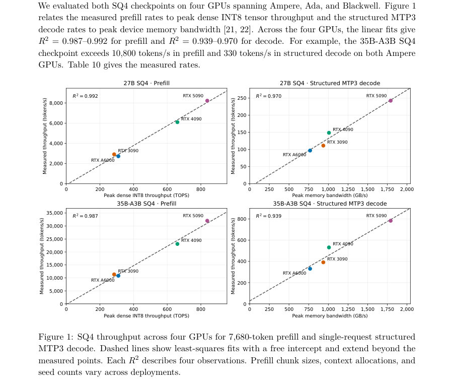

# Shifter Quantization: Compact Representations for Native Integer Computation

- **게시일:** 2026-11-25
- **arXiv:** [2611.33080v1](http://arxiv.org/abs/2611.33080v1) · [PDF](https://arxiv.org/pdf/2611.33080v1)
- **저자:** Yufeng Huang
- **분야:** cs.LG
- **선정 점수:** 6.55
- **선정 이유:** 최근성 1.3, 인용 영향 0.0 (인용 0회), 저자 영향 0.0 (최고 h-index 0), AI 주제 적합성 2.7, 개발자 관심 0.5, 학술 신호 0.3, 오픈 웨이트·주요 연구조직 신호 1.8

[← 2026-11-25 목록으로 돌아가기](../daily/2026-11-25.html)

<!-- paper-visuals:start -->
## 주요 Figure

> 원문 PDF에서 실제 Figure 캡션과 그림 영역이 함께 확인된 자료만 자동 추출했다.

*Figure · 원문 PDF 16쪽 · Figure 1: SQ4 throughput across four GPUs for 7,680-token prefill and single-request structured*

<!-- paper-visuals:end -->

## 한 문장 요약

그룹별 스케일로 인한 정수 MMA 활용 제한을 해결하기 위해, 공유 비트 추가와 그룹별 시프트로 정수 피연산자를 재구성하는 Shifter Quantization(SQ)과 이를 INT4 연산에 맞춘 변형 Shifter Integer(SHI)를 제안하여 낮은 비트폭에서 정확도와 GPU 추론 속도를 동시에 개선한다.

## 해결하려는 문제

기존의 그룹별(groupwise) 스케일 기반 양자화는 낮은 비트 폭에서 정확도를 유지하기 위해 유용하지만, 서로 다른 그룹 스케일이 같은 내적에 포함될 때 각 그룹 기여를 따로 유지·스케일해야 하므로 표준 정수 MMA가 전체 축(K 차원)으로 누적(accumulate)하지 못하게 된다. 그 결과 하드웨어 효율을 충분히 활용하지 못하고, 블록 스케일 명령은 제한된 포맷과 그룹 크기만 지원하여 범용적으로 적용하기 어렵다. 연구 질문은 '작은 그룹 단위의 지역적 적응능력을 유지하면서도 정수 MMA가 전체 reduction 차원에 걸쳐 동작하도록 하는 표현법을 설계해 실사용 GPU에서 낮은 비트폭의 모델 추론 속도와 품질을 모두 개선할 수 있는가'이다.

## 핵심 기여

- Shifter Quantization (SQ): 저비트 코드에 대해 그룹별 공유 비트를 덧붙이고(append) 그룹별 시프트를 적용한 뒤 타깃 정수 폭으로 잘라(truncate) 정수 피연산자를 재구성하여 그룹 스케일을 메인 정수 축 내에서 제거하고 전체 reduction 차원에서 MMA를 사용하게 함.
- Shifter Integer (SHI): SQ를 확장해 메인 행렬곱을 INT4로 수행하고, 그룹 단위 보정(가중치·활성화 보정)을 짧은 정수 제품들로 평가하여 INT4 기반의 더 효율적인 실행 경로를 제공함.
- 수치적·시스템적 평가: 투영(projection) 수준, 전체 체크포인트 수준(위키텍스트-2 KL·top-1·PPL), 그리고 실제 서빙(단일/동시 요청, prefill, structured decode) 수준에서 SQ/SHI를 llama.cpp, NInfer, vLLM, NVFP4 등과 비교해 품질과 추론량(throughput) 개선을 보였음.
- 실행 프로필·표현 규격 제시: SQx-GyAmSn와 같은 포맷 표기, 코드·그룹 필드와 bpw(비트/가중치) 식(BSQ=(x+m+n)/y), 그리고 SHI의 W4A4/W4.5A4/W4.5A4.5 같은 제품 구조 및 계산량 프로파일을 제시함.
- 하드웨어·GPU 간 확장성 관찰: 여러 GPU(Ampere/Ada/Blackwell)에서 SQ4의 prefill throughput이 장치의 peak dense INT8 throughput과, structured decode가 메모리 대역폭과 각각 높은 상관(R^2≈0.94–0.99)을 보인다는 실험적 관찰 제공.

## 접근 방법

* (조건화와 기저) 각 projection은 서명된 정규화 Hadamard 블록 회전(예: B=512 블록의 UB = DB HB)과 입력/출력 채널 스케일(Ci, Co)로 조건화한 뒤, 정수 재구성 P를 찾아 WU ≃ Co P Ci 관계를 만족하도록 적합(fit)한다.
* 이 회전과 채널 스케일은 양자화 기저의 조건화 수단이다.
* (SQ 표현 및 재구성) SQ는 각 가중치에 대해 기저 코드 q(부호 x-bit)를 저장하고, 그룹당 공유 append 필드 a_g(m-bit)와 그룹별 shift 선택자 r_g(n-bit)을 함께 저장한다.
* 재구성은 세 단계로 이루어진다: 1) append: z = (q << m) + a_g, 2) grouped shift: v = (z << ℓ) >> r_g (정수 시프트, 산술 오른쪽 시프트 포함), 3) truncate: P = clipt( v >> δ )로 타깃 정수 폭 t(INT8/INT4 등)으로 잘라낸다.
* 포맷 표기법은 SQx-GyAmSn (x: 코드 비트, y: 그룹 크기, m: append 비트, n: shift 비트)이고, 저장(bpW)은 (x+m+n)/y이다.
* 이로써 그룹별 정보가 정수 피연산자 내부에 포함되어 메인 정수 축에서 별도의 그룹 스케일을 적용할 필요가 사라진다.
* (SHI: INT4 중심 구조) SHI는 가중치를 베이스와 그룹 보정으로 분해해 w = ρ q + r 형태로 표현한다.
* 베이스 q는 INT4에 맞게 설계되어 메인 제품은 전체 K에 걸쳐 INT4 연산(W4A4)을 사용하고, 그룹별 보정은 그룹 합(sum over group)과 짧은 INT4 제품으로 계산한다 (W4.5A4: 가중치 보정만, W4.5A4.5: 가중치·활성화 보정 포함).
* 그룹 보정 제품은 길이가 K/y로 짧아 추가 비용이 작다.
* 제품 수에 따른 논리적 작업량은 표(Table 1)로 제시되어 있으며, 예: G=8일 때 두·세 제품은 각각 1.125K, 1.25K의 INT4 작업량에 해당.
* (활성화 양자화) 활성화는 A4(그룹 보정 포함), A8, A16 경로를 지원한다.
* A4에서 동적/정적 클리핑 팩터(α∈{0.5,0.625,0.75,0.875,1})를 탐색해 토큰별 스케일 Sα를 선택하고, 그룹 보정 c 등 추가 필드를 적합한다.
* A8는 토큰별 스케일로 INT8 제품을 수행하고, A16은 BF16/FP16 산술을 사용한다.
* 아웃라이어 보호(outlier protection)는 선택적으로 활성화 가능하다.
* (구현·비교) 서버 수준 평가를 위해 Shifter Engine 구현을 사용하고, llama.cpp Qx_* 계열, NInfer, vLLM, NVFP4/MXFP4 등과 동일한 BF16 참조와 조건으로 비교(투영 레벨/전체 체크포인트/서빙)했다.
* 측정은 RTX 5090 등 GPU에서 이루어졌고, 시간 측정에는 활성화 준비, 매트릭스 곱, 스케일 적용, residual 더하기, 백엔드 변환, 동기화 등을 포함한다.

## 주요 결과

- 프로젝션(투영) 레벨(MLP down projection, Qwen3.8-27B layer-31, RTX 5090, 4,096 tokens): SQ2-G4A1S1(INT8 activations) packed bpw=2.500, output error 22.971%, latency 1,504.74 µs, 2.77× throughput vs llama.cpp Q2_K. 동일 가중치로 SHI2(INT4 single-product) output error 27.924%, latency 914.34 µs, 4.55× speedup (Table 2).
- 4-bit 투영: SQ4-G8A2S2/INT8 bpw=4.500 output error 6.804% latency 1,481.26 µs (1.94× vs Q4_K). SHI4 (G8A4S0) INT4 path bpw=4.500 output error 12.236% latency 1,014.05 µs (2.83×). NVFP4/FP8 paths show 더 빠른 INT4-equivalent latency(예: 767.71 µs)지만 활성화 정밀도·오류가 다른 경우 존재(Table 3).
- 풀 체크포인트 · WikiText-2(메트릭: KL, top-1, PPL): 2-bit weight-only fits: Shifter-SQ2 KL=0.20001, SHI2 KL=0.21210, Q2_K refit KL=0.27849 — SQ2/SHI2는 refit 대비 KL 28.2%/23.8% 감소(Table 4).
- 릴리스 체크포인트(2-bit): Qwen3.8-27B Bartowski Q2_K 대비 Shifter-SQ2 KL=0.15322 top-1=84.02% PPL=7.57241 4,096-token prefill 8,378.4 tok/s (2.71×). Shifter-SHI2 KL=0.15537 prefill 11,662.4 tok/s (3.77×). Bartowski Q2_K prefill 3,090.7 tok/s (Table 5).
- 4-bit 체크포인트 쌍: Qwen3.8-27B SHI4 KL=0.01373 vs NVFP4 KL=0.01875 (SHI4가 KL·PPL·top-1에서 우세). SQ4은 NInfer의 groupwise INT 대비 KL 24–40% 낮음(숫자쌍별 비교 제공)(Table 6). 또한 SHI4에 Ancillary INT8 보호를 적용하면 KL이 0.05569→0.03531로 감소한다고 보고됨(본문).

(8-bit 비교) Qwen3.8-27B: SQ8 / Shifter KL=0.00211 top-1=98.0439% prefill 9,206.3 tok/s vs vLLM FP8 W8A8 KL=0.00774 prefill 7,226.8 tok/s — SQ8는 배치-1 prefill에서 27.4% 증가, KL 72.7% 개선(Table 7).","서빙(4-bit)·단일/구조화 디코드 및 동시성: Shifter vs NInfer 비교에서 SQ4는 27B 모델 short prefill(7.7K fixture)에서 8,221.9 tok/s vs NInfer groupwise INT 3,331.9 tok/s (2.47×), extreme prefill(260K) 3,055.2 vs 2,139.4 (1.43×) 등이며 35B-A3B에서는 short 32,039.0 vs 17,705.4 (1.81×) (Table 8). 동시 MTP3 decode(동시성 C=8)에서는 모델·구성에 따라 Shifter가 0.88×–1.31×의 상대성능을 보임(Table 9).","GPU 간 확장성: SQ4 prefill throughput은 장치의 peak dense INT8 throughput과, structured MTP3 decode는 peak memory bandwidth와 선형 상관을 보였음(측정 R^2=0.987–0.992, 0.939–0.970). 측정 예: RTX 5090에서 27B SQ4 prefill 8,221.9 tok/s, MTP3 decode 242.6 tok/s; 35B-A3B SQ4 prefill 32,039.0 tok/s, MTP3 decode 784.0 tok/s (Figure 1, Table 10)."],

## 한계

- 저자가 명시한 한계(논문 본문에서 직접 언급): 1) 네 개의 제품(특히 SHI4의 다제품 경로)과 활성화 그룹 보정 준비는 추가 근사오차와 데이터 이동/준비 비용을 발생시키며, SHI4는 테스트된 서빙 구성에서 네이티브 NVFP4보다 느릴 수 있음(본문 결론 및 3.3·7절). 2) 최근 GPU는 일부 블록 스케일 포맷과 그룹 크기만 하드웨어로 지원하므로 모든 그룹별 표현을 효율적으로 지원하는 것이 여전히 도전적임(서론·관련연구).
- 실험적 범위에서 확인되는 제약(본문 기반 합리적 한계): 1) 평가 대상 모델과 체크포인트는 주로 Qwen 계열(Qwen3.8-27B, Qwen3.6-35B-A3B) 중심이며, 다른 아키텍처·대형 모델이나 사전학습 분포에 대한 일반화는 본문에 직접 제시되지 않음. 2) 성능은 특정 GPU와 드라이버/라이브러리(CUDA 13.2, RTX 5090 등)에서 측정되었고, 다른 하드웨어/드라이버에서 달라질 가능성이 있음(섹션 6·C). 3) 세부적인 커널 융합(fusion), cuBLASLt 스케줄, MACaQ 캘리브레이션의 파라미터 등 낮은 수준의 구현·튜닝 세부사항은 본문에 완전한 재현 정보를 제공하지 않음 — 따라서 동일 성능을 얻으려면 추가 공학적 튜닝이 필요할 수 있음.

## 개발자 관점

- 표현·인코딩: SQx-GyAmSn 포맷을 구현하려면 코드 비트(q), 그룹 append(a_g), 그룹 shift(r_g)를 저장·페치하고, 레지스터 수준에서 append·left/right shift·truncate 연산을 효율적으로 수행해 타깃 정수 피연산자(INT8/INT4)를 재구성해야 함. 비트 조작과 패킹/언패킹 효율이 전체 성능에 직접 영향.
- SHI 구현 고려사항: SHI는 메인 INT4 제품과 그룹 보정(short products)을 추가로 요구하므로 그룹 합(h_g) 계산, 그룹별 스케일링 및 짧은 제품을 위한 정수 코드화(quantize group sums) 구현이 필요함. correction 제품들이 K/y 길이이므로 그룹 크기(y) 선택은 정확도·성능의 핵심 트레이드오프임.
- 활성화 처리 및 캘리브레이션: A4 동적/정적 클리핑(α 후보 집합), A8 token-scale, A16 경로와 아웃라이어 보호 선택은 품질-속도의 주된 레버이다. MACaQ와 같은 캘리브레이션 절차를 채택하면 품질 개선을 얻을 수 있으나 캘리브레이션 데이터·절차가 필요하다.
- 메모리와 배치 전략: 저장은 코드 비트(bpW)와 채널 스케일/변환(signs) 등을 분리해 계상해야 함. 재구성된 피연산자(예: INT8 plane)를 상시 유지하면 메모리 사용이 증가하지만 재구성 비용을 줄일 수 있다—배포 시 메모리·속도 최적화 정책을 고려할 것.
- 하드웨어·성능 검증: 성능은 장치의 INT4/INT8 산술 처리율과 메모리 대역폭에 따라 달라짐(논문은 prefill이 dense INT8 peak throughput과, structured decode가 memory bandwidth와 상관관계가 높음을 보고). 따라서 목표 GPU에서의 벤치마크, CUDA graph 사용, prefill chunk sizing, KV 포맷 선택 등을 실측해 튜닝해야 함.

**근거 범위:** 이 분석은 제출된 논문 PDF 본문(제공된 텍스트)을 근거로 작성되었다. 모든 수치와 설정은 본문 표와 설명에서 직접 발췌했으며, 저자가 문서화한 수치·비교만을 포함했다. 다만 커널 퓨전, low-level cuBLASLt 스케줄, MACaQ의 내부 파라미터, 구체적 구현 최적화(예: 패킹 세부, 스레드 블로킹 전략) 등은 본문에 완전한 재현 정보가 없어 확정할 수 없었음을 밝힌다.
