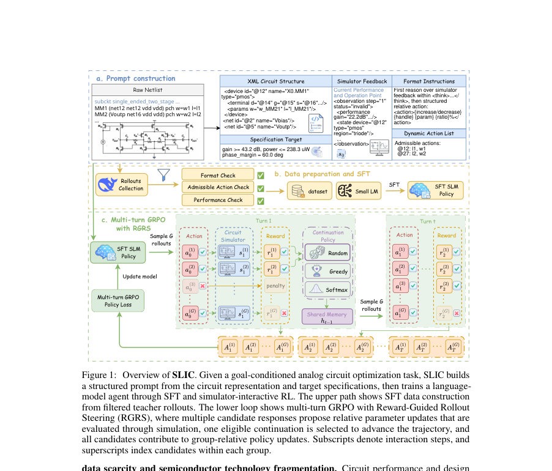
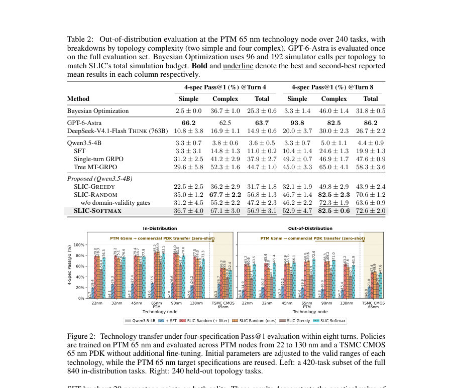
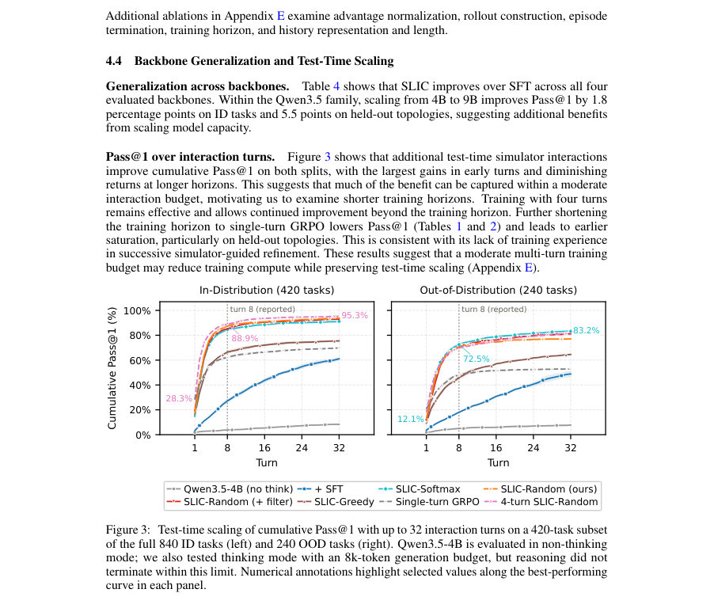

# SLIC: Reinforcement Fine-Tuning Small LMs for Multi-Turn Analog Circuit Optimization

- **게시일:** 2026-11-11
- **arXiv:** [2611.13452v1](http://arxiv.org/abs/2611.13452v1) · [PDF](https://arxiv.org/pdf/2611.13452v1)
- **저자:** Yan Xu, Zhengqi Gao, Ching-Yun Ko, Zhang-Wei Hong, Wenjie Lu, Tao Yu, Xin Zhang, Duane S. Boning, Ruonan Han
- **분야:** cs.LG
- **선정 점수:** 7.07
- **선정 이유:** 최근성 0.9, 인용 영향 0.0 (인용 0회), 저자 영향 0.0 (최고 h-index 0), AI 주제 적합성 2.9, 개발자 관심 0.9, 학술 신호 0.8, 오픈 웨이트·주요 연구조직 신호 1.6

[← 2026-11-11 목록으로 돌아가기](../daily/2026-11-11.html)

<!-- paper-visuals:start -->
## 주요 Figure

> 원문 PDF에서 실제 Figure 캡션과 그림 영역이 함께 확인된 자료만 자동 추출했다.

*Figure · 원문 PDF 2쪽 · Figure 1: Overview of SLIC. Given a goal-conditioned analog circuit optimization task, SLIC builds*

*Figure · 원문 PDF 8쪽 · Figure 2: Technology transfer under four-specification Pass@1 evaluation within eight turns. Policies*

*Figure · 원문 PDF 9쪽 · Figure 3: Test-time scaling of cumulative Pass@1 with up to 32 interaction turns on a 420-task subset*

<!-- paper-visuals:end -->

## 한 문장 요약

시뮬레이터 피드백을 이용한 다중 상호작용 강화파인튜닝(그룹-롤아웃 GRPO + RGRS)으로 4B급 로컬 배포 가능한 언어모델을 아날로그 회로(증폭기) 최적화에 적용해 높은 Pass@1 성능과 기술 노드/토폴로지 전이를 달성함.

## 해결하려는 문제

아날로그 집적회로(IC) 설계는 다중 턴의 시뮬레이터 기반 반복 의사결정이 필요하지만, 공개 데이터가 희소하고 파운드리 PDK(공정설계키트)가 기밀이기 때문에 외부 호스팅 LLM을 쓰기 어렵다. 기존 수치검색 기반 최적화나 특정 회로군에 특화된 학습 방법은 프로세스와 토폴로지 단편화에 약하며, LLM을 직접 쓰더라도 시뮬레이터 피드백을 효과적으로 학습해 다중 턴에서 신속하게 유효한 설계를 찾는 방법이 부재했다. 연구 질문은 '로컬에서 운영 가능한 소형 언어모델을 시뮬레이터 상호작용 강화학습으로 파인튜닝해 다중-턴 아날로그 회로 최적화를 실용적으로 달성하고, 토폴로지·공정 전이를 보이는가?'이다.

## 핵심 기여

- 로컬 배포 가능한 4B급 소형 언어모델 기반의 시뮬레이터-인터랙티브 강화파인튜닝 프레임워크 SLIC 제안 (SFT로 초기화 후 다중-턴 GRPO로 훈련).
- 도메인 특화 보상 설계(도메인-유효성 게이트, 성공-조건적 slack 보너스)와 Reward-Guided Rollout Steering(RGRS)를 결합해 단계별 시뮬레이터 피드백으로 정책 학습과 온라인 롤아웃 구성을 지원.
- 41개 증폭기 토폴로지(35 훈련/ID, 6 OOD)를 포함한 공개 목표-조건화 벤치마크와 표준화된 평가 프로토콜(인-분포 검증, 보류 토폴로지 평가, 공정 노드 전이) 공개.
- PTM 65 nm 시뮬레이터 데이터만으로 학습한 4B SLIC가 다중 성능지표(이득, 소비전력, 대역폭, 위상여유) 동시 만족에서 우수한 성능과 공정/토폴로지 전이를 보임을 실험적으로 입증.

## 접근 방법

* 전체 파이프라인은 (1) 강력한 프롬프트 모델(DeepSeek-V4.1-Flash)을 시뮬레이터로 구동해 다중-턴 롤아웃을 수집하고 HER 원리로 각 궤적을 목표-조건화로 재라벨링해 SFT 학습 데이터를 만든다, (2) 필터링된 유효·성능 향상 턴들로 SFT를 수행해 초기 정책을 얻고, (3) XML 형태의 구조화된 회로 표현과 동적 적법 행동 목록을 프롬프트로 주며 행위는 절대값이 아닌 이산화된 상대적 비율 업데이트(action grammar)의 형태로 출력하게 한다.
* 이후 (4) 다중-턴 GRPO(그룹 기반 PPO 스타일 목표)를 정책 최적화에 사용하되 도메인-유효성 게이트와 성공-조건적 slack 보너스 등 보상 성형으로 중간 보상을 설계하고, (5) 매 턴 G개의 후보 응답을 샘플해 시뮬레이션으로 평가하고 후보들 전부를 그룹 상대적 업데이트에 사용하면서(학습 신호 확보), 하나의 '연속 선택' 후보를 다음 상태로 진전시키는 Reward-Guided Rollout Steering(RGRS)을 적용한다.
* RGRS의 연속 선택은 RANDOM / GREEDY / SOFTMAX 전략으로 실험되어 탐색·이용 균형을 조절한다.
* 정책 백본은 Qwen3.5-4B로 시작해 SFT 후 RL을 수행(39시간, 2×B200 GPU, 최대 8턴 기본 horizon).
* 보상 정규화는 유효성·성능을 분리해 정규화한다(자세한 수식은 본문·부록).

## 주요 결과

- 데이터셋: 41개 증폭기 토폴로지(35 훈련/ID, 6 보류/OOD), PTM 65 nm 시뮬레이터(ngspice) 사용; 상용 평가는 Cadence Spectre + TSMC 65 nm PDK.
- 주요 지표: 네 개 성능(specs: 이득, 전력, −3dB 대역폭, 위상여유)을 모두 만족하면 롤아웃 성공으로 간주(5% tolerance). 주 보고 지표는 누적 4-spec Pass@1 (Turn 4 및 Turn 8).
- 인-분포(65 nm PTM, 840 작업) 결과: SLIC-RANDOM이 Turn 8에서 87.1% 4-spec Pass@1 (±0.7), Turn 4에서 74.9%를 달성. 동일 설정에서 SFT는 Turn 8에서 26.5%, DeepSeek-V4.1-Flash THINK은 38.6%이며, GPT-6-Astra는 Turn 8에서 90.6% (단일 롤아웃 제한).
- 보류(held-out) 토폴로지(240 작업) 결과: SLIC-SOFTMAX가 Turn 8에서 72.6% Pass@1, SLIC-RANDOM은 70.6%를 달성. DeepSeek-V4.1-Flash는 26.7%, GPT-6-Astra는 86.2% (단일 롤아웃).
- 공정 노드 전이: PTM 65 nm으로 학습된 정책이 22–130 nm PTM 노드들에 추가 미세조정 없이 전이되어, SLIC-SOFTMAX가 해당 노드들에서 ID 73.3–79.8% 및 OOD 61.9–71.0% 범위의 Pass@1을 유지. (훈련 노드에서는 83.5% ID, 72.6% OOD). 저자 표기대로 PTM→상용 TSMC 65 nm PDK 제로-샷 전이 성능: SLIC-RANDOM은 ID 55.8% 및 OOD 49.9% Turn 8 Pass@1을 기록(PTM 대비 성능 하락 있음). 이는 PTM과 상용 PDK 간의 모델-디바이스 동작 차이로 설명됨.  또한 테스트 시뮬레이터 호출 수(턴 수)를 32턴까지 늘리면 held-out Pass@1이 최대 83.2%까지 상승(테스트타임 스케일링 효과).

## 한계

- 저자가 명시한 한계: PTM 기반 학습과 상용 PDK 간의 불일치로 전이 성능이 감소할 수 있으며(실험에서 PTM→상용 PDK Pass@1가 하락), 확장성 측면에서 멀티에이전트·장문 컨텍스트·교차-에이전트 조정 등 추가 연구가 필요하다고 명시함.
- 본문 실험에서 드러나는 제약(저자가 직접 언급한 것과 구분): 학습은 증폭기 토폴로지(41개)에 한정되어 있어 mixed-signal·더 큰 블록·레이아웃 의존성 등으로의 일반화는 검증되지 않음. 학습은 PTM 65 nm 데이터로 제한되며 훈련 백본과 하이퍼파라미터(예: Qwen3.5-4B, 4B 규모, 최대 8턴 훈련 기본 설정)에 의존함. 다중-턴 트래젝토리 레벨 GRPO는 불안정했고(직접 적용의 한계), 대안인 Tree MT-GRPO는 분기 수 증가로 샘플링 비용이 지수적으로 늘어나는 단점이 보고됨.
- 훈련 비용/샘플 효율: RL 기반 학습은 많은 시뮬레이터 호출을 필요로 하며(실험 예산에 맞춘 후보 평가 등), 실제 상용 환경에서 시뮬레이터 비용·시간 제약이 존재할 수 있음.

## 개발자 관점

- 로컬 배포 필요성: PDK·디바이스 모델 기밀을 반출하지 않고 자동화된 설계 최적화를 하려면 소형(4B급) 모델 + 로컬 시뮬레이터가 현실적인 대안임. SLIC는 로컬 추론+시뮬레이션으로 상용 PDK에 제로-샷 적용 가능한 점을 강조함.
- 데이터·SFT 활용: 강한 프롬프트 기반 교사(DeepSeek)로부터 시뮬레이터-구동 롤아웃을 수집하고 hindsight relabeling(HER)으로 목표-조건화 학습 데이터를 만드는 방식은 공개 데이터가 부족한 도메인에서 실용적임.
- 구현·아키텍처 팁: XML 구조화된 회로 표현과 동적 적법(action) 목록, 절대값이 아닌 이산화된 상대적 업데이트(action grammar)를 사용해 모델 출력의 유효성 검사·파싱을 단순화하고 시뮬레이터 연동을 안정화할 것. 도메인-유효성 게이트(예: 비양성 이득 차단)와 성공-조건적 slack 보너스는 학습 안정성과 일반화에 유의미함.
- 학습·추론 비용: 본 논문 설정으로 SFT→GRPO 전체 파이프라인은 약 39시간(2×B200 GPU, 기본 8턴) 소요되었음. 실무 적용 시 시뮬레이터 호출 횟수와 후보 그룹 수(G)를 조절해 시간/성능을 절충해야 함.
- 테스트타임 스케일링: 정책은 추가 테스트 턴(시뮬레이터 상호작용)을 통해 성능이 개선되므로 배포 시 사용자 예산(시뮬레이터 비용)에 따라 턴·롤아웃 수를 동적으로 조정하는 것이 실용적임(예: 8턴 훈련 정책이라도 32턴 테스트에서 OOD 성능 개선 관찰).

**근거 범위:** 이 분석은 제공된 논문 PDF 본문(본문 페이지와 표/그림/사례 롤아웃 포함)을 근거로 작성되었음. 본문에서 여러 기법의 수식·세부 구현(예: 부록의 하이퍼파라미터 표, Algorithm 1의 세부절차)은 본문에서 요약된 수준으로만 확인 가능하며, 부록의 전체 내용 일부는 제공된 PDF 범위에 포함되어 있지 않아 상세 하이퍼파라미터·정밀 구현 수치는 부록 참조가 필요함.
