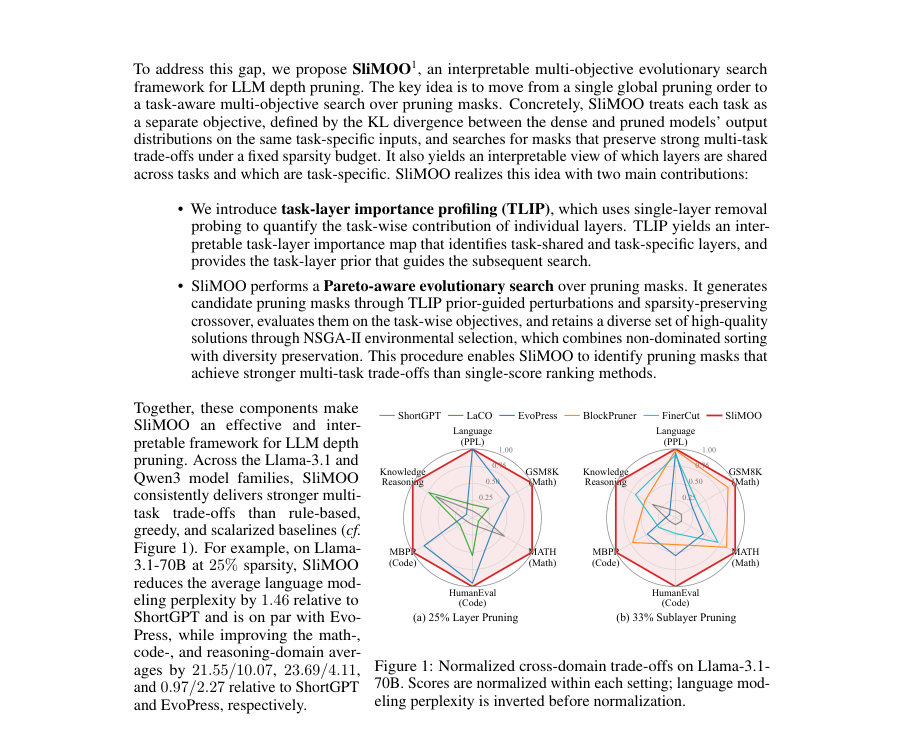
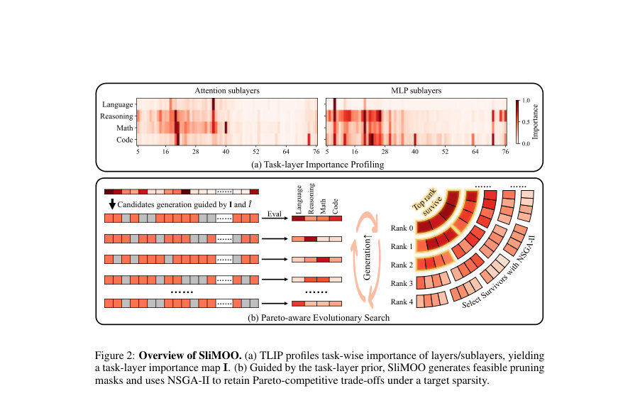
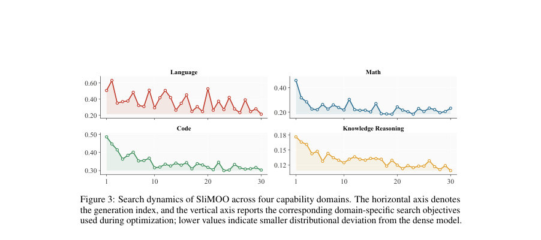

# SliMOO: Interpretable Multi-Objective Evolutionary Search for LLM Depth Pruning

- **게시일:** 2026-10-21
- **arXiv:** [2610.27812v1](http://arxiv.org/abs/2610.27812v1) · [PDF](https://arxiv.org/pdf/2610.27812v1)
- **저자:** Guanchen Li, Yixing Xu, Xuanwu Yin, Dong Li, Emad Barsoum
- **분야:** cs.LG
- **선정 점수:** 5.74
- **선정 이유:** 최근성 1.0, 인용 영향 0.0 (인용 0회), 저자 영향 0.0 (최고 h-index 0), AI 주제 적합성 2.2, 개발자 관심 0.8, 학술 신호 0.6, 오픈 웨이트·주요 연구조직 신호 1.2

[← 2026-10-21 목록으로 돌아가기](../daily/2026-10-21.html)

<!-- paper-visuals:start -->
## 주요 Figure

> 원문 PDF에서 실제 Figure 캡션과 그림 영역이 함께 확인된 자료만 자동 추출했다.

*Figure · 원문 PDF 2쪽 · Figure 1: Normalized cross-domain trade-offs on Llama-3.1-*

*Figure · 원문 PDF 3쪽 · Figure 2: Overview of SliMOO. (a) TLIP profiles task-wise importance of layers/sublayers, yielding*

*Figure · 원문 PDF 8쪽 · Figure 3: Search dynamics of SliMOO across four capability domains. The horizontal axis denotes*

<!-- paper-visuals:end -->

## 한 문장 요약

SliMOO는 단일 점수 기반 층 중요도 추정의 한계를 지적하고, 단일층 제거 기반의 해석 가능한 태스크-층 중요도 맵(TLIP)을 프라이어로 사용해 NSGA-II 기반의 태스크별 KL 목적을 최적화하는 해석 가능한 다목적 진화 탐색으로 LLM 깊이(층/서브레이어) 가지치기를 수행한다.

## 해결하려는 문제

기존 깊이(층) 가지치기 방법들은 층 중요도를 단일 전역 점수나 스칼라화된 목표로 환원해 판단하므로, 서로 다른 능력(예: 언어모델링, 수학, 코드, 추론)이 서로 다른 층 기여도를 갖는다는 사실을 무시하게 되어 특정 벤치마크나 도메인에만 잘 작동하고 광범위한 능력을 보존하지 못한다. 따라서 LLM 깊이 가지치기는 서로 다른 태스크를 각각의 목적(objective)으로 하는 다목적 최적화 문제로 다루어야 한다는 문제가 제기된다.

## 핵심 기여

- 단일층 제거(싱글톤) 프로빙을 이용해 태스크별 층 기여도를 정량화하는 Task-Layer Importance Profiling(TLIP)을 도입하여 태스크-층 중요도 맵 I를 얻고, 이를 탐색 프라이어로 활용해 해석 가능성과 검색 효율을 제공함.
- 각 태스크를 밀도 모델과 가지치기 모델의 분포 차이(마스킹된 엔트로피 정규화된 forward KL)로 정의한 태스크별 목적들을 사용해 페어토-인지(Pareto-aware)한 진화 탐색을 수행하는 SliMOO 프레임워크를 제안함 (TLIP 가이드된 초기화·돌연변이 + NSGA-II 환경선택 + 하이퍼볼륨 기반 최종 선택).
- 층(또는 서브레이어) 단위의 정확한 예산(K) 제약을 유지하는 카드리너리티-보존 교차 및 교환(swap) 돌연변이 설계로 탐색 공간의 유효성(정확한 sparsity 유지)을 보장함.
- Llama-3.1 및 Qwen3 계열에서 광범위한 평가를 통해 규칙·탐욕적·스칼라화된 기준선보다 다목적 트레이드오프를 더 잘 보존함을 실증하고, TLIP 맵을 통해 어떤 층이 태스크 공유/특이적인지 해석 가능하게 제시함.
- 실무적 효율성 주장: 검색 전(한번의) TLIP 프로빙과 세대별 진화 검색의 계산 비용을 보고하고(vLLM 기준 서빙 속도 향상도 함께 제시) 실제 서빙에서 레이어/서브레이어 가지치기가 체크포인트 크기·지연 시간 개선에 기여함을 보임.

## 접근 방법

* 문제 설정: N개의 트랜스포머 층(또는 주의/MLP 서브레이어를 포함하면 D=2N)을 가지치기 단위로 보고, 제거 유닛 집합 F에서 정확히 K개를 제거하는 이산 마스크 집합 XK을 탐색한다.
* TLIP(Phase 1): 각 제거 가능한 유닛 i에 대해 그 유닛만 제거한 싱글톤 마스크 ei를 적용하여 각 태스크 t의 성능(ft(ei))과 밀도 모델(ft(0))의 차이 It,i = ft(ei) - ft(0)을 계산해 태스크-층 중요도 행렬 I ∈ R^{T×D}를 구성한다.
* 보수적(prior) 가이드 ˆI는 각 유닛에 대해 max_t It,i로 계산하여 어떤 태스크에라도 중요하면 위험하게 보호한다.
* 목적 정의: 각 태스크의 목적 ft(x)는 마스킹된, 엔트로피 정규화된 forward KL로 정의되어(식 (6)) 가지치기된 모델의 다음 토큰 분포이탈을 측정하며, 수학·코드 등은 응답-부분 토큰만 마스킹해 평가한다.
* 탐색(Phase 2/3): 초기화는 ˆI에 따라 확률적으로(확률 ∝ exp(-ˆI/τ)) K개를 선택해 중요도-유도된 마스크와 무작위 마스크를 혼합해 생성한다.
* 진화는 NSGA-II 기반으로 수행되며 교차는 카드리너리티를 보존(공통 제거는 유지하고 불일치 부분에서 남은 슬롯을 채움), 돌연변이는 부모의 제거/복원 인덱스를 ˜I(ˆI와 무작위로 선택한 It,:을 번갈아 사용)에 따라 확률 Pprune(a) ∝ exp(-˜Ia/τ), Prestore(r) ∝ exp(˜Ir/τ)로 샘플링하는 swap 변이로 구현한다.
* τ는 하이퍼볼륨 개선에 따라 적응적으로 감쇠/증가한다.
* 후보 평가는 캘리브레이션 세트에서 태스크별 KL을 계산(다단계 다중-해상도 예산으로 빠르게 약한 후보 여과)하고 NSGA-II로 비지배·다양성 보존 후 하이퍼볼륨 기여(∆HV)로 최종 단일 마스크를 선택한다.
* 구현·하이퍼파라미터: TLIP 프로빙 토큰 수 8192/태스크, 초깃값 τ=1.0, 세대 G=30, 모집단 크기 P=4, 세대당 자손 B=64, 초기 후보 128, 교차율 ρ=0.3, 첫/마지막 두 층은 검색에서 제외.
* 캘리브레이션 코퍼스는 fineweb_edu(언어), commonsense_170k(지식), GSM8K+DeepScaleR(수학), python-codes(코드)를 사용하며 각 도메인에 균등하게 65,536 토큰 예산을 할당(수학은 GSM8K/DeepScaleR로 반반).

## 주요 결과

- Llama-3.1-70B, 25% 전체층(layer) 가지치기: SliMOO의 도메인 평균은 언어(Perplexity) 9.89, 수학(Math) 평균 34.40%, 코드(Code) 평균 39.14%, 지식추론(Knowledge) 평균 66.90%로 보고되었다. 비교 사례로 EvoPress의 수학/코드 평균은 24.33%/35.03%였고 ShortGPT는 수학 12.85%/코드 15.45%로 수학·코드에서 SliMOO가 큰 개선을 보였다(예: 수학 평균 24.33 → 34.40, 코드 평균 35.03 → 39.14 상대비교 표기).
- Llama-3.1-70B, 33% 서브레이어(sublayer) 가지치기: SliMOO는 EvoPress 대비 수학 평균을 10.33% → 27.27%로, 코드 평균을 15.11% → 30.78%로 크게 개선했다(표 1).
- 대형 모델(405B)에서도 유사한 경향: Llama-3.1-405B 25%에서 SliMOO는 수학 평균 49.83%, 코드 51.99%, 지식 71.03%로 보고되어 기준선보다 개선을 보였다(표 1).
- 캘리브레이션·공정비교: 모든 캘리브레이션 기반 기준선을 SliMOO와 동일한 혼합 도메인 캘리브레이션 풀과 토큰 예산으로 재실행한 경우에도 SliMOO가 전반적 트레이드오프에서 우세함(표 4).
- 도메인 외 일반화: 보고된 25%/33% 마스크를 추가 프로파일링 없이 그대로 오프 도메인(TruthfulQA, ToxiGen, MedMCQA 등)에서 평가한 결과 SliMOO가 TruthfulQA·ToxiGen·MedMCQA에서 가장 높은 점수를 기록했고 CrowS-Pairs 등 행동 보존에서도 밀집 모델과 근접함(표 2). 이는 다목적 균형이 보이지 않는 태스크들에도 도움을 줄 수 있음을 시사한다. 25% layer에서 MedMCQA 등에서 각각 +2.66 포인트 개선 보고됨(표 2).  (수치는 표에 명시된 대로 표기됨).  
    
    효율성: Llama-3.1-70B 기준(AMD Instinct MI300X, 2 GPUs) TLIP 프로빙은 12.0분, SliMOO 검색은 세대당 20.8분이며(총 30세대 기본 설정), EvoPress는 세대당 18.8분×30세대로 유사한 규모의 계산을 사용했으나 SliMOO가 더 나은 마스크를 산출함(섹션 4.6). Llama-3.1-405B에서는 프로빙 46.4분, 검색 52.1분/세대로 보고됨.  
    서빙 성능: Llama-3.1-70B에서 vLLM으로 측정한 Time-to-first-token(TTFT)와 Decode TPS: 밀집 모델(0%) TTFT=3.39s/Decode TPS=482.9; 25% layer: TTFT=2.54s/Decode TPS=623.9 (약 1.33× TTFT, 1.29× TPS 향상); 33% sublayer: TTFT=2.37s/Decode TPS=672.2 (약 1.43×/1.39×)로 실전 서빙 이득을 보고함(표 8).

## 한계

- 저자 명시 한계: SliMOO는 미리 정의된 능력(domain) 집합과 캘리브레이션 코퍼스를 사용하므로, 타겟 도메인을 합리적으로 지정할 수 있는 배포 환경에는 적합하지만, 개방형·무작위적(in-the-wild) 태스크 혼합에 대한 일반화성은 추가 연구가 필요하다고 저자가 명시함.
- 저자 명시 한계: TLIP 프로빙과 진화 검색은 일회성 오프라인 비용이 발생하므로 이 오버헤드를 줄이는 추가 개선이 실용성 측면에서 필요하다고 명시됨(특히 매우 큰 모델에 대해).
- 저자 명시 한계: 서브레이어 가지치기 비교에서 동일한 '구조 단위 예산'을 사용했으나 attention과 MLP 유닛은 파라미터·FLOP 차이가 있으므로 정확한 자원-대응 측면에서는 세부 차이가 존재한다고 언급함.
- 논문 본문으로부터 합리적으로 확인되는 제약: 방법은 캘리브레이션 분포(데이터·토큰 예산)와 태스크 목록에 민감하다(캘리브레이션 할당이 도메인 중심으로 치우치면 해당 도메인 성능이 향상되는 것이 실험으로 확인됨, 표 5). 따라서 사용자는 배포 목적에 따라 캘리브레이션 구성을 신중히 설계해야 한다는 제약이 존재한다는 점이 본문에서 확인된다.  
    
    추가로 본문에서 확인 가능한 실무적 제약: SliMOO는 대형 모델에서 수십~수백 GPU-분 단위의 메모리·계산 자원(예: 405B 실험에 8 GPUs, 933 GB 메모리 예산)을 필요로 하며 이는 모든 연구자/엔지니어가 쉽게 재현하기 어려운 비용임.

## 개발자 관점

- 재현·구성요소: 구현은 PyTorch + Hugging Face Transformers/Datasets 기반이며 TLIP 프로빙(각 태스크 8,192 토큰)→TLIP로 초기화된 인구(population)→NSGA-II 기반 진화 탐색(세대 30, P=4, B=64, 초기 128 후보, 교차율 0.3) 순으로 진행된다. 첫/마지막 두 층은 검색에서 제외하는 것이 기본 설정이다.
- 캘리브레이션 데이터: 다중 도메인(언어/지식/수학/코드) 캘리브레이션 풀을 권장하며 기본 설정은 도메인당 65,536 토큰(총 혼합 예산)이나 32K/도메인까지는 안정적임(표 5). 도메인 우선 할당은 의도한 도메인으로 마스크를 유도하는 간단한 수단이다.
- 탐색 설계와 하이퍼파라미터: 돌연변이에서 제거/복원 샘플링은 exp(±I/τ) 기반이며 τ는 하이퍼볼륨 개선에 따라 적응적으로 조정하는 것이 성능에 유리하다. 다중-해상도(저·중·고 토큰 예산) 평가 스케줄을 사용해 약한 후보를 빠르게 걸러 탐색 효율을 높일 수 있다(부록 A.1).
- 배포·서빙: 구조적(depth) 가지치기는 특수한 sparse 커널 없이도 체크포인트 크기·메모리·지연을 줄여 표준 vLLM 같은 서빙 프레임워크에서 즉시 속도 이득을 얻을 수 있음(보고된 TTFT/TPS 개선).
- 후처리·튜닝: 가지치기 후 LoRA 등 경량 파인튜닝을 적용하면 성능 회복이 가능하며(부록 A.3), SliMOO의 마스크는 LoRA 튜닝 후에도 다른 기준선보다 더 좋은 회복 성능을 보임(표 11). 또한 안전성·정책 관련 성능(예: 편향, 독성 등)은 가지치기 후 별도 평가가 필요함.

**근거 범위:** 이 분석은 제공된 논문 PDF 본문(본문, 표, 부록)을 기반으로 작성되었으며 초록은 보조적으로 참조했습니다. 제시된 수치와 구현 세부사항(하이퍼파라미터, 캘리브레이션 예산, 시간 측정 등)은 논문 본문과 표에 직접 기재된 값을 사용했습니다. 코드·외부 리포지토리나 추가 보충자료는 PDF 외부에 있으므로 접근 불가했으며, 본문에 명시되지 않은 내부 구현 세부(예: 특정 I/O 파이프라인 최적화)나 환경 의존적 수치는 유추하지 않았습니다.
