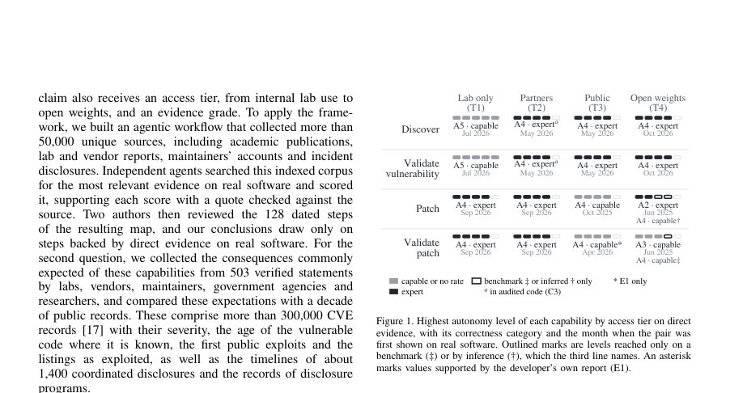
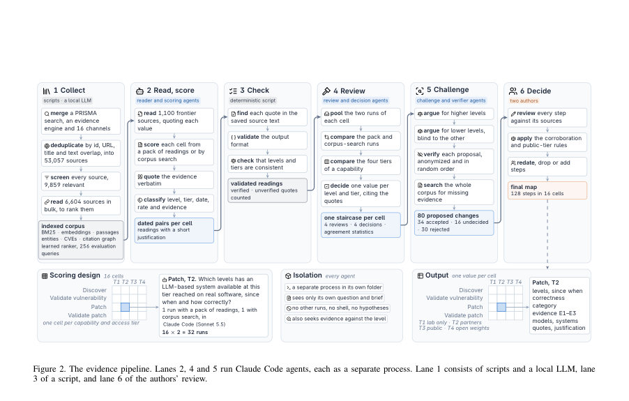
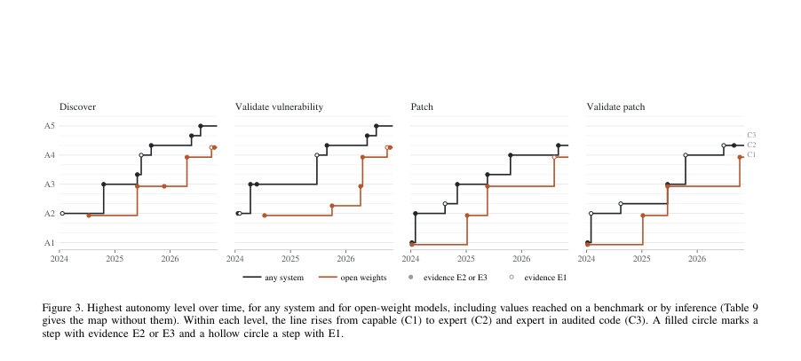

# SoK: Assessing the Evolution of LLM Capability in Software Vulnerability Research

- **게시일:** 2026-11-21
- **arXiv:** [2611.26601v1](http://arxiv.org/abs/2611.26601v1) · [PDF](https://arxiv.org/pdf/2611.26601v1)
- **저자:** Amine Lbath, Manan Suri, Aurelien Delaitre, Vadim Okun, Massih-Reza Amini, Dinesh Manocha
- **분야:** cs.CR, cs.AI, cs.SE
- **선정 점수:** 5.19
- **선정 이유:** 최근성 0.7, 인용 영향 0.0 (인용 0회), 저자 영향 0.0 (최고 h-index 0), AI 주제 적합성 2.3, 개발자 관심 0.2, 학술 신호 0.3, 오픈 웨이트·주요 연구조직 신호 1.6

[← 2026-11-21 목록으로 돌아가기](../daily/2026-11-21.html)

<!-- paper-visuals:start -->
## 주요 Figure

> 원문 PDF에서 실제 Figure 캡션과 그림 영역이 함께 확인된 자료만 자동 추출했다.

*Figure · 원문 PDF 2쪽 · Figure 1. Highest autonomy level of each capability by access tier on direct*

*Figure · 원문 PDF 5쪽 · Figure 2. The evidence pipeline. Lanes 2, 4 and 5 run Claude Code agents, each as a separate process. Lane 1 consists of scripts and a local LLM, lane*

*Figure · 원문 PDF 7쪽 · Figure 3. Highest autonomy level over time, for any system and for open-weight models, including values reached on a benchmark or by inference (Table 9*

<!-- paper-visuals:end -->

## 한 문장 요약

LLM 기반 에이전트가 소프트웨어 취약점의 발견·검증·수정에 대해 지난 몇 년간 어떤 자율성과 정확도를 입증했는지, 공개 기록(수천건의 CVE 등)과 대조해 영향과 완화책의 근거를 체계화한 SoK 연구.

## 해결하려는 문제

연구자·벤더·유지관리자들이 LLM 기반 시스템이 실제 소프트웨어에서 취약점을 어떻게 찾아내고 증명하며 패치하는지를 서로 다른 형태의 보고서·벤치마크·사건 공시에서 주장해 왔으나, 이들 주장이 서로 비교 가능하게 정리된 증거 기반 평가는 부족하다. 따라서 (1) 실제 소프트웨어에서의 각 작업(발견·취약성 검증·패치·패치 검증)에 대해 시스템이 보여준 자율성·정확도는 무엇인지, (2) 2024년 이후 어떻게 진화했는지, (3) 최첨단(프론티어) 실험실 시스템에서 입증된 능력이 공개/오픈웨이트 모델로 얼마나 빠르게 확산되는지, (4) 공개 취약점 기록에서 어떤 변화가 관찰되는지를 답할 필요가 있다.

## 핵심 기여

- LLM 기반 시스템의 취약점 연구 작업(발견·취약성 검증·패치·패치 검증)에 대해 자율성(A0–A5), 정확도(C0–C3), 접근 계층(T1–T4), 증거 등급(E1–E3)을 결합해 처음으로 체계적으로 평가하는 프레임워크를 제시함(섹션 3).
- 문헌·보고서·공시 등 53,057개 출처를 색인하고 에이전트 기반 파이프라인으로 증거를 수집·점수화해 2024년 이후의 시계열적·접근계층별 '능력 지도(capability map)'(최종 128 dated steps, 그중 85개는 직접 근거)를 작성·공개함(섹션 4, 부록 C).
- 수십만건의 공개 CVE 기록(논문 시점 304,028건)과 503개의 검증된 진술을 사용해 2018–2026년 공개 기록에서의 양(공개건수), 심각도(High/Critical 비율), 취약코드의 연령, 보고→수정·공개→공격 시점 간격 등 변화를 정량 측정함(섹션 6).
- 문헌에서 제안된 15개 완화책을 명시적 루브릭으로 등급화하고(증거 등급 적용) 이해관계자별 실무 지침과 향후 연구 의제를 제시함(섹션 7–8).
- 프론티어 실험실 시스템이 2025년 10월 이전에(= 2025년 중) 인간 개입 없이 취약점 발견·검증·패치를 달성했음을 보이고, 공개·오픈웨이트 모델은 몇 달 내에 해당 능력을 따라잡았음을 입증함(결과 요약).

## 접근 방법

* 평가 프레임워크: 자율성(A0–A5, SAE 유사 정의), 정확도(정확도 기반 C0–C3), 접근 계층(T1 내부·T2 파트너·T3 공개 서비스·T4 오픈웨이트), 증거 등급(E1 개발사 보고·E2 체크가능 세부·E3 독립 확인)을 정의.
* 증거 수집·색인: PRISMA 스타일 체계적 검색(67개 쿼리, 105개 조직 출처)과 18개 커넥터 탐색을 결합해 총 53,057개 소스 색인.
* 파이프라인: 로컬 LLM(Muse Glimmer 30B)이 6,604개 2024년 이후 소스를 우선 랭킹해 클로드(Claude Sonnet/Opus 계열) 에이전트가 1,100개를 본문 검토·인용문 추출.
* 각 '셀'(작업×접근계층, 총 16셀)에 대해 두 차례(리더팩 기반·코퍼스 검색 기반) 점수화 실행, 각 값은 출처 인용문으로 근거 제시.
* 두 저자가 검토·재결정해 최종 맵(128 단계, 85 direct)을 도출.
* 보완적 근거로 벤치마크 및 추론된(이동·전이) 값 표시.
* 공개기록 측정: CVE 목록(논문 기준 2026-10-31, 304,028건), Zero Day Initiative 어드바이저 표본(1,417/14,738) 등으로 양·심각도·연령·시차를 계측.

## 주요 결과

- 맵 요약(2026-11-07 시점): 128개의 dated step 작성(직접 근거 85개, 벤치마크 35개, 추론 8개).
- RQ1(현재 능력): LLM 기반 에이전트는 실제 소프트웨어에서 인간 개입 없이 작업을 완료하는 수준(A4)을 입증했고(발견·검증·패치·패치검증 대부분 셀에서 A4), 발견·취약성 검증은 모든 접근 계층에서 전문가 수준 정확도(A4·C2)를 달성(공개·오픈웨이트 포함). 특히 Anthropic의 Claude Mythos Preview는 2026-05에 장기간 감사된 코드에서 전문가 수준(A4·C3)을 보였고, 독립 업체가 1,752건 중 90.6%를 확인함. Aikido Attack 결과는 96% 확인 사례(공개 시스템).
- 패치 관련: 에이전트의 자동 패치·패치검증은 2025-10경 A4·C1 수준으로 입증되었고(예: Google CodeMender가 72개의 보안 수정 upstream), 파트너·방식에 따라 2026-09에는 전문가 수준(A4·C2) 사례(예: OpenAI Defense Factory, 롤백률 0.53%)가 보고됨. 다만 오픈웨이트에서의 A4 패치는 일부는 추론 기반으로 직접 근거는 제한적임(논문에서 명시).
- 자율성 진화(RQ2): 2024년 A2(지시된 단계 수행)→ 2024~25년 A3(에이전트 계획·실행) → 2025-10경 대부분 작업에서 A4(주어진 타깃에서 무인 완료). 각 레벨은 먼저 'capable'(C1)로 나타나고 이후 'expert'(C2)로 확립되는 패턴.
- 확산(RQ3): 프론티어(연구실)에서 입증된 능력은 수개월 내에 공개 서비스·오픈웨이트 모델로 확산되었다고 정량화(벤치마크·실제 사례 병기). 벤치마크 점수들에서 오픈웨이트 모델이 최고값을 세우는 데 평균 약 7.6–8개월 지연이 관찰됨(그림 4 설명). 예: GLM-5.3(2026-08) 등이 오픈웨이트 측 상향을 보임. 일부 패치 관련 성과는 오픈웨이트에서 직접 입증되지 않아 추론 표기함(†).

## 한계

- 저자가 명시한 한계: 완화·수정(remediation) 관련 증거가 가장 부족하고, 패치·패치검증 관련 결과의 상당 부분이 개발자 보고(E1)에 의존해 독립적 검증이 적음(섹션 5, 부록 C).
- 저자가 언급한 한계: 벤치마크 결과는 준비된/주입된 타깃에 기반하므로 실제 소프트웨어에서의 성과와 동일시할 수 없으며, 일부 지도 값은 벤치마크(‡) 또는 추론(†)에 근거함(섹션 3·5).
- 본문에서 합리적으로 확인되는 제약(추론적 한계): 수집 코퍼스에 블로그·보도·벤더 보고가 포함되어 있어 출처 편향·자기보고 편향 가능성이 존재하고(본문에서 해당 자료 유형 존재 언급), 일부 정확도 수치는 유지관리자·벤더의 평가 방식 차이로 직접 비교가 어렵다.
- 시계열·관찰 한계: 공개 기록 분석은 2026년 말(논문 시점)까지의 데이터에 기반하므로 이후 변화는 반영되지 않음(데이터 범위 명시).

## 개발자 관점

- 증거 수집·재현: 논문이 사용한 색인·파이프라인(53,057 소스, 에이전트 판독·이중 점수화, 두 저자의 수동 검토)은 재현 가능한 절차이므로, 유사한 연구·감시 체계를 도입해 신규 에이전트 성과를 추적·검증하라.
- 패치·패치검증 측정 강화: 패치의 실제 유효성(레그레션·루트 원인 제거)과 롤백률 등 지표를 표준화해 보고·검증하라. 현재 패치 관련 증거는 제한적이며 개발사 보고에 편중되어 있다.
- 출시·접근 정책: 논문이 제시한 접근 계층(T1–T4)과 증거 등급(E1–E3)을 참조해, 내부 평가·파트너 테스트·공개 배포 등 각 단계에 맞는 안전 통제(예: 평가용 격리, 파트너 한정 배포, 공개 전 독립검증)를 마련하라.
- 유지관리자 준비: 2026년 공개건수가 급증(2.3배 이상)했고 심각도 비율이 상승했으므로, 유지관리·패치 프로세스와 자동화(검증 도구·릴리즈 파이프라인)를 확충해 '패치파도'를 감내할 운영 능력을 갖춰라.
- 모델·스캐폴드 의존성 관리: 높은 성과가 특정 스캐폴드·파이프라인과 결합되어 보고되는 사례가 많으므로, 실제 배포 시에는 스캐폴드·프롬프트·체크포인트를 포함한 전체 파이프라인을 감사하고 롤백 계획을 마련하라.

**근거 범위:** 이 분석은 제공된 논문 PDF 본문(본문 및 부록 포함)에 명시된 내용만을 근거로 작성함. 수치·사례는 논문 본문·도표·부록에서 직접 인용 가능한 값에 한정했으며, 저자가 표기한 벤치마크(‡)나 추론(†) 표시는 원문 근거를 반영함. 논문 이후 사건·데이터(2026-11-07 이후)는 반영되지 않음.
