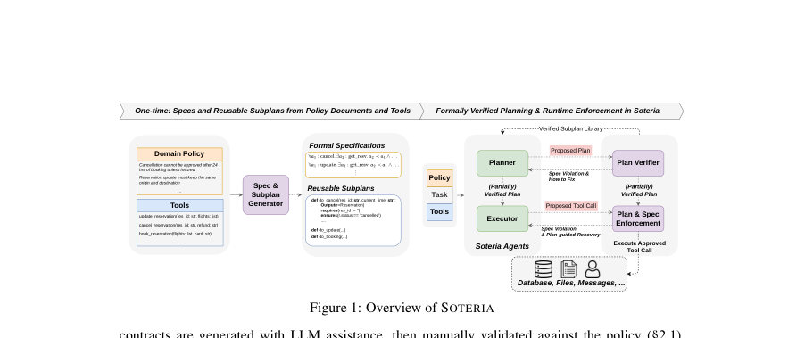
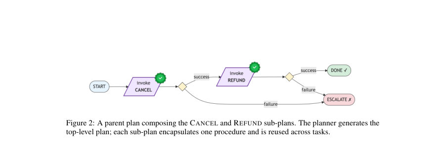
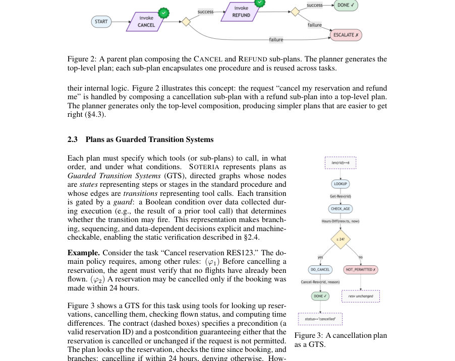

# Soteria: Formally Verified Planning with Runtime Enforcement for Safe LLM Agents

- **게시일:** 2026-11-16
- **arXiv:** [2611.17880v1](http://arxiv.org/abs/2611.17880v1) · [PDF](https://arxiv.org/pdf/2611.17880v1)
- **저자:** Mike He, Ankush Desai, Sharad Malik, Aarti Gupta
- **분야:** cs.AI, cs.SE
- **선정 점수:** 4.24
- **선정 이유:** 최근성 0.4, 인용 영향 0.0 (인용 0회), 저자 영향 0.0 (최고 h-index 0), AI 주제 적합성 3.0, 개발자 관심 0.6, 학술 신호 0.3, 오픈 웨이트·주요 연구조직 신호 0.0

[← 2026-11-16 목록으로 돌아가기](../daily/2026-11-16.html)

<!-- paper-visuals:start -->
## 주요 Figure

> 원문 PDF에서 실제 Figure 캡션과 그림 영역이 함께 확인된 자료만 자동 추출했다.

*Figure · 원문 PDF 2쪽 · Figure 1: Overview of SOTERIA*

*Figure · 원문 PDF 4쪽 · Figure 2: A parent plan composing the CANCEL and REFUND sub-plans. The planner generates the*

*Figure · 원문 PDF 4쪽 · Figure 3: A cancellation plan*

<!-- paper-visuals:end -->

## 한 문장 요약

SOTERIA는 도메인 정책과 툴 계약을 형식 사양으로 정의하고 LLM이 생성한 계층적 계획(plan)을 Dafny 기반 정적 검증으로 사전 검증한 뒤, 실행 시 SpecMonitor로 호출을 차단하고 검증된 계획을 복구 가이드로 사용하여 안전성과 작업 완수율을 동시에 확보하는 프레임워크이다.

## 해결하려는 문제

LLM 에이전트가 다단계 툴 호출을 수행할 때 사용자 목표(유틸리티)를 달성하면서 도메인 정책·정확성 제약(안전성)을 지키는 것이 필요하다. 기존 런타임 가드레일(LLM 판정기)은 확률적이며 형식 보장을 제공하지 못하고, 명세 기반 모니터는 위반을 차단하더라도 차단 시 합리적 복구 계획이 없어 유틸리티가 크게 저하될 수 있다. 따라서 안전성과 유틸리티의 상충을 해소할 방법이 필요하다.

## 핵심 기여

- SOTERIA: 검증된 계층적 계획(verified hierarchical planning)과 런타임 명세 집행(SpecMonitor)을 결합해 안전성(정책·툴 계약 준수)과 유틸리티(작업 성공)를 동시에 달성하는 프레임워크를 제안함.
- 계층적 재사용 서브플랜(sub-plan)과 Guarded Transition System(GTS) 표현을 이용해 계획을 구조화하고, 툴 계약(tool contracts), 진행성(progress), 정책 준수(policy compliance)를 검증하는 Dafny 기반 정적 검증 루프를 설계함.
- 실행 시 SpecMonitor가 제안된 호출을 사전 검사(pre-execution)하고 위반 시 실행을 차단하며, 검증된 계획을 '워크리스트'로 제시해 차단된 경우 계획 유도(plan-guided) 복구를 제공하는 런타임 집행 전략을 제시함.
- 검증-유도 기법(최대 재시도 예산 내에서 검증 루프, 부분 검증 허용 후 최강의 부분 검증 계획을 대체로 사용)은 검증 실패 시에도 복구 지침을 제공하도록 설계함.
- 세 벤치마크(τ2-Airline, τ2-Retail, Toolathlon)와 네 백본 LLM(GPT-5.4-mini, Gemini 3 Flash, Claude Haiku 4.5, Claude Opus 4.6)에서 평가하고, 평균적으로 최종 성공률을 기존 최선 대비 1.7배로 개선하고 명세 위반을 0건으로 달성함.

## 접근 방법

* SOTERIA는 다음 구성 요소로 동작한다.
* (1) 명세 작성: 자연어 도메인 정책과 툴 정의를 LLM 기반 자동 정형화(auto-formalizer)로 초안 생성한 뒤 수동 검증으로 보완하여 툴 계약(전/후조건)과 정책 명세(트레이스에 대한 1차 논리식)를 확보한다.
* (2) 계층적 계획 생성: 재사용 가능한 서브플랜 라이브러리를 이용해 상위 계획을 생성하고, 계획은 상태 노드와 가드가 있는 Guarded Transition System(GTS)으로 표현되며 DSL로 기술된다.
* 서브플랜은 인터페이스(요구·보장)를 갖는 도구처럼 취급된다.
* (3) 정적 검증: 계획별로 세 가지 검증 조건을 생성하여 Dafny(자동 증명기)를 통해 검증한다—툴 계약 만족(각 호출의 전조건), 진행성(도달 가능성·가드 실현 가능성으로 교착 방지), 정책 준수(트레이스 전반에 대한 명세).
* 검증 인코딩은 심볼릭 상태 Σ(s)와 '고스트 상태'(step 카운터, 호출 로그, provenance 맵)를 유지하여 VC로 변환한다.
* 검증 실패 시 진단을 받아 플래너가 수리(repair)하며 재시도 예산(논문 실험은 8회)을 소진하면 최강의 부분 검증 계획을 사용한다.
* (4) 런타임 집행: SpecMonitor가 각 제안된 툴 호출을 받아들여 사전검사(check_proposed_action)로 전조건 및 관련 명세를 구체적 트레이스 확장으로 평가해 위반 시 차단한다.
* 승인 후 실행 결과는 후검(commit_action)으로 확인하며 포스트컨디션 위반 시 중단한다.
* 계획은 실행자에게 워크리스트(단계별 흐름도)로 제시되어 결과에 따라 축소되며, 엄격 모드(PGAS)와 가이드 모드(Worklist)를 지원한다.
* 호출 처리에는 INVOKE/CALL의 2단계 프로토콜을 사용해 인자 해석 이후 승인하도록 한다.

## 주요 결과

- 데이터셋·설정: τ2-Airline 50개 작업, τ2-Retail 114개 작업, Toolathlon에서 43개 작업(선택). 총 207개 작업, 네 백본 LLM을 사용. 계획 재시도 예산 8회, Dafny 검증 타임아웃(부문별)은 설정되어 있음(부록에 상세).
- 안전성(Conformance): SOTERIA는 모든 모델·모든 벤치마크에서 100% conformance를 달성했고, 실험 전반에서 명세 위반 수는 0건이었다(논문 표·본문). 반면 비교기법(NeMo, AgentSpec, ABC, No Guardrail) 중 어느 것도 전 영역에서 완전한 준수를 달성하지 못했다(예: τ2-Airline에서 최고 베이스라인은 90.0% 등).
- 유틸리티(성공률): SOTERIA는 모델·벤치마크 쌍마다 가장 높은 성공률을 보였다. 전반적으로 SOTERIA는 '최고 베이스라인' 대비 작업 성공률을 4.7–43.9 퍼센트포인트만큼 향상시켰고, 평균적으로는 성공률이 1.7배 향상되었다(초록·본문). 예시로 Claude Opus 4.6에서 τ2-Airline 성공률은 SOTERIA 88.0%였으며(표 2), τ2-Retail에서는 SOTERIA 90.4%를 기록(표 2).
- 검증·계획 효과: 서브플랜을 사용하면 중앙값 상태 수가 11→8로 감소했고(그림 6a), 검증 가능한 계획 수가 증가(65/68 vs 38/60)하여 재시도 내 검증 성공률이 크게 개선되었다. 논문은 서브플랜 사용 시 95.6%의 계획이 재시도 예산 내에 검증되었다고 보고한다.
- 런타임 비용·지연: SpecMonitor의 런타임 검사(구체적 트레이스 평가)는 SMT를 호출하지 않아 단계별 오버헤드는 미미하며, 잘못된 호출을 초기에 차단해 전체 실행 시간의 중앙값과 꼬리 지연을 줄이는 효과가 있었다(그림 10). 다만 대화형(다중 턴) 벤치마크에서는 SOTERIA의 평균 API 비용이 베이스라인보다 더 높게 측정되었다(표 2, 표 8) — 이는 매 턴마다 계획을 생성하기 때문이라고 논문이 설명함.

## 한계

- 저자가 명시한 한계: (1) SOTERIA는 형식화된 명세 집합을 입력으로 필요로 하며 현재는 LLM 기반 자동 정형화 후 수동 검증(수 시간/도메인) 워크플로우에 의존한다. (2) 계획 검증은 툴 계약이 실제 툴 동작을 충실히 모델링한다는 가정에 의존하며, 툴의 포스트컨디션이 런타임에 만족된다는 가정이 필요하다(포스트컨디션 위반 시 실행을 중단). (3) 사용한 자동 증명기(Dafny/Boogie/Z3)는 지원하는 일차 논리 이론이 제한적이며 실무에서 검증이 완료되지 않을 수 있다. (4) 서브플랜은 현재 LLM 보조 + 반복 검증으로 생성되며, 서브플랜·명세의 자동 추출·진화는 향후 과제로 남음. (5) 계획 생성·검증은 토큰 비용·지연을 증가시키므로 계획 캐시·재사용 같은 최적화가 필요하다.
- 실험·검증으로 드러난 제약(본문에서 합리적으로 확인 가능한 제약): (1) 대화형(다중 턴) 환경에서는 SOTERIA의 per-turn 비용이 베이스라인보다 높아 실제 운영비용이 증가할 수 있다(표 2·8). (2) 검증 성공률은 서브플랜 유무와 재시도 예산에 민감하며, 재시도 예산을 줄이면 성공률이 떨어질 수 있다(부록의 다중 실행 결과 참조). (3) 시스템은 계획이 유한(비순환)임을 전제로 하며, 환형(back-edge)을 포함한 계획은 거부된다(부록 A.3.5). (4) 많은 구현 세부사항(프로덕션 수준의 실패 복구 정책, 대규모 서브플랜 라이프사이클 관리)은 본문에서 개념적으로 다루지만 세부 구현은 공개된 리포지토리·코드 확인이 필요함.

## 개발자 관점

- 명세 워크플로우: 도메인 정책과 툴 문서로부터 전/후조건 및 트레이스 기반 정책을 생성하는 자동화 파이프라인을 마련하되 사람의 수동 검증 단계를 포함시켜 커버리지와 정확도를 확보해야 한다(논문은 몇 시간의 수동 작업을 보고함).
- 계층화·모듈화: 반복되는 절차는 서브플랜으로 캡슐화하고 인터페이스(요구·보장)만으로 상위 계획에서 취급하면 계획 크기·검증 비용을 크게 줄일 수 있다(중앙값 상태 수 11→8, 검증 가능 계획 증가).
- 검증 인프라: Dafny 같은 자동 검증 도구와 '고스트 상태'(step 카운터, 호출 로그, provenance)를 통해 정책(순서·값 흐름·관계)을 정적으로 확인하는 설계를 도입하라. 다만 증명 실패·타임아웃 처리를 위한 진단·재시도 루프가 필요하다.
- 런타임 보호: SpecMonitor 방식(사전 검증: 제안된 호출을 구체적 트레이스 확장으로 평가)은 SMT 호출 없이도 실시간 차단 가능하며, 차단 시 검증된 계획을 워크리스트로 제시해 복구를 유도하는 UX를 설계하면 안전성과 복구 가능성을 동시에 높일 수 있다.
- 운영 모드 선택: 높은 안전성이 반드시 우선인 워크로드에는 PGAS(엄격 모드)를, 유연성이 필요한 경우 워크리스트 모드를 사용해 실행자의 재량을 허용하되 SpecMonitor로 안전 보장을 유지하라. INVOKE/CALL의 2단계 승인 프로토콜은 인자 해석 이후 정책 검사를 보장하므로 권장된다.

**근거 범위:** 이 분석은 제공된 논문 PDF 본문(본문 및 부록, 표와 그림 포함)을 근거로 작성되었다. 수치와 수치는 논문 내 표와 본문 문구에서 직접 인용했으며, 구현·코드·리포지토리의 상세 동작(프롬프트 원본, 코드 수준 최적화 등)은 PDF에 요약되어 있어 추가 확인은 외부 아티팩트(저자 리포지토리)를 참조해야 한다. 논문이 제시한 가정(예: 툴 계약의 충실성, 증명기 이론 한계, 재시도 예산)은 본문에 명시된 내용으로 본 분석에서도 동일하게 보고했다.
