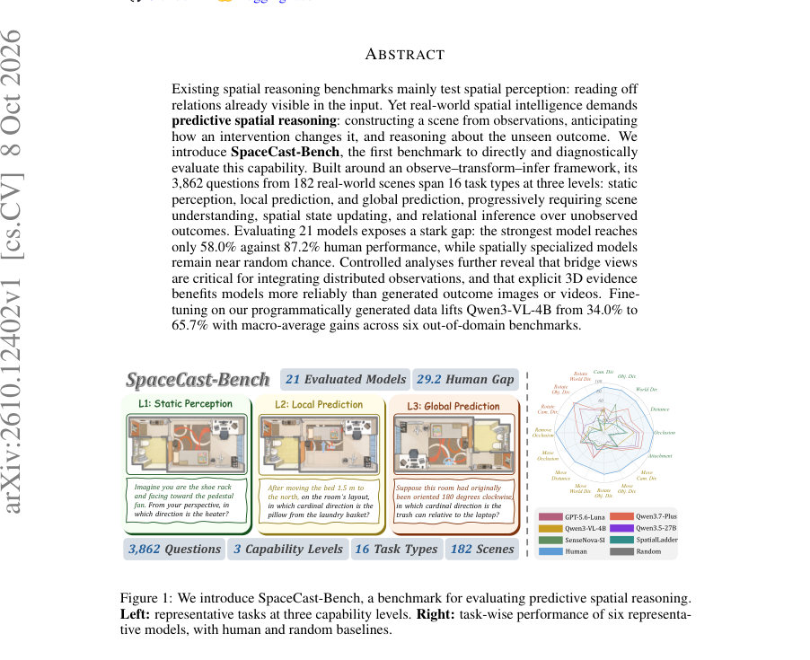
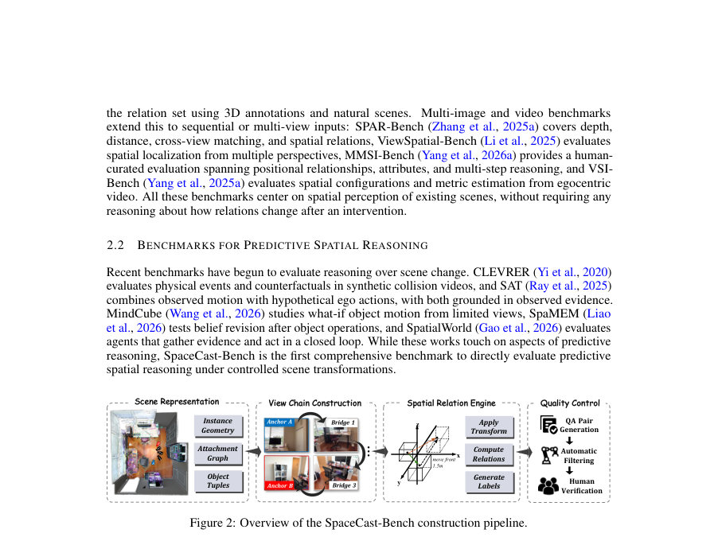
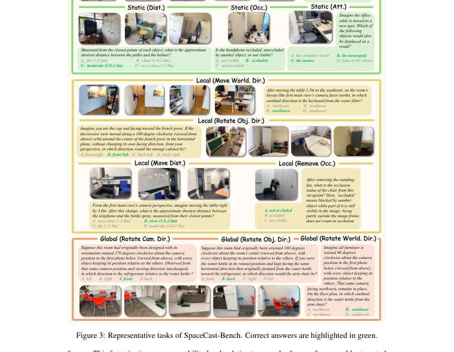

# SpaceCast-Bench: Evaluating Predictive Spatial Reasoning in Vision-Language Models

- **게시일:** 2026-10-11
- **arXiv:** [2610.12402v1](http://arxiv.org/abs/2610.12402v1) · [PDF](https://arxiv.org/pdf/2610.12402v1)
- **저자:** Hongxing Li, Jinyue Su, Dingming Li, Wenqi Zhang, Weiming Lu, Jun Xiao, Yueting Zhuang, Yongliang Shen
- **분야:** cs.CV, cs.CL
- **선정 점수:** 3.88
- **선정 이유:** 최근성 0.5, 인용 영향 0.0 (인용 0회), 저자 영향 0.0 (최고 h-index 0), AI 주제 적합성 2.6, 개발자 관심 0.2, 학술 신호 0.6, 오픈 웨이트·주요 연구조직 신호 0.0

[← 2026-10-11 목록으로 돌아가기](../daily/2026-10-11.html)

<!-- paper-visuals:start -->
## 주요 Figure

> 원문 PDF에서 실제 Figure 캡션과 그림 영역이 함께 확인된 자료만 자동 추출했다.

*Figure · 원문 PDF 1쪽 · Figure 1: We introduce SpaceCast-Bench, a benchmark for evaluating predictive spatial reasoning.*

*Figure · 원문 PDF 3쪽 · Figure 2: Overview of the SpaceCast-Bench construction pipeline.*

*Figure · 원문 PDF 4쪽 · Figure 3: Representative tasks of SpaceCast-Bench. Correct answers are highlighted in green.*

<!-- paper-visuals:end -->

## 한 문장 요약

실제 관찰에서 장면을 구성하고 개입 후 보이지 않는 결과를 추론하는 예측적 공간 추론 능력을 평가하기 위해 관찰–변환–추론(observe–transform–infer) 파이프라인 기반의 SpaceCast-Bench 벤치마크와 기하 기반 데이터 생성·검증 파이프라인을 제안하고, 21개 모델 평가와 사후학습 실험으로 성능 병목과 개선 경로를 진단했다.

## 해결하려는 문제

기존 공간 추론 벤치마크는 주로 관찰된 입력에서 이미 보이는 관계를 읽어내는 '공간 지각(spatial perception)'을 평가한다. 그러나 실제 로봇·에이전트에는 관찰로부터 장면의 내적 모델을 구성하고, 개입(물체 이동·회전·제거, 전체 레이아웃 회전 등)이 있을 때 보이지 않는 결과 상태를 예측·추론하는 '예측적 공간 추론(predictive spatial reasoning)' 능력이 필요하다. 이러한 능력을 통제되고 진단적으로 평가하는 공개된 벤치마크가 없다는 점이 문제이다.

## 핵심 기여

- SpaceCast-Bench라는 예측적 공간 추론을 직접·진단적으로 평가하는 최초의 벤치마크를 제안(3,862문제, 182장면, 16개 과제유형, L1/L2/L3 세 수준).
- 기하학 기반 파이프라인을 개발해 RGB-D 스캔과 포즈를 이용한 depth-검증 뷰체인(앵커·브리지 뷰)을 구성하고 3D 변환을 적용해 결과 상태를 프로그램적으로 라벨링함으로써 비관찰 결과를 생성·검증.
- 광범위한 모델 스위트(21개; 상용·오픈·공간특화 모델)를 평가하고 상세 진단(참조 프레임·관계 타입·능력 수준별)을 통해 현행 모델들의 성능 병목을 규명.
- 브리지 뷰의 중요성, 명시적 3D 증거(BEV 이미지·3D 메타데이터)가 생성된 결과 이미지/비디오보다 안정적으로 성능 향상을 도모함을 입증.
- SpaceCast-Bench로 생성한 프로그램적 데이터로 Qwen3-VL-4B에 대해 SFT·GRPO 실험을 수행해 대규모 성능 향상 및 일부 OOD 전이 가능성을 보임(예: Staged SFT로 전체 34.0%→65.7%).

## 접근 방법

* SpaceCast-Bench는 관찰–변환–추론(observe–transform–infer)을 명시적 평가 절차로 삼는다.
* 입력은 변환 이전의 RGB 뷰들의 순서화된 체인 O이며, 자연어로 정의된 변환 T와 질의 q가 주어졌을 때 모델은 관찰된 S0로부터 변환 F(S0,T)=S1을 추론하여 S1에서 q를 평가해야 한다.
* 데이터 생성 파이프라인 구성요소는 다음과 같다: (1) 데이터 소스: ScanNet(134장면)과 ScanNet++(48장면)의 RGB-D, 카메라 포즈, 재구성된 3D 메시와 인스턴스 주석 사용; (2) 장면 표현: 각 인스턴스의 표면 기하, 3D 중심, AABB와 접촉·지지 기반의 단일 부모를 갖는 방향성 attachment 그래프(전이적 폐쇄로 동반 이동 결정) 구축; (3) 뷰체인(Anchor–Bridge) 구성: 두 앵커뷰가 서로의 쿼리 대상 그룹을 노출하지 않도록 필터링하고, 깊이 검증된 'corridor'를 따라 겹침 기준(최소 10%)와 전진성을 만족하는 중간 브리지 뷰를 삽입(브리지 최대 6개); 모든 뷰는 사전 변환 상태만 포함; (4) 공간관계 엔진: 3D 기하로부터 방향(바닥면 투영 + 8분면/상하), 거리(표면-대-표면 근사 후 4개 범주), 가시성·차폐(카메라 중심에서 메시 레이캐스팅), 부착(attachment 전이적 자손 집합) 등을 계산하고, 지정된 변환(물체 병렬 이동·궤도 회전·제거, 레이아웃 전역 회전)을 적용해 S1을 재계산하여 정답 라벨 생성; (5) 자동 필터링과 인간 검증(각 질문 최소 2명 독립 검토, 불일치 시 3번째 검토)으로 기하적 모호성·경계 근처 라벨·시각적 근거 부족 등을 제거.
* 평가 메트릭은 16개 과제별 정확도의 단순 매크로 평균(Overall)과 수준별(Static/Local/Global) 매크로 평균을 사용한다.

## 주요 결과

- 데이터셋: 평가집합 3,862문제(ScanNet 718, ScanNet++ 3,144)·182장면·16과제유형. L1 Static 1,368, L2 Local 1,709, L3 Global 785.
- 인간·무작위 기준: 인간 타입-매크로 정확도 87.2%, 무작위 기준 25.9%.
- 전체 성능: 최고 모델은 Gemini 3.5 Flash로 Overall 58.0%이며 인간과의 격차 29.2포인트 존재. 상용·일반 오픈 모델이 공간특화 모델들보다 우수함(공간특화 모델들 25.7–29.1%로 무작위에 근접).
- 모델별·관계별 관찰: 첨부(attachment) 관계는 상대적으로 높게 예측(예: Qwen3.7-Plus 80.4%, GPT-5.6-Luna 74.2%)되나 방향·거리 추정은 가장 어려움. 참조 프레임별로는 세계(world)-중심 방향이 가장 잘 맞는 경향(예: Qwen3.7-Plus 58.4%).
- 브리지 뷰 중요성: 브리지 뷰 제거 시 전 모델 평균으로 방향 정확도 하락. 특히 world-centric 방향에서 39.9%→34.6%로 −5.3 pp 감소, 카메라·객체 프레임에서는 더 작은 하락(각각 −1.9 pp, −1.7 pp). (Figure 6)  .  	
외부 공간 증거 효과: 명시적 3D 증거(BEV 이미지 또는 텍스트 3D 메타데이터)는 일반목적 모델에서 성능 향상을 유발. 논문은 텍스트 3D 메타데이터가 '프로프라이어터리 모델군'에서 +30.7 pp, '오픈-웨이트 모델군'에서 +10.9 pp의 큰 향상을 준다고 보고. 반면, 생성된 결과 이미지/비디오는 일관된 이득을 주지 못하고, 생성 실패 비율(수동 감사 결과)은 Qwen-Image-Edit에서 오답의 80.3%, GPT-image-2에서 38.3%가 생성 실패에 기인함을 발견(객체 변형·누락·스케일·원근 불일치 등).  
사후학습 실험: Qwen3-VL-4B 기본 모델 Overall 34.0%. Mixed SFT로 64.8%, Staged SFT로 65.7%까지 상승. GRPO는 37.7%로 제한적 개선. Staged SFT는 OOD 6개 벤치마크의 매크로 평균을 33.5%→38.1%로 개선하여 전이성을 보임(특히 DSI 등에서 큰 향상). (Table 4, Table 9)

## 한계

- 저자가 명시한 한계: 데이터가 ScanNet·ScanNet++의 검증 분할에서 생성되었고 모두 실내 장면에 국한되어 있어 실외 환경·다른 배치·스케일을 포함하지 않음. 라벨이 재구성된 메시·깊이·카메라 포즈·인스턴스 주석에 의존하므로 재구성 오류가 가시성·접촉·지지 관계와 관련된 라벨에 영향을 줄 수 있으며, 모호성 케이스는 배제했으나 완전 제거 불가. 세 가지 개입 유형(병렬 이동·회전·제거)은 물리 시뮬레이션을 수행하지 않으므로 탄성·마찰·충돌로 인한 변형이나 동역학적 파급 효과는 평가하지 않음.
- 본문 실험·분석에서 확인되는 제약(본 논문 본문 기준으로 합리적으로 확인되는 한계): (1) 결과 이미지/비디오같은 생성된 outcome 미디어는 높은 생성 실패율을 보여 현실적 증거로 즉시 신뢰하기 어렵다(예: Qwen-Image-Edit 오류 다수). (2) 브리지 뷰 설계는 성능에 중요하지만, 실제 수집 시 동일한 수준의 브리지 뷰를 확보하는 비용과 현실적 제약이 크며 본 데이터는 포즈가 있는 RGB-D 스캔에 의존한다. (3) 공간특화 모델들이 낮은 성능을 보였는데, 이는 기존의 공간 미세조정 데이터가 '공간 상태 업데이트' 유형을 충분히 포함하지 않아 전이성이 낮음을 시사하나, 이 결론은 벤치마크 도메인(실내·ScanNet 기반)에 종속될 가능성이 있다.

## 개발자 관점

- 재현 및 데이터 준비: 벤치마크는 RGB-D 스캔(카메라 포즈·깊이·메시)과 인스턴스 주석이 필요하다. view-chain(앵커·브리지) 구성, depth-검증 corridor, attachment 그래프 생성, 변환 적용 후 기하 기반 재계산 엔진을 정확히 구현해야 재현 가능. 저자 제공된 파이프라인·세부절차(부록 B,C)를 따를 것.
- 브리지 뷰 확보의 중요성: 분산 관찰을 통합하려면 앵커 사이를 잇는 깊이 검증된 중간 뷰가 모델 성능에 큰 영향을 줌. 실제 수집/배포시 연속성(카메라 경로)과 브리지 뷰 유무를 고려해야 함.
- 증거 형태 설계: 외부 공간 증거를 제공할 때는 가능하면 명시적 3D 증거(BEV 이미지, 구조적 3D 메타데이터)를 우선 사용해야 하며, 생성된 endpoint 이미지/비디오는 낮은 신뢰도로 자동 파이프라인에 그대로 투입하면 오히려 오류를 유발할 수 있음.
- 사후학습 구현 팁: SFT(Staged 방식 포함)로 LoRA 기반 적응만 해도 큰 성능 향상이 가능함(논문은 rank-32 LoRA, vision encoder freeze, 언어 어댑터 LR 1e-4, aligner LR 1e-5, batch size 32 등을 사용). Staged 학습(L1→L2/L3 재생성)은 OOD 전이에 더 일관된 효과를 보였음.
- 배포·안전성: 현 단계 모델들은 인간 성능과 큰 격차가 있으므로 안전·실제 조작 제어에 직접 투입하지 말 것. 모델 출력의 불확실성(특히 occlusion·attachment 관련)을 명시적으로 반환하고, 물리적 조작 전에는 3D 센서 기반 검증 루틴을 추가할 것.

**근거 범위:** 이 분석은 제출된 논문 PDF 본문(본문 및 부록 A–D 포함)의 텍스트를 근거로 작성되었다. 모든 수치·실험 세부사항(데이터 크기, 모델별 정확도, 학습 하이퍼파라미터, 생성 실패 비율 등)은 본문·표·그림과 부록에 명시된 값만을 사용했다. PDF에서 제공되지 않거나 명시적 근거가 없는 구현 세부사항·추정치는 포함하지 않았다.
