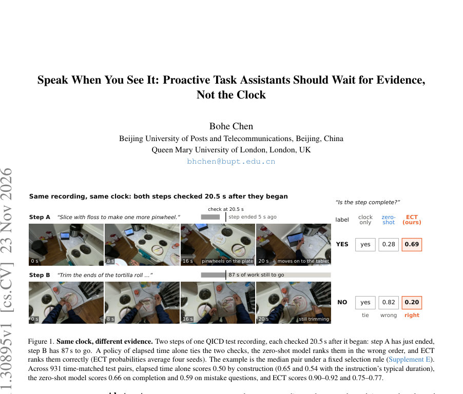
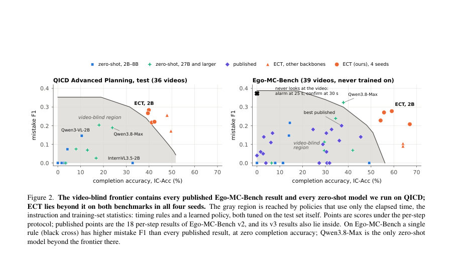
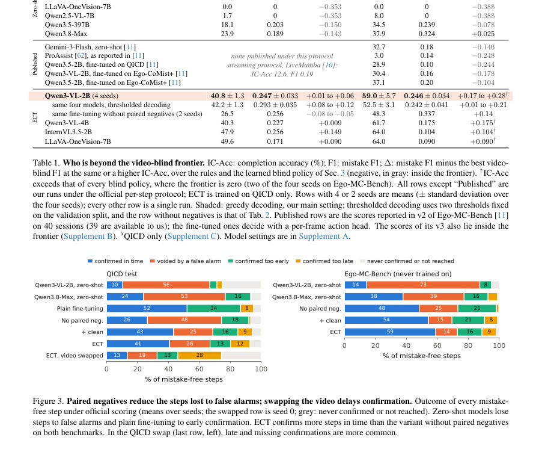

# Speak When You See It: Proactive Task Assistants Should Wait for Evidence, Not the Clock

- **게시일:** 2026-11-24
- **arXiv:** [2611.30895v1](http://arxiv.org/abs/2611.30895v1) · [PDF](https://arxiv.org/pdf/2611.30895v1)
- **저자:** Bohe Chen
- **분야:** cs.CV, cs.AI
- **선정 점수:** 4.51
- **선정 이유:** 최근성 1.1, 인용 영향 0.0 (인용 0회), 저자 영향 0.0 (최고 h-index 0), AI 주제 적합성 1.5, 개발자 관심 0.2, 학술 신호 0.6, 오픈 웨이트·주요 연구조직 신호 1.1

[← 2026-11-24 목록으로 돌아가기](../daily/2026-11-24.html)

<!-- paper-visuals:start -->
## 주요 Figure

> 원문 PDF에서 실제 Figure 캡션과 그림 영역이 함께 확인된 자료만 자동 추출했다.

*Figure · 원문 PDF 1쪽 · Figure 1. Same clock, different evidence. Two steps of one QICD test recording, each checked 20.5 s after it began: step A has just ended,*

*Figure · 원문 PDF 3쪽 · Figure 2. The video-blind frontier contains every published Ego-MC-Bench result and every zero-shot model we run on QICD;*

*Figure · 원문 PDF 5쪽 · Figure 3. Paired negatives reduce the steps lost to false alarms; swapping the video delays confirmation. Outcome of every mistake-*

<!-- paper-visuals:end -->

## 한 문장 요약

프로액티브 작업 보조자가 '시계'가 아니라 실제 시각적 근거를 기다리도록 만들기 위해, 동일 녹화·동일 경과시간에서 긍정 샘플과 부정 샘플을 짝지어 미세조정하는 Evidence-Contrastive Training(ECT)를 제안하고, 이를 통해 기존 벤치마크의 '시간만 보는' 한계를 넘는다.

## 해결하려는 문제

프로액티브 보조 모델은 수초 간격으로 현재 단계가 완료되었는지와 실수(오류)가 발생했는지를 판단해야 한다. 하지만 QICD와 Ego-MC-Bench의 공식 per-step 평가 프로토콜은 단계 경계에 어노테이션이 몰리고 첫 번째 확인이 허용되는 특성 때문에, 경과 시간·지침·훈련 통계만으로도 좋은 점수를 얻을 수 있다. 결과적으로 기존 연구들의 많은 결과가 시각적 증거를 읽지 않고 '시계'에 의존하는 정책들(video-blind) 내부에 머물며, 실제로 장면(비디오)을 보고 판단하는지 불분명하다.

## 핵심 기여

- 현행 두 개의 프로액티브 안내 벤치마크(QICD Advanced Planning, Ego-MC-Bench)의 per-step 평가가 경과시간 기반의 정책으로도 높은 성능을 얻을 수 있음을 보이고, 이를 비디오-블라인드 프런티어(video-blind frontier)로 정형화하여 모든 공개된 per-step 결과와 실험한 제로샷 모델이 그 내부에 있음을 보여 진단 도구로 제안함.
- Evidence-Contrastive Training(ECT)를 제안: 벤치마크의 '체크'(check) 단위를 학습 예제로 삼고, 긍정(YES) 상황을 동일 녹화·동일 경과시간의 부정(NO) 상황과 페어로 묶어 경과시간만으로는 분리할 수 없도록 학습시키는 간단한 파이프라인을 제시함.
- 자원·데이터 효율성 증명: Qwen3-VL-2B(2B) 기반 모델을 LoRA(rank=64)로 2,400 스텝(약 1 epoch, 209 QICD 학습 비디오)만 학습하여 약 15 GPU-시간(A100)으로 두 벤치마크에서 비디오-블라인드 프런티어를 넘어서는 성능을 달성함.
- 행동 단위 검사(시간-매칭 쌍, 타임스탬프 재스케일, 비디오 스왑)로 ECT의 결정이 경과시간이 아니라 실제 영상 증거에 근거함을 실험적으로 입증함(예: 동일 경과시간 쌍에서 완료/미완료 구분 90–92%).
- 훈련에서 페어드 네거티브가 주로 '각 체크에서의 거짓 경보(false alarm) 비율'을 낮춰 완료 정확도(IC-Acc)를 크게 개선함을 분석적으로 보여줌.

## 접근 방법

* 핵심 아이디어는 벤치마크의 per-step 프로토콜에서 모델이 실제로 마주하는 '체크(situation)'들을 직접 학습 예제로 삼고, 긍정 예(예: 단계 완료 또는 실수 보고)가 등장한 동일 녹화 내, 동일 경과시간(E)에 존재하는 부정 예를 페어로 만들어 엘랩스드 타임(elapsed time)만으로는 두 쪽을 구분할 수 없게 하는 것이다.
* 구현 세부사항(본문 기준): 입력 모델은 Qwen3-VL-2B이고 LoRA(rank=64)로 어댑터만 미세조정한다.
* 학습 데이터 구성: 209 QICD 학습 비디오에서 총 약 18,406개의 상황을 생성(예: 1,938 mistake, 4,563 success, 6,315 silence, 4,068 notdone, 1,159 clean 등).
* 상황 샘플링 가중치는 (예: mistake 0.25, success 0.20, silence/notdone/clean 0.15, shifted 0.10).
* 페어드 네거티브 종류: notdone(성공 상황을 경과시간 E에서, 아직 20s 이상 남은 다른 단계의 상황과 짝지어 'NO'로 학습 — 조기 확인 억제 목표), clean(실수 상황을 경과시간 E에서 실수 없는 다른 단계와 짝지어 'NO'로 학습 — 증거 없는 경보 억제 목표).
* 최적화: AdamW, 학습률 2e-4, 2,400 스텝(약 한 epoch), 교차엔트로피 손실 on answer tokens.
* 추론은 벤치마크의 공식 프롬프트와 그리디 디코딩을 그대로 사용(결정 임계값 없이도 평가).
* 비디오-블라인드 프런티어는 경과시간·지침·훈련 통계만을 사용하는 규칙(고정 지연, 지침별 전형적 지속시간 배수 등)과 학습된 규칙(GBDT로 예측한 지속시간·실수확률 기반의 폴리시)을 테스트해 얻은 (IC-Acc, mistake F1) 점들의 상단 컨벡스 헐로 정의함.

## 주요 결과

- 비디오-블라인드 진단: '알람 25s, 확인 30s' 규칙(비디오 미사용)이 Ego-MC-Bench에서 mistake F1 = 0.373을 기록해, 당시 공개된 모든 per-step 결과(최고 0.27)를 상회함. QICD에서도 유사한 비디오-블라인드 프런티어 도출.
- ECT( Qwen3-VL-2B, 4 시드 ) 성능: QICD Advanced Planning 테스트에서 IC-Acc = 40.8 ± 1.3% , mistake F1 = 0.247 ± 0.033 , 비디오-블라인드 프런티어 대비 margin ∆ = +0.012…+0.061(시드별). Ego-MC-Bench(비적응 전이)에서 IC-Acc = 59.0 ± 5.7% , mistake F1 = 0.246 ± 0.034 , margin ∆ = +0.17…+0.28.
- 자원 비교: ECT는 QICD의 209 학습 비디오와 약 2,400 스텝, 단일 A100에서 약 15 GPU-시간으로 학습됨. 대비되는 공개된 같은 백본의 모델은 약 25k 합성 counterfactual 쌍과 다수의 GPU(약 100k iteration, 8 H100)를 사용해 보고된 바 있음; ECT는 학습 데이터·자원 측면에서 훨씬 적음에도 Ego-MC-Bench에서 같은 백본의 공개 모델(보고된 수치: IC-Acc 30.4, F1 0.16 등)보다 높은 IC-Acc(59.0%)를 달성.
- 페어드 네거티브의 효과: 페어드 네거티브를 추가하면 체크 당 false alarm 비율을 약 18%→7%로 낮추어(본문 수치) 완료 정확도 향상의 대부분을 설명. 시간-매칭 테스트 쌍(931쌍)에서, 경과시간만으로는 0.5의 성능, 지침의 전형적 지속시간은 완료 쌍에서 0.65를 보이나 ECT는 같은 경과시간 쌍에서 완료 쌍 0.90–0.92, 실수 쌍 0.75–0.77의 구분 정확도를 보임.
- 비디오 의존성 검증: 프레임 타임스탬프를 두배/절반으로 스케일해도 ECT 성능은 거의 변하지 않음(AUROC completion ~0.945 유지), 반면 페어드 네거티브 없는 모델은 타임스탬프 변경에 민감. 다른 녹화로 비디오를 교체하면(동일 레시피 내 가능한 경우) ECT의 완료 정확도는 예시에서 41.2%→13.4%로 크게 하락해 실제 영상 증거를 사용함을 시사.

## 한계

- 저자가 명시한 한계: 실험은 요리 도메인(주로 QICD, Ego-MC-Bench)과 그들의 공식 per-step 프로토콜에 국한되어 있으며, Ego-MC-Bench는 ECT가 학습되지 않은 상태에서 전이 평가됨. 또한 비디오-블라인드 프런티어 정의에 포함되지 않는 추가 입력(예: 녹화 내 이전 단계들의 실제 지속시간 등)을 블라인드 학습자가 사용하면 프런티어가 확장되어 ECT의 마진이 줄어들 수 있음(논문: 이전 단계 지속시간을 추가하면 greedy ECT의 QICD 마진이 −0.028…+0.029로 변화).
- ECT의 한계로 저자가 밝힌 점: ECT는 말할 '시점'의 타이밍 개선에 더 기여하며, 실수 검출 자체의 재현성/민감도 개선은 제한적임(예: Ego-MC-Bench에서 실수 재현률이 낮음(0.18)). 또한 수동 점검에서 검출된 알람의 많은 경우(25개 중 13개)는 주석된 실수를 정확히 명명하지 못함 — 경보의 적시성은 있으나 '무엇이 잘못되었는가' 식별은 약함.
- 실험 범위의 제약: 벤치마크에 존재하는 편향(지침 표기·합성 counterfactual 데이터의 문체 차이 등)이 다른 데이터 또는 실전 설정으로 일반화될 때 결과가 달라질 수 있음(문서에서 합성 데이터의 문체가 shortcut을 만들 수 있음 언급).
- 평가 프로토콜 의존성: per-step 프로토콜의 특성(±15s 허용창, 첫번째 확인 허용 등)에 크게 의존하므로, 다른 실시간/스트리밍 프로토콜에서는 비디오-블라인드 규칙의 유효성이 달라질 수 있음(논문은 스트리밍 설정에서 blind 규칙이 더 약하다고 언급).

## 개발자 관점

- 벤치마크 결과를 보고할 때는 '비디오-블라인드 프런티어(video-blind frontier)'에 대한 마진 ∆을 함께 보고하라—경과시간·지침·훈련 통계만으로 달성 가능한 성능을 정량화해야 모델이 실제로 영상을 이용하는지를 판단할 수 있다.
- 실전 구현에서 시점 결정(when to speak)을 개선하려면 ECT와 같이 '동일 녹화·동일 경과시간'의 페어드 네거티브를 포함해 학습 분포에서 시간에 의존한 shortcut을 제거하는 것이 효과적이다. 특히 notdone(조기확인 억제)와 clean(근거없는 경보 억제) 네거티브를 모두 포함하는 것이 균형 있는 운영점을 만든다.
- 경량화 미세조정(LoRA rank=64) + 소수 비디오(209개) + 단일 A100으로도 유의미한 개선을 얻을 수 있으니, 대규모 합성 데이터·대규모 GPU가 없는 환경에서도 적용 가능하다. 복제 시 주된 하이퍼파라미터: LoRA rank, 학습률(2e-4), 스텝 수(≈2400), 상황 샘플링 가중치(논문에 명시된 값) 등을 맞출 것.
- 운영 포인트는 네거티브의 비율로 조정된다. clean 네거티브를 늘리면 완료 정확도(IC-Acc)가 올라가나 mistake recall이 하락할 수 있으므로(논문: clean×3로 IC-Acc 증가, F1/precision 변화 관찰), 실제 서비스의 비용/편익(잘못된 방해의 비용 vs 놓친 실수의 비용)에 따라 네거티브 비중을 튜닝하라.
- 모델이 실제 비디오 증거를 사용하도록 검증하려면 논문에서 사용한 진단 실험들을 도입하라: 시간-매칭 쌍(pair) 성능, 타임스탬프 재스케일 시험, 비디오 스왑 실험, 블랙-프레임 입력 시험. 이들 테스트는 시간 기반 shortcut 의존 여부를 직접 드러낸다.

**근거 범위:** 이 분석은 제공된 논문 PDF 본문(주요 본문, 표와 그림, 보충설명 일부 인용)을 근거로 작성되었음. 본문에 명시된 수치(예: IC-Acc, F1, 네거티브 개수, 학습 스텝·시간, LoRA 설정 등)는 PDF에서 직접 추출한 값이다. 보충자료의 세부 항목이나 코드·모델 공개(저자 약속)는 본문에서 언급되었으나, 실제 저장소·추가 파일은 본 PDF에 포함되어 있지 않아 확인되지 않았다.
