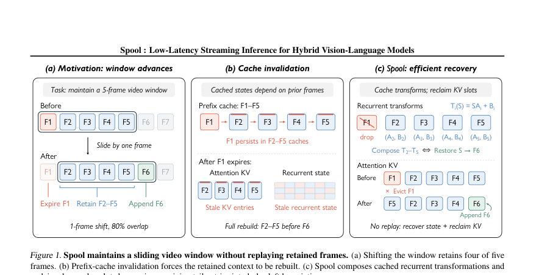
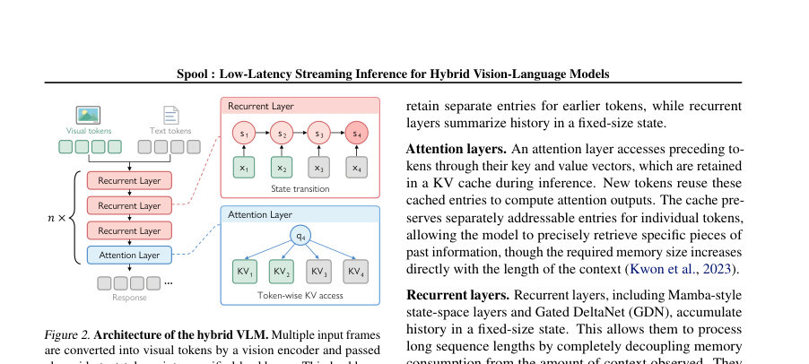
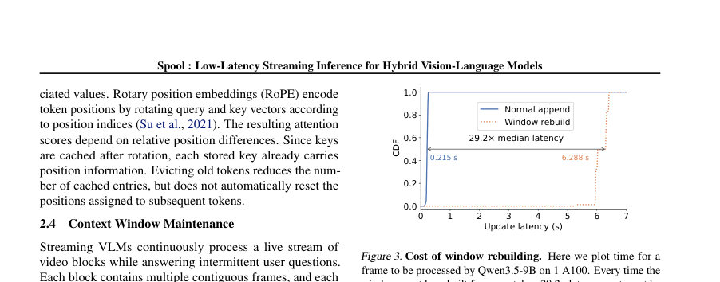

# Spool: Low-Latency Streaming Inference for Hybrid Vision-Language Models

- **게시일:** 2026-11-18
- **arXiv:** [2611.23228v1](http://arxiv.org/abs/2611.23228v1) · [PDF](https://arxiv.org/pdf/2611.23228v1)
- **저자:** Rui Ning, Om Chabra, Hari Balakrishnan
- **분야:** cs.CV, cs.LG
- **선정 점수:** 5.34
- **선정 이유:** 최근성 1.3, 인용 영향 0.0 (인용 0회), 저자 영향 0.0 (최고 h-index 0), AI 주제 적합성 2.5, 개발자 관심 0.9, 학술 신호 0.6, 오픈 웨이트·주요 연구조직 신호 0.0

[← 2026-11-18 목록으로 돌아가기](../daily/2026-11-18.html)

<!-- paper-visuals:start -->
## 주요 Figure

> 원문 PDF에서 실제 Figure 캡션과 그림 영역이 함께 확인된 자료만 자동 추출했다.

*Figure · 원문 PDF 2쪽 · Figure 1. Spool maintains a sliding video window without replaying retained frames. (a) Shifting the window retains four of five*

*Figure · 원문 PDF 3쪽 · Figure 2. Architecture of the hybrid VLM. Multiple input frames*

*Figure · 원문 PDF 4쪽 · Figure 3. Cost of window rebuilding. Here we plot time for a*

<!-- paper-visuals:end -->

## 한 문장 요약

Spool은 학습 없이 하이브리드 VLM의 각 프레임이 재귀적 상태에 미치는 영향을 아핀 변환(A,B)으로 저장하고, 세그먼트 트리로 이들을 효율적으로 합성해 슬라이딩 윈도우에서 만료된 프레임의 영향을 재연산 없이 제거함으로써 스트리밍 질의의 p95 응답 지연을 크게 줄이는 프레임워크이다.

## 해결하려는 문제

하이브리드 VLM(주의(attention) 레이어와 고정 크기 상태를 갱신하는 선형 재귀 레이어(GDN, Mamba/SSM 등)를 교차 사용)은 스트리밍에서 고정 길이 슬라이딩 윈도우를 유지해야 할 때 문제를 일으킨다. attention은 만료된 토큰의 KV를 개별적으로 제거할 수 있지만, 재귀 레이어는 과거 프레임을 단일 상태에 혼합하므로 특정 프레임의 만료는 상태에서 직접 제거할 수 없다. 이 때문에 윈도우가 진행될 때(프레임이 만료될 때) 보통은 보유된 모든 잔여 프레임을 다시 통과시켜 상태를 재구성해야 하며, 이는 큰 지연(테일 레이턴시)을 초래한다. 기존의 prefix 캐시(예: vLLM)는 윈도우의 왼쪽 경계가 바뀌면 캐시가 무효화되며, vLLM-Omni의 배치(evict-by-batch) 증분 prefill은 전체 재빌드 발생과 컨텍스트 손실, 용량 예약 문제를 남긴다.

## 핵심 기여

- 재귀 레이어(GDN, Mamba/SSM 등)의 상태 갱신이 입력 종속 계수에 의해 표현되는 아핀 변환 St = St−1 A_t + B_t 형태이며, 프레임별 변환들이 결합(합성) 가능하다는 관찰과 정식화(각 블록에 대해 (A_i,B_i)를 얻으면 임의의 진입 상태에 동일하게 적용 가능).
- Spool 프레임워크: 프리필(prefill) 과정에서 블록 단위의 아핀 변환 (A_i,B_i)를 기록하고, 세그먼트 트리를 이용해 연속 블록 구간의 변환을 O(log W) 합성하여 윈도우가 진전될 때 만료된 블록을 재실행 없이 정확히 제외(레이어 단위로 정확)하는 방법 제안.
- attention 캐시 관리를 위한 실무적 기법 제시: (1) KV tail-filling — 만료로 생긴 홀을 tail의 살아있는 KV로 채워 페이지 단위 재배치 비용을 줄임, (2) RoPE rebasing — 위치 인덱스 오버플로우를 막기 위해 공통 오프셋을 빼고 캐시된 키에 R(−Δ) 회전을 적용해 위치를 재기준화함으로써 재계산 없이 상대 위치 보존.
- 효율적 구현과 시스템화: 잔차(A−I) 저장(저정밀 BF16), Triton 기반 커널과 Flash Linear Attention 경로 확장, 계층/헤드 병렬 합성으로 실사용 가능성 확보 및 다양한 공개 하이브리드 VLM(0.8B–122B)과 4개 벤치마크에서 실험적 검증을 수행.
- 광범위한 실험 결과: p95 time-to-first-token(TTFT)를 모든 20 모델–벤치마크 조합에서 최저치로 낮추었고(기하평균 6.6× 빨라짐, 최대 35.7×), 온라인 환경에서 평균 약 2.3 퍼센트포인트의 정확도 개선을 보고함.

## 접근 방법

* 아키텍처와 알고리즘(본문 기준):
* 실행 모델: 비디오를 블록 단위로 받아 고정 프롬프트(앵커 상태 Sp) 뒤에 슬라이딩 윈도우 [a,b)를 유지한다.
* 블록 단위로 만료(evict)는 블록 경계에서만 발생한다.
* 블록 변환 추출: 프리필(prefill) 경로에서 재귀 레이어가 각 토큰의 내부 중간값(kt, vt, αt, βt 등)을 계산하는 것을 활용하여 블록 i에 대한 아핀 변환 Fi(S)=S A_i + B_i를 구성한다.
* 구현상 A 대신 잔차 D = A−I를 BF16로 저장해 소수 변경을 보존한다.
* B는 블록 입·출력 상태로부터 Bi = S_out − S_in A_i 형태로 얻는다.
* 세그먼트 트리 기반 합성: 연속 블록 구간의 변환은 아핀 합성(비가환 단체(monoid))에 의해 또 다른 아핀 변환으로 표현된다.
* 각 블록은 사이클로 재사용되는 리프 슬롯에 저장되고, 조상 노드들은 자식의 변환을 bottom-up으로 합성해 둔다.
* 삽입은 O(log W) 합성, 만료 시 보유 구간을 커버하는 O(log W) 요약(노드)을 시간순으로 적용해 상태 재구성(S ← S A + B)한다.
* 이로써 재구성 비용을 O(log W)로 줄인다.
* attention KV 관리: 만료로 인한 페이지 내 홀을 메모리 전면 재복사 없이 tail-filling으로 생존 KV쌍으로 채워 슬롯을 조밀화(각 이동은 키/값을 읽고 쓰므로 복사 비용은 2·m·b_KV 바이트, m≤e 만료된 토큰 수).
* RoPE rebasing은 전체 캐시에 대해 위치 오프셋 Δ를 빼고, 저장된 키들에 R(−Δ) 회전을 적용해 상대 위치 기반 attention 점수를 정확히 보존한다.
* 구현 요약: PyTorch + Triton으로 구현, Flash Linear Attention의 GDN prefill 경로 확장, 요약/병합/적용 커널을 Triton으로 작성, 요약은 BF16 저장·FP32 누적, attention 페이지는 256-token 페이지 사용, RoPE 재기준화는 FP32로 계산 후 BF16 저장.

## 주요 결과

- 평가 대상: 6개 공개 하이브리드 VLM(예: Qwen3.5/Qwen3.6 계열: 0.8B, 9B, 27B, MoE 35B-A3B, 122B-A10B; Nemotron Nano-12B Mamba/SSM 포함)과 4개 비디오 스트리밍 벤치마크(PhoStream, StreamingBench, FastBench, Beyond3D).
- 비교 기준: vLLM-Omni 기본 경로와 vLLM-Omni + Incremental Prefill(증분 prefill)과 비교. 주요 지표는 온라인 p95 time-to-first-token(TTFT), p50 TTFT, 온라인/오프라인 정확도, 프레임 당 인제스천 지연, 최대 GPU 할당 메모리, 출력 분포 KL 변화.
- 주요 정량 결과(본문에서 보고된 수치):
- - p95 TTFT: 모든 20개 모델–벤치마크 테스트에서 Spool이 최저 p95를 기록. p95 기준 v. 기준선(더 빠른 baseline) 대비 기하평균 6.6× 단축(최대 35.7×). 예: PhoStream·Qwen3.5-9B에서 vLLM-Incremental 12.22 s → Spool 0.34 s (×35.7). vLLM-Omni 대비 기하평균 33.8× 단축. Spool은 20 테스트 중 16개에서 p95<1s 유지(증분 prefill은 3개만).
- - 온라인 정확도: 질문이 제 시간에 답해지는 비율이 올라가며(느린 경우 질문이 드롭됨), 평균 온라인 정확도가 본문 평균 기준으로 52.8%(Spool) vs 50.3%(vLLM-Incremental) vs 45.4%(vLLM-Omni)로 보고되어 약 평균 +2.3 퍼센트포인트 개선(본문과 초록 일관). Beyond3D에서는 최대 +18.4 포인트 개선 사례 보고(예: Nemotron-Nano-12B에서 30.32% vs 11.94%).
- 오프라인 정확도(타이밍 제약 제거): Spool은 더 정확한 기준선과 비교해 −1.6에서 +1.8 포인트 범위 내에 머무르며, 평균 정확도는 Spool 54.4% vs vLLM-Incremental 54.1% vs vLLM-Omni 53.7%로 동등함(즉 온라인 이득은 지연 감소로 인한 드롭 감소에서 기인).","- 메모리·지연 트레이드오프: 세그먼트 트리 추가로 프레임 인제스천 지연이 4.7–14.8% 감소(모델별), KV filling을 더하면 총 7–17% 감소. 세그먼트 트리는 피크 GPU 할당량을 2.25–4.37 GiB 추가하고 KV filling이 0.38–1.77 GiB를 회복. 전체적으로 나이브 캐시 대비 평균 9.2% 더 많은 메모리 사용(본문 Table 4). 본문은 9B 모델에서 변환 캐시가 4.8 GiB(약 18%)를 쓴다고 명시함. ","- 출력 충실도: 만료된 프레임이 누적될 때 Spool의 상태 재구성이 없으면 KL 발산이 누적되지만, 재구성을 하면 1024 만료 프레임까지도 KL divergence가 약 0.04로 유지(오차가 축적되지 않고 유계함). 또한 재구성은 만료된 과거 컨텍스트를 묻는 질문에서 정확도 이득을 제공(예: PhoStream의 backward 질문에서 재구성 시 2.4~4.7 포인트 이득)."], 

## 한계

- 저자가 명시한 한계: (1) 레이어 단위로는 변환 캐싱·재생성이 정확하지만, 다계층(백본)에서 앞선 레이어들이 이미 만료된 프레임을 반영한 입력을 생성했을 수 있어 만료 프레임의 잔여 영향은 완전히 제거되지 않음(본문에서 이 점을 명확히 밝힘). (2) 요약은 BF16으로 저장(잔차 D=A−I를 사용)하므로 정밀도 손실 가능성 존재; 저자는 이를 완화하기 위해 잔차 표현을 사용함을 명시함. (3) 만료와 재구성은 블록 단위로 이루어지며, 블록 내부 토큰 단위로의 세밀한 만료는 지원하지 않음.
- 본문에서 합리적으로 확인되는 제약(저자가 명시하지 않거나 추가로 확인된 제약): (1) 적용 대상 모델: 재귀 업데이트가 아핀 형태로 표현되는 하이브리드 VLM(예: GDN, Mamba, SSM 계열)에 한정됨 — 완전히 일반적(임의 아키텍처)인 해결책은 아님. (2) 세그먼트 트리는 메모리·연산 오버헤드를 요구: 본문은 노드 당 A,B 저장으로 인해 수 GiB 규모 추가 메모리를 보고(예: 2.25–4.37 GiB), 삽입/합성 비용이 O((d_k^3 + d_v d_k^2) log W) 형태로 증가함을 명시함. (3) RoPE 재기준화와 KV tail-filling은 구현 복잡도와 동기화 이슈(페이지 테이블·위치 맵 관리)를 수반함; 서비스 통합 시 추가 엔지니어링 필요. (4) 실험은 공개된 특정 모델·벤치마크·하드웨어에서 수행되었으며, 결과가 다른 아키텍처/하드웨어/워크로드에 그대로 일반화된다는 보장은 없음.

## 개발자 관점

- 재현·구현: Spool은 모델 내부(재귀 커널)의 중간값에 접근해 블록별 A_i,B_i를 추출해야 하므로 사전학습된 체크포인트와 백본의 prefill 경로를 확장할 수 있어야 한다. 구현에는 Triton 커널(요약 병합·적용), Flash Linear Attention 확장, 페이지드 KV 캐시 제어가 필요하다.
- 정밀도·저장: 요약은 BF16으로 저장하고 prefix 앵커·live 상태는 FP32로 유지하는 점이 중요하다. A 대신 잔차 D=A−I를 저장하면 BF16에서 작은 변화를 더 잘 보존한다는 구현 팁이 본문에 있음.
- 운영·배포: 세그먼트 트리와 KV tail filling은 낮은 p95를 확보하지만 수 GiB 추가 메모리를 요구하므로 배포 시 GPU 메모리 예산(예: 2–5 GiB 여유)을 고려해야 한다. KV filling은 페이지 단위의 이동만 수행하므로 복사 비용은 만료된 토큰 수에 비례해 예측 가능하다.
- 성능·모니터링: 실제 서비스에서는 p95/Tail-latency가 핵심 지표다. Spool은 온라인에서 응답 지연으로 인한 질문 드롭을 줄여 최종 서비스 정확도를 개선하므로 운영 중 p95와 드롭율(시간에 따른 처리 실패율)을 같이 모니터링할 것.
- 호환성·제한 검증: 적용 전 모델이 아핀 재귀 업데이트 규격(GDN/Mamba/SSM 등)을 따르는지 확인하고, RoPE 사용 여부·형태(다축 RoPE 등)에 맞게 rebasing을 구현해야 한다. 또한 재구성 없이도 충분한 성능인 경우(만료된 과거가 질의에 영향이 거의 없는 워크로드)에는 단순 KV eviction 전략으로도 충분할 수 있다.

**근거 범위:** 이 분석은 제공된 논문 PDF 본문(페이지 및 본문 텍스트)을 근거로 작성하였다. 본문에 명시된 수치(예: p95 속도비, 메모리 수치, 특정 모델·벤치마크 결과)와 설계·구현 세부사항을 직접 인용했으며, 확인이 어려운 내부 구현 세부(정밀한 커널 내 연산 최적화 파라미터 등)나 다른 하드웨어/모델에서의 일반화 영향은 추정하지 않았다. 이미지나 표의 시각적 요소는 텍스트로 추출된 내용을 바탕으로 요약했으며, PDF에서의 도표·부록 숫자 일부는 본문 표/설명과 일치시키며 사용했다.
