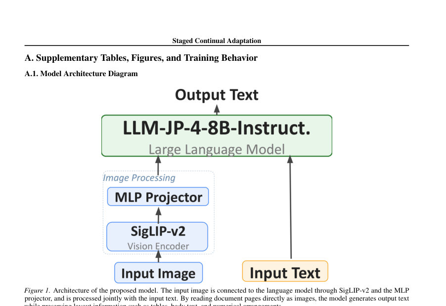
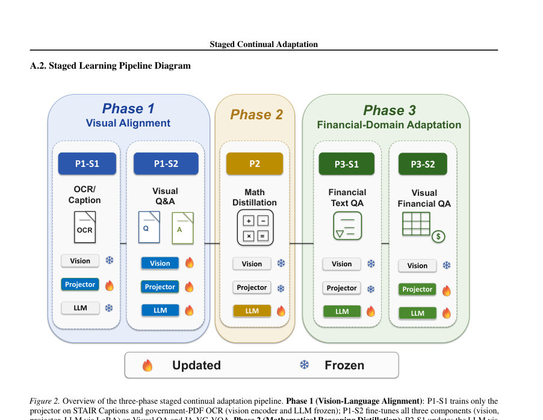
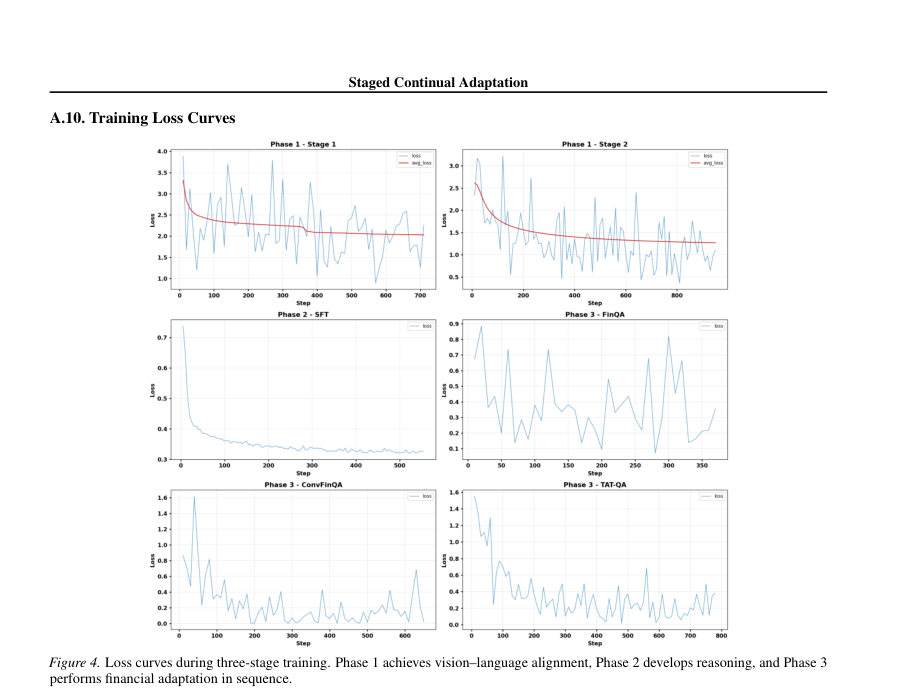

# Staged Continual Adaptation of Multimodal Foundation Models for Japanese Financial Documents

- **게시일:** 2026-10-21
- **arXiv:** [2610.27904v1](http://arxiv.org/abs/2610.27904v1) · [PDF](https://arxiv.org/pdf/2610.27904v1)
- **저자:** Genshin Kakimoto, Atsushi Yanagisawa
- **분야:** cs.AI, cs.CL, cs.CV
- **선정 점수:** 5.53
- **선정 이유:** 최근성 1.1, 인용 영향 0.0 (인용 0회), 저자 영향 0.0 (최고 h-index 0), AI 주제 적합성 3.0, 개발자 관심 0.0, 학술 신호 0.9, 오픈 웨이트·주요 연구조직 신호 0.6

[← 2026-10-21 목록으로 돌아가기](../daily/2026-10-21.html)

<!-- paper-visuals:start -->
## 주요 Figure

> 원문 PDF에서 실제 Figure 캡션과 그림 영역이 함께 확인된 자료만 자동 추출했다.

*Figure · 원문 PDF 7쪽 · Figure 1. Architecture of the proposed model. The input image is connected to the language model through SigLIP-v2 and the MLP*

*Figure · 원문 PDF 8쪽 · Figure 2. Overview of the three-phase staged continual adaptation pipeline. Phase 1 (Vision-Language Alignment): P1-S1 trains only the*

*Figure · 원문 PDF 12쪽 · Figure 4. Loss curves during three-stage training. Phase 1 achieves vision–language alignment, Phase 2 develops reasoning, and Phase 3*

<!-- paper-visuals:end -->

## 한 문장 요약

이미지-텍스트 정렬, 수리적 추론(코드-오브-소트) 증류, 도메인 미세조정의 세 단계 연속 적응으로 일본어 재무문서에 8.4B 멀티모달 파운데이션 모델을 적응시키고, 각 단계가 성능을 상호 비가산적으로 교란·수복·활성화하는지를 분석했다.

## 해결하려는 문제

멀티스테이지(vision–language alignment → reasoning distillation → domain tuning) 기반의 멀티모달 파운데이션 모델 적응법은 통상 여러 단계를 연쇄적으로 적용하는데, 각 단계가 이전에 설치한 능력을 보존·상실·혹은 활성화하는 방식과 그 트레이드오프가 충분히 규명되어있지 않다. 특히 레이아웃·표·수치 연산이 중요한 일본어 재무공시 도메인에서 이러한 상호작용(예: 절차적 수리능력 vs. 선언적 도메인 지식의 보존성)이 어떻게 나타나는지 불명확하다.

## 핵심 기여

- P0(비파인튜닝)부터 세 단계(P1 시각-언어 정렬, P2 수학적 추론 증류, P3 재무 도메인 적응)를 연속적으로 추적하여 단계 간 상호작용이 비가산적임을 실증적으로 제시함(예: 수학 증류가 선언적 재무지식을 덮어쓰는 반면 절차적 수리능력은 유지됨).
- 단일-페이지 이미지 입력을 대상으로 한 3단계 연속 적응 파이프라인 구현 및 세부 아키텍처( SigLIP-v2 + 2-layer MLP 프로젝터 + llm-jp-4-8B-Instruct ) 공개.
- 정부·공공 PDF로부터 OCR·시각 QA·도메인 금융 QA를 합성하는 재현 가능한 데이터 생성 파이프라인과, Qwen3-30B-A3B-Thinking-2507으로부터 XML 구조의 체인-오브-소트 증류 레시피를 공개(코드·데이터 허깅페이스/깃허브에 공개).
- 단계 생략(예: P2 생략) 실험을 통해 수치추론 성능과 도메인 지식 보존 사이의 명확한 트레이드오프를 제시하고, 최적 체크포인트는 태스크별로 다르므로 스케줄링·체크포인트 보존·파라미터 분리(어댑터) 같은 설계 레버를 권고함.

## 접근 방법

* 아키텍처: SigLIP-v2 SO400M-patch14-384 비전 인코더(≈0.4B)와 llm-jp-4-8B-Instruct(8B)를 2층 MLP 프로젝터(Linear→GELU→Linear)로 연결해 총 ≈8.4B 모델을 구성.
* 학습 파이프라인(세 단계): P1(vision–language alignment): P1-S1은 프로젝터만 STAIR 캡션·정부 PDF로 합성한 OCR으로 학습(비전·LLM 동결), P1-S2는 비전·프로젝터·LLM(LoRA) 동시 업데이트로 시각적 추출·추론 QA·JA-VG-VQA 등을 학습.
* P2(수학적 추론 증류): 약 150K 문제를 Qwen3-30B-A3B-Thinking-2507 교사로 XML-구조의 <Problem>/<Thinking>/<Answer> 형식 체인-오브-소트로 생성하여 QLoRA(4-bit 양자화 기반)로 LLM을 SFT(학습률·배치 등은 부록 표 참조).
* P3(재무 도메인 적응): P3-S1은 텍스트 기반 재무 QA(FinQA, ConvFinQA, TAT-QA)로 LLM(LoRA) 조정, P3-S2는 정부 PDF로 합성한 시각적 재무 QA로 프로젝터+LLM(LoRA) 학습(비전 인코더는 P3에서 동결).
* 훈련 하이퍼파라미터·데이터 규모는 본문 표(Table 3,4) 참조.

## 주요 결과

- 주요 벤치마크(단일 greedy-run 표의 발췌, 표 Table 2 기준): GSM8K 정확도 P0 58.5 → P1 64.3 → P2 73.8 → P3 71.6 (P1→P3 59.6).
- JP Fin Harness 평균 정확도 P0 45.0 → P1 53.5 → P2 31.6 → P3 49.6 → P1→P3 56.2; 세부서브태스크에서는 chabsa가 P1에서 대폭 상승(0.859→0.943) 후 P2에서 붕괴하고 P3에서 부분 회복(부록 Table 5).
- EDINET fraud(ROC-AUC) 단일-run: P0 0.516 → P1 0.554 → P2 0.534 → P3 0.614; 다중 시드 평균(3 seed, Table 9)은 P1 0.562±0.008, P2 0.523±0.008, P3 0.547±0.005로 단일 최댓값의 불안정성을 보임.
- 단계 상호작용 요약: P2(수학 증류)는 수치추론 성능을 크게 향상시켰으나 P1에서 얻은 '선언적' 재무 지식을 덮어썼고(예: JP Fin 평균 53.5→31.6), 반면 절차적 수리능력은 P3 이후에도 비교적 유지됨(GSM8K P2 73.8→P3 71.6).
- 스킵-어블레이션(P1→P3): P2를 건너뛰면 재무/도메인 성능은 보존되어 JP Fin과 EDINET industry에서 최고치를 보였으나 수치추론(GSM8K)은 크게 떨어짐(59.6). 이는 단계별 기여가 가법적이지 않음을 시사함. 또한 P3(단일 최선 run)의 EDINET fraud 0.614는 Llama-3.3-70B(0.59)·DeepSeek-R1(0.56)을 능가하고 GPT-5(0.62)에 접근하지만, 다중 시드 평균은 이 결과보다 낮아 안정적 우위로 단정하기 어렵다.

## 한계

- 저자 언급: (i) 다중 시드 검증은 부록 Table 9에서 제공되며 GSM8K·earnings에 대해 비교적 안정적이지만, skip-P2(ablation)의 다중 시드 검증은 자원 제약으로 포함하지 못했음(따라서 skip-P2 관련 단일-런 변동성이 주요 후속 과제).
- 저자 언급: (ii) 단일 모델 규모(≈8.4B), 단일 언어(일본어), 단일 도메인(재무)에 대한 결과이므로 일반화는 제한적임.
- 저자 언급: (iii) 학습은 단일-페이지 입력에 한정되어 있어 다중-페이지 문서 처리로의 확장이 필요함.
- 저자 언급: (iv) P2는 QLoRA(4-bit)로, 나머지 단계는 풀-정밀도 LoRA를 사용했으므로 양자화의 소규모 기여 가능성을 배제할 수 없음. (본문에서 저자가 명시).

## 개발자 관점

- 체크포인트 유지와 단계별 조합 전략이 중요하다: 서로 다른 태스크별로 최적 체크포인트가 다르므로 모든 단계의 체크포인트를 보존하고 필요에 따라 되돌리거나 조합하는 정책(예: per-phase adapter의 합성)을 권장함.
- 자원-절약 실무: 수리 증류(P2)에서 QLoRA(4-bit quantized + LoRA)를 사용해 비용을 줄였으나, 양자화 영향은 검증 필요 — 동일 정밀도 환경에서 재검증 권장.
- 재현성: 정부 공개 PDF로 합성한 OCR·시각 QA·도메인 금융 QA와 XML-구조 체인-오브-소트 데이터셋 및 코드(깃허브/허깅페이스)를 공개했으므로 동일 파이프라인 재현이 가능함. 다만 P2의 150K 문제 구성과 교사 모델(Qwen3-30B-A3B-Thinking-2507) 사용을 재현해야 함.
- 설계 시 고려사항: 도메인 적응(P3)은 '파괴된' 지식을 수리(repair)하는 역할을 더 많이 할 수 있으므로(설치보다 수복), P2/P3의 데이터량·순서·인터리빙(재플레이)을 조정하거나 파라미터 격리(LoRA 어댑터, 모듈별 동결)로 덮어쓰기 위험을 줄여라.
- 평가 권고: 시드 수(다중 시드), 스킵-단계(ablation) 다회 실험, 태스크별(수치 vs 선언적 지식) 세분화 평가를 우선 수행해 단일-런 우연성을 제거할 것.

**근거 범위:** 이 분석은 제공된 논문 PDF 본문(주요 본문과 부록의 표·도표·수치 포함)을 기반으로 작성되었다. 표(Table 2,3,4,5,9)와 본문 서술을 직접 인용했으며, 단일-런 값과 다중 시드 평균 간의 차이(특히 EDINET fraud의 단일-run 최고값과 다중시드 평균 차이) 및 skip-P2의 다중 시드 미포함 등 본문에서 명시한 불확실성을 반영했다. PDF에서 명시되지 않은 구현 세부(예: 정확한 하드웨어 비용, 전체 학습 시간)는 추정하지 않았다.
