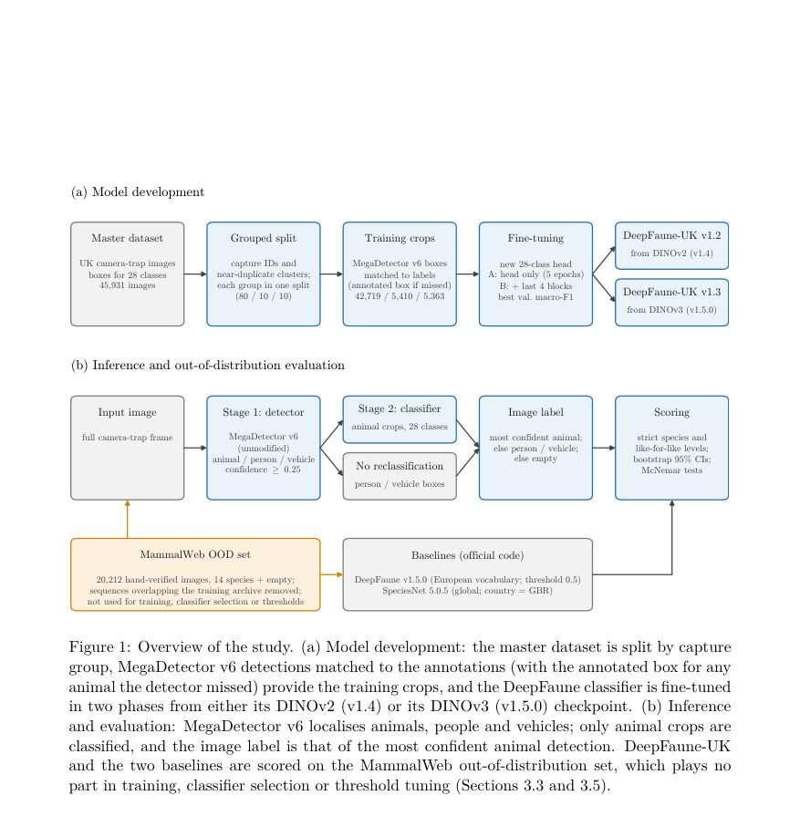
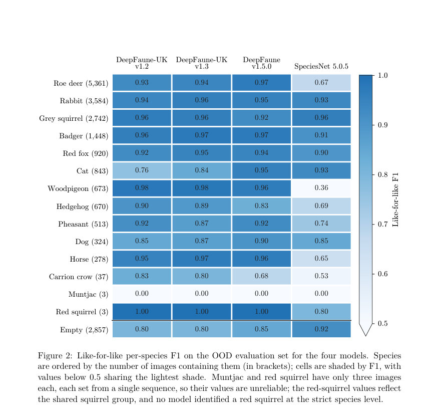
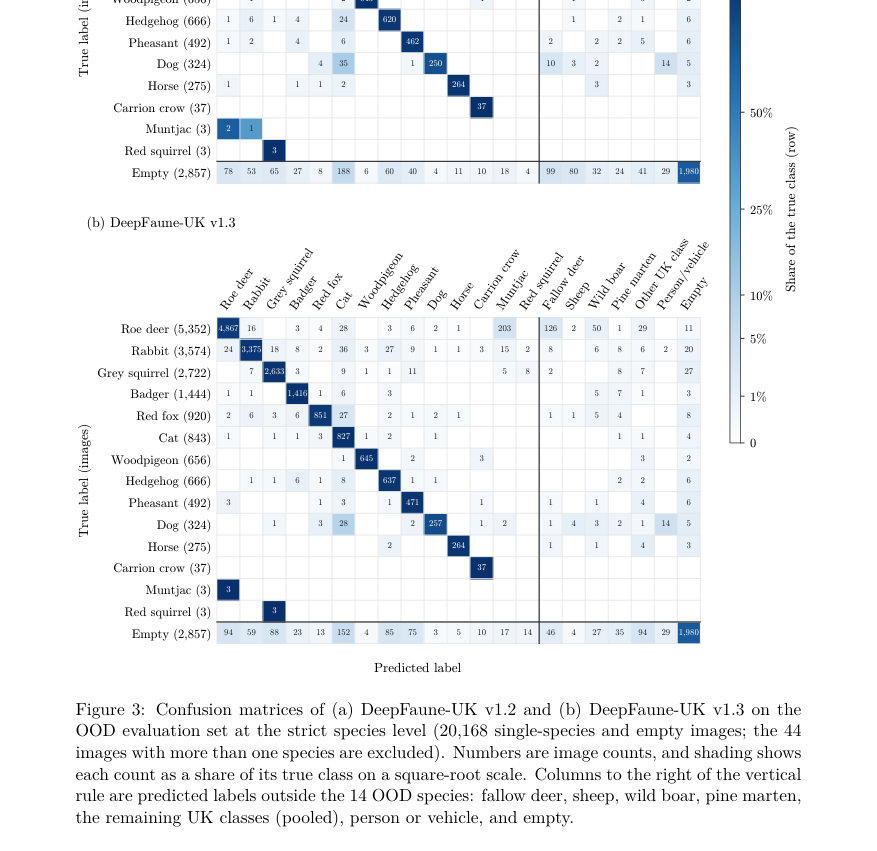

# Standing on Open Shoulders: Regional Fine-Tuning of Open-Weight Camera-Trap Models for UK Wildlife with Modest Data and Compute

- **게시일:** 2026-10-26
- **arXiv:** [2610.32573v1](http://arxiv.org/abs/2610.32573v1) · [PDF](https://arxiv.org/pdf/2610.32573v1)
- **저자:** Paul Fergus
- **분야:** cs.CV
- **선정 점수:** 4.74
- **선정 이유:** 최근성 0.4, 인용 영향 0.0 (인용 0회), 저자 영향 0.0 (최고 h-index 0), AI 주제 적합성 1.1, 개발자 관심 0.2, 학술 신호 0.5, 오픈 웨이트·주요 연구조직 신호 2.5

[← 2026-10-26 목록으로 돌아가기](../daily/2026-10-26.html)

<!-- paper-visuals:start -->
## 주요 Figure

> 원문 PDF에서 실제 Figure 캡션과 그림 영역이 함께 확인된 자료만 자동 추출했다.

*Figure · 원문 PDF 7쪽 · Figure 1: Overview of the study. (a) Model development: the master dataset is split by capture*

*Figure · 원문 PDF 15쪽 · Figure 2: Like-for-like per-species F1 on the OOD evaluation set for the four models. Species*

*Figure · 원문 PDF 16쪽 · Figure 3: Confusion matrices of (a) DeepFaune-UK v1.2 and (b) DeepFaune-UK v1.3 on the*

<!-- paper-visuals:end -->

## 한 문장 요약

오픈 소스 가중치를 출발점으로, 단일 GPU와 소규모 지역 데이터(약 클래스당 150개 크롭)로 DeepFaune 분류기를 영국 28개 클래스에 지역 미세조정해 MegaDetector v6와 결합한 두 단계 파이프라인(DeepFaune-UK)을 만들고, 공개 모델들과 손실통제된 OOD(Out-Of-Distribution) 검증으로 성능·자원 요구량·민주화 가능성을 평가했다.

## 해결하려는 문제

대형 모델들은 자원과 데이터가 풍부한 연구집단이 주로 개발해 지역적 보전에서 필요한 종 수준 구분(예: 영국의 붉은 다람쥐 vs 회색 다람쥐)을 제공하지 못하거나 어휘를 합쳐버리는 경우가 많다. 소규모 팀이 제한된 데이터와 단일 GPU로 공개된 가중치를 이용해 지역 요구에 맞는 실용적 모델을 만들고 배포할 수 있는지(민주화 가능성), 그리고 이를 위해 실제로 필요한 데이터·계산량은 어느 정도인지가 본문에서 해결하려는 핵심 문제다 (RQ1: 성능 비교, RQ2: 데이터·연산 자원 요구).

## 핵심 기여

- 오픈 가중치 기반 카메라트랩 분류기들의 지역 적응을 손에 잡히는 사례로 제시: MegaDetector v6(수정 없음) + DeepFaune 기반의 DeepFaune-UK v1.2(v1.4/DINOv2 시작점)와 v1.3(v1.5.0/DINOv3 시작점)를 구축·공개하고 MammalWeb의 손검증된 OOD 이미지(중복시퀀스 제거 후 20,212장)에 대해 평가함.
- 라벨 어휘 차이를 보정하는 like-for-like 평가와 정확한 누수 제거(바이트 동일 이미지 1,039장 발견 후 해당 시퀀스 제거), 시퀀스·기여자(사이트) 클러스터 부트스트랩과 페어드 검정으로 불확실성을 정량화한 OOD 벤치마크를 제공함.
- 단일 GPU에서의 학습 곡선·자원발자국 분석을 수행(학습시간, 피크 GPU 메모리, GPU 에너지 소비, 추정 탄소배출), 그리고 DINOv2 vs DINOv3 기반 백본 비교로 ‘시작 체크포인트’의 영향력을 분리함.
- 실용적 관점의 결과(약 150 크롭/클래스, 10% 데이터로도 OOD 성능 근접 달성, 22분·<4GB 메모리·~0.06 kWh로 DINOv2 적응 가능)를 제시해 소규모 팀의 지역 모델 개발 가능성을 실증적으로 평가함.
- 오픈 가중치의 민주화 가능성을 기술·정책적 제약(가중치·백본의 라이선스 차이와 의존성)과 함께 비판적으로 논의함.

## 접근 방법

* 파이프라인은 두 단계로 구성된다.
* 1단계에서 공개된 MegaDetector v6(YOLOv10-e, 1280 입력)를 수정 없이 사용해 animal/person/vehicle 박스를 예측하고, 분류기는 오직 animal 박스만 처리한다.
* 학습용 크롭은 실제 배포에서의 분포를 반영하기 위해 검출기 예측박스를 우선 매칭(IoU ≥0.5, greedy)하고 검출이 없으면 주석 박스를 그대로 사용하여 각 인스턴스마다 크롭(장변 최대 640px, 박스에 20% 패딩, 정사각형으로 확장)을 생성했다(최종: 42,719 학습 크롭, 5,410 검증, 5,363 테스트).
* 분류기는 DeepFaune의 ViT-L 기반 체크포인트(DeepFaune v1.4: DINOv2 backbone, v1.5.0: DINOv3 backbone)를 출발점으로 European head를 버리고 랜덤 초기화된 28-way 선형 헤드를 붙였다.
* 미세조정은 두 단계로 진행한다: Phase A(백본 고정, 헤드만 학습, AdamW, lr=1e-3, 5 epoch), Phase B(백본의 마지막 4개 transformer block과 최종 LayerNorm 언프리즈, lr=1e-5, 최대 40 epoch, early stopping patience 10).
* 손실은 레이블 스무딩 0.1 적용된 교차엔트로피, 클래스 불균형 대응을 위해 클래스 역빈도 가중 샘플러 사용, 경량 증강, mixed precision, batch size 64.
* 배포용 모델은 ONNX로 저장되어 Trap Tracker에 바로 배포 가능하다.
* 평가에서는 이미지 수준 레이블(가장 자신감 높은 animal 박스의 분류 또는 detector의 person/vehicle/empty)을 사용했고, strict species와 like-for-like(DeepFaune 어휘 수준으로 보정) 두 레벨로 정확도를 측정했다.
* 누수 통제는 SHA-256 해시와 DINOv2 임베딩·dHash 유사도를 결합한 그룹화(연결 요소)로 시퀀스·근중복을 그룹화해 80/10/10 비율로 스플릿을 만들었다.

## 주요 결과

- 평가 데이터(중복 시퀀스 제거 후): 20,212장(14종 + empty, 5,579 시퀀스). DeepFaune-UK v1.2( DINOv2 출발)는 strict 이미지 수준 정확도 88.8% (95% CI 88.0–89.5), strict macro-F1 0.778을 기록함. 비교로 SpeciesNet은 strict 59.0% (macro-F1 0.536), DeepFaune v1.5.0(원본 유럽 모델)은 strict 56.5% (macro-F1 0.398)로 낮았음(이는 라벨 어휘 차이 영향이 큼).
- like-for-like(DeepFaune 어휘 수준)에서는 DeepFaune v1.5.0가 91.4%로 가장 높고(95% CI 90.9–92.0), DeepFaune-UK v1.2는 88.8%, SpeciesNet은 73.4%였음. 두 모델 간 paired sequence bootstrap으로 비교했을 때 v1.5.0과 v1.2의 차이는 시퀀스 클러스터에서 유의미했으나(차이 2.6 p.p., p<0.001) 기여자(사이트) 클러스터에서는 불확실함(p=0.08).
- 동일한 미세조정 레시피를 DINOv3 기반 DeepFaune v1.5.0 체크포인트에 적용한 DeepFaune-UK v1.3은 strict 90.6% (95% CI 89.9–91.3)·like-for-like 90.6%로 개선되어 v1.2와 비교해 roe deer→fallow deer 오분류를 69% 감소(407→126건)시켰고, v1.5.0과의 like-for-like 격차를 0.8 p.p.로 좁힘(주요 향상은 시작 체크포인트의 영향임).
- 사이트 완전 분리(subset 26개 기여자, 1,850장)에서는 DeepFaune-UK v1.2 90.5%, v1.3 90.6%, DeepFaune v1.5.0 89.9%로 세 모델 간 차이는 통계적으로 유의하지 않았음.
- 학습 곡선: 전체(42,719 크롭) 대비 10%(4,270 크롭, 클래스당 평균 약 150 크롭)로도 OOD 성능 차이는 시드 변동 범위 내로 유사함(like-for-like macro-F1 0.838 ± 0.007 @10% vs 0.839 ± 0.009 @100%). 이것은 지역 데이터가 라벨 어휘 규정에 주로 기여하고 일반화 성능의 대부분은 공개된 프리트레인 백본에서 온다는 해석을 지지함(특히 DINOv3 체크포인트로 변경했을 때 더 큰 개선이 관찰됨).

## 한계

- 저자가 직접 언급한 한계: 평가용 OOD 세트는 MammalWeb 단일 시민과학 프로젝트에서 유래해 종 분포가 편중(roe deer, rabbit, grey squirrel 우세)되어 있고, 일부 종(muntjac, red squirrel)은 각 3장만 존재해 종별 추정치가 불안정함.
- 저자가 직접 언급한 한계: OOD 세트에서 마스터 아카이브와 바이트 동일 이미지 1,039장(4.8%)이 발견되어 해당 시퀀스를 제거했으나, 남아있는 이미지들이 같은 카메라/사이트에서 유래했을 가능성이 있으며 완전한 독립성은 보장되지 않음; 또한 검출기 선택(MegaDetector v6)은 OOD 세트에서의 검출 성능을 기준으로 이루어져 OOD가 파이프라인 설계에 일부 영향을 미침.
- 저자가 직접 언급한 한계: 평가 프로토콜은 이미지 수준(시퀀스 집계 미적용)·고정 운영점 사용·like-for-like 매핑(판단 포함) 등 단순화된 선택을 채택했으며, 이는 각 모델이 가질 수 있는 최적 성능을 반영하지 않을 수 있음.
- 저자가 직접 언급한 한계: 자원 측정은 단일 워크스테이션(NVIDIA RTX A6000)에서의 GPU 에너지·메모리만 포함하고 호스트 전력 및 백본·검출기 사전훈련 비용(대규모)의 에너지·탄소는 제외됨; 결과는 사전훈련 비용에 의존하는 ‘적응 비용’만을 나타냄(민주화 주장의 전제임). 또한 재현은 저자 제공 모델에 의해 보고되었고 독립적 복제는 아직 없음(단, 두 베이스라인은 공식 코드로 실행됨).

## 개발자 관점

- 단일 고성능 GPU(논문: NVIDIA RTX A6000)에서 공개 백본을 출발점으로 두 단계(헤드만 학습 후 하위 블록 일부 언프리즈)로 미세조정하면 소규모 데이터·컴퓨팅으로도 실용적 지역 모델을 만들 수 있다. (Phase A: 헤드 5 epoch lr=1e-3; Phase B: 마지막 4 블록 언프리즈 lr=1e-5, early stopping).
- 약 150 크롭/클래스(총 약 4,270 크롭, 클래스별 균등 샘플링) 수준의 라벨링이 OOD 성능 측면에서 비용대성능이 매우 준수하므로, 먼저 핵심 종에 대한 소수의 잘선택된 샘플을 모으고 지역 특화 어휘를 정의하는 것이 효율적이다.
- 실험에서 DINOv2 기반 미세조정은 피크 PyTorch 할당 메모리 ≈3.8 GB로 측정되어 최신 8–12 GB 소비자 GPU에서도 실행 가능성이 높으나, 실제 재현 시에는 CUDA 컨텍스트·호스트 메모리 등을 고려해야 한다.
- 검출기(false positives)→분류기 오류 전파가 중요한 문제다. 빈 프레임을 동물로 잘못 검출한 사례(빈 프레임 2,857장 중 848장)가 전체 성능에 큰 영향(특히 precision 저하)을 주므로, 검출기에 대한 하드 네거티브(빈 프레임 사례) 추가, 분류기에 명시적 empty 클래스 추가, 또는 시퀀스 레벨 스무딩(시퀀스 정보 사용) 도입을 권장한다.
- 중요한 안전 응용(예: 종 선택적 트랩/피더)에서는 희귀·보호종에 대해 비대칭 의사결정 규칙을 적용해 오탐의 안전 리스크를 줄여야 하며(목표 종일 때만 작동, 낮은 확신은 안전한 기본 동작), 실제 배포 전 지역별 검증용 이미지를 반드시 수집해 미세조정(re-fine-tune) 해야 한다. 또한 seed간 변동성으로 인해 여러 시드로 학습해 안정된 체크포인트를 선택하는 것이 좋다(저자는 검증 macro-F1 최고 시드 선택).

**근거 범위:** 이 분석은 제공된 논문 PDF 본문 전체의 텍스트에 근거해 작성되었다. 모든 수치(데이터 크기, 정확도, 학습시간, 메모리·에너지 소비, CI 등)와 실험 절차·하이퍼파라미터는 본문에 명시된 값을 그대로 사용했다. 본문에서 바이트 동일 이미지로만 중복을 검사했다고 명시되어 있어, 재인코딩된 복제본 등은 탐지되지 않았을 수 있음. 구현 세부사항이나 외부 리포지토리의 추가 내용은 본문에 명시된 범위 밖이므로 본문 근거 없이 생성하지 않았다.
