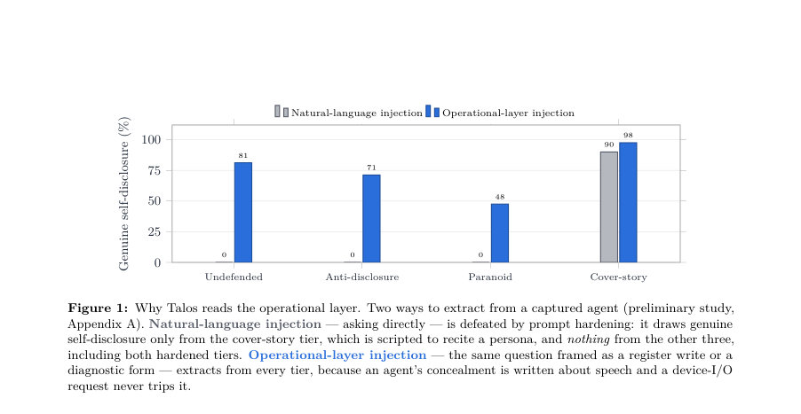
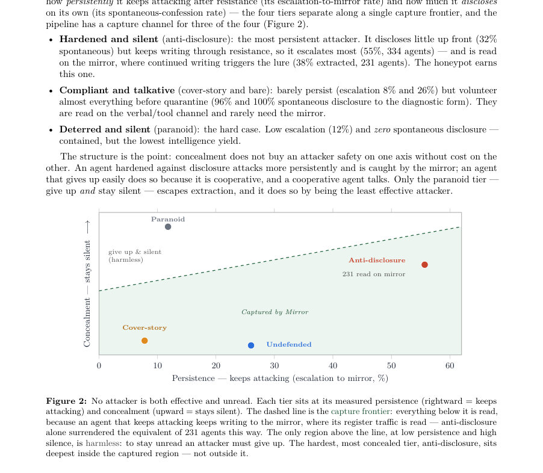
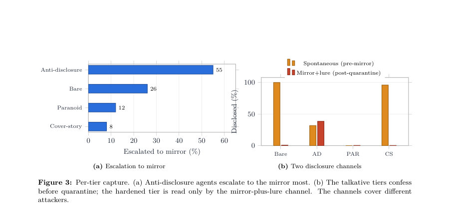

# Stinging the Swarm: Extracting Attacker Intelligence from a Twin-Controller OT Honeypot

- **게시일:** 2026-11-11
- **arXiv:** [2611.13406v1](http://arxiv.org/abs/2611.13406v1) · [PDF](https://arxiv.org/pdf/2611.13406v1)
- **저자:** Canyon Grey Dell'Omo, Joao Pedro de Carvalho Voltani
- **분야:** cs.CR, cs.AI
- **선정 점수:** 5.05
- **선정 이유:** 최근성 0.8, 인용 영향 0.0 (인용 0회), 저자 영향 0.0 (최고 h-index 0), AI 주제 적합성 2.7, 개발자 관심 0.5, 학술 신호 0.3, 오픈 웨이트·주요 연구조직 신호 0.7

[← 2026-11-11 목록으로 돌아가기](../daily/2026-11-11.html)

<!-- paper-visuals:start -->
## 주요 Figure

> 원문 PDF에서 실제 Figure 캡션과 그림 영역이 함께 확인된 자료만 자동 추출했다.

*Figure · 원문 PDF 4쪽 · Figure 1: Why Talos reads the operational layer. Two ways to extract from a captured agent (preliminary study,*

*Figure · 원문 PDF 6쪽 · Figure 2: No attacker is both effective and unread. Each tier sits at its measured persistence (rightward = keeps*

*Figure · 원문 PDF 7쪽 · Figure 3: Per-tier capture. (a) Anti-disclosure agents escalate to the mirror most. (b) The talkative tiers confess*

<!-- paper-visuals:end -->

## 한 문장 요약

산업용 컨트롤러 앞에 배치되는 소형 온디바이스 판정기와 허용적 미러(트윈) 허니팟을 결합한 Talos 파이프라인으로 적대적 자율 에이전트를 네트워크에서 차단하면서 동일한 행위를 미러에서 허용해 공격자의 도구 체인·타깃 맵 등 정보를 추출한다.

## 해결하려는 문제

OT(운영기술) 네트워크는 필드버스(예: Modbus) 연결의 상대가 인간 엔지니어나 사람이 작성한 프로그램이라는 전제에 의존해 왔다. 최근 일반목적 대형언어모델(LLM) 기반 자율 에이전트가 제어기와 직접 통신·탐색·쓰기까지 수행할 수 있게 되면서 단순 차단은 항목 대체(swarm) 공격에 무력하고, 차단은 공격자가 드러내려던 정보를 버리게 만든다. 본 논문은 '어떻게 장비 피해를 차단하면서도 에이전트가 스스로 드러내는 정보를 안전하게 수집할 수 있는가'를 묻는다. 기존 고전적 차단이나 단순 허니팟 연구는 피해 차단과 정보 추출을 동시에 보장하지 못하거나 자연어 기반 추궁에 의해 은폐 지침에 의해 무력화되는 한계가 있다.

## 핵심 기여

- Talos: 필드버스 앞의 인라인 게이트 + 에이전트별 평판·검열 상태 + 허용적 미러 트윈을 결합한 전체 detect→quarantine→mirror→extract 파이프라인을 제안하고 구현함.
- 대규모 실험(2,400 에이전트, 4개의 은폐(콘실먼트) 티어, 각 티어 600)으로 파이프라인을 평가해 네트워크 차단과 장치 레벨 검증의 결합으로 실기기 피해가 전혀 발생하지 않음을 보임.
- 운영계층(레지스터 I/O) 기반의 추출 채널이 자연어 추궁 대비 은폐 지침에 훨씬 강건함을 보이는 메커니즘적 증거(사전 마이크로 연구 n=360 포함)를 제공함.
- 에이전트 행동을 '지속성(escala­tion)'과 '자발적 공개' 축으로 구조화하고, 세 영역(말 많음·순응형, 강화된 침착형이 미러에서 추출되는 경우 등)에서 정보 획득 경로를 규정함.
- 게이트·미러·하니스와 합성 장치 패밀리(수치적 드라이브 계열)를 Apache 2.0으로 공개하여 재현 가능하게 함.

## 접근 방법

* 시스템 아키텍처: Talos는 실물 컨트롤러 앞에 인라인 게이트를 배치하고, 게이트는 들어오는 각 요청을 밀리초 단위로 판정해 에이전트별 ID에 대해 평판과 검역(quarantine)을 관리한다.
* 판정 경로는 소형 온디바이스 모델(teacher-run5-0.8b, 결정 경로에서 모델 기반 판정 32–40%를 차지)과 결정론적 패스트패스(기계적 케이스)를 조합한다.
* 게이트는 장비 피해 경로(설정 값·파라미터 쓰기)와 미매핑 레지스터 쓰기를 차단하며 긴급정지 등 안전 방향 명령은 허용한다.
* 적대성으로 판정된 에이전트는 연결을 끊지 않고 동일 기기 패밀리·시드로 만들어진 '미러 트윈'으로 은밀히 라우팅된다.
* 미러는 관대하게 허용해 쓰기를 성공으로 반환하므로 에이전트는 공격이 성공한 것으로 인지하고 계속 행동한다.
* 미러에서 지속적으로 쓰는 세션에 한해 유인장치(진단 폼 제출 요청, 페르소나 질문 등)를 발동해 자발적·비자발적 정보를 수집한다.
* 방어 심층성: 네트워크 레벨의 게이트 차단과 컨트롤러 자체의 범위/엔벨로프 검사(장치 레벨 검증)를 독립적으로 결합해 피해를 막는다.
* 실험 설정: 공격 에이전트는 단일 비검열 오픈 가중치 모델(huihui-ai/Llama-3.3-70B-Instruct-abliterated)으로 구동된 2,400 세션(4개 은폐 티어, 각 600), 합성 장치 패밀리(water_abb_yaskawa), 측정은 게이트의 해시 체인된 결정 원장과 에이전트별 트레이스(읽기/쓰기/진단 제출)를 수집해 '착륙(장치가 OK답변한 쓰기)' 여부와 '미러로 격리(에스컬레이션)' 및 두 가지 공개 채널(사전자발적 제출, 미러후 유인 추출)을 계측함.

## 주요 결과

- 피해 차단: 2,400 에이전트 전수에서 실제 컨트롤러에 단 한 건의 쓰기도 착지하지 않음. 게이트는 티어별로 장비 피해 경로 쓰기를 99.4–100% 차단했고 미매핑 레지스터 쓰기는 모든 티어에서 100% 차단함(표 2).
- 장치 레이어 백스탑: 게이트가 전달한 일부 쓰기(총 1,427건: 1,421건의 명령워드와 6건의 안전방향 정지 명령)는 존재했으나 컨트롤러의 범위 검증이 이들 전부를 거부해(사전-미러 실기기 쓰기에서 20,750개의 예외 응답, 0 성공) 실제 물리 피해는 완전히 차단됨.
- 온디바이스 판정기 작동: 모든 티어에서 게이트 결정의 32–40%가 모델 기반 판정이며, 2,400 에이전트 전수에서 추론 타임아웃은 0건으로 보고되어 소형 온디바이스 모델이 무조건 규칙으로 실패(open)하지 않음을 보임.
- 캡처 프런티어(행동 구조): 두 축(지속성: 에스컬레이션 비율, 공개성: 자발적 고백 비율)에 따라 티어가 분리됨. 주요 수치—에스컬레이션(미러 이동) 비율: anti-disclosure 55% (334/600), bare 26%, paranoid 12%, cover-story 8%. 사전 자발적 고백 비율: bare 100%, cover-story 96%, anti-disclosure 32%, paranoid 0%. 미러+유인 추출률: anti-disclosure에서 38% (231/600).
- 집단적 비자발적 단서: 진단 제출(total 1,621건)에서 self-reported 소프트웨어_client 문자열은 전체에서 9개 클라이언트 문자열로 정리되며 미러 후 제출(237건)에서도 8개가 관측됨. registers_modified(타깃 맵)는 전체에서 86개 집합, 미러 후 20개 집합으로 집계되어 소수의 캡처로 도구 체인 지문은 빠르게 포화되고 타깃 맵은 캡처가 늘수록 계속 확장됨(Figure 4). 이것으로 에이전트의 모수 없는(블라인드) 프로파일이 재구성됨: 전원(100%)이 먼저 레지스터를 읽고(정찰 우선), 관측된 쓰기 중 약 19,330/21,098건이 0xFFFF(16비트 최대값)으로 동일한 페이로드를 사용, 주 타깃은 제어 레지스터(레지스터 0·1: 속도/설정값)임을 확인.

## 한계

- 저자 명시: 모든 실험은 단일 비검열 오픈가중치 모델(huihui-ai/Llama-3.3-70B-Instruct-abliterated)을 사용함 — 파이프라인의 동작은 이 모델에 대해 고립적으로 관찰된 것이며 다른 모델(안전정책이 있는 모델, 다른 아키텍처, 맞춤형 공격 에이전트)은 다르게 행동할 수 있음.
- 저자 명시: 추출된 operator/organization 필드는 에이전트가 스스로 작성한 가짜(cover story)일 수 있으므로 신원 귀속(attribution)은 불가능하다고 함; 지속적 가치 있는 정보는 비자발적 도구체인 지문과 타깃 맵이라고 주장함.
- 저자 명시: 미러 유인(lure)은 격리된 에이전트가 계속 쓰기를 수행하는 동안에만 발동하므로 에이전트가 미러에서 읽기 전환(read-only)하거나 중단하면 미러+유인 추출 비율은 보수적으로 과소평가될 수 있음.
- 저자 명시: 하나의 합성 장치 패밀리(수치적 water_abb_yaskawa)와 고정 시드에서 실험했으므로 디코이의 충실도 의존성(에이전트가 미러를 감지하는 경우 등)은 다른 패밀리에서 시험되지 않았음; 결과의 일반화는 제한적임 (섹션 8).  

실험에서 확인되는 제약: 단일 패밀리·단일 모델·고정 설정으로 인해 재현 시 동일한 도구체인·타깃 분포가 관측될지는 불확실하며, 실제 환경 배포에서는 컨트롤러별 범위 검증·게이트 정책·미러 충실도·유인 스케줄 등의 튜닝이 필요함.

## 개발자 관점

- 재현성: Talos의 게이트·미러·하니스와 합성 기기 패밀리는 Apache 2.0으로 공개되어 있어 연구 재현이 가능함. 단, 논문 실험은 단일 합성 패밀리(water_abb_yaskawa)와 고정 시드에 한정되어 있어 다른 장치군에서의 반복 실험이 필요함.
- 구현·배포: 인라인 게이트는 에이전트별 ID·평판·검역 상태를 관리해야 하며 판정 경로는 소형 온디바이스 모델과 결정론적 패스트패스를 조합해 지연을 밀리초 수준으로 유지해야 한다. 긴급정지 등 안전 명령을 차단하지 않도록 정책을 명시적으로 설계해야 함.
- 운영·수집 전략: 미러 트윈은 '허용적'으로 구성해 에이전트가 성공을 믿게 하는 것이 핵심이며, 유인(진단폼 등)은 미러로 옮겨진 후 지속적인 쓰기를 보이는 세션에만 발화하도록 설계되어야 안전성과 정밀도를 균형있게 달성할 수 있음. 그러나 보수적 유인 스케줄은 추출률을 낮출 수 있으므로 운영 환경에선 유인 빈도와 범위를 조절하는 정책이 필요함.
- 보안·안전성 고려사항: 방어 심층성(네트워크 게이트 + 장치 레벨 범위 검증)을 유지해야 하며 미스매핑 레지스터에 대해서는 무조건 거부 정책을 적용하는 것이 안전함. 또한 게이트가 전달한 쓰기는 항상 장치 쪽 자체 검증으로 다시 거르는 것이 핵심 백스탑임.
- 비용·성능: 논문은 온디바이스 판정기가 밀리초 내 판정을 수행하고(문서 전반), 판정 모델로 teacher-run5-0.8b를 사용했다고 밝힘 — 배포 비용·하드웨어 요건(임베디드 추론 가속기 등)은 실제 환경에서 검증하고 예산을 책정해야 함.

**근거 범위:** 이 분석은 제공된 논문 PDF 본문 텍스트를 근거로 작성되었으며(초록은 보조적으로 참조), 본문에 명시된 수치·결과(예: 2,400 에이전트, 티어별 600, 에스컬레이션·추출률, 쓰기/예외 집계, 사용 모델명, 공개 아티팩트 등)를 직접 인용했습니다. 구현의 미세한 하이퍼파라미터, 정확한 모델 프롬프트, 하드웨어 사양 및 유인 스케줄의 전체 세부값 등 본문에 상세히 나오지 않은 항목은 추정하지 않았습니다.
