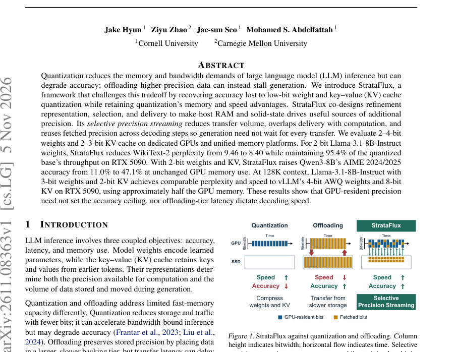
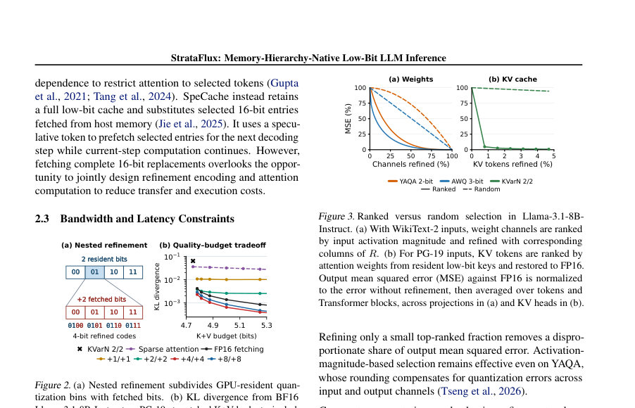
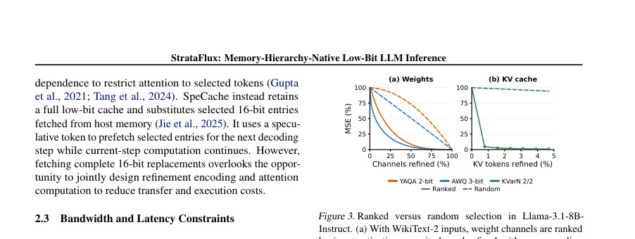

# StrataFlux: Memory-Hierarchy-Native Low-Bit LLM Inference

- **게시일:** 2026-11-07
- **arXiv:** [2611.08363v1](http://arxiv.org/abs/2611.08363v1) · [PDF](https://arxiv.org/pdf/2611.08363v1)
- **저자:** Jake Hyun, Ziyu Zhao, Jae-sun Seo, Mohamed S. Abdelfattah
- **분야:** cs.LG, cs.DC
- **선정 점수:** 5.89
- **선정 이유:** 최근성 0.7, 인용 영향 0.0 (인용 0회), 저자 영향 0.0 (최고 h-index 0), AI 주제 적합성 2.9, 개발자 관심 0.8, 학술 신호 0.3, 오픈 웨이트·주요 연구조직 신호 1.2

[← 2026-11-07 목록으로 돌아가기](../daily/2026-11-07.html)

<!-- paper-visuals:start -->
## 주요 Figure

> 원문 PDF에서 실제 Figure 캡션과 그림 영역이 함께 확인된 자료만 자동 추출했다.

*Figure · 원문 PDF 1쪽 · Figure 1. StrataFlux against quantization and offloading. Column*

*Figure · 원문 PDF 3쪽 · Figure 2. (a) Nested refinement subdivides GPU-resident quan-*

*Figure · 원문 PDF 3쪽 · Figure 3. Ranked versus random selection in Llama-3.1-8B-*

<!-- paper-visuals:end -->

## 한 문장 요약

메모리 계층에 맞춘 선택적 정밀도 스트리밍(Selective Precision Streaming)을 통해 GPU에 저비트(2–4bit)로 상주시키는 가중치와 KV 캐시의 정밀도를 호스트 RAM/SSD의 정제(refinement) 비트로 보완해 정확도를 회복하면서 메모리·지연 이점을 유지하는 런타임·표현·스케줄링 공동설계를 제안한다.

## 해결하려는 문제

대규모 언어 모델(LLM) 추론은 정확도·지연·메모리의 상충관계가 존재한다. 저비트 양자화는 메모리와 대역폭 요구를 줄여 속도를 올리지만 정확도를 해치고, 오프로드는 높은 정밀도를 보존하지만 느린 계층에서 데이터를 불러와 생성이 지연된다. 기존 동적 정밀도 보완(예: DecDEC)과 KV 오프로드 방식은 (1) 보충 데이터를 전부 불러오면 대역폭 이점 소실, (2) 투입 시점과 사용 시점이 결합되어 전송 지연을 숨기기 어렵고 반복 전송이 발생한다는 한계가 있다. 핵심 연구 질문은 “GPU에 적은 비트로 값을 보관하면서도 정확도와 생성 속도를 유지할 수 있는가(즉, GPU에 남는 비트가 정확도의 상한이 되고 오프로드 대역폭·지연이 디코딩 속도를 규정하지 않도록 할 수 있는가)?”이다.

## 핵심 기여

- Selective precision streaming: GPU에는 저비트(거주 base)를 유지하고 호스트 RAM/SSD에 추가 정밀도(정제 비트)를 둔 뒤, 계산에 중요한 채널/토큰에 대해서만 선택적으로 정제 비트를 전송해 전송량을 줄임.
- 비동기 정밀도 전달(fetch lead/lag): 정제 비트의 전송 시점과 적용 시점을 분리하여 이전 블록의 활성화로 미리 선택(fetch lead)하거나 정제 덧셈을 나중 블록으로 지연(fetch lag)해 전송 대기 시간을 모델 계산과 겹치게 하여 정제 전송으로 인한 정지(stall)를 숨김.
- 계층-네이티브 표현 설계: 중첩(nested) 정량화(예: KVarN 기반)로 resident 코드의 양자화 구간을 세분화하는 정제 인덱스를 저장해 전체 교체(FP16 교체)보다 전송 효율을 높임.
- 재사용·캐시 정책: 디코딩 단계 간 선택이 반복되는 특성을 이용해 RAM 캐시(또는 호스트 RAM)를 유지해 정제 비트의 반복 전송을 줄이고, miss에 대해 현재 단계에서 대기하지 않고 건너뛰는 정책으로 지연을 회피하는 운영 선택지를 제공.
- 실제 시스템·튜닝·평가: llama.cpp 기반으로 CUDA/Metal 구현 및 플랫폼·양자화별 튜너(주어진 속도 예산 내에서 k, s, MLP 방식, 스레드 블록 수 등을 탐색)를 제시하고 다양한 모델·플랫폼(전용 GPU, unified-memory)에서 정량적 개선을 보임.

## 접근 방법

* 아키텍처 개요: GPU에는 저비트(거주) 가중치와 저비트 KV 캐시를 유지하고, 호스트 RAM(전용 GPU) 또는 SSD+공유 RAM(unified-memory)에는 정제(refinement) 비트를 저장한다.
* 실행 시점에는 현재 블록의 활성화(또는 이전 블록 활성화)를 이용해 중요 채널(가중치 정제) 또는 중요 토큰(키/값 정제)을 점수화하여 선택하고, 선택된 항목에 대해만 백업 계층에서 정제 비트를 비동기적으로 읽어들인다.
* 가중치 정제: 입력 채널을 1,024 단위 청크로 나누고 각 청크에서 \|xi\|가 큰 상위 k 채널을 선택해 해당 열의 정제 열(C)을 더함(식 2).
* 정제 값은 잔차 R에 대해 식(3)-(4)로 fitting(정규화항 λ 포함)하여 4비트로 양자화해 저장.
* MLP는 채널-단위 또는 뉴런-번들(게이트/업 행과 다운 열을 함께 정제) 두 방식 지원.
* KV 정제: KVarN 기반의 nested encoding을 사용해 거주 코드 구간을 세분화한 인덱스를 저장(키/값 독립적).
* 선택 점수 sj(i)=max_h αh,i(동일 KV 헤드를 공유하는 쿼리 헤드에서 최대 attention weight)로 토큰 그룹을 선택하고, 선택 그룹에 대해서만 정제 인덱스를 읽어 더 높은 정밀도로 재구성 후 주의 가중치·가중합을 갱신(식 8).
* 전송·스케줄링: fetch lead로 이전 블록 활성화에서 미리 선택해 전송을 시작하고, fetch lag로 정제 덧셈을 블록 이후로 지연해 전송·정제 연산을 블록 사이의 연산과 겹치게 함.
* 런타임: CUDA 스트림·이벤트로 fork-and-continue 스케줄링을 구현해 각 정제 작업이 결과가 필요할 때까지 전체 그래프의 진행을 차단하지 않음.
* 캐시·누적: unified-memory에서는 SSD→RAM 캐시를 유지하고, miss 시 선택을 건너뛰거나(지연 회피) 기다리는 두 정책을 제공.
* 튜닝: 사용자 지정 속도 저하(예: 5%) 제한하에 k, s, MLP 방식, 스레드 블록수를 검색하여 KL 감소가 최대가 되도록 구성.

## 주요 결과

- 가중치 정제(Weight-only): Llama-3.1-8B-Instruct, YAQA 2-bit base에서 RTX 5090 기준으로 StrataFlux-W가 WikiText-2 perplexity를 9.46→8.40으로 개선하면서(표에서 PPL 9.46 → 8.40) 정량화 베이스 대비 약 95.4% 처리량(예: base 245.8 tok/s → StrataFlux-W 234.4 tok/s, 같은 GPU 메모리 3.9 GB)으로 유지(5% slowdown 예산으로 튜닝). DecDEC와 비교 시 동일 예산에서 전반적 PPL·KL 우수(Table 1).
- KV 정제(KV-only): Llama-3.1-8B-Instruct에 대해 resident 2/2 KV에 +4/+4 비트 정제를 1/128 그룹 선택으로 적용하면 PG-19(128K) perplexity와 KL이 크게 개선되어 RULER 정확도가 68.6%→78.1%로 상승(RTX 5090, Table 3). Qwen3-8B에서도 2/2 KV에서 RULER 66.0%→74.2%(DGX)·74.7%(RTX) 등 개선이 보고됨. KV 정제는 배치/플랫폼에 따라 처리량 영향이 다르며(예: batch=1,16에서 RTX PRO 6000 Max-Q 상 throughput 감소 11.2%/18.8%, DGX Spark 7.0%/25.4%, Figure 11).
- 통합 전반(Weights+KV): RTX 5090에서 Qwen3-8B, YAQA 2-bit weights + 2/2 KV에 StrataFlux 적용 시 AIME 정확도가 11.0%→47.1%로 대폭 향상(메모리 사용은 동일, Table 4). Llama-3.1-8B-Instruct에서 YAQA 3-bit weights + 2/2 KV의 StrataFlux 결과(128K)는 vLLM의 AWQ 4-bit 가중치+8-bit KV와 유사한 PPL·처리속도를 제공하면서 GPU 메모리는 약 절반 수준으로 사용(초록·본문 요약).
- 튜닝·지연 회피: fetch lead/lag 거리 s를 조절하면(예: YAQA 2-bit은 s=0.5로 대부분의 이득, AWQ 3-bit는 s=1 필요) 정제 전송을 모델 계산과 효율적으로 겹쳐 정지 최소화 가능(Figure 8). RAM 캐시 크기를 늘리면 PPL 개선을 보며, unified-memory에서 캐시 miss를 'skip'하는 정책이 작은 속도 예산에서 더 나은 지연-정확도 절충을 제공(Figure 12(c–e)).

## 한계

- 저자가 명시한 한계: (1) 플랫폼·양자화·모델에 따라 최적 전략(채널-대 뉴런-번들, k, s 등)이 달라 각 조합별 튜닝이 필요함(Section 3.5). (2) unified-memory(SSD 백엔드) 구성에서는 SSD 지연 때문에 RAM 캐시가 필요하고, 작은 캐시/높은 miss율이면 성능·정확도 절충이 발생함(Section 3.4, Fig.12(c–e)). (3) 일부 비교(예: DecDEC)는 SSD 페칭을 지원하지 않아 단일 환경간 완전 동등비교의 제약이 있음(Section 4.1).

## 개발자 관점

- 재현·통합: 구현은 llama.cpp 기반(CUDA·Metal 지원)으로 공개 런타임에 통합 가능. 그러나 각 모델·양자화·플랫폼별로 튜닝(속도 예산에 따른 k, s, MLP 방식, 스레드 블록 수)을 수행해야 하므로 자동화된 튜너와 평가 파이프라인을 준비해야 한다(Section 3.5).
- 하드웨어·스토리지 요구: GPU 메모리는 절감되지만 호스트 RAM(전용 GPU) 또는 SSD+공유 RAM(unified-memory) 쪽에 추가 저장공간과 CPU 백그라운드 로더가 필요하다. 배치/플랫폼에 따라 KV 정제의 처리량 영향이 다르므로 배포 환경(대화형 단일 시퀀스 vs 배치)에 따라 설정을 달리해야 한다(Fig.11).
- 스케줄링·병렬화: fetch lead/lag를 위한 CUDA 스트림·이벤트 관리(‘fork-and-continue’)가 필요하다. 단순히 다른 스트림에 올리는 것만으로는 병렬 실행을 보장하지 않으며 SM 점유와 그리드 크기를 고려한 스케줄링 설계 필요(Appendix G).
- 캐시·정책 결정: unified-memory 환경에서는 ‘skip on miss’(정제 없는 저비트 사용)와 ‘wait on miss’(현재 단계에 적용 위해 대기) 사이의 절충을 제공한다. 대화형 지연저감 목적이라면 miss를 스킵하고 비동기 로더로 채우는 정책이 실용적임(Section 3.4, Fig.12(e)).
- 비용·운영: StrataFlux는 GPU 메모리 요구를 줄여 더 작은(또는 더 적은) GPU로도 동일 작업을 처리하거나 더 긴 컨텍스트를 지원할 수 있지만, 전체 시스템(호스트 RAM/SSD I/O, CPU 스레드) 자원을 더 사용하므로 인프라 설계 시 저장·IO 비용을 고려해야 한다(Section 3.1, Fig.12(f)).

**근거 범위:** 이 분석은 제공된 논문 PDF 본문(본문과 부록의 발췌)을 근거로 작성되었으며 표와 그림에 기재된 수치(예: WikiText-2, PG-19, RULER, MATH500, AIME, 특정 플랫폼의 PPL·throughput·메모리 수치)는 본문 표·설명에서 직접 인용했습니다. 다만 부록의 일부 세부 구현·하이퍼파라미터 표나 전체 코드 레벨 구현 세부사항은 PDF 발췌 내 일부 표/행이 잘리거나 요약되어 있을 수 있으므로, 재현을 위해서는 논문에 명시된 튜닝 구성(Appendix B.7 등)과 공개 코드/추가 보조자료를 확인할 것을 권고합니다.
