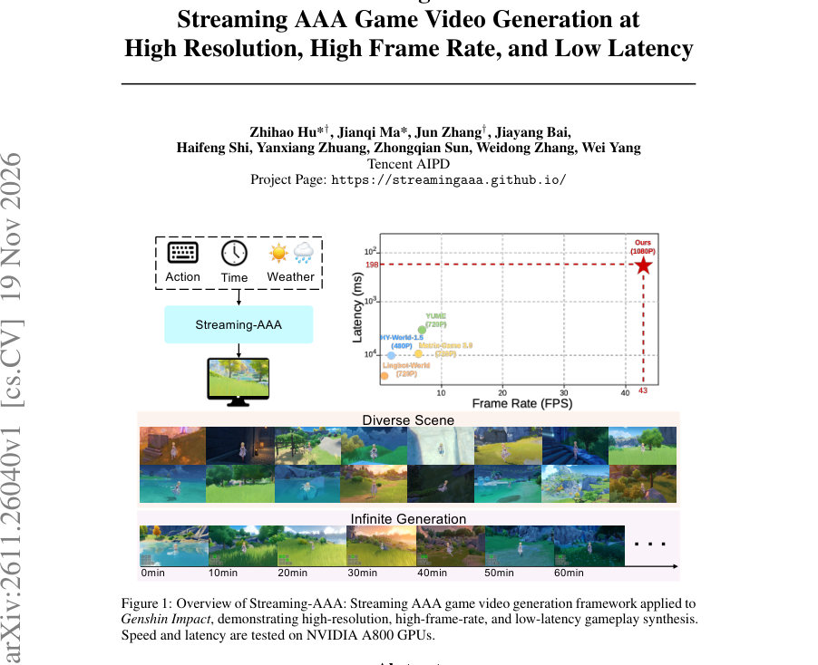
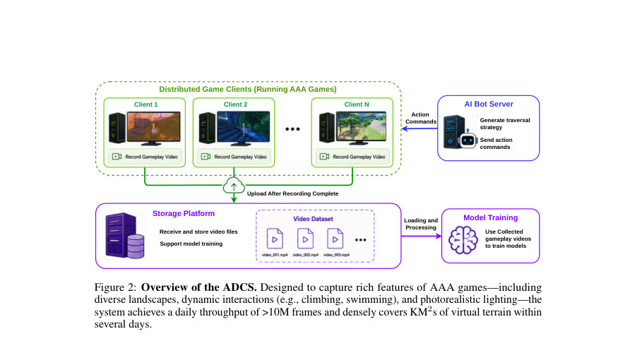
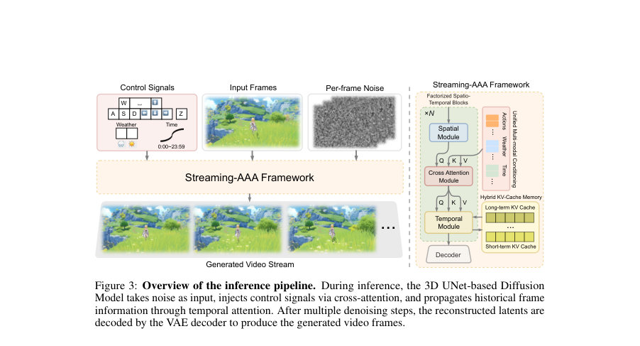

# Streaming-AAA: Streaming AAA Game Video Generation at High Resolution, High Frame Rate, and Low Latency

- **게시일:** 2026-11-20
- **arXiv:** [2611.26040v1](http://arxiv.org/abs/2611.26040v1) · [PDF](https://arxiv.org/pdf/2611.26040v1)
- **저자:** Zhihao Hu, Jianqi Ma, Jun Zhang, Jiayang Bai, Haifeng Shi, Yanxiang Zhuang, Zhongqian Sun, Weidong Zhang, Wei Yang
- **분야:** cs.CV
- **선정 점수:** 5.41
- **선정 이유:** 최근성 1.1, 인용 영향 0.0 (인용 0회), 저자 영향 0.0 (최고 h-index 0), AI 주제 적합성 1.6, 개발자 관심 1.0, 학술 신호 0.3, 오픈 웨이트·주요 연구조직 신호 1.4

[← 2026-11-20 목록으로 돌아가기](../daily/2026-11-20.html)

<!-- paper-visuals:start -->
## 주요 Figure

> 원문 PDF에서 실제 Figure 캡션과 그림 영역이 함께 확인된 자료만 자동 추출했다.

*Figure · 원문 PDF 1쪽 · Figure 1: Overview of Streaming-AAA: Streaming AAA game video generation framework applied to*

*Figure · 원문 PDF 4쪽 · Figure 2: Overview of the ADCS. Designed to capture rich features of AAA games—including*

*Figure · 원문 PDF 7쪽 · Figure 3: Overview of the inference pipeline. During inference, the 3D UNet-based Diffusion*

<!-- paper-visuals:end -->

## 한 문장 요약

고해상도(1080p), 고프레임(약 43 FPS), 저지연(약 198 ms) 실시간 스트리밍 AAA 게임 비디오 생성을 목표로, 고해상도용 VAE 재설계, per-frame 노이즈 기반의 확장된 확산( Diffusion Forcing ) 사전학습, 분포정합 증류와 하이브리드 KV-캐시 메모리를 결합한 Streaming-AAA 프레임워크를 제안한다.

## 해결하려는 문제

인터랙티브 게임 시뮬레이션용 스트리밍 비디오 생성은 고화질, 높은 프레임률, 낮은 사용자-픽셀 지연, 장기 롤아웃 안정성(temporal consistency)을 동시에 만족해야 하지만, 기존 방법들은 주로 단기간 클립에서만 시각적 품질을 낼 수 있거나 해상도·프레임률·지연 중 적어도 한 가지를 희생하여 실전 플레이어빌리티를 충족하지 못한다. 본 연구는 AAA급 게임(특히 Genshin Impact)을 대상으로 이 네 가지 요구를 동시에 만족하는 무한(연속) 스트리밍 비디오 생성 문제를 해결하고자 한다.

## 핵심 기여

- 고해상도(1080p) 실시간 디코딩을 위한 목적 설계된 고효율 비디오 VAE(공간·시간 압축 4×16×16 및 디코더 말단의 Pixel Shuffle 포함)를 제안하여 고해상도 복원을 낮은 디코딩 오버헤드로 가능하게 함.
- 공간, 시간, 교차-어텐션을 분리한 3D-UNet 기반 잠재 확산(backbone)과 하이브리드 KV-캐시(장기 희소 샘플 + 단기 연속 윈도우)를 결합해 시간적 추론과 다중 모달 제어를 효율적으로 처리함.
- Diffusion Forcing(프레임별 독립 노이즈 스케줄) 기반의 장시점(pre-training)과 v-예측을 적용해 장기 불확실성을 모델링하고 연속 롤아웃 안정성을 확보함.
- 사후 학습 단계에서 Distribution Matching Distillation(DMD)과 무작위화된 스코어 모델 섭동을 도입하여 교사-강제(teacher-forcing) 추론 분포와 정렬시키고 2-step 세팅에 맞춘 증류로 롤아웃 안정성과 일관성을 향상시킴.
- 추론 효율화를 위한 실무적 최적화(denoising step 수 2, 타임스텝 {999,666}, KV-캐시 쓰기와 초기 디노이즈 병합, diffusion/VAE를 별 GPU에 파이프라인 배치, torch.compile 및 TensorRT 활용)를 통해 NVIDIA A800 환경에서 1080p 43 FPS, 액션→픽셀 지연 약 198 ms를 달성함.

## 접근 방법

* 아키텍처: 입력(최대 네임스탬프 길이) 1920×1080(또는 논문상 1792×1024로도 기술된 고해상도)를 공간·시간으로 4×16×16 비율로 압축하는 VAE 인코더와, 픽셀 셔플을 포함한 Conv3D 업샘플링을 갖는 디코더로 구성된 고해상도용 VAE를 설계했다.
* 잠재공간에서 동작하는 3D-UNet 기반 확산 모델은 각 스테이지를 Spatial Module(주로 Conv), Cross-Attention Module(조건 주입을 위한 Transformer), Temporal Module(Transformer 기반, causal temporal attention)로 팩터화하여 연산을 줄였다.
* 시간 모듈은 하이브리드 KV-캐시를 이용해 최종화된 프레임의 K/V를 저장하고 이후 참조하도록 하여 O(T^2)에서 O(T) 수준 복잡도로 줄인다(총 KV 토큰 30개: 장기 22개(5프레임 간격 샘플), 단기 8개(연속)).
* 학습 절차: (1) VAE는 3단계 커리큘럼(이미지 256×256, 비디오 256×256 패치, 최종 네이티브 고해상도 1792×1024)으로 학습.
* (2) 확산 모델은 Diffusion Forcing(프레임별 독립 노이즈 ki 샘플링)과 v-예측 손실로 사전학습: Stage1 단기(64프레임, 200 epoch), Stage2 장기(640프레임, 20 epoch).
* (3) 사후학습에서 Distribution Matching Distillation(DMD)과 랜덤화된 스코어-모델 섭동을 적용하고, 추가로 최대 512프레임 길이(약 17s)로 확장하여 롤아웃 안정성 확보.
* 추론 절차: teacher-forcing 기반 스트리밍(과거 프레임은 clean), denoising step 2(타임스텝 999·666), KV-캐시 쓰기와 첫 디노이즈를 배치 병합으로 결합, diffusion 모델과 VAE 디코더를 별 GPU에 배치해 파이프라인으로 실행, torch.compile 및 TensorRT 적용.

## 주요 결과

- 데이터셋: 자동화된 데이터 수집 시스템(ADCS)을 통해 수집한 AAA 게임 데이터 약 22,000개 비디오(각 1분), 총 약 40M 프레임, 해상도 1920×1080, 30 FPS, >5 KM2 커버리지. 각 프레임에 에이전트 액션(키 입력)과 Qwen-VL로 추정한 weather/time-of-day 메타데이터가 동기화되어 제공됨(표 1).
- 정량평가: VBench(커스텀 입력 모드)를 사용해 subject consistency, background consistency, motion smoothness, imaging quality를 측정. 우리 방법은 평균 점수에서 경쟁방법들 대비 우수: Subject Consist. 0.761, Background Consist. 0.910, Motion Smooth. 0.982, Imaging Quality 0.677, Average 0.832(표 2). 비교 대상 예시: Lingbot(평균 0.747, 720p, 2.6 FPS, 8200 ms latency), YUME(0.800, 720p, 6.7 FPS, 6600 ms), Matrix Game 3.0(0.807, 720p, 6.1 FPS, 9800 ms), HY-World1.5(0.810, 480p, 2.1 FPS, 11300 ms).
- 효율/지연: 모델은 NVIDIA A800 GPU에서 diffusion 모델(93 ms)과 VAE 디코더(58 ms)로 구성된 파이프라인을 통해, denoising이 1.5배(extra half-step 기대치)로 고려될 때 이론적 연산 지연 약 198 ms를 달성하고(네트워크·코덱 제외), 병렬 파이프라인으로 약 43 FPS(1080p)를 달성했다고 보고함(표 2 및 Sec 5.5).
- 장기 안정성: 사후학습과 장시점 확장을 통해 1분 이상 연속 롤아웃에서 붕괴 없이 시각적 품질과 일관성을 유지했으며, 논문에서는 스트레스 테스트로 1시간 연속 재생 시에도 큰 붕괴가 관찰되지 않았다고 보고함(그림 8).
- 모델 규모·학습 구성: 확산 모델 파라미터 약 1.2B, 사전학습은 Stable Diffusion v1.5로 초기화, 사후학습 확장 시 96GB H20 GPU를 사용해 512프레임 길이로 학습했다고 기술됨.

## 한계

- 저자 명시(논문에 기재된 한계): 방법은 특정 게임 타이틀(Genshin Impact)에 최적화되어 설계 및 학습되었으며, 단일 게임 도메인 데이터로 학습되어 미지의 게임 환경, 다른 아트 스타일, 또는 다른 게임 메커닉으로의 일반화가 제한적이라고 저자가 명시함.
- 본문에서 확인되는 제약(분석가 관찰): 대규모 도메인 특화 데이터(약 40M 프레임, ADCS)를 필요로 하며 데이터 수집 인프라(병렬 렌더 클러스터, 텔레포트 기반 샘플링, Qwen-VL을 통한 메타 추정)가 재현의 진입장벽을 높임. 또한 높은 시퀀스 길이(최대 640/512 프레임) 학습과 1.2B 파라미터 모델은 상당한 GPU 메모리·연산 자원을 요구하므로 재현 비용이 높음(논문은 구체적 금액·총 FLOPs·학습 시간 표기는 없음).
- 추론/배포 관련 제약: 보고된 198 ms 지연과 43 FPS는 A800 GPU 환경에서의 파이프라인·배치·하드웨어 최적화(별 GPU에 diffusion/VAE 분리, TensorRT 변환, denoising step=2 등)에 크게 의존하므로 다른 하드웨어·네트워크 환경에서 동일 성능을 보장하지 않음.
- 데이터 메타정보 신뢰성: 날씨와 시간 같은 환경 컨텍스트는 게임 엔진에서 직접 읽지 않고 Qwen-VL로 추정하여 주석을 생성했으므로 메타데이터의 추정 오차가 모델 제어의 정확도나 일반화에 영향을 줄 가능성이 있음.

## 개발자 관점

- 데이터 파이프라인: 대규모 AAA 게임 도메인 모델을 위해서는 자동화된 데이터 수집(ADCS)이 필수적이다. 논문은 병렬 렌더 클러스터, AI 에이전트 서버(텔레포트 waypoint 기반 병렬 샘플링), OBS 캡처(1080p@30fps), 중앙 저장소 업로드 워크플로우를 상세히 설명하므로 재현 시 유사한 파이프라인이 필요하다.
- VAE 재현 팁: 고해상도 안정 학습을 위해 3단계 커리큘럼(256×256 이미지 → 256×256 비디오 → 네이티브 고해상도 1792×1024)과 마지막 업샘플 단계의 Pixel Shuffle 적용을 권장. 롤링 프레임 예측 시 손실을 마지막 1~4 프레임에만 적용해 오차 누적을 완화한 설계도 복제 포인트.
- 확산 모델/학습: Diffusion Forcing(프레임별 독립 노이즈 스케줄)과 v-예측을 사용하여 장시점 안정성을 확보한다. 사전학습 단계는 단기(64프레임, 200 epochs)→장기(640프레임, 20 epochs)로 진행하고, 사후학습에서는 Distribution Matching Distillation(DMD)과 랜덤 노이즈 섭동을 적용해 teacher-forcing 추론 분포와 정렬해야 품질이 개선됨.
- 추론 최적화: 실시간 목표 달성을 위해 denoising step을 2로 설정(타임스텝 999,666), KV-캐시 쓰기와 초기 디노이즈를 배치 합침으로 배치 사이즈 활용을 높이고 diffusion 모델과 VAE 디코더를 별 GPU에 분리해 파이프라인으로 운영한다. 소프트웨어 측면에서는 torch.compile과 TensorRT 변환이 성능에 기여함.
- 메모리/메커니즘 설정: 하이브리드 KV-캐시(총 30 토큰: 장기 22개(5프레임 간격 샘플), 단기 8개(연속))는 장기 맥락과 단기 연속성을 균형 있게 보존하면서 캐시 크기를 제한해 지연을 낮춘 실무적 디자인임. 사후학습과 추론에서 동일한 메모리 정책을 유지해야 분포 불일치 방지에 유리함.

**근거 범위:** 이 분석은 제공된 논문 PDF 본문(페이지 1–19)의 텍스트를 근거로 작성되었음. 수치는 표(표 1, 표 2), 본문(실험·구현 상세, 아키텍처 기술, 하드웨어 언급)에서 직접 확인 가능한 것만 포함했다. 다만 학습에 소요된 총 연산량(FLOPs), 구체적 하이퍼파라미터(예: 배치 사이즈, 옵티마이저 세부 설정), 실제 분산 학습 클러스터 구성(노드 수·네트워크 대역폭) 등은 PDF에 상세히 기술되지 않아 본문에 기반한 추정으로 대체하지 않았다.
