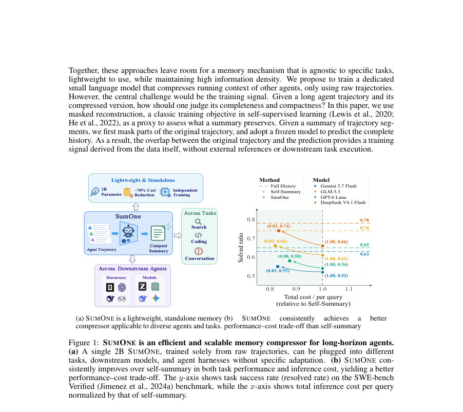
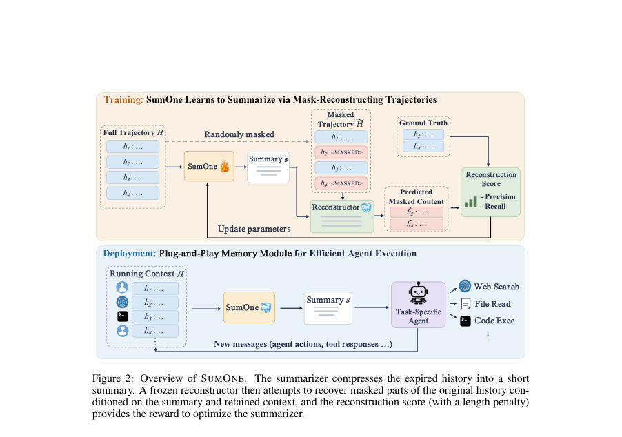

# SUMONE: A Simple and Efficient Summarizer for Plug-and-Play Agent Memory

- **게시일:** 2026-11-05
- **arXiv:** [2611.06445v1](http://arxiv.org/abs/2611.06445v1) · [PDF](https://arxiv.org/pdf/2611.06445v1)
- **저자:** Jizhe Zhang, Ang Li, Chenheng Zhang, Yisen Wang
- **분야:** cs.AI
- **선정 점수:** 5.87
- **선정 이유:** 최근성 1.1, 인용 영향 0.0 (인용 0회), 저자 영향 0.0 (최고 h-index 0), AI 주제 적합성 2.7, 개발자 관심 0.9, 학술 신호 0.5, 오픈 웨이트·주요 연구조직 신호 0.6

[← 2026-11-05 목록으로 돌아가기](../daily/2026-11-05.html)

<!-- paper-visuals:start -->
## 주요 Figure

> 원문 PDF에서 실제 Figure 캡션과 그림 영역이 함께 확인된 자료만 자동 추출했다.

*Figure · 원문 PDF 2쪽 · Figure 1: SUMONE is an efficient and scalable memory compressor for long-horizon agents.*

*Figure · 원문 PDF 4쪽 · Figure 2: Overview of SUMONE. The summarizer compresses the expired history into a short*

<!-- paper-visuals:end -->

## 한 문장 요약

SUMONE은 마스크 복원을 보상 신호로 삼아 원 궤적에서 정보 보존을 학습한 경량(2B) 독립형 요약 모델로, 훈련 시에는 냉동 재구성기와 LLM 판정을 사용해 요약의 정보 보존력을 측정하고 추론 시에는 요약기만 플러그인해 에이전트 컨텍스트를 효율적으로 압축한다.

## 해결하려는 문제

도구 사용·장기 추론 에이전트는 누적되는 상호작용 기록으로 문맥이 계속 커져 추론 비용이 증가하고 컨텍스트 한계에 도달한다. 기존 학습 기반 압축 방법들은 downstream 작업 보상이나 솔버 행위에 의존해 특정 작업/에이전트에 결속되는 경우가 많아, 작업·솔버에 독립적인 플러그앤플레이형 요약기가 필요하다.

## 핵심 기여

- 마스크 복원(masked reconstruction)을 보상으로 사용하는 완전한 자기지도 학습 신호를 제안하여, 레퍼런스 요약이나 하위 작업 실행 없이 원시 에이전트 궤적만으로 요약기를 학습함.
- 경량(약 2B 파라미터) 독립형 요약기 SUMONE을 제안하고, 추론 시에는 요약기만 남겨 플러그앤플레이 방식으로 다양한 다운스트림 에이전트·하니스와 결합되도록 설계함.
- 훈련 파이프라인으로 GRPO 기반 RL 최적화를 도입하고, 냉동 재구성기(frozen reconstructor)와 LLM 판정기를 통해 블록 단위 정밀도·재현율을 측정해 보상으로 사용함(길이 패널티 병합).
- 웹 서치 및 소프트웨어 엔지니어링 장기 작업에서 광범위한 평가를 수행해, 풀 히스토리 대비 입력 토큰·추론 비용을 크게 줄이면서 성능 손실을 소폭(약 0.04)으로 억제함을 보임.
- 재구성 보상, 마스크 비율(50%), 길이 패널티(λ=0.1) 등 설계 선택의 영향에 대한 실험적 분석(ablations)을 제공하고, 같은 체크포인트가 여러 다운스트림 모델·하니스에 전이됨을 보임.

## 접근 방법

* 목표는 만료된 상호작용 기록 H를 짧은 요약 S로 압축해 정보 손실을 최소화하는 것임.
* (1) 요약기 πθ는 (C, H)를 입력받아 요약 S를 샘플링한다.
* (2) H는 약 512토큰 단위 블록으로 분할되고 그 중 Ω의 블록을 무작위로 선택해 마스킹(훈련에서는 약 50%)해 부분 관찰 eH를 만든다.
* (3) 냉동 재구성기 D(Qwen3.5-9B)를 사용해 (C, eH, S) 조건하에 마스킹된 블록들을 재생성하고, LLM 기반 판정기(DeepSeek V4.1 Flash)가 재생성 블록 각각에 대해 정밀도(pi)와 재현율(ri)을 평가한다.
* (4) 블록별 점수의 평균 Q(S) = (1/\|Ω\|) Σ(ri + pi)를 계산하고 길이 패널티 R(S) = Q(S) − λ\|S\|/Lmax로 최종 보상을 정의한다(λ는 길이 페널티 계수).
* (5) 각 문맥에서 G(=8)개의 후보 요약을 샘플링해 그룹 내 정규화한 이득(Ak)을 구하고 GRPO로 요약기 파라미터를 업데이트한다.
* 훈련 데이터는 약 5K 컴팩션 인스턴스(16K/32K 컨텍스트 길이 비율 혼합)로 구성되며, 요약기는 Qwen3.5-2B 초기화, 재구성기는 Qwen3.5-9B(고정), 판정기는 DeepSeek V4.1 Flash를 사용했다.
* 최종 배포(추론) 단계에서는 재구성기·판정기 파이프라인을 제거하고 요약기만 사용해 만료된 기록을 S로 교체한다.

## 주요 결과

- 주요 벤치마크 및 설정: 다운스트림 에이전트 기본 평가는 Qwen3.5-35B-A3B + OpenCode 하니스, 모든 압축법은 동일 컴팩션 임계치(32K) 및 출력 예산 사용.
- DeepSearchQA(다운스트림 성능: F1): Full History 0.52 → SUMONE 0.48 (성능 손실 0.04). 입력 토큰은 2.83M → 591K로 감소(약 79% 절감). 총 추론 비용은 $0.170 → $0.038로 감소(약 77.6% 절감). 표에서 SUMONE의 압축비(C. Ratio)는 90%.
- SWE-bench Verified(해결률): Full History 0.63 → SUMONE 0.59 (성능 손실 0.04). 입력 토큰은 4.10M → 1.09M로 감소. 총 비용은 $0.286 → $0.071로 감소(약 75.2% 절감). 표에서 SUMONE의 압축비는 69%.
- LongMemEval-S(격리된 메모리 평가): 전체 점수 기준으로 Oracle(0.85) > Full History(0.77) > SUMONE(0.47) > Prompt-2B(0.43) > CoMem(0.31). SUMONE은 단일/멀티/시간/업데이트 질문 카테고리에서 비교적 균형 잡힌 성능을 보였음(예: Single 0.48, Multi 0.41, Temporal 0.36, Update 0.43).
- 교차 모델·하니스 전이: 동일한 SUMONE 체크포인트가 DeepSeek V4.1 Flash, GPT-6 Luna, GLM-5.3, Gemini 3.7 Flash 등 여러 다운스트림 모델과 OpenCode/DeepSeek Harness/Codex/OpenHands 하니스에 대해 Full History에 근접하거나 Self-Summary보다 우수한 성능을 보이며 비용을 절감(예: DeepSearchQA에서 DeepSeek V4.1 Flash: Full 0.74 → SUMONE 0.66, Self-Sum 0.59). 표 8·9에 상세 수치 제공됨.  
    
    (참고: 위 수치는 본문 표(표 1,4,8,9 등)의 숫자를 직접 인용하거나 본문에서 계산한 비율임.)

## 한계

- 저자가 명시한 한계: 훈련 데이터가 웹 검색과 소프트웨어 엔지니어링 궤적에 집중되어 있어 다른 도메인에 대한 일반성은 보장되지 않음.
- 저자가 명시한 한계: 학습 신호는 냉동 재구성기와 LLM 기반 판정기에 의존하며, 이들의 능력과 편향이 학습된 요약기의 품질에 영향을 줄 수 있음(훈련 시에만 필요).
- 본문 실험 기반 제약(확인 가능한 한계): 훈련 데이터 규모가 약 5K 인스턴스로 비교적 작고 훈련 예산(600 스텝, 그룹 샘플링 등)이 제한적이므로 대규모·다양한 분포에 대한 확장성은 추가 검증이 필요함.
- 추론 성능·비용 절감은 다운스트림 모델의 토큰 가격·구조에 따라 크게 달라지므로 실제 절감 효과는 배포 환경에 크게 의존함(논문은 특정 API 가격표를 사용해 비용을 추정함).

## 개발자 관점

- 훈련 파이프라인에서 재구성기(reconstructor)와 LLM 판정기는 필수적이지만, 인퍼런스에는 요약기만 필요하므로 배포 비용·지연은 낮음(논문: 요약기만 플러그인).
- 논문에서 최적으로 관찰된 하이퍼파라미터: 마스크 비율 ≈ 50%(훈련 시), 길이 패널티 λ ≈ 0.1, 블록 크기 ≈ 512 토큰. 이 설정이 재구성 난이도와 신호 품질의 균형을 잘 맞춤(본문의 ablative 실험 근거).
- 초기화·구성 재현성: 요약기는 Qwen3.5-2B로 초기화했으며 재구성기는 Qwen3.5-9B(고정), 판정기는 DeepSeek V4.1 Flash를 사용했다. 훈련은 GRPO(그룹 샘플링 G=8, 배치 6, 롤아웃/스텝 48, lr=1e-6, 총 600 스텝)로 수행됨(부록 표에 상세 설정).
- 배포 고려사항: SUMONE은 다운스트림 모델·하니스에 대해 플러그앤플레이로 사용 가능하므로, 고비용 백엔드 모델에서 컴팩션을 외부로 오프로드하면 전체 추론 비용 절감 효과가 큼(논문 교차모델 결과 참고).
- 리스크·안전성: 재구성기·판정기의 한계(환각·편향)가 학습된 요약의 품질/보존 내용에 영향을 줄 수 있으므로, 민감 정보나 보안 관점에서는 훈련 시 판정기 선택과 검증을 신중히 해야 함(논문에서 해당 의존성 명시).

**근거 범위:** 이 분석은 제공된 논문 PDF 본문(주요 본문과 부록 표 포함)을 직접 근거로 작성했습니다. 표와 본문에서 명시된 수치(예: 표 1,4,8,9와 부록 표 7/10)를 사용했으며, 본문에 명시되지 않은 구현 세부(예: 내부 가중치 초기화 세부, 추가 로깅 등)는 포함하지 않았습니다. 분석 대상 PDF의 텍스트를 근거로 했으나, 코드·추가 실험은 저자의 공개 자료(수락 후 공개 예정)에서 확인이 필요합니다.
