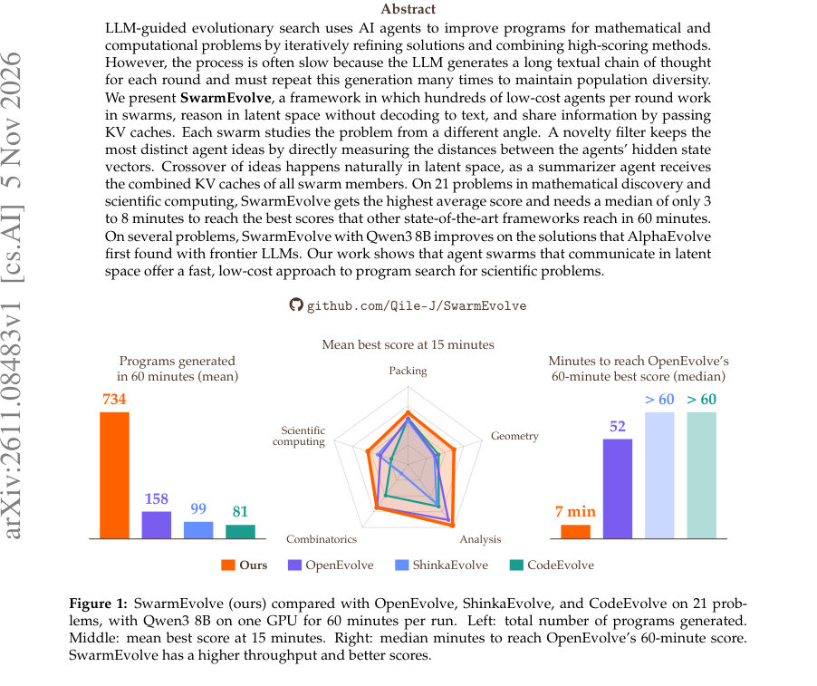
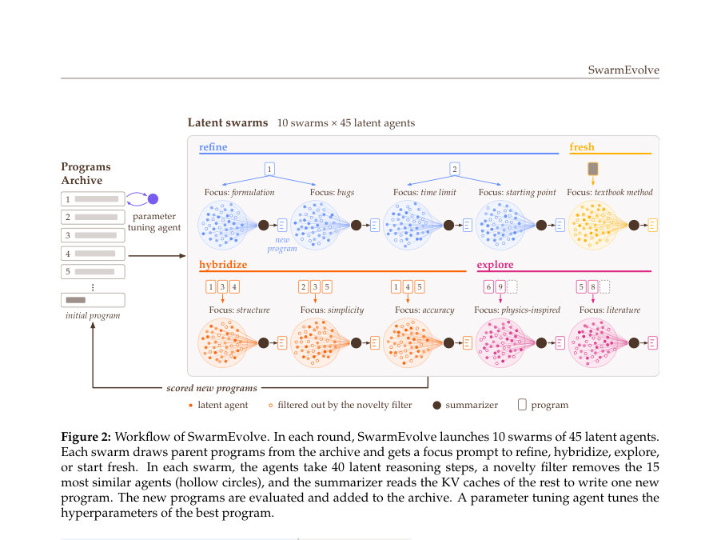
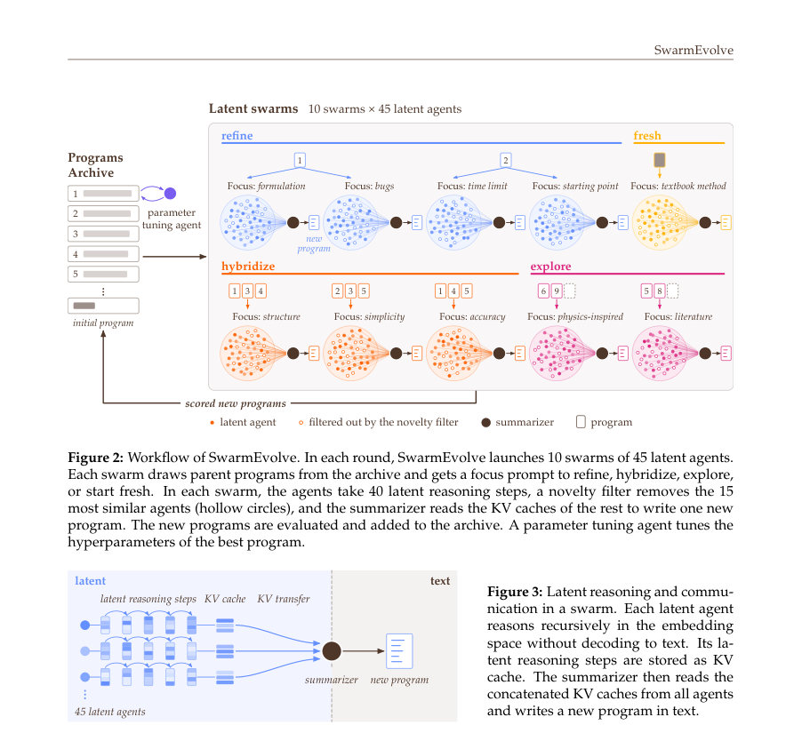

# SwarmEvolve: Latent Agent Swarms for Evolutionary Discovery and Optimization

- **게시일:** 2026-11-08
- **arXiv:** [2611.08483v1](http://arxiv.org/abs/2611.08483v1) · [PDF](https://arxiv.org/pdf/2611.08483v1)
- **저자:** Qile Jiang, George Em Karniadakis
- **분야:** cs.AI, cs.NE
- **선정 점수:** 5.75
- **선정 이유:** 최근성 0.5, 인용 영향 0.0 (인용 0회), 저자 영향 1.7 (최고 h-index 20), AI 주제 적합성 3.0, 개발자 관심 0.2, 학술 신호 0.3, 오픈 웨이트·주요 연구조직 신호 0.0

[← 2026-11-08 목록으로 돌아가기](../daily/2026-11-08.html)

<!-- paper-visuals:start -->
## 주요 Figure

> 원문 PDF에서 실제 Figure 캡션과 그림 영역이 함께 확인된 자료만 자동 추출했다.

*Figure · 원문 PDF 1쪽 · Figure 1: SwarmEvolve (ours) compared with OpenEvolve, ShinkaEvolve, and CodeEvolve on 21 prob-*

*Figure · 원문 PDF 4쪽 · Figure 2: Workflow of SwarmEvolve. In each round, SwarmEvolve launches 10 swarms of 45 latent agents.*

*Figure · 원문 PDF 4쪽 · Figure 3: Latent reasoning and commu-*

<!-- paper-visuals:end -->

## 한 문장 요약

수백 개의 저비용 에이전트가 잠재 표현(KV 캐시)로 사고하고 교차·선택을 수행하는 SwarmEvolve라는 진화적 프로그램 탐색 프레임워크를 제안하여 텍스트 기반 LLM 진화 탐색보다 훨씬 빠르고 비용 효율적으로 수학·과학 계산 문제의 프로그램을 발견·개선한다.

## 해결하려는 문제

기존 LLM 기반 진화 탐색은 각 에이전트가 긴 텍스트 추론(chain-of-thought)을 생성하고 이를 반복하므로 GPU 시간과 컨텍스트가 급증하여 다수의 에이전트·다양성 유지·대규모 탐색을 곧잘 수행하지 못한다. 연구 질문은 ‘잠재(latent) 공간에서 수백 개의 저비용 에이전트(스웜)를 운영하고 KV 캐시로 통신하면 진화적 프로그램 탐색을 더 빠르고 더 나은 결과로 만들 수 있는가?’이다.

## 핵심 기여

- SwarmEvolve 프레임워크: 1라운드에 10개 스웜×45 latent 에이전트(총 450개)를 병렬로 실행하고, 에이전트들이 텍스트를 디코딩하지 않고 잠재 공간에서 40단계씩 추론하여 KV 캐시를 생성·공유하는 설계
- 잠재-공간 교차와 요약자(summarizer): 각 스웜에서 유지된 에이전트들의 KV 캐시를 결합(concatenate)해 요약자 에이전트가 이를 읽고 하나의 새 프로그램을 텍스트로 출력함으로써 잠재 수준에서 자연스러운 아이디어 혼성(crossover)을 구현
- 잠재 기반 새로움 필터(novelty filter): 각 에이전트의 40단계 평균 은닉 상태를 중심화·정규화한 뒤 코사인 거리와 그리디 farthest-point 선택(초기에는 군집 중심에 가장 가까운 하나 선택 후 차례로 최대 거리 선택)으로 스웜 내에서 가장 서로 다른 30개 에이전트를 유지
- 고처리량·저비용 검색: 텍스트 디코딩을 건너뛰는 잠재 추론·통신으로 시간 당 평가 프로그램 수를 5–13배로 늘리고, 다른 SOTA 프레임워크가 60분에 도달한 성능을 중앙값 3–8분만에 달성
- 광범위한 실험 검증: 수학적 발견 및 과학계산의 21개 문제에서 Qwen3 8B/14B/32B-FP8로 비교하여 평균 점수·문제별 최고 성능 우위를 보고 (일부 문제에서는 Qwen3 8B로 AlphaEvolve의 결과를 능가)

## 접근 방법

* (구성요소와 절차 요약) 1) 라운드 구성: 매 라운드 10개 스웜(각각 특정 'focus')을 구성하고 스웜 유형은 refinement(4), hybridization(3), exploration(2), fresh-start(1)으로 나뉨.
* 각 스웜은 45개의 잠재 에이전트를 띄우고 각 에이전트는 문제 설명·포커스·(할당된)부모 프로그램을 읽음.
* 2) 잠재 추론: 각 에이전트는 텍스트 디코딩 없이 latent reasoning을 40단계 수행한다(식(2): 출력 히든 상태 h_t를 입력 임베딩 e_{t+1}으로 매핑하는 정렬 행렬 W_a와 노름 재조정).
* 각 단계는 KV 캐시에 키·값을 추가함.
* 3) 신기성 필터: 각 에이전트의 40단계 평균 히든 상태 ¯h_j를 계산하고 군집 평균 μ로 중심화·정규화한 단위 벡터 z_j로 표현한 뒤 그리디 farthest-point 선택(코사인 거리 기준)으로 30개 에이전트를 보존(식(4),(5)).
* 4) KV 전송·요약: 요약자(summarizer)는 문제의 KV, 30개 에이전트의 latent 단계 KV, 스웜의 부모 프로그램 KV, 요약자 지시문 KV를 층별로 순서대로 연결(concatenate)하고 RoPE 기반 회전(R^δ)을 적용해 위치 오프셋을 맞춘 뒤 이를 어텐션해 최종 텍스트(방향 설명 + 완전한 프로그램)를 디코딩(식(3),(6)).
* 5) 하이레벨 연산: 새 프로그램 문법·중복 검사·자동 임포트 보완 후 CPU 코어(8개)에서 병렬로 결정적 평가기를 실행해 점수·로그를 아카이브에 저장.
* 매 라운드마다 파라미터 튜닝 에이전트가 최상 프로그램의 수치 파라미터 하나를 제안(라운드당 최대 8개의 1-숫자 편집 평가).
* 구현 세부: PyTorch + Hugging Face Qwen3 모델, vLLM의 paged attention/FlashAttention, speculative sampling, CUDA 그래프 및 fused kernels 사용.

## 주요 결과

- 전체 비교(21문제, 1 GPU, 8 CPU, 60분, 3시드, 모델별 실험): 평균 점수(60분 기준) — Qwen3 8B: SwarmEvolve 0.804 vs OpenEvolve 0.693, ShinkaEvolve 0.642, CodeEvolve 0.700; Qwen3 14B: 0.837 vs 0.771/0.686/0.739; Qwen3 32B-FP8: 0.869 vs 0.774/0.733/0.731 (Table 1)
- 처리량: 60분 동안 평가한 프로그램 수 평균 — SwarmEvolve 734, OpenEvolve 158, ShinkaEvolve 99, CodeEvolve 81 (Supplementary Table 2) — 즉 시간당 평가량이 대략 5–13배 증가 (본문·그림1)
- 탐색 속도: SwarmEvolve는 다른 프레임워크의 60분 최고 점수에 도달하는 중앙값 소요시간이 대체로 3–8분(문제별로 OpenEvolve 목표를 달성하는 중앙값 7분 등, Figure 4)
- 작은 모델로의 성능: Qwen3 8B를 사용한 SwarmEvolve가 동일 문제들에서 다른 프레임워크들의 32B 모델 결과보다 우수한 평균 점수를 보였음(본문 p.6)
- AlphaEvolve 재현·능가 사례: SwarmEvolve(Qwen3 8B)는 AlphaEvolve가 처음 찾았던 일부 구성들을 개선함 — 예: 26개 원의 사각형 포장(최적 합 반지름 2.635983)과 두 autocorrelation 부등식에 대한 향상 (본문 p.6, Supplementary Table 5)

## 한계

- 저자 명시 한계 — (1) 단일 모델 의존: 모든 latent 에이전트와 요약자가 동일 LLM을 공유해야만 요약자가 직접 해당 에이전트들의 KV 캐시를 읽을 수 있음(따라서 멀티모델 스웜은 현재 구현에서 미지원). 저자는 KV 캐시 간 번역을 학습하면 확장 가능하다고 제안함.
- 저자 명시 한계 — (2) 표준 어텐션 필요: linear-attention·state-space·하이브리드 아키텍처는 과거를 고정 크기 상태로 압축하므로 에이전트 간 잠재 통신을 위해 상태 병합 메커니즘이 필요함.
- 저자 명시 한계 — (3) 메모리 확장성: 라운드 당 KV 캐시 메모리는 (에이전트 수)×(latent 단계 수)×(레이어 수)에 비례해 증가하므로 큰 모델을 돌리려면 큰 GPU 메모리가 필요함(저자는 압축 기법·여러 GPU로 라운드를 분산하는 방법을 제안).
- 추론된/실험 범위에 근거한 제약 — (4) 평가 범위: 실험은 수학적 구성·과학계산의 21개 문제(AlphaEvolve의 문제들과 설계된 5문제)에 한정되어 있어 다른 도메인·일반 코드 생성 사례 전반의 성능은 미검증(본문의 실험 구성과 문제 목록 참조).

## 개발자 관점

- 재현/구현: 구현은 PyTorch + Hugging Face Qwen3로 하였으며 vLLM의 paged attention(FlashAttention 커널), speculative sampling, CUDA 그래프, fused kernels를 활용해 성능을 냄(부록 C). 같은 모델의 인스턴스에서 에이전트의 KV 캐시를 공유하는 구조를 요구함.
- 핵심 하이퍼파라미터(본문·부록 표에 명시): 10 스웜×45 latent 에이전트(스웜당 30 보존), 각 에이전트 40 latent reasoning steps, 요약자 토큰 예측 최대 토큰 4096, 라운드당 최대 8개의 1-숫자 파라미터 튜닝 제안.
- 성능·비용 설계: 잠재 추론과 KV 전송은 텍스트 디코딩을 회피해 라운드당 GPU 시간을 크게 줄이므로 더 작은 모델(Qwen3 8B)으로도 최종 성능을 얻을 수 있음 — 따라서 예산이 제한된 환경에서 큰 이점.
- 합리적 아키텍처 제한: 모든 에이전트가 동일 모델을 써야 요약자가 직접 KV를 읽어 결합할 수 있으므로, 멀티모델 병렬화가 필요하다면 'KV-간 번역(cache-to-cache translation)' 모듈이나 중간 표현을 설계해야 함(저자가 언급).
- 운영·스케일링: 라운드당 생성되는 KV 캐시 메모리(에이전트 수·단계·레이어 수에 비례)를 모니터링하고, 큰 모델·더 많은 단계로 확장 시 GPU 메모리·통신 분산(여러 GPU에 라운드 분산) 및 메시지 압축 기법을 고려할 것(본문·부록에서 제안된 확장 방향).

**근거 범위:** 이 분석은 제공된 논문 PDF 본문(본문 및 부록 전체 텍스트)을 근거로 작성되었음. 표·그림·수치(예: 평균 점수, 프로그램 평가 수, 라운드 구성, 하이퍼파라미터, 한계)는 본문과 보충 자료에서 직접 발췌한 값이다. 논문에 명시되지 않은 내부 구현의 미세한 튜닝 값(예: GPU 메모리 사용량, 정확한 CUDA 그래프 설정, 랜덤 시드 처리의 내부 로직)은 본문에서 확인할 수 없어 생성하지 않았음.
