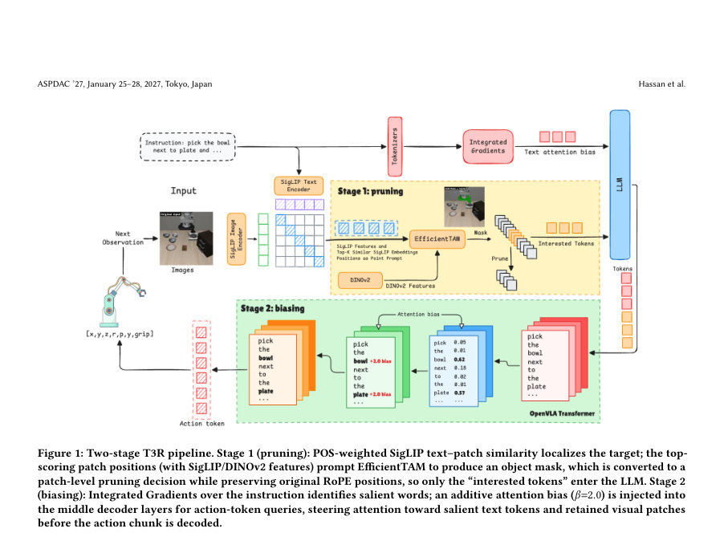
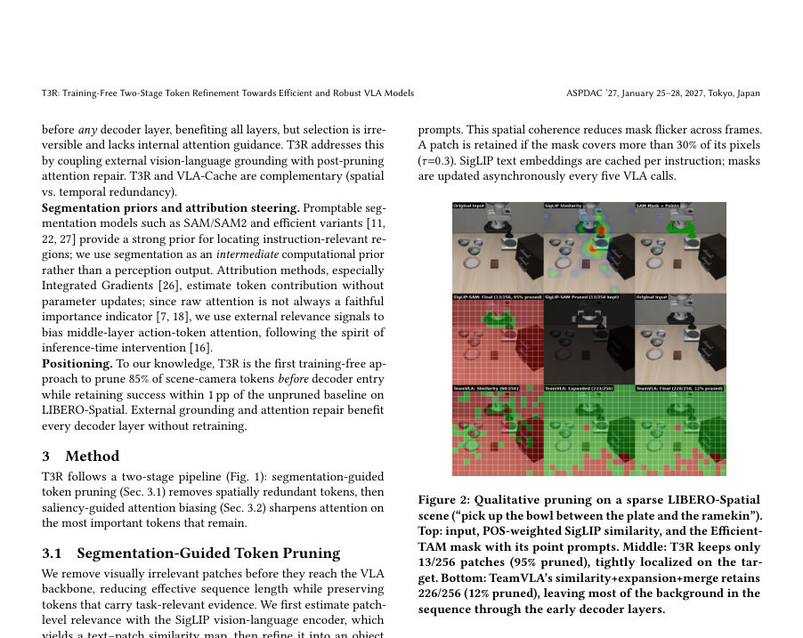
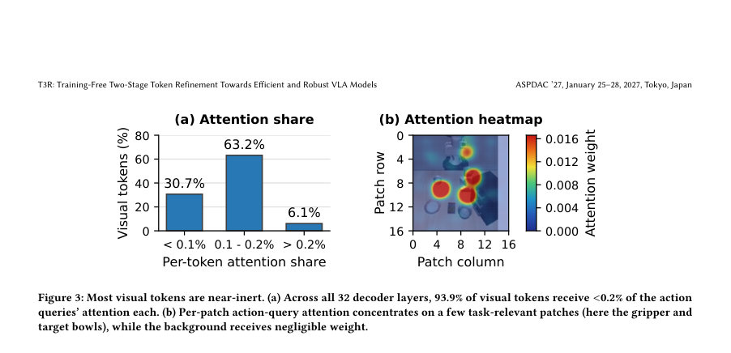

# T3R: Training-Free Two-Stage Token Refinement Towards Efficient and Robust VLA Models

- **게시일:** 2026-11-08
- **arXiv:** [2611.08413v1](http://arxiv.org/abs/2611.08413v1) · [PDF](https://arxiv.org/pdf/2611.08413v1)
- **저자:** Mohammed Hassan, Zhenyang Chen, Zheng Wang, Zhixin Zhu, Tianlong Chen, Yingyan, Lin, Chaojian Li
- **분야:** cs.RO, cs.CV
- **선정 점수:** 5.93
- **선정 이유:** 최근성 0.5, 인용 영향 0.0 (인용 0회), 저자 영향 2.0 (최고 h-index 43), AI 주제 적합성 2.4, 개발자 관심 0.5, 학술 신호 0.6, 오픈 웨이트·주요 연구조직 신호 0.0

[← 2026-11-08 목록으로 돌아가기](../daily/2026-11-08.html)

<!-- paper-visuals:start -->
## 주요 Figure

> 원문 PDF에서 실제 Figure 캡션과 그림 영역이 함께 확인된 자료만 자동 추출했다.

*Figure · 원문 PDF 2쪽 · Figure 1: Two-stage T3R pipeline. Stage 1 (pruning): POS-weighted SigLIP text–patch similarity localizes the target; the top-*

*Figure · 원문 PDF 3쪽 · Figure 2: Qualitative pruning on a sparse LIBERO-Spatial*

*Figure · 원문 PDF 5쪽 · Figure 3: Most visual tokens are near-inert. (a) Across all 32 decoder layers, 93.9% of visual tokens receive <0.2% of the action*

<!-- paper-visuals:end -->

## 한 문장 요약

VLA 모델의 사전-디코더 단계에서 세그멘테이션 기반 패치 제거와 중간층 통합그래디언트 기반 텍스트·시각 중요도 편향을 결합해 훈련 없이 추론 토큰을 대폭 줄이고(최대 85%) 지연을 낮추며 OOD 강건성을 개선하는 T3R 프레임워크를 제안한다.

## 해결하려는 문제

비전-언어-액션(VLA) 모델은 각 결정에서 수백 개의 시각 토큰(특히 다중 카메라 환경에서)을 대형 언어 백본에 통과시키기 때문에 추론 비용과 지연이 커지고, 많은 토큰이 언어 지시와 약하게 결합되어 배경 정보가 주의(attention)를 분산시켜 분포 이동(예: 물체 위치 변화) 시 행동 예측을 방해한다. 기존 접근(사후 레이어에서의 토큰 축약 등)은 (i) 디코더 진입 이전에 토큰을 안전하게 제거하기 어렵고, (ii) 제거 후 내부 주의를 재정렬하지 않으면 핵심 증거가 손실되거나 노이즈가 유지되는 한계가 있다.

## 핵심 기여

- 훈련-불요(Training-free)인 두 단계 토큰 정제 프레임워크 T3R을 제안: (1) 세그멘테이션 기반, 위치 보존(position-preserving) 토큰 프루닝, (2) 통합그래디언트(Integrated Gradients) 기반 텍스트·시각 살리언시를 이용한 중간층 주의 편향.
- 프루닝을 디코더 진입 이전에 적용해 모든 트랜스포머 레이어가 짧은 입력 시퀀스를 사용하도록 하고, 위치 ID를 보존함으로써 사전학습된 RoPE 기반 포지셔널 구조와의 불일치를 피함.
- LIBERO-Spatial에서 장면-카메라(scene-camera) 토큰의 85%를 제거하면서 성공률을 거의 유지(96% vs. 무프루닝 97%)하고, OOD 물체 배치 변동에서 최대 +7 퍼센트포인트의 강건성 개선을 보고.
- 다중 카메라 환경에서 더 큰 절감 여지가 있음을 보이며 해상도 확장에 따라 LLM-forward 기준 최대 3.3× (논문 내부 프로파일링) 및 엔드투엔드 투영으로 최대 2.47×(768 px) 속도 이득을 제시.
- 훈련 없이 기존 사전학습된 VLA 정책에 바로 적용 가능한 실용적 추론-레벨 절감 기법임을 강조.

## 접근 방법

* T3R은 두 단계로 구성된다.
* 1) 세그멘테이션-가이드 토큰 프루닝: SigLIP 비전-언어 임베더로 입력 이미지(224×224, 256 패치)를 패치별 텍스트 유사도 맵으로 평가하고, 자연어의 단어별 중요도를 POS 가중치(w_j)로 반영한 점수(s_i)를 계산(식(1)).
* 상위 K_init=50 패치를 선택해 DBSCAN(ε=2.0 패치 단위)으로 클러스터링하고 가장 큰 클러스터에서 K=8의 상위 스코어 패치(양성 포인트)와 K_neg=3의 최저 스코어 패치(음성 포인트)를 EfficientTAM-S에 포인트 프롬프트로 주어 마스크를 생성한다.
* 패치 보존 임계값 τ=0.3(마스크가 패치 픽셀의 30% 이상 덮으면 보존).
* 중요한 구현 요소로는 원래 RoPE 포지션 ID를 유지하여 프루닝 후에도 토큰의 위치 인덱스를 변경하지 않는 'position-preserving pruning'과 마스크 업데이트를 5 VLA 호출마다 비동기적으로 수행하는 스케줄링이 있다.
* SigLIP 텍스트 임베딩은 지시문 단위로 캐시된다.
* 2) 살리언시-가이드 주의 편향: 예측의 입력 토큰 기여도를 Integrated Gradients(IG, n_steps=5)로 임베딩층에서 계산해 상위 30% 텍스트 토큰을 살리언트로 지정하고(에피소드 집합에서 캐시), 중간 디코더 층(레이어 8–23)에 대해 행동 토큰 쿼리(Q_action)에만 추가적인 어텐션 로짓 바이어스(식(2))를 더한다.
* 바이어스 강도 β=2.0, 바이어스 대상 S_bias는 살리언트 텍스트 토큰(IG 스코어 가중)과 보존된 시각 패치( SigLIP 유사도 ×0.5 )의 합집합이다.
* 이 편향은 중간 레이어에서만 적용하여 초·후단의 특성 추출/출력 포매팅을 방해하지 않도록 설계되었다.

## 주요 결과

- LIBERO-Spatial, OpenVLA-OFT (SigLIP ViT-S0 400M + LLaMA-2-7B, dual-camera ⇒ 512 visual tokens/call): T3R는 장면-카메라 토큰의 85%를 제거하면서 성공률(SR) 96%를 기록하여 무프루닝 베이스라인의 97%에 근접함(테이블 1).
- 같은 실험에서 VLA 추론 지연(latency)은 VLA 호출당 107.5 ms → 92.5 ms로 줄어들어 14% 감소(약 1.16× 속도 향상).
- LLM 전방(LLM-forward) 프로파일링에서 해상도 증가에 따라 최대 3.3×의 속도 향상을 관찰했으며, 엔드투엔드 투영에서는 768 px에서 최대 2.47×의 속도 향상(논문 내부 투영 수치)을 제시함(프루닝 비율 고정 유지 시).
- 프루닝·주의 편향 적용에 따른 오버헤드로 VLA 호출당 약 7.8 ms가 계산됨(LLM-only 저장량 비교에서 산출).
- OOD 물체 배치(가우시안 위치 노이즈 0–5 cm, 21 수준)에서 T3R 전체 파이프라인은 작은 변동에서는 베이스라인을 추적하고, 약 ≥2 cm에서 우위로 전환하여 최대 +7 pp 개선(예: 4 cm에서 최고 이득) 보고(그림 4). TeamVLA는 동일 실험에서 더 빠르게 성능 저하를 보임(예: 5 cm에서 35% vs T3R 48%).

## 한계

- 저자 기재 한계: (i) 단계1은 프롬프트 가능한 세그멘테이션(예: EfficientTAM/SAM 계열)에 의존하므로 병합된 객체 경계나 거친 마스크에 취약하고, 잘못된 마스크는 관련 영역을 잘못 제거함. (ii) IG는 태스크당 1회 비용이 있어 짧은 태스크에서 상쇄되지 않을 수 있고 초기화 지연 허용치가 엄격한 시스템에서는 문제 될 수 있음. (iii) 단일 카메라(센서 중복이 적은) 설정에서는 프루닝 여지가 작아 혜택이 제한적임. (iv) 모든 평가는 시뮬레이션 기반이며 실제 로봇 실행, 비동기 센서/구동 지연 하에서 검증되지 않음. (v) 하드웨어 프로파일링은 NVIDIA L40S에서만 수행되었고 에너지 측정 또는 엣지 디바이스 테스트는 없음.
- 실험 범위 및 본문에서 확인되는 제약(합리적 추론 기반): (i) 일부 비교(예: FastV/ADP의 특정 운영 지점)에서 레이턴시 값이 논문 표에 누락되어 있어 완전한 비교가 제한됨. (ii) 세그멘테이션 업데이트는 비동기(54 ms/업데이트, 5 호출마다)로 동작하므로 실시간 제어 루프에서의 스케줄링·지연 영향(예: 마스크 업데이트 지연으로 인한 단계 이동 시 마스크 불일치)은 추가 검증이 필요함. (iii) 조명·부분 가림(occlusion) 등 실제 환경 변화가 세그멘테이션 및 SigLIP 유사도에 미치는 영향은 본문에서 분리하여 정량화되지 않음.

## 개발자 관점

- 훈련-불요 파이프라인이므로 기존 사전학습 VLA 정책에 수정 없이 적용 가능하나, 재현 시 위치 보존(position-preserving pruning)을 반드시 지켜야 함(원래 RoPE 포지션 ID를 유지).
- 세그멘테이션 기반 프루닝 구현 세부값(논문 본문에 명시된 값)을 그대로 사용하면 재현 용이: SigLIP로 상위 K_init=50 패치 선택 → DBSCAN(ε=2.0 패치 단위)으로 클러스터링 → 상위 K=8 양성 포인트, K_neg=3 음성 포인트 → EfficientTAM-S로 마스크 생성 → 패치 보존 임계 τ=0.3. 마스크 업데이트는 5 VLA 호출마다 비동기 실행(세그멘테이션 비용 54 ms/업데이트).
- 주의 편향 하이퍼파라미터(논문 기본값)는 β=2.0, 중간 레이어(8–23)에만 주입, 텍스트 살리언시 상위 30% 토큰 선택, 보존된 시각 패치는 SigLIP 유사도 ×0.5로 가중. IG은 태스크당 한 번 계산(n_steps=5)하여 캐시(예상 비용: 약 1 s/태스크 보고).
- 프루닝·편향 적용 자체 오버헤드로 VLA 호출당 약 7.8 ms가 추가되며, 전체 시스템 이득을 확보하려면 세그멘테이션과 IG 비용을 에피소드 단위로 분산·재사용하도록 설계해야 함(예: IG 캐시, 비동기 마스크 업데이트).
- 다중 카메라(센서 중복) 환경에서 가장 큰 이득이 나타나므로 다중 센서 시스템에 우선 적용을 권장하며, 단일 카메라 환경에서는 보수적 프루닝 설정 또는 단계적 예비검증 필요(프루닝 비율 낮춤). 또한 실제 로봇 배포 전에는 조명·가림·물체 이동성 등 세그멘테이션 실패 모드를 집중 검증할 것.

**근거 범위:** 논문 PDF 본문 기반 분석입니다. 본 분석은 제공된 PDF 텍스트(전체 8쪽)에 명시된 수치·하이퍼파라미터·실험 설정·제약을 중심으로 작성했으며, 표에서 누락된 일부 레이턴시 항목(일부 비교방법)은 본문에 수치가 없어 포함하지 않았습니다. LLM-forward 관련 '최대 3.3×'와 엔드투엔드 '투영 2.47×' 수치는 논문 본문에서 각각 다른 프로파일링/투영 문맥으로 제시되므로 둘 다 명시했습니다. 본문에 직접 언급되지 않은 구현·하드웨어 외 환경(예: 실제 로봇 실험, 엣지 디바이스 전력 측정) 관련 정보는 추가 검증이 필요합니다.
