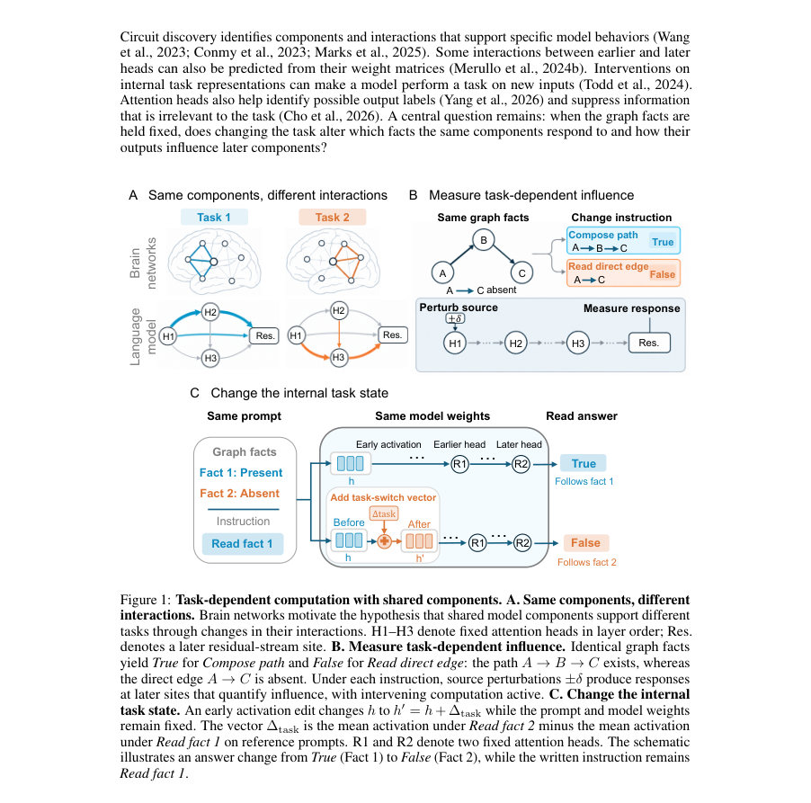
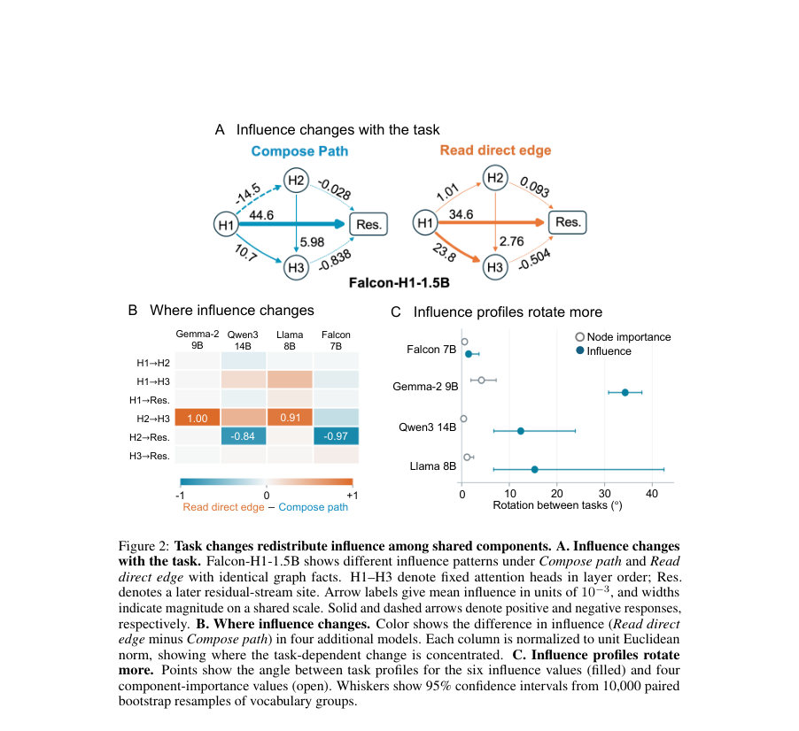
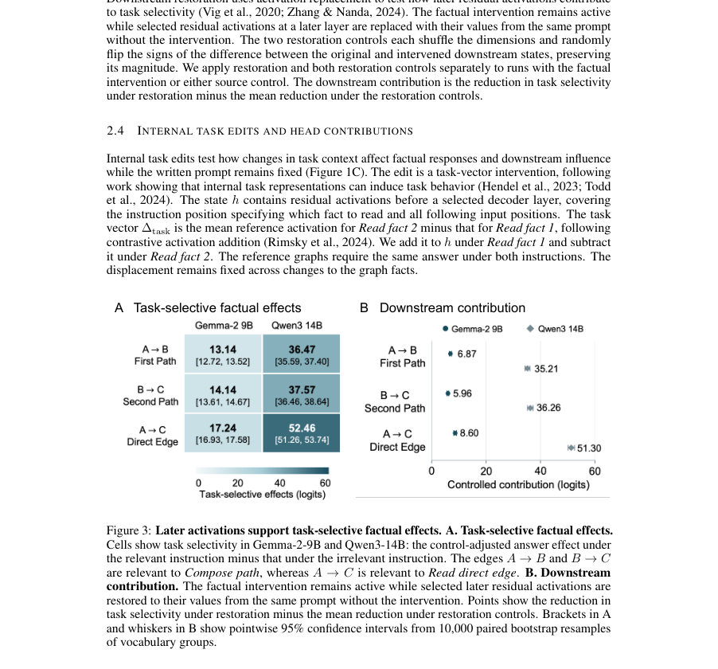

# Task Context Shapes Component Roles in Language Models

- **게시일:** 2026-10-12
- **arXiv:** [2610.13895v1](http://arxiv.org/abs/2610.13895v1) · [PDF](https://arxiv.org/pdf/2610.13895v1)
- **저자:** Sovesh Mohapatra, Dani S Bassett
- **분야:** cs.CL, cs.AI
- **선정 점수:** 5.37
- **선정 이유:** 최근성 0.5, 인용 영향 0.0 (인용 0회), 저자 영향 0.0 (최고 h-index 0), AI 주제 적합성 1.5, 개발자 관심 0.0, 학술 신호 0.3, 오픈 웨이트·주요 연구조직 신호 3.1

[← 2026-10-12 목록으로 돌아가기](../daily/2026-10-12.html)

<!-- paper-visuals:start -->
## 주요 Figure

> 원문 PDF에서 실제 Figure 캡션과 그림 영역이 함께 확인된 자료만 자동 추출했다.

*Figure · 원문 PDF 2쪽 · Figure 1: Task-dependent computation with shared components. A. Same components, different*

*Figure · 원문 PDF 4쪽 · Figure 2: Task changes redistribute influence among shared components. A. Influence changes*

*Figure · 원문 PDF 5쪽 · Figure 3: Later activations support task-selective factual effects. A. Task-selective factual effects.*

<!-- paper-visuals:end -->

## 한 문장 요약

동일한 그래프 사실을 유지한 채로 작업 지시만 바꿔 모델 내부에서 같은 구성요소(주로 어텐션 헤드)가 어떤 사실에 반응하고 이후 계산에 어떻게 영향을 주는지 활성화 개입과 응답 맵으로 정량화하여, 작업 맥락이 구성요소의 역할(응답 대상과 영향 전달)을 바꾼다는 증거를 제시한다.

## 해결하려는 문제

대형 언어모델은 동일한 파라미터를 여러 작업에 재사용하지만, 동일한 구성요소가 작업마다 "같은 일을 다르게" 하는지(즉 어떤 사실에 반응하는지와 그 출력이 이후 컴포넌트에 어떻게 전달되는지)가 명확하지 않음. 기존 회로 분석은 공유된 헤드를 식별하지만, 그 헤드들이 작업 맥락에 따라 응답 대상과 전달 효과를 어떻게 재분배하는지는 설명하지 못함. 본 논문은 동일한 입력(그래프 사실)을 유지하면서 작업 지시만 바꿔 동일 구성요소 간의 상호작용(영향력)과 정답 기여도(중요도)를 비교하는 것을 연구 질문으로 삼음.

## 핵심 기여

- 작업 지시가 동일한 그래프 사실에서 동일한 구성요소들의 영향(influence) 분포를 재분배함을 다섯 개의 공개체크포인트(모델군 네 개, 1.5–14B 파라미터)에서 실험적으로 입증함.
- 활성화 추가(activation addition)로 내부의 '작업 벡터'를 편집해(내부 작업 상태 변경) 같은 지시문 하에서도 모델이 읽는 사실을 전환시키고, 그 결과 동일한 헤드가 다른 사실에 반응하며 이후 구성요소에 다른 영향을 미치게 됨을 보임.
- 각 프롬프트에 대해 편집 전·후의 선형 응답 맵을 구성하여, 동일한 초기 헤드의 변화로부터 후속 헤드의 반응을 예측하고, 해당 내부 문맥에 맞는 맵이 평균 맵보다 예측오차를 크게 줄임(예: Gemma에서 MSE 53.6% 감소).
- 사실 개입(factual intervention)과 다운스트림 복원(replacement)을 함께 사용해, 후속 활성화들이 사실에 대해 작업 선택적(task-selective)인 답변 효과를 지지함을 정량적으로 보임(여러 로그잇 단위의 선택성 및 복원에 의한 감소 보고).
- 회로/네트워크 관점에서 작업 맥락이 동일 파라미터를 이용한 서로 다른 계산을 가능하게 하는 메커니즘으로서의 '상호작용 변화'를 제안하고, 작업-의존적 영향 측정이 특정 행동만 바꾸고 다른 행동을 보존하는 개입 설계에 활용될 수 있음을 논의함.

## 접근 방법

* 설정: 각 프롬프트는 A→B, B→C, A→C의 존재/부재를 서술하는 세 개의 그래프 사실과 작업 지시(예: Compose path: A→B && B→C 여부 확인, Read direct edge: A→C 여부 확인)를 포함한다.
* 동일한 그래프 사실을 유지하고 작업 지시만 바꿔 비교한다.
* 모델: Gemma-2-9B-it, Qwen3-14B, Llama-3.1-8B-Instruct, Falcon-H1-Deep-Instruct(1.5B) 및 Falcon-H1-7B 등 다섯 체크포인트(1.5–14B).
* 영향력(influence): 소스 헤드 출력의 활성화 투영을 참조 방향(task/사실·지시 기반)으로 표준편차 단위(si)로 정규화한 후, 각각 +2, −2 단위(δ=2)로 변조하여 수신 사이트의 표준화된 응답 변화로 정의(부호 포함).
* 중요도(importance): 해당 사이트의 전체 활성화 벡터를 참조 평균으로 교체했을 때 올바른-오답 로그잇 마진(margin)의 감소로 측정.
* 사실 개입(factual intervention): 레이어 입력에 사실-대응 활성화 차이를 더해(fact-present vs absent에서 얻은 Δf) 정답 로그잇 차이를 계산, 두 개의 소스 제어(permutation+sign-flip)로 보정.
* 다운스트림 복원(downstream restoration): 사실 개입이 활성화된 상태에서 이후 레이어의 잔여(residual) 활성화를 원래 값으로 돌려놓아 작업 선택성의 감소를 측정(복원 제어 포함).
* 내부 작업 편집(internal task edit): 레이어 전/후 잔여 활성화의 평군 차이로 구성한 작업 벡터 Δtask를 더하거나 빼서(contrasted activation addition) 모델 내부 상태만 전환함(프롬프트·가중치는 고정).
* 응답 맵(response map): 동일 프롬프트에서 H2에 대한 양·음 제어 변화로부터 H3 반응을 예측하는 선형 연산자 M을 계산(두 방향 평균).
* 평가·통계: 어휘 그룹(vocabulary groups) 단위 부트스트랩(다수 반복)으로 불확실성 산정, 여러 제어 및 보정 사용.

## 주요 결과

- 영향력 재분배: 다섯 모델에서 동일 소스 헤드의 하류 응답(영향력)이 작업에 따라 달라짐을 관찰. 예: Falcon-H1-1.5B에서 H1→H2 평균 영향이 Compose path에서 −0.0145에서 Read direct edge에서 0.00101로 변화.
- 작업 선택적 사실 효과: Gemma-2-9B의 사실별 작업 선택성(task selectivity, 제어 보정된 정답 로그잇 효과)은 A→B: 13.14 [12.52,13.68], B→C: 14.14 [13.39,14.90], A→C: 17.24 [16.81,17.73] logits. Qwen3-14B에서는 각각 36.47 [35.24,37.86], 37.57 [35.93,39.04], 52.46 [50.83,54.36] logits.
- 다운스트림 복원 기여: 복원은 작업 선택성을 크게 줄이며(제어 보정값) Gemma에서 A→B 등 세 사실에 대해 각각 6.87, 5.96, 8.60 logits 감소; Qwen에서 35.21, 36.26, 51.30 logits 감소(모두 부트스트랩 신뢰구간에서 유의).
- 내부 작업 편집 효과: Gemma와 Qwen에서 초기(조기) 활성화 편집으로 동일한 지시문 하에서도 모델이 읽는 사실이 전환됨. 예: Read fact 1 지시 하에서 H2의 Fact 2 응답 비중이 Gemma에서 +78.9 퍼센트포인트, H3에서 +97.1 pp 증가(부트스트랩 CI 유의), Qwen에서도 각각 +68.7 pp 및 +91.8 pp.
- 영향 프로파일 정합성 전환: 내부 편집 후 편집 전의 대안 지시下(타깃) 영향 프로파일과의 평균 제곱거리 감소율은 Gemma에서 93.2%, Qwen에서 76.7%로 관찰됨(랜덤 조기 편집보다 더 큰 정합성).', '응답 맵 예측 개선: 동일 프롬프트에서 현재 내부 문맥에 맞는 응답 맵이 편집 전·후 평균 맵보다 H3 변화 예측 MSE를 더 낮춤 — Gemma에서 MSE 53.6% 감소, Qwen에서 5.0% 감소(부트스트랩 신뢰구간으로 유의).', '조건부 응답(AND, 파인튜닝 모델): 같은 H2 변위가 사실이 정답에 영향이 있을 때(H3의 평균 제곱 반응이) 더 큼—Gemma 관련/비관련 비율 1.40 [1.31,1.51], Qwen 1.53 [1.34,1.74].

## 한계

- 저자가 명시한 한계: 그래프 설정(graph facts)은 사실 관련성을 명시적으로 만들기 때문에 이 범위 밖의 자연언어 장문의 추론이나 다단계 추론으로의 일반화는 미확인이며, 응답 맵의 이득 또한 동일 프롬프트 내·동일 문맥에서의 향상임(프롬프트 간 재사용성 미검증).
- 측정 제약: 영향력 측정은 선택한 활성화 방향(task/fact 방향)과 perturbation 크기(δ=2 표준편차)에 의존하며, 이는 미소선형 근사(미분)나 완전히 고립된 직접 연결을 측정하는 것이 아님 — 중간 컴포넌트를 통한 전송을 포함함.
- 모델·분석 범위: 사실 개입, 내부 편집, 응답 예측 실험은 주로 Gemma-2-9B와 Qwen3-14B에서 상세히 수행되었고, 다른 모델들은 영향 프로파일 비교에만 일부 포함되어 결과의 보편성은 제한적임.
- 중요도 측정의 편향: 잔여(residual) 사이트(나중 계층)가 중요도 벡터의 제곱 노름에서 대부분(97.8–99.95%)을 차지해 4-사이트 기반 중요도 프로파일 각도가 작게 나타날 수 있음—즉 중요도와 영향력의 차이는 측정 위치 선택에 민감함. (저자 서술)

## 개발자 관점

- 재현성: 모든 개입은 활성화 수준에서의 직접 접근(activation addition, replacement)을 요구하므로 내부 활성화에 접근 가능한 프레임워크(예: 모델 훅)를 준비해야 하며, 저자들은 실험 코드 공개를 예고함.
- 실험 설계: 참조(레퍼런스) 활성화 집합을 어휘그룹(vocabulary groups) 단위로 만들어 방향·스케일(한 단위=참조 투영의 표준편차)을 정의하고, 소스·복원 제어(permutation+sign-flip)를 항상 포함해 우발적 효과를 보정해야 함.
- 내부 편집 구현: 작업 벡터 Δtask는 Read fact 2 평균 활성화 − Read fact 1 평균 활성화로 정의하며, 편집은 Δtask를 더하거나 빼는 단순 덧셈으로 수행(스케일 조정 없음). 편집 레이어 범위와 위치가 효과 크기에 민감하므로 레이어 선택을 검증해야 함.
- 파인튜닝·배포: 조건부 응답 실험에는 LoRA(rank=8, q/v에 적용, scale=16, no dropout)로 경량 파인튜닝을 사용했으며, 실무적 적용 시 파인튜닝 대신 런타임 활성화 조작만으로 일부 행동 전환이 가능함 — 다만 활성화 개입은 서버측 내부 접근을 필요로 해 배포 제약 및 보안 고려 필요.
- 비용·안전성: 모델 크기(1.5–14B)와 활성화 조작의 반복적 부트스트랩 통계(수만 회 재샘플링)를 고려하면 계산 비용이 높음. 또한 내부 작업 편집으로 모델이 지시문과 상반되게 행동할 수 있어(지시문 고정 상태에서 읽는 사실 전환) 안전성·탈동작 가능성 검토 필요.

**근거 범위:** 본 분석은 제공된 논문 PDF 본문 전체(본문 및 부록)를 근거로 작성함. 본문과 부록에서 보고된 수치(로그잇 단위, 백분율, MSE 감소 등)와 실험 절차(모델 체크포인트, 레이어·헤드 위치, 제어 방법, 부트스트랩 절차 등)를 직접 인용·요약했음. 논문이 추후 공개할 코드나 추가 구현 세부사항(랜덤 시드, 하드웨어, 일부 내부 파라미터 튜닝)은 PDF에서 확인할 수 없어 분석에 포함하지 않았음.
