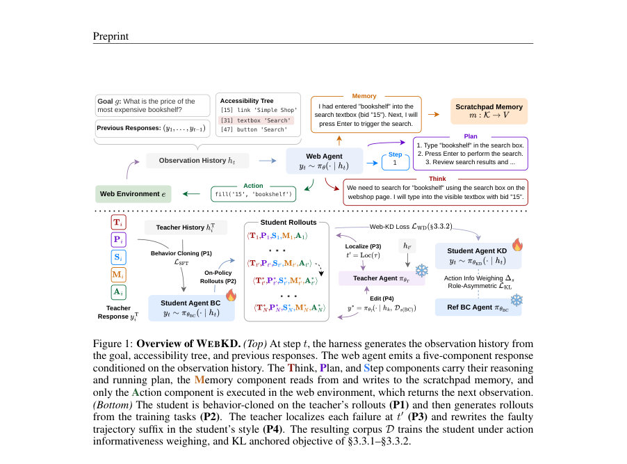
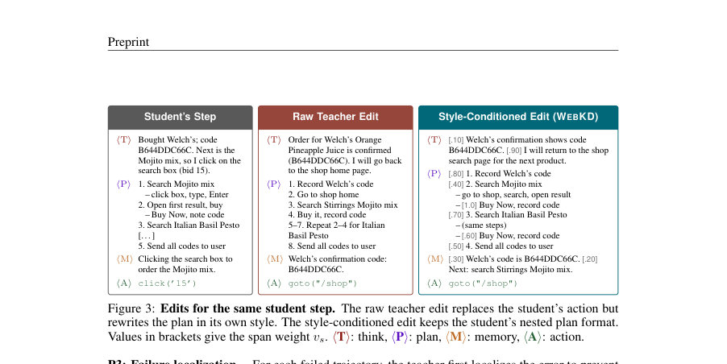
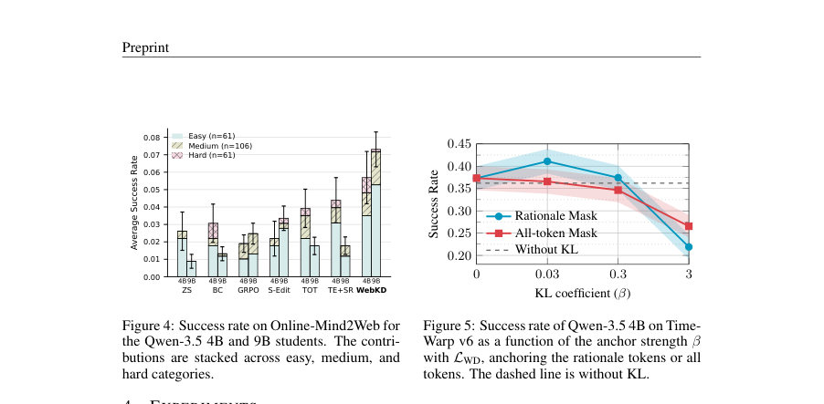

# Teaching Agents in their Own Style: Blackbox Teacher Distillation for Web Agents

- **게시일:** 2026-10-15
- **arXiv:** [2610.19834v1](http://arxiv.org/abs/2610.19834v1) · [PDF](https://arxiv.org/pdf/2610.19834v1)
- **저자:** Md Farhan Ishmam, Kenneth Marino
- **분야:** cs.AI
- **선정 점수:** 6.07
- **선정 이유:** 최근성 1.1, 인용 영향 0.0 (인용 0회), 저자 영향 0.0 (최고 h-index 0), AI 주제 적합성 2.6, 개발자 관심 0.2, 학술 신호 0.6, 오픈 웨이트·주요 연구조직 신호 1.6

[← 2026-10-15 목록으로 돌아가기](../daily/2026-10-15.html)

<!-- paper-visuals:start -->
## 주요 Figure

> 원문 PDF에서 실제 Figure 캡션과 그림 영역이 함께 확인된 자료만 자동 추출했다.

*Figure · 원문 PDF 3쪽 · Figure 1: Overview of WEBKD. (Top) At step t, the harness generates the observation history from*

*Figure · 원문 PDF 6쪽 · Figure 3: Edits for the same student step. The raw teacher edit replaces the student’s action but*

*Figure · 원문 PDF 8쪽 · Figure 4: Success rate on Online-Mind2Web for*

<!-- paper-visuals:end -->

## 한 문장 요약

폐쇄형(black-box) 최첨단 교사 모델이 노출하는 '텍스트'만으로 학생 웹 에이전트에 능력을 전이하기 위해, 실패 에피소드를 교사가 학생 스타일로 최소한만 편집하고(데이터 측면) 편집된 근거(rationale)가 행동에 기여하는 정도로 가중치하며(목적함수 측면) 합성 KL 앵커로 근거만 학생의 사전분포에 묶어 행동은 자유롭게 하여(distillation) 성능을 끌어올리는 WEBKD 방법을 제안한다.

## 해결하려는 문제

대형 폐쇄형 LLM을 교사로 삼아 소형 오픈 가중치 웹 에이전트로 능력을 전이하려면 교사 내부(로짓)에 접근하지 못하는 경우가 많아 기존의 토큰-레벨 지식증류(KD)·역KL·on-policy KD 같은 방법을 쓸 수 없다. 표준적 행동복제(behavior cloning)는 교사의 상태분포에만 학습시키므로 배포 시 학생이 방문하는 상태에서의 누적 오차(compounding error)와 '교사 스타일'이라는 학생이 잘 생성하지 못하는 표면분포를 함께 학습시켜 퍼플렉시티 프리미엄(학생이 교사 텍스트에 지불하는 초과 surprisal) 문제를 일으킨다. 따라서 (1) 블랙박스 교사로부터 어떤 감독 신호를 얻을지, (2) 교사의 텍스트 감독이 학생에게 너무 '이질적'일 때 손실이 어디에 집중되는지를 해결하는 방법이 필요하다.

## 핵심 기여

- 블랙박스 교사로부터 텍스트만 이용해 학생 웹 에이전트를 학습시키는 문제를 형식화하고(on-policy) 교사 편집이 학생에게 초래하는 'on-policy perplexity premium'을 정의·분석함(Defn.1, §3.2).
- WEBKD 알고리즘 제안: (P1) 교사 데모로 행동복제 초기화, (P2) 학생 온폴리롤아웃 수집, (P3) 실패 국소화(localize earliest erroneous step), (P4) 해당 suffix를 학생이 실제 본 상태에서 교사가 '학생 스타일'로 최소한만 편집하여 생성 — 편집은 실행되지 않음(§3.3, Alg.1).
- 편집-학습 목적함수 설계: (a) 편집된 근거(rationale) 내 각 문장·구간을 학생 모델의 '수정된 행동에 대한 기여도' ∆s로 가중(action-informative token weighting, Eq.4, §3.3.1), (b) 근거 토큰만 학생의 사전 πref(=BC 체크포인트)로 끌어당기고 행동 토큰은 자유롭게 허용하는 역할-비대칭 KL 앵커(γ mask, β 하이퍼파라미터) 도입(Eq.5, §3.3.2).
- 실험증거: TimeWarp 벤치마크와 라이브 웹(OnlineMind2Web)에서 여러 백본(Qwen-3.5 4B/9B, Gemma 4 E4B)과 비교실험을 통해 WEBKD가 행동복제·결과보상 기반 RL·여러 편집 기반 대조군보다 우수함을 보이고, 편집 스타일·목적함수·β 등 중요 설계요소에 대한 소거실험을 제시함(§4, Tab.1–3, Fig.4–5).

## 접근 방법

* 전체 파이프라인(Alg.1):
* P1: 교사(black-box)로부터 성공 데모 DT를 수집해 학생의 초기 모델 πθBC를 행동복제로 학습(시퀀스 단위 SFT, Eq.6)하고 고정한다.
* (Behavior Cloning seed)
* P2: πθBC로 훈련 과제에서 온-폴리롤아웃을 생성하고 실패 에피소드 Df(BC)와 성공 에피소드 풀 Ds(BC)로 분리한다.
* 실패 에피소드는 편집 대상, 성공 에피소드는 학생 스타일 예시(예: K=3) 마이닝에 사용(§3.3 P2, §B.3).
* P3: 실패한 각 에피소드에 대해 교사에 단일 호출로 '최초 오류 단계 t⋆를 식별하라'고 묻는 로컬라이저(Loc) 실행.
* 로컬라이저는 대체로 '초기화(early)' 오류(무해) 쪽으로 치우치며 늦게(localize late) 지정하면 위험(§B.2).
* 재생(prefix τp)은 t′−1까지 보존.
* P4: 교사에게 재생된 학생 상태 hk(교수가 학생이 실제로 본 관찰을 보도록 deterministic replay)와 학생 스타일 예시 Ds(BC)를 컨텍스트로 주어, k ≥ t′부터의 structured response(think/plan/step/memory/action)를 편집하게 함.
* 편집 시 스타일 블록(3개의 학생 예시)을 첨부해 교사가 '학생의 문체'로 쓴 편집을 유도하되 결정(액션)은 교사 본래의 결정을 따르도록 요구(§B.1–B.3).
* 편집은 환경에서 실행되지 않음(관찰은 학생의 원래 행동에 따라 이어짐).
* 편집 결과는 필터링(grounding) 후 학습 코퍼스 D에 저장(Alg.1).
* 목적함수(LWD, Eq.5): 편집된 토큰들에 대해
* LSW: 토큰별 교사 강제 크로스엔트로피에 토큰 가중치 wi 적용(총합 정규화) — wi는 각 근거 세그먼트 s의 ∆s(leave-one-out으로 학생 πθBC 아래에서 교사 편집이 수정된 action 확률을 얼마나 올리는지, Eq.4) 순위로 매핑하여 높은 기여 세그먼트에 더 큰 가중치를 줌(§3.3.1, §B.4–B.5).
* LKL: 역할-비대칭 KL 앵커(β)로 근거 토큰(think/plan/memory)에만 강하게 작용(γ=1), action/step 토큰에는 거의 영향 없음(γ≈1e-6).
* 앵커는 πref(고정된 BC 체크포인트)로 당겨 근거 표현을 학생의 사전에 가깝게 유지하면서 행동은 자유롭게 학습되도록 함(§3.3.2, Prop.2, Cor.1).
* 추가 설계: dead-zone τdz로 Δs 내부 분산이 작을 때 평균 가중치로 한정(§B.4 Eq.10), CE weight floor ϕ=0.1로 최저 가중치 보장, k3 KL 추정기 사용 등(Appendix §B.6, Table 4).

## 주요 결과

- 주요 지표: TimeWarp(v6, seen)에서 Qwen-3.5 4B 학생의 성공률: WEBKD 41.1±2.80% (Tab.1). 논문은 WEBKD가 TimeWarp에서 행동복제·결과보상 RL·교사 편집 계열 대비 학생 성능을 +5.5–10.7 percentage points 향상시킨다고 보고함(본문 §4.2: '10.7pp for Qwen 3.5 4B, 8.1pp for Qwen 3.5 9B, and 5.5pp for Gemma 4 E4B on v6').
- Web→Web 전이: 동일 분포의 보이지 않는 버전(v1–v5)과 라이브 웹(OnlineMind2Web)으로의 전이 관찰: WEBKD는 미학습 버전에 대해 베이스라인보다 3.0–10.6pp 우수했고, OnlineMind2Web에서도 다른 방법들보다 분명한 우위를 보였음(§4.2, Fig.4).
- 소거실험(ablations): 편집 스타일 소거(Table 2)에서 'teacher edits + student-style (in-context)'이 최선(예: Qwen-3.5 4B에서 41.10±2.80%). 목적함수 소거(Table 3)에서 LWD(제안 손실) + KL 앵커(β=0.03)가 최선(41.10±2.80)이며 동일한 가중치 없이(또는 다른 가중치 방식으로) 성능 하락을 보임. β 스윕(Fig.5)에서 β≈0.03이 근거 마스킹상 최적.
- 실험적 운영비·데이터 규모: 훈련 코퍼스(예시): 15개의 실패 훈련 에피소드에서 432 스텝 레코드(403가 편집 호출 대상, 392개 생존). 편집 단계의 총 프롬프트 토큰은 파이프라인 전체에서 약 26.3M(그 중 P1 데모 수집이 21.8M 토큰), 한 번의 파인튜닝은 H200에서 약 1 GPU-시간(§C.3). 학생 추론 지연: 4B 학생은 스텝 당 중간 6.10 s(교사보다 빠름)로 보고됨(§C.3).

## 한계

- 저자 명시 한계: 학생은 여전히 교사 성공률의 대략 절반 수준만 달성하여(본문 결론) 성능 갭이 상당히 남음 — 본문에서 'student still reaches only about half of the teacher’s success rate'로 명시(§5).
- 저자 언급된 제약: 블랙박스 교사 제약으로 인해 토큰-레벨 로짓 기반 증류가 불가능하고, 교사 편집의 오류(로컬라이제이션 지연·교사 자체의 실패)가 최종 성능의 하한을 설정함(이론적 보장 Theorem 1, §E.2).
- 실험·방법에서 본문으로 확인되는 제약: (a) 코퍼스가 상대적으로 작음 — 예시 실험은 15 실패 에피소드(≈392 편집·replay 레코드, ≈64k 응답 토큰)로 훈련됨(§C.3). (b) 로컬라이저(Loc)는 '일찍' 찾는 쪽 편향이 많아(benign) 대부분의 오류는 조기에 국소화되지만, 다른 해석(예: 루프-온셋)에서는 약 10% 가량 늦게(localize late) 판단하는 경우가 존재함(§B.2). (c) 앵커 구현의 메모리 비용이 큼 — 참조 정책 πref의 16-bit 복사본이 각 랭크에 필요해(9B 스케일에서 ≈27 GB) 단일-랭크 훈련과 ZeRO-3+CPU 오프로딩을 요구했음(§B.6, §C.3). (d) OnlineMind2Web 등 라이브 웹 성능 절대값은 여전히 낮음(모든 방법에서 <8%) — 전반적 난이도가 높음(§4.2, Fig.4).

## 개발자 관점

- 재현·구현 핵심: 파이프라인은 단계별로 분리(P1 seed BC checkpoint 생성 → P2 학생 롤아웃 수집 → P3 로컬라이즈 → P4 교사 편집)되므로 각 파이프를 독립적으로 디버그 가능(Alg.1, §3.3).
- 스타일-conditioning: 교사 편집은 편집 시 K=3의 학생 성공 에피소드 예시를 style block으로 제공하여 '학생의 문체'로 작성하도록 유도함(§B.1–B.3). 중요: 예시에는 action 토큰은 포함하지 않음(스타일만).
- ∆s 계산·스코어링: 각 근거 세그먼트 s에 대해 학생(고정된 BC 체크포인트) 아래에서 '해당 세그먼트를 제거한 경우와 포함한 경우의 교사-수정된 action의 로그확률 차이(leave-one-out)'로 ∆s를 계산(식 4). 이 계산은 교사 로짓 불필요 — 학생의 로그확률을 얻어 실현 가능. 실무적으로는 teacher-forced echo-scoring을 통해 수행(§B.4, §B.5).
- 목적함수·하이퍼: LWD(Eq.5) 사용. 핵심 하이퍼: CE weight floor ϕ=0.1, dead-zone τdz=0.05, 앵커 강도 β≈0.03(근거 마스크 γ=1 on think/plan/memory, γ≈1e-6 on action/step), 토크나이저 관련 가중치는 문자-커버리지로 토큰 가중치 wi 산출(§B.4–B.6, Table 4).
- 훈련·리소스: 참조(BC) 체크포인트를 훈련 중 고정 πref로 유지해야 함(메모리·추론 비용 발생). 앵커평가를 위한 πref의 포워드 패스가 추가로 필요하므로 메모리/연산 비용 고려(9B급에서 πref 복사본 약 27 GB). 권장: ZeRO-3+CPU 오프로딩, bf16 연산, gradient accumulation(16)과 같은 실무 설정 사용(§C.3, Table 4).

**근거 범위:** 이 분석은 제공된 논문 PDF 본문(제목, 본문, 표·그림·부록 포함)의 텍스트만을 근거로 작성되었음. 수치(성공률, 토큰·토큰수, 하이퍼파라미터, 코퍼스 크기 등)는 본문·표·부록에 기재된 값만 사용하였다. 코드·데모·추가 로그는 검토하지 못했고(본문에서 요약된 비용·토큰 수 등은 저자 보고에 근거), 내부 구현·토크나이저 특성·외부 API 요금 등은 본문에서 명시된 범위를 벗어나면 확인 불가하므로 그와 관련한 세부 추정은 포함하지 않았다.
