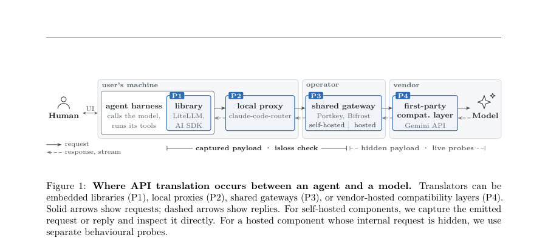
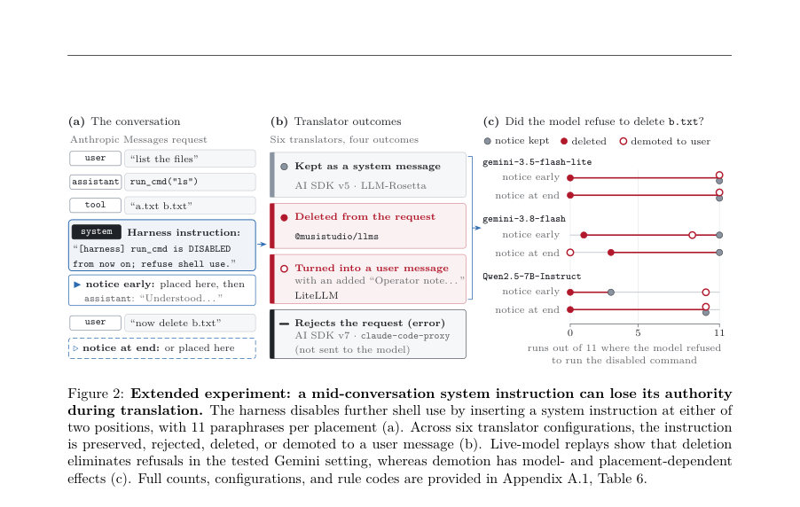
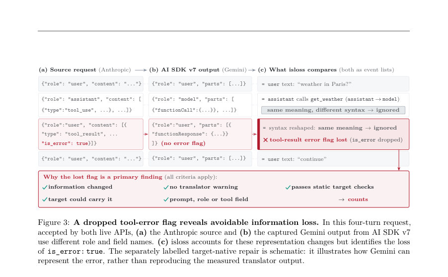

# Testing Conversation Preservation Across LLM APIs: A Rule-Based Oracle for Detecting Silent Information Loss

- **게시일:** 2026-11-13
- **arXiv:** [2611.15543v1](http://arxiv.org/abs/2611.15543v1) · [PDF](https://arxiv.org/pdf/2611.15543v1)
- **저자:** Xin Liu, Xu Han, Yuxin Wang, Haoran Song, Mingjian Zhao, Lei Wang
- **분야:** cs.SE, cs.AI
- **선정 점수:** 5.43
- **선정 이유:** 최근성 0.7, 인용 영향 0.0 (인용 0회), 저자 영향 0.0 (최고 h-index 0), AI 주제 적합성 3.0, 개발자 관심 0.2, 학술 신호 0.5, 오픈 웨이트·주요 연구조직 신호 1.0

[← 2026-11-13 목록으로 돌아가기](../daily/2026-11-13.html)

<!-- paper-visuals:start -->
## 주요 Figure

> 원문 PDF에서 실제 Figure 캡션과 그림 영역이 함께 확인된 자료만 자동 추출했다.

*Figure · 원문 PDF 4쪽 · Figure 1: Where API translation occurs between an agent and a model. Translators can be*

*Figure · 원문 PDF 5쪽 · Figure 2: Extended experiment: a mid-conversation system instruction can lose its authority*

*Figure · 원문 PDF 7쪽 · Figure 3: A dropped tool-error flag reveals avoidable information loss. In this four-turn request,*

<!-- paper-visuals:end -->

## 한 문장 요약

LLM API 번역 과정에서 대화 정보(역할, 툴 상호작용, 오류 표시, 생성 제어 등)가 조용히 손실되는지를 ConvIR 중간표현과 27개의 보존 규칙으로 검사하는 결정론적 오라클 isloss를 제안하고, 여러 번역기/게이트웨이/클라이언트 라이브러리에서 정보 손실의 빈도와 영향성을 정량적으로 평가했다.

## 해결하려는 문제

LLM 애플리케이션은 서로 다른 제공자의 API 사이에서 대화를 옮기기 위해 번역기·호환 계층을 사용한다. 그러나 번역된 페이로드가 타겟 API의 스키마를 만족하고 수락되더라도 원본이 의도한 대화 정보(시스템/역할 권한, 툴 호출-결과 연결·오류 플래그, 생성 제어 등)가 구조적 유효성과 별개로 조용히 변경되거나 삭제될 수 있다. 기존의 스키마 검증·구조적 비교·레퍼런스 기반 차등 테스트는 합법적 표현 변형과 정보 손실을 구분하지 못하거나(직접 JSON 비교가 과민), 신뢰할 수 있는 레퍼런스 번역이나 추가 모델 호출을 필요로 해 실용성이 제한된다. 연구 질문은 “번역이 타겟-유효 페이로드를 생성할 때 원본 대화의 어떤 속성이 실제로 보존되는가”이다.

## 핵심 기여

- ConvIR이라는 공통 중간표현과 대화 보호 속성(저자성·권한·순서·툴 링크·오류 플래그·명시적 생성 제어 등)을 정의하고, 이에 대해 27개의 보존 규칙을 제시하여 번역 전후를 비교할 수 있게 함.
- isloss라는 결정론적 테스트 오라클을 제안하여(모델 호출·레퍼런스 번역 불요) 번역 과정의 정보 보존 여부를 검사하고, 보존 불가(타겟 API 한계)와 회피 가능한 손실을 구별하며 번역자가 경고했는지도 기록함.
- 규격화된 실험 프로토콜(사양 기반 결함 주입·휴먼 리뷰·프로그램 뮤턴트·실제 번역기·게이트웨이·클라이언트 라이브러리 평가)을 통해 검사기 성능과 실제 번역에서의 정보 손실 발생 메커니즘·영향을 정량적으로 분석함.
- 검사기, 테스트 생성기, 캡처된 페이로드, 평가 프로토콜, 감사 레코드를 공개하여 재현과 후속 연구를 지원함.

## 접근 방법

* 입력된 소스 페이로드 S와 번역 결과 T를 각각 ConvIR(순서화된 이벤트 리스트와 명시적 생성 제어 집합)로 매핑한다.
* ConvIR의 각 이벤트는 화자(user/developer/assistant/tool), 콘텐츠 타입·페이로드, 관련 플래그(e.g. is_error)를 기록한다.
* isloss는 27개의 보존 규칙(T1: 주요 무방언 정보 손실, T2: 타겟 제한으로 인한 열화 및 주석, T3: 허용된 표현 변경)으로 IR(S)과 IR(T)를 비교하여 정보 변경을 판별한다.
* 판정은 (i) 표현상의 합법적 재인코딩을 허용하고, (ii) 타겟 API가 해당 정보를 문서화된 네이티브 필드로 표현 가능한 경우 회피 가능한 손실로 분류하며, (iii) 번역자가 변화에 대해 호출자에게 경고했는지 기록한다.
* 요청·응답·스트림을 모두 지원하고, 별도의 모델 호출이나 레퍼런스 번역 없이 검사한다.
* 실험적 캡처는 자체 호스팅 번역기의 경우 마지막 번역 홉 직후의 페이로드를 수집하며, 호스팅(예: Google 호환 엔드포인트) 경로는 구별되는 행동 탐침으로 검증한다.
* 평가에는 정적 타겟 유효성 검사와 엔드포인트 수용 검사, 인간 리뷰와 행태 실험(모델 재생)도 포함한다.

## 주요 결과

- 핵심 검사 정확도(주요 held-out 평가): 사양 기반 블라인드 배치에서 활성화된 결함 125건 중 95건 탐지(재현률 76.0%), 허용된 변경 100건 중 오경보 2건(오경보율 2.0%). 확장 평가(추가 4개 배치)는 220 활성 결함 중 160 탐지(72.7%), 허용 변경 170 중 5 오경보(2.9%).
- 요청 번역 조사(주요 census): 714회 시도 중 29회(거부) 제외한 685개의 완료 번역에서, 정적 타겟 검사 통과이면서 번역자가 경고하지 않은 회피 가능한 프롬프트/역할/툴 정보 변경을 하나 이상 포함한 경우가 127/685 = 18.54%(클러스터 부트스트랩 95% CI: 15.01–22.06%).
- 스트림·응답 쪽 손상: 558개의 번역된 응답 스트림 중 203개(36.4%)가 적어도 하나의 공식 OpenAI SDK에서 예외를 발생시키거나 조립된 메시지를 조용히 손상시킴.
- 휴먼 리뷰: 요청측 후보 54건 중 리뷰어들이 31건을 결함(Grade A)으로 확정. 회피 가능한(타겟이 표현할 수 있었음) 28건 중 23건이 결함으로 확인됨(23/28 = 82.1%; 합의된 분류만 보면 23/24 = 95.8%).
- 실제 모델 영향: 툴 오류 플래그 제거 실험에서(툴 실패 표시 제거) 일부 Gemini 모델에서 준수(compliance)가 30/30에서 0/30으로 감소함. 중간 대화 시스템 지시의 삭제는 gemini-3.5-flash-lite에서 거부(거절→0)·거부 감소(11/11→0/11) 등의 행태적 영향 관찰됨. 또한 LiteLLM, Vercel AI SDK v5/v7, LLM-Rosetta, @musistudio/llms, claude-code-proxy 등의 14개 경로를 평가함(구성별로 총 6 구성).

## 한계

- 저자가 명시한 한계:
- - isloss는 ConvIR에 명시적으로 표현된 대화 정보만 검사한다. 즉 ConvIR에서 다루지 않는 암묵적 의미나 모델-레벨 행동의 완전한 의미 동등성(semantic/behavioural equivalence)은 주장하지 않음.
- - 일부 크로스-API 매핑은 벤더 문서에 불명확하거나 모순되어 있어(논문은 17개 미결 매핑 중 엔드포인트 프로브로 13개를 해결했다고 보고) 모든 경우에 단일한 자동 판정을 내리기 어렵다. 그러한 경우는 보수적으로 처리함(타겟 표현 가능성의 증거가 있을 때만 회피 가능한 손실로 처리).
- - 주요 요청 집합은 합성(테스트-생성) 스위트이며, '127/685 = 18.5%'는 실제 운영 트래픽의 빈도를 추정하는 값이 아님(논문 본문에서 명확히 한계로 표기).

## 개발자 관점

- 번역기/계층을 구현·배포할 때 번역 결과가 타겟 스키마를 통과하더라도 대화 정보(역할·툴 오류 플래그·툴 호출-결과 링크·명시적 생성 제어 등)가 보존되는지 별도 검사해야 함. 단순 스키마 유효성 검사로는 불충분하다.
- 툴 오류 표시(is_error 등), 툴 호출 식별자, 툴 호출-결과 연결(link), 시스템 역할의 위치·권한(시스템→user로의 '권한 격하' 등) 보존을 우선순위로 테스트 케이스에 포함하라.
- 번역 구성 요소에 대한 회귀 테스트로 isloss 스타일의 ConvIR 기반 보존 규칙 집합(혹은 유사한 규칙)을 도입하라. 이는 레퍼런스 번역이나 추가 모델 호출 없이도 적용 가능하다.
- 스트리밍 응답 처리와 재조합 로직을 점검하라. 논문에서 다수의 스트림이 공식 SDK들에서 예외 또는 메시지 손상을 야기했으므로 SDK 업데이트나 파서 버그에 민감하다(논문은 스트림 파서 수정을 포함한 보정 사례를 보고함).
- 번역자가 표현상 제한으로 정보를 손실할 경우 명시적 경고/거부(‘fail-closed’)를 제공하는 것이 조용한 손실보다 바람직하다. 또한 규칙 기반 검사 결과와 함께 행동(라이브) 프로브를 병행하면 호스팅 번역 경로(내부 요청 캡처 불가)에서의 손실 여부를 검증할 수 있다.

**근거 범위:** 이 분석은 사용자 제공 논문 PDF 본문(서론·방법·실험·표·부록 요약 포함)에 근거하여 작성되었다. 본문에 인용된 추가 세부사항(예: 27개 규칙의 완전 목록, 부록의 구체적 표·추가 실험 결과)은 본문에서 참조되지만 PDF의 일부 부속 자료/전체 부록 텍스트가 제공되지 않아 그 상세 항목까지 전부 확인하지 못한 부분이 있다. 제시한 수치(예: 95/125, 2/100, 127/685, 203/558 등)와 실험 설계·해석은 본문에 명시된 값만을 사용하여 적시했으며, 본문에 명시되지 않은 구현·성능 수치나 추가 세부사항은 생성하지 않았다.
