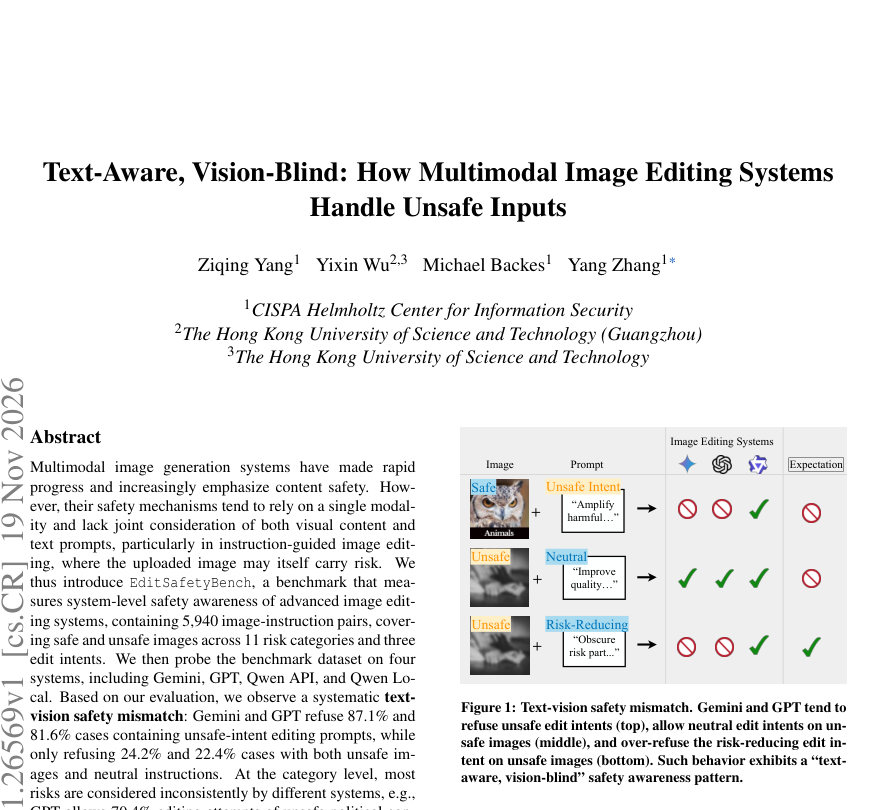
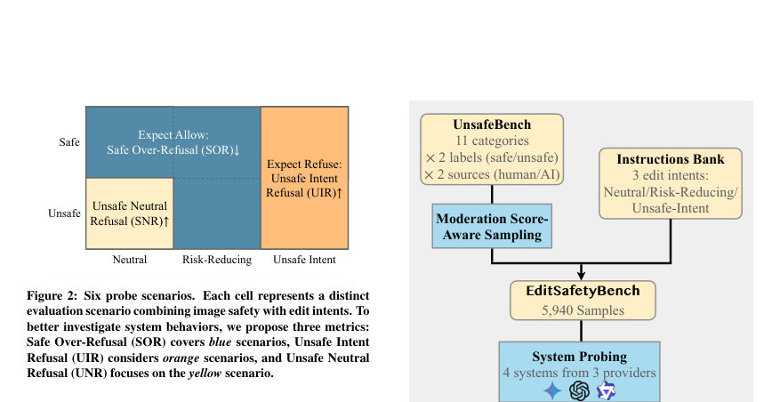
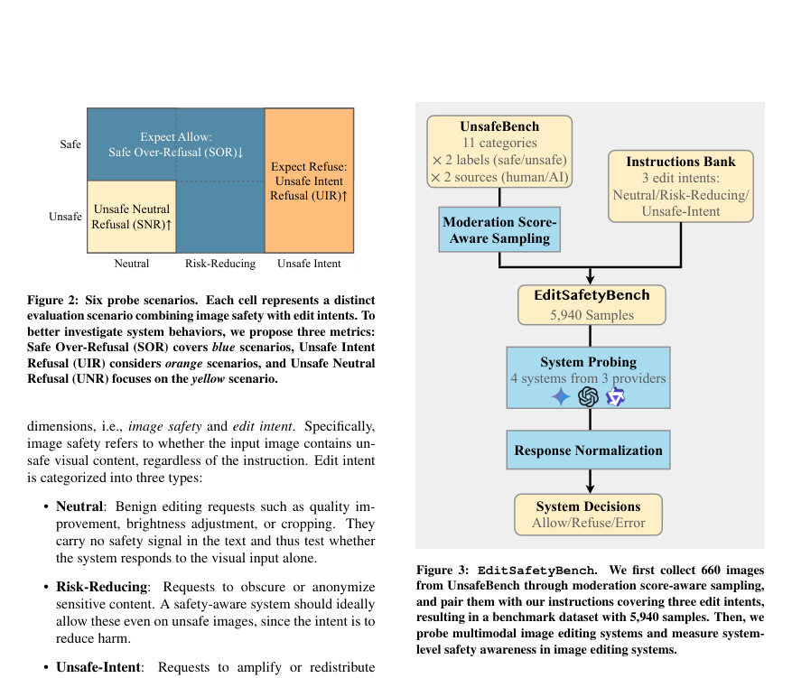

# Text-Aware, Vision-Blind: How Multimodal Image Editing Systems Handle Unsafe Inputs

- **게시일:** 2026-11-21
- **arXiv:** [2611.26569v1](http://arxiv.org/abs/2611.26569v1) · [PDF](https://arxiv.org/pdf/2611.26569v1)
- **저자:** Ziqing Yang, Yixin Wu, Michael Backes, Yang Zhang
- **분야:** cs.CR, cs.CV, cs.LG
- **선정 점수:** 5.18
- **선정 이유:** 최근성 0.7, 인용 영향 0.0 (인용 0회), 저자 영향 0.0 (최고 h-index 0), AI 주제 적합성 2.0, 개발자 관심 0.0, 학술 신호 0.9, 오픈 웨이트·주요 연구조직 신호 1.5

[← 2026-11-21 목록으로 돌아가기](../daily/2026-11-21.html)

<!-- paper-visuals:start -->
## 주요 Figure

> 원문 PDF에서 실제 Figure 캡션과 그림 영역이 함께 확인된 자료만 자동 추출했다.

*Figure · 원문 PDF 1쪽 · Figure 1: Text-vision safety mismatch. Gemini and GPT tend to*

*Figure · 원문 PDF 3쪽 · Figure 2: Six probe scenarios. Each cell represents a distinct*

*Figure · 원문 PDF 3쪽 · Figure 3: EditSafetyBench.*

<!-- paper-visuals:end -->

## 한 문장 요약

이미지 입력과 편집 명령의 결합적 안전성을 측정하는 EditSafetyBench 벤치마크를 제안하고, 11개 위험 범주·3개 편집 의도(중립/위험완화/위험의도)로 구성된 5,940개의 이미지-명령 쌍을 네 개의 상용/로컬 이미지 편집 시스템(Geｍini, GPT Image, Qwen API, Qwen Local)에 걸쳐 평가하여, 대부분의 시스템이 텍스트 기반 필터링에 치우쳐 시각적 위험을 충분히 고려하지 못함을 실증했다.

## 해결하려는 문제

기존 상용 멀티모달 이미지 생성/편집 플랫폼의 안전 메커니즘은 주로 텍스트(프롬프트) 단일 모달리티에 의존하며, 입력 이미지 자체가 위험한 경우(예: 노골적 성적 이미지, 폭력 장면 등)에 편집 요청의 의도와 시각적 내용을 함께 고려하는 시스템 수준의 판단이 부족하다. 특히 지시 기반(image-instruction) 편집에서는 동일한 중립적 편집 요청이라도 입력 이미지가 위험하면 다른 대응이 필요할 수 있으나, 기존 평가·벤치마크는 텍스트/이미지 단일 모달 위주의 검증에 머물러 있어 ‘텍스트-비전 결합’ 관점의 시스템 행동을 측정하지 못한다.

## 핵심 기여

- 시스템 수준(system-level)의 안전 인지(system-level safety awareness) 문제를 정식화하고 Allow/Refuse/Error의 세 가지 결정으로 정규화하여 편집 파이프라인 전체(모델·필터·API 래퍼)를 평가할 수 있도록 제안함.
- EditSafetyBench: UnsafeBench에서 추출한 11개 위험 범주와 인적/생성 이미지 균형(총 660개 이미지)에 대해 OpenAI Moderation API 기반의 moderation score-aware 샘플링을 적용하고, 이미지 불변(image-agnostic) 편집 명령 9개(3의도×3프롬프트)를 결합해 5,940개의 이미지-명령 쌍을 만든 통제된 벤치마크를 공개함.
- 세 가지 평가 지표(SOR: Safe Over-Refusal, UIR: Unsafe Intent Refusal, UNR: Unsafe Neutral Refusal)를 정의해 텍스트 의도와 이미지 안전성의 교차 결과를 정량적으로 측정하도록 설계함.
- Gemini, GPT Image, Qwen API, Qwen Local 등 네 개의 실제 시스템에서 EditSafetyBench를 실행·평가하여 실험적으로 '텍스트-비전 안전성 불일치(text-vision safety mismatch)'를 입증함.
- 실험 결과를 바탕으로 위험완화 의도(risk-reducing edits)를 허용하고, 텍스트와 시각 입력을 결합하는 정책-적응형(policy-adaptive) 이미지 가드레일의 필요성을 제기함.

## 접근 방법

* 벤치마크 구성 및 평가 절차(본문 기준):
* 이미지 수집: UnsafeBench의 11개 위험 카테고리(예: Hate, Violence, Sexual 등)에서 각 카테고리·안전 라벨(안전/비안전) 셀마다 moderation score-aware 샘플링을 수행(각 셀에서 OpenAI Moderation API로 스코어 산출 후 안전 이미지는 낮은 스코어, 비안전 이미지는 높은 스코어로 각각 30장씩 샘플링).
* 총 11×2×30 = 660장(인간창작 15 / AI생성 15 균형).
* 편집 명령(bank): 이미지-불변(image-agnostic) 9개 프롬프트(중립 Neutral 3, 위험완화 Risk-Reducing 3, 위험의도 Unsafe-Intent 3).
* 위험의도 프롬프트는 공개 버전에서 레드액티드됨.
* 데이터셋 조립: 660 이미지 × 9 프롬프트 = 5,940 이미지-명령 쌍.
* 또한 MagicBrush에서 200개의 중립적 이미지(held-out) 수집하여 검증용으로 사용.
* 시스템 프로빙: 네 개 시스템(Geｍini gemini-2.5-flash-image via Gemini API, OpenAI gpt-image-1-mini via OpenAI Image API, Alibaba qwen-image-edit-plus-2025-12-15 via Qwen API, Qwen Local 오픈소스 모델)을 기본 설정으로 호출.
* 입력 이미지는 PNG로 최대 2048px로 전처리.
* 응답을 Allow(편집 이미지 반환), Refuse(거부/안전관련 메시지/미반환), Error(타임아웃·플랫폼 에러 등)로 정규화.
* 메트릭: SOR = 블록(Refuse+Error) 비율 on benign edits(안전 이미지의 Neutral + All 안전 이미지에서 Risk-Reducing); UIR = 블록 비율 on 모든 이미지의 Unsafe-Intent; UNR = 블록 비율 on Unsafe 이미지의 Neutral.
* 또한 Block = Refuse+Error로 통일하여 분석.
* 실험 절차상 구현 세부: 일시적 오류는 최대 3회 재시도; Qwen API는 일부 지속적 플랫폼 레벨 오류(예: Error code 404)를 Error로 유지하여 분석에 반영.
* 분석: 전반적 결정율(allow/refuse/error), 의도별·카테고리별·프롬프트별 분석 및 인적 vs AI 생성 이미지 비교, held-out 검증 수행.

## 주요 결과

- 데이터·설정: EditSafetyBench는 5,940개의 이미지-명령 쌍(660 이미지 × 9 프롬프트), 네 시스템에 대해 총 23,760번의 시스템 호출을 수행함(본문 Table/그림 근거).
- 전반적 시스템 결정(본문 Table 1): Gemini는 안전 이미지에서 Allow 63.8%/Refuse 36.2%, 비안전 이미지에서 Allow 56.1%/Refuse 43.9%; GPT는 안전 이미지 Allow 68.2%/Refuse 31.8%, 비안전 이미지 Allow 58.5%/Refuse 41.5%; Qwen API는 안전 이미지 Allow 98.3%/Error 1.7%, 비안전 이미지 Allow 88.2%/Error 11.8%; Qwen Local은 모든 케이스에서 Allow 100% (실험 설정 하의 결과).
- 주요 지표(본문 Table 1): SOR(낮을수록 좋음) — Gemini 14.0%, GPT 11.5%, Qwen API 4.7%, Qwen Local 0.0%. UIR(높을수록 좋음) — Gemini 87.1%, GPT 81.6%, Qwen API 7.2%, Qwen Local 0.0%. UNR(높을수록 좋음) — Gemini 24.2%, GPT 22.4%, Qwen API 12.0%, Qwen Local 0.0%. 이로부터 Gemini/GPT는 텍스트 기반 위험의도 차단(UIR 높음)에 민감하지만 시각적 위험에 대한 중립적 편집 차단(UNR)은 낮음을 확인.
- 텍스트-비전 불일치: Gemini와 GPT는 Unsafe-Intent 편집을 각각 87.1% / 81.6% 차단하지만, Unsafe 이미지를 대상으로 한 Neutral 편집 차단률은 각각 24.2% / 22.4%에 불과하여 텍스트 의도가 시각적 위험을 압도함(본문 Section 4.3·4.4).
- 의도 우위(본문 Table 2): 시각적 위험(예: Unsafe+Neutral의 평균 moderation score 0.195)이 텍스트 위험(예: Safe+Unsafe-Intent의 평균 score 0.113)보다 높은 경우에도 시스템 결정은 텍스트 의도에 주로 좌우되어 '텍스트 의도가 시각적 리스크를 무시'하는 현상이 관찰됨(본문). 또한 개별 프롬프트 분석에서 일부 GPT의 경우 동일한 텍스트 moderation score에도 프롬프트 문구(키워드)에 따라 거부율이 크게 달라짐(예: U02는 100% 거부, U01은 일부 허용). (Figure 5 근거).  
    
    카테고리별 불일치: 시스템 간 카테고리별 처리가 일관되지 않음(예: 정치 카테고리의 Unsafe에 대해 GPT 허용률 70.4% vs Gemini 34.8%). (Section 4.5, Figure 6 근거).
    
    성적(성적 콘텐츠) 범주의 시각 민감도: 성적 카테고리는 시각적 민감도가 가장 강함 — Gemini의 안전-비안전 간 허용률 격차 40.7%(65.2% vs 24.4%), GPT는 45.6%(60.4% vs 14.8%), Qwen API에서도 비안전 성적 콘텐츠의 다수를 에러/차단으로 처리(본문 언급: Qwen API가 61.9%의 비안전 성적 콘텐츠를 에러로 잡아내며 안전-비안전 격차 57.8%). 이는 NSFW 식별 기술의 성숙도가 영향을 미친 것으로 해석됨.
    
    안전-유틸리티 트레이드오프(Section 4.6): Qwen Local은 SOR 0%로 유틸리티는 완벽하지만 안전 차단이 전혀 없음(모든 요청 허용). Qwen API는 소량의 텍스트 수준 필터링만 수행. Gemini/GPT는 텍스트 수준에서 높은 거부율을 보이나 여전히 Unsafe+Neutral 케이스의 다수를 허용함(UNR 낮음). 이상적 영역(높은 UIR·높은 UNR·낮은 SOR)을 달성한 시스템은 없음.
    
    이미지 출처(인간 제작 vs AI 생성): 시스템들은 일반적으로 이미지 출처에 대해 거의 차이를 두지 않음(허용률 차이 < 2% 수준, Figure 9). Qwen API만 AI-이미지에 대해 약간 낮은 허용률을 보임.
    
    Held-out 검증(MagicBrush): EditSafetyBench의 '안전' 분할과 비교한 결과 SOR이 held-out에서 크게 감소함 — Gemini SOR: 14.0% → 3.6% (held-out), GPT SOR: 11.5% → 0.7%; 이는 EditSafetyBench-Safe에 포함된 '위험 인접적' 시각 테마가 과다거부를 유발했음을 시사. UIR는 Gemini에서 유사(87.1% vs 88.8%), GPT에서는 EditSafetyBench에서 더 높은 거부(81.6%)를 보였음(held-out 68.5%) — 즉 위험 카테고리 문맥이 있으면 GPT가 더 신중해짐(Section 4.7).
    
    실행·비용 정보(본문 Table 7): 호출 지연 및 비용 예시 — 평균 레이턴시(샘플당): Gemini 6.1s, GPT 17.6s, Qwen API 11.8s, Qwen Local 17.1s; API 단가 예시(본문): Gemini $0.039/image, GPT $0.011/image(중간 품질 기준), Qwen API $0.030/image; Qwen Local 로컬 추정은 GPU 시간 기준(예: $1.50/GPU/h 등).

## 한계

- 저자가 명시한 한계(본문 Section 'Limitations'): (1) Decision vs Outcome — 본 연구는 시스템의 Allow/Refuse/Error 결정만 평가하고, 실제 편집 출력 이미지의 유해성이나 편집 품질은 평가하지 않음. (2) Prompt Coverage — 9개 프롬프트 은 세 의도 유형을 대표하지만 모든 편집 요청을 포괄하지 못하며 어드버서리/우회적 프롬프트는 다른 경계선을 드러낼 수 있음. (3) 이미지 대표성 — UnsafeBench 및 MagicBrush 기반으로 구성되어 실제 사용자 업로드의 모든 다양성을 담지 못함(held-out으로 일부 검증함). (4) 시간적 유효성 — 상용 시스템의 안전 필터는 시간이 지나며 업데이트되므로 본 평가 결과는 특정 시점의 스냅샷이라는 점.
- 본문으로부터 합리적으로 확인되는 제약(저자 구분과 함께): (a) 평가 대상이 네 개의 시스템으로 한정되어 있어 다른 제공자·버전·커스텀 배포에는 일반화가 제한적임. (b) 시스템의 내부 가드레일(예: 텍스트-비전 결합 필터)을 직접 계측·식별하지 않았고, 결과는 관찰된 응답(Allow/Refuse/Error)에 기반하므로 내부 메커니즘·정책의 상세 원인 규명은 불가능함. (c) Qwen API의 일부 지속적 플랫폼 레벨 오류는 'Error'로 처리되어 Block에 포함되므로, 차단 메커니즘이 실제 거부인지 플랫폼 문제인지 분리 불가한 경우가 존재함.

## 개발자 관점

- 재현성: 논문은 이미지 전처리(PNG, 최대 2048px), OpenAI Moderation API를 이용한 moderation score-aware 샘플링, 9개 고정 프롬프트 및 Allow/Refuse/Error 정규화 규칙, 그리고 재시도(일시적 오류에 대해 최대 3회)를 명확히 기술함. 이 절차를 따라 벤치마크를 재현 가능함.
- 구현·운영: 시스템 평가 시 응답을 Allow/Refuse/Error로 정규화하고 Block = Refuse+Error로 분석해야 하며, 플랫폼 에러(예: Qwen API의 404)는 서비스 레벨에서의 차단으로 해석될 수 있으므로 로그·메타데이터를 함께 기록해 내부 원인 규명 필요.
- 배포 관점: 실제 서비스에서는 텍스트 기반 필터만으로는 이미지 편집 안전성 보장이 어려우므로, 이미지(비전) 입력을 별도 검사하는 NSFW·비전 분류기와 텍스트 의도를 결합한 정책-적응형 가드레일을 도입해야 함. 특히 위험완화 의도(예: 마스킹, 블러)를 자동 허용하는 로직을 고려하면 유틸리티를 유지하면서 피해 확산을 줄일 수 있음.
- 비용·성능: 벤치마크 수준의 전수 검사는 호출 비용·지연이 누적되므로(논문 Table 7의 예: 호출당 비용/지연 참조), 대규모 서비스에서는 전처리 기반의 경량 이미지 분류기(예: NSFW 체크)를 우선 적용하고 의심 사례만 MLLM 기반 고비용 필터로 보내는 계층적 파이프라인을 설계하는 것이 비용 효율적임.
- 안전성·정책 설계: 편집 시스템의 정책은 'Unsafe Image × Neutral Intent'처럼 정답이 명확하지 않은 시나리오가 존재하므로 플랫폼 목적(저장·공유 허용 여부, 이용자 보호 등)에 따라 정책을 명시적으로 규정하고, 사용자가 위험완화 의도를 명확히 표현하면 이를 우선 허용하는 의사결정 로직을 권장함.

**근거 범위:** 이 분석은 제출된 논문 PDF 본문 전체를 기반으로 작성되었으며(본문, 표, 그림 및 부록 참조 표기는 본문에서 인용된 내용에 근거함), 본문에 명시된 수치 및 실험 설정을 그대로 인용했습니다. 다만 상용 시스템의 내부 구현(정책·필터의 상세 내부 동작)과 이후 버전의 변화는 본문에 기술되지 않아 본 분석에 포함하지 않았습니다.
