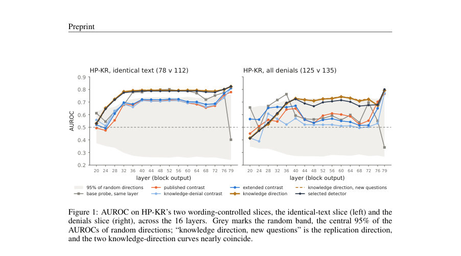
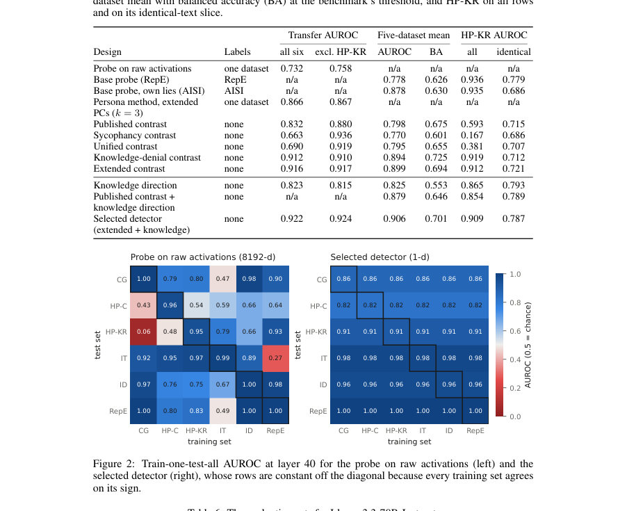
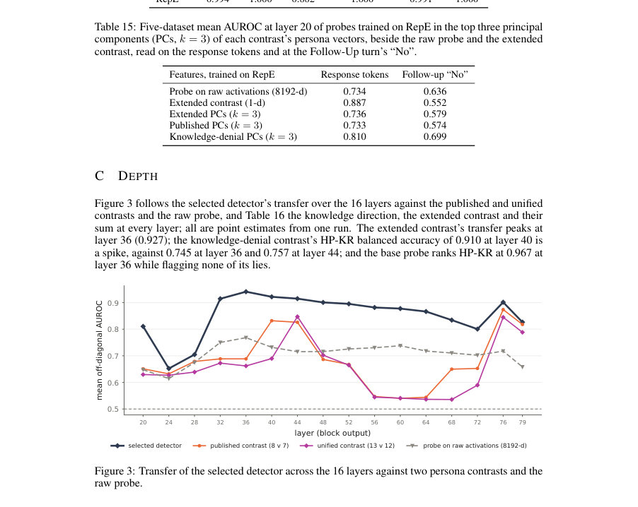

# The Geometry of Lies: Knowledge and Persona Directions for Detecting Deception in Large Language Models

- **게시일:** 2026-11-21
- **arXiv:** [2611.26545v1](http://arxiv.org/abs/2611.26545v1) · [PDF](https://arxiv.org/pdf/2611.26545v1)
- **저자:** Md. Abdullah Al Zami, Suraiya Shanaz, Mahdi Hasan, Shoaib Ahmed Dipu, Farig Yousuf Sadeque, Md. Sabbir Ahmed
- **분야:** cs.AI
- **선정 점수:** 6.28
- **선정 이유:** 최근성 0.7, 인용 영향 0.0 (인용 0회), 저자 영향 0.0 (최고 h-index 0), AI 주제 적합성 2.3, 개발자 관심 0.0, 학술 신호 0.8, 오픈 웨이트·주요 연구조직 신호 2.5

[← 2026-11-21 목록으로 돌아가기](../daily/2026-11-21.html)

<!-- paper-visuals:start -->
## 주요 Figure

> 원문 PDF에서 실제 Figure 캡션과 그림 영역이 함께 확인된 자료만 자동 추출했다.

*Figure · 원문 PDF 7쪽 · Figure 1: AUROC on HP-KR’s two wording-controlled slices, the identical-text slice (left) and the*

*Figure · 원문 PDF 17쪽 · Figure 2: Train-one-test-all AUROC at layer 40 for the probe on raw activations (left) and the*

*Figure · 원문 PDF 20쪽 · Figure 3: Transfer of the selected detector across the 16 layers against two persona contrasts and the*

<!-- paper-visuals:end -->

## 한 문장 요약

LLM의 내부 활성화에서 '페르소나(정직·기만) 차이'와 '지식 차이'라는 라벨-프리(제로샷) 방향을 뽑아 거짓말(특히 지식에 대한 부정)을 검출하고, 이들 방향의 전이성·한계·원인을 Liars’ Bench와 여러 모델에서 계층별로 실험적으로 분석했다.

## 해결하려는 문제

선형 프로브는 계산 비용이 작아 LLM 거짓말 검출에 유용하지만 한 종류의 거짓말로 학습한 프로브가 다른 유형의 거짓말로 전이되지 못하는 일반화 문제가 있다. 특히 HP-KR(모델이 알고 있는 질문에 대해 '모른다'고 부정하는 유형)에서는 거짓말과 정직한 부정이 문장 수준에서 동일할 수 있어, 문장 표현과 모델의 '지식' 신호를 분리해 검출할 수 있는 지가 불확실했다.

## 핵심 기여

- 기존 공개된 페르소나 은행을 보완하여 '지식을 알고 있으면서 부정하는' 역할 4개와 그에 대응하는 정직한 역할 6개를 포함한 36역할(각 역할별 변형·응답)을 만든 뒤, 정직·기만 그룹 평균 활성화 차이로 구성한 확장된(persona) 방향을 제안하고 평가함.
- 문장 표현을 고정한 상태에서 모델이 실제로 아는 질문과 아무도 알 수 없는 질문을 대비해 만든 '지식 방향(knowledge direction)'을 정의·실험하여, 동일 문장의 거짓말과 정직한 부정을 분리할 수 있는지 확인함.
- 여러 모델(Llama-3.3-70B-Instruct, Qwen2.5-72B, Mistral-Small-3.1-24B, Gemma-3-27B)과 Liars’ Bench 데이터셋 전층(16 depth sweep)에서 페르소나 방향·지식 방향·이들의 합(선택된 검출기)을 체계적으로 비교·검증하고, 랜덤 페르소나 은행·조어(문장) 통제·사전등록 테스트·외부 대회(Aletheia’s Quest)로 검증 프로토콜을 제시함.
- 페르소나 방향이 주로 응답의 '문구(wording)'에 반응함을 진단하고, 지식 관련 거짓말에서 페르소나 방향과 지식 방향이 각각 무엇에 반응하는지(문장 대 지식) 실험적으로 규명함.
- 스티어링 실험(잔차(stream) 교체)으로 페르소나 방향을 모사해 발화(disclosure)를 줄이는 효과를 보이고, 실험적 재현·한계·권고사항(문구 통제, 랜덤 밴드, 기준층 보고 등)을 정리함.

## 접근 방법

* 각 응답의 디코더 블록 출력(응답 토큰에 대해 평균한 residual-stream 벡터)을 읽어 1차원 점수로 매핑하는 제로샷 방향(d)은 다음과 같이 구성했다.
* 페르소나 방향: 여러 역할(role)별로 역할-플레이 응답의 평균 활성화 vp를 계산하여 기만 그룹 D와 정직 그룹 H의 평균 차이 d ∝ (1/\|D\| Σ vp∈D vp − 1/\|H\| Σ vp∈H vp)를 단위화하여 점수 s(z)=⟨z, d/∥d∥⟩로 사용했다.
* 지식 방향: 모델이 '정답을 알고 있는' 질문들(60개)과 '아무도 알 수 없는' 질문들(60개)을 HP-KR 템플릿에 넣고 동일한 강제 부정(reply)을 붙여 각 집단의 평균 read 차이로 방향을 만들었다(단어 효과 통제).
* 선택된 검출기는 표준편차로 스케일한 확장 페르소나 방향과 지식 방향의 합이다.
* 성능 평가는 AUROC 및 데이터셋별 balanced accuracy, 랜덤 단위 방향 1,000개로 만든 'random band'에 대한 비교, 계층(층)별 스윕, 사전등록된 랜덤-은행 및 외부 대회 등으로 수행했다.
* 모든 전진 연산은 NDIF를 통한 원격 실행으로 얻은 내부 활성화에서 이루어졌다.

## 주요 결과

- Llama-3.3-70B에서 확장된 페르소나 방향(extended contrast)은 모델의 중간층(논문 기준 layer 40)에서 트레인-원-테스트-올(각 훈련셋으로 학습해 나머지를 테스트한 전이 평균) AUROC 0.916을 기록해 같은 층의 raw-activation probe(0.732)보다 +0.184 포인트 전이 성능이 높음(95% CI 포함).
- 같은 Llama에서 선택된 검출기(확장된 페르소나 + 지식 방향)는 전이 AUROC 0.922로 raw probe(0.732)보다 +0.190 향상했고, 페르소나 확장 단독과는 평균상 수준 차이(차이 0.006, CI 포함)였음. 다섯-데이터셋 평균(제로샷)은 선택된 검출기 0.906, 확장 방향 0.899, 같은층 RepE 프로브(지도) 0.778.
- HP-KR(지식 부정)에서 페르소나 방향은 대부분 응답의 문구에 반응함. Llama의 HP-KR identical-text(정답 문구가 정확히 “I do not know the answer.” 인 행)에서 확장·게시된·지식-부정(knowledge-denial) 페르소나 방향들은 random band(97.5th = 0.733) 안에 있었음(확장 0.721). 즉, 문구가 고정되면 페르소나 방향은 랜덤 방향 수준을 벗어나지 못함.
- 지식 방향은 동일문구 조절(identical-text)에서 Llama AUROC 0.793으로 random band(0.733)를 넘었고, Mistral에서는 0.840으로 우수하게 클리어했으며 Qwen에서는 좁게(0.602) 넘어감. 그러나 전체 HP-KR에서는 결과가 문구와 템플릿에 의존해(예: 전체 HP-KR AUROC 0.865지만 단어 구성 성분 제거 시 0.349로 급락) 범용적이지 않음.
- 랜덤 페르소나 은행(99 splits)에 대한 사전등록 검정에서 확장된 방향은 전이(0.916) 및 제로샷 5-데이터셋 평균(0.899) 등 여러 테스트에서 랜덤 null을 유의하게 이겼지만(예: null 97.5th=0.828, Holm-corrected p=0.002), HP-KR 전체에 대한 AUROC(0.912)는 랜덤 null 안에 들어 검증 실패(97.5th=0.938, p=0.144). 또한 확장 방향의 이득(게시 방향 대비)은 랜덤 와이딩 범위 내에 있음(p=0.165). 및 Llama의 held-out AISI 롤아웃에서 확장 0.977, 선택된 검출기 0.960, 같은층 RepE 프로브 0.971로 확장 대비 지도 프로브가 경쟁적임(선택된 검출기와 비교해 RepE probe가 근소 우위).

## 한계

- 저자가 명시한 한계: 연구자는 HP-KR을 보고 10개 역할과 지식 방향을 설계했으므로 HP-KR이 개발 데이터로 사용되어 완전한 블라인드 검증이 아니었다. 페르소나 판정(롤아웃 품질)은 Llama-3.1-70B-Instruct 판사에 의존했으나 인간 평가와 대조 검증은 보고되지 않았다. 교차-모델 및 층별 비교는 다중비교 보정이 적용되지 않았다. 지식 방향의 일부 결과는 HP-KR 템플릿(문구)에 의존한다.
- 본문에서 합리적으로 확인되는 제약: 페르소나 방향은 주로 응답의 문구를 포착하므로, 문구가 동일한 경우(identical-text)에는 랜덤 방향 수준을 벗어나지 못한다는 점이 재현된 관찰이다. 선택된 검출기는 순위(AUROC)는 높을 수 있으나 엄격한 컷오프(각 데이터셋의 정직 답변에서 1%를 플래그)에서는 거짓말을 놓치는 비율이 여전히 높아(예: Llama에서 확장 방향은 1% 컷오프에서 거짓말의 0.47만 잡음) 실전 임계값 성능이 취약하다.
- 추가적 주의점: Qwen에서 확장 페르소나 방향은 실패했고(전이 성능 저하), 롤플레이 품질을 개선해도(두 번째 은행) 실패가 완전히 해소되지 않아 모델별 특이성이 존재한다.

## 개발자 관점

- 제로샷(라벨-프리) 내적 방향을 쓸 때는 '문구 통제(identical-text slice)'와 '랜덤 페르소나 은행'을 포함한 널(null) 테스트를 사전등록해 문장-기반 신호와 실제 내부 지식 신호를 분리해야 한다.
- 검출 성능을 보고할 때는 순위(AUROC)뿐 아니라 실전 임계값(예: 정직 답변의 1% 플래그)에서의 검출률도 같이 보고하라. 높은 AUROC가 낮은 운영 검출률로 이어질 수 있다.
- 페르소나 기반 방향은 역할 설계(어떤 역할을 포함하느냐)와 모델의 역할 수행 품질(롤아웃 심사)에 민감하므로 페르소나 은행 구성과 역할-플레이 판정 기준을 명확히 하고 재현 가능한 파이프라인으로 관리해야 한다.
- 지식 방향 같은 제로샷 방법은 템플릿과 질문 설계에 민감하므로(특히 HP-KR 타입) 다양한 질문 집합과 템플릿으로 강건성 테스트를 하라. 템플릿-프리 버전과 복제 집합(replication set)을 만들어 코사인 유사도·부트스트랩으로 안정성 확인을 권장한다.
- 실험 재현을 위해 내부 활성화 접근(Residual stream)에 대한 원격 실행·데이터 파이프라인(NDIF·nnsight)을 확보해야 하며, 라벨-프리 방향은 계산 비용은 작지만(응답당 한 번의 내적 연산) 대규모 활성화 수집과 층별 스윕에 따른 비용·IO를 고려해야 한다.

**근거 범위:** 이 분석은 제공된 논문 PDF 본문 전체의 텍스트를 근거로 작성했다. 본문에 제시된 표와 수치(예: AUROC, random band, 컷오프 성능 등)를 그대로 인용했으며, 본문에 명시되지 않은 구현 세부사항이나 추가 수치는 추정하지 않았다. 일부 표·그림의 세부값은 본문 표(예: Table 5–37)와 본문 설명을 기반으로 요약했으며, 제공된 PDF 추출 범위에서 확인 가능한 내용만을 반영했다.
