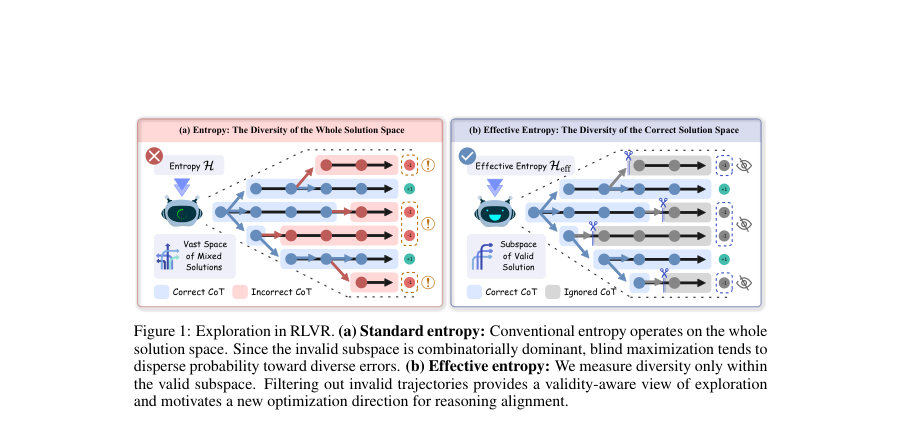
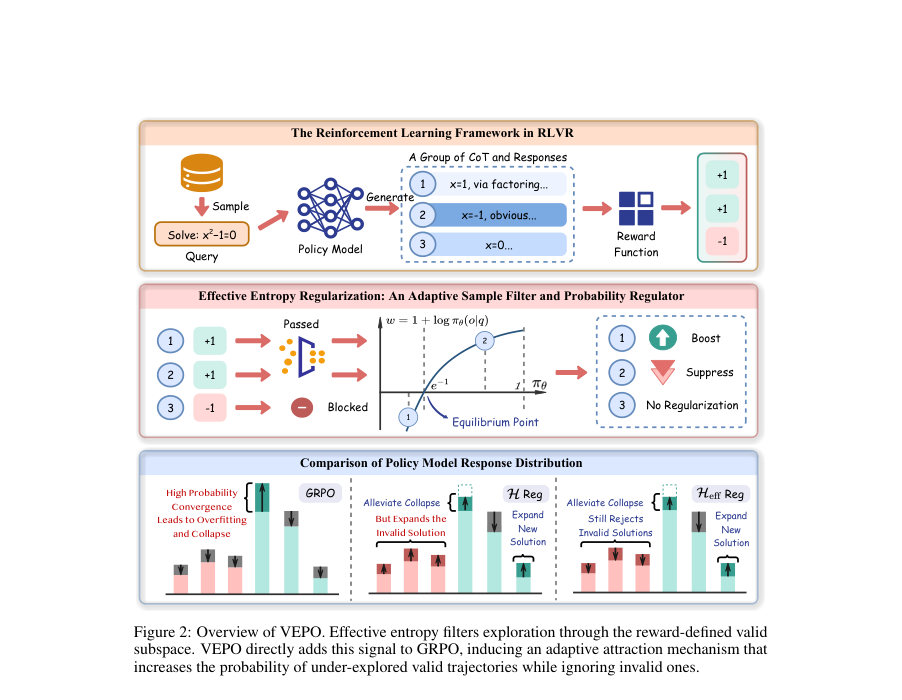
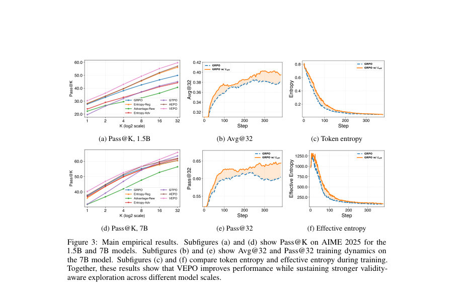

# The Illusion of Diversity: Aligning LLM Exploration via Effective Entropy

- **게시일:** 2026-11-13
- **arXiv:** [2611.15493v1](http://arxiv.org/abs/2611.15493v1) · [PDF](https://arxiv.org/pdf/2611.15493v1)
- **저자:** Xiaoliang Fu, Jiaye Lin, Yangyi Fang, Cong Qin, Binbin Zheng, Chaowen Hu, Zekai Shao
- **분야:** cs.LG
- **선정 점수:** 6.77
- **선정 이유:** 최근성 0.7, 인용 영향 0.0 (인용 0회), 저자 영향 0.0 (최고 h-index 0), AI 주제 적합성 2.9, 개발자 관심 0.0, 학술 신호 0.7, 오픈 웨이트·주요 연구조직 신호 2.5

[← 2026-11-13 목록으로 돌아가기](../daily/2026-11-13.html)

<!-- paper-visuals:start -->
## 주요 Figure

> 원문 PDF에서 실제 Figure 캡션과 그림 영역이 함께 확인된 자료만 자동 추출했다.

*Figure · 원문 PDF 2쪽 · Figure 1: Exploration in RLVR. (a) Standard entropy: Conventional entropy operates on the whole*

*Figure · 원문 PDF 6쪽 · Figure 2: Overview of VEPO. Effective entropy filters exploration through the reward-defined valid*

*Figure · 원문 PDF 9쪽 · Figure 3: Main empirical results. Subfigures (a) and (d) show Pass@K on AIME 2025 for the*

<!-- paper-visuals:end -->

## 한 문장 요약

검증 가능한 보상(RLVR) 환경에서 '무작위 분산'이 잘못된 다양성으로 이어지는 문제를 지적하고, 정답(유효) 궤적만을 대상으로 엔트로피를 측정하는 Effective Entropy를 정의하여 이를 보조목표로 더한 VEPO(Validity-aware Entropy Policy Optimization)를 제안해 RL 학습에서 유효한 탐색을 증가시킨다.

## 해결하려는 문제

기존 RLVR 방법들은 토큰 수준 또는 전체 시퀀스 수준의 표준 엔트로피를 탐색 장치로 사용하는데, 이들은 유효한(정답) 궤적과 비유효한(오류·환각) 궤적을 구별하지 못한다. 수학적 추론 문제에서는 비유효한 궤적의 조합적 우세로 인해 전체 엔트로피를 높이는 것이 오히려 오류 분포로 확률 질량을 분산시키는 ‘다양성의 환상’을 만들며, 이는 유효한 탐색(정답 전략의 발굴)과 정렬되지 않는다. 연구 질문은 엔트로피를 유효한 해공간으로 제한하면 RLVR에서 탐색 신호와 성능이 개선되는가이다.

## 핵심 기여

- 유효성(정답)만을 대상으로 하는 새로운 엔트로피 개념 Effective Entropy(Heff)를 정의하고, 엔트로피 측정의 도메인을 전체 출력공간에서 보상-검증된 유효 부분공간으로 변경하여 탐색의 초점을 재정의함.
- Effective Entropy를 보조목표로 기존 GRPO에 단순히 추가한 VEPO를 제안하고, 그 그래디언트 분석을 통해 '저확률 유효 궤적에 대한 적응적 끌어당김(attraction)' 역학을 밝혀냄(시퀀스 확률이 e^{-1}보다 작을 때 확률 증가).
- 수학적 유도(시퀀스 수준 그라디언트, 토큰 수준 구현 분해)와 실험적 검증을 결합: 1.5B 및 7B DeepSeek-R1-Distill-Qwen 계열에서 6개 수학 벤치마크에 대해 VEPO가 GRPO 대비 일관된 Avg@32 향상을 보임.
- 정답 개수를 맞춘 상태에서 MATH500-7B의 441문제에 대해 전략(코드·계획) 다양성을 직접 측정해 VEPO가 군집 수와 Hill-1 모드 수를 유의하게 증가시킴(부트스트랩 CI 및 페어드 퍼뮤테이션 검정 제공).

## 접근 방법

* 목표 함수: J_VEPO(θ)=J_GRPO(θ)+β·Heff(π_θ)이며 Heff(π)=−Σ_{o} r(o\|q) π_θ(o\|q) log π_θ(o\|q)로 정의된다.
* 유효 궤적(r=1)만 엔트로피에 기여하게 하여 비유효 출력에는 엔트로피 보조 신호를 주지 않는다.
* Heff의 파라미터 그라디언트는 E_{o∼π}[ r(o)(1+log π(o)) ∇ log π(o) ]로 유도되며 시퀀스 확률 π(o)<e^{-1}인 유효 궤적에 대해 음수 가중치(최소화 관점에서)를 가지므로 확률을 증가시키는 '끌어당김' 효과를 가진다(실제 LLM 시퀀스는 곱으로 인해 π≪e^{-1}이므로 실무상 일관된 끌어당김).
* 구현: 샘플된 시퀀스에 대해 Wi = r(oi)(1+log π(oi))를 계산해 detach한 뒤 각 토큰 log-prob에 동일한 스칼라로 곱해 토큰 단위 그래디언트로 적용(식(13)).
* 하이퍼파라미터 β는 검증셋 그리드서치로 선정(기본값 β=1e-4).
* 학습 프로토콜은 GRPO 프레임워크(그룹 사이즈 G=8, 클리핑 ϵ=0.2)를 유지하고 ε-클리핑 기반 업데이트에 Heff 보조항을 추가하는 최소한의 방식이다.
* 검증/평가는 학습 중 math_verify, 최종 평가는 prime_math의 이중 오라클 방식 사용.

## 주요 결과

- 주요 벤치마크: AIME2024/2025, AMC2023, MATH500, Minerva, OlympiadBench에서 평가(메트릭: Avg@32, Pass@32).
- 표1(본문): 1.5B 백본에서 VEPO의 6-벤치마크 평균 Avg@32 = 50.6 versus GRPO = 48.4 (증가 약 +2.2 퍼센트포인트). Pass@32 평균도 VEPO 우세(본문 표 참조).
- 7B 백본에서 VEPO 평균 Avg@32 = 61.1 versus GRPO = 58.9 (증가 약 +2.2 퍼센트포인트). 개별 벤치마크별로는 VEPO가 대부분의 항목에서 개선 또는 경쟁력을 보임(표1).
- 전략 다양성(Section 6.3, MATH500-7B): GRPO와 VEPO가 각각 문제당 정확히 8개의 정답 궤적을 맞춘 441문제에 대해 클러스터링 비교. 문제 단위 클러스터 수 평균 차이 +0.37 (상승률 +16.0%), 95% 문제-부트스트랩 CI = [0.24, 0.50], 페어드 sign-flip permutation p < 10^{-4}. Hill-1(유효 모드 수) 차이 +0.27, 최대 군집 점유율은 VEPO에서 감소(더 분산된 전략).
- 훈련 반복성: 세 개의 페어드 시드(0,1,2)에서 1.5B의 6-벤치마크 Avg@32 증분은 +2.1,+2.4,+2.1 pp, 7B는 +2.3,+2.4,+1.9 pp로 세드간 일관된 이득을 관찰(부록 G.2).

## 한계

- 저자 언급(본문·Appendix H): Effective Entropy는 신뢰할 수 있는 유효성(바이너리 또는 결정적 검증자)에 의존하므로 정확답 검증이 불가능하거나 주관적 보상(선호 기반) 문제에는 직접 적용이 어렵다.
- 저자 언급: VEPO는 개념 검증을 위한 '의도적으로 단순한' 구현으로 설계되어 안정성·효율성을 더 개선하는 정교한 변형 가능성이 남아 있음.
- 저자 언급: 실험은 수학적 추론과 1.5B/7B 규모 모델에 한정되어 있으며 더 큰 모델·멀티모달·도구 사용·장기 상호작용 환경으로의 일반화는 검증 필요.
- 저자 언급: 샘플 기반 추정의 한계 — 유효 궤적이 매우 희귀한 초기 학습 단계에서는 표본 커버리지가 부족해 Heff 추정이 불안정하므로 워밍업·커리큘럼·초기 정책 강화가 필요할 수 있음.  (본문 언급)

## 개발자 관점

- 실행 전제: 작업에 신뢰가능한 바이너리(또는 결정적) 검증자(예: exact-answer 매칭, 수학/컴파일 검증)를 확보해야 VEPO의 효과를 기대할 수 있음(논문은 math_verify로 학습 중, prime_math로 평가).
- 하이퍼파라미터/구현: β(Effective Entropy 계수)를 검증셋 그리드서치로 튜닝하라. 본 논문 기본값은 β=1e-4이며 큰 β는 탐색을 오래 지속시켜 수렴 지연 가능.
- 토큰-레벨 구현: 시퀀스 가중치 Wi = r(oi)(1+log π(oi))를 계산해 detach한 뒤 모든 토큰의 ∇ log π에 동일 스칼라로 곱하는 간단한 방식으로 구현했다(제공된 의사코드 사용 가능).
- 샘플링·그룹 구성: GRPO 기준 그룹 사이즈 G=8과 클리핑 ϵ=0.2 설정을 그대로 사용해 비교적 적은 구조 변경으로 적용 가능. 그룹 내 정답 비율이 높아질수록 보조신호 빈도 증가(부록 F.2에 비율 수치 제시).
- 평가·진단: Avg@k/Pass@k 외에 유효 엔트로피(Heff), 전체 엔트로피(Htok), 효과비율(Heff/Hseq), Entropy Conversion Efficiency(ECE) 등의 지표를 함께 모니터링하면 탐색 방향과 전환 효율을 진단하기 쉬움(논문에서 사용한 진단들).','계산비용·재현성: 논문은 A100(80GB) 노드 30대, 총 실험 예산 >25,000 GPU-시간을 보고함. VEPO는 GRPO 대비 steady-state 오버헤드 약 9.8%이며 시간-대-타겟은 롤아웃 예산 기준 73%~78%로 빠르게 동등 성능에 도달하는 사례 보고. 실무 도입시 추가 계산 비용과 롤아웃 설계(샘플 수) 고려 필요.','검증자 노이즈에 취약: 논문 제시 실험에서 false-negative/false-positive 비율이 증가하면 VEPO 성능이 점진적으로 저하됨(부록 G.4). 검증자 신뢰도와 오류 특성을 검사·완화할 안전망 필요.','다양성 평가: 전략(체계적 계획) 다양성을 평가하려면 정답 수를 고정한 matched-count 실험과, 문장 벡터 임베딩(논문은 gte-Qwen2) 기반 군집화 및 인적 블라인드 라벨링으로 파이프라인을 검증할 것(논문 프로토콜 재현 권장).

**근거 범위:** 이 요약과 분석은 제공된 논문 PDF 본문(제시된 모든 섹션과 부록 포함)을 근거로 작성함. 표와 본문에서 명시된 수치(테이블 1, 표기된 CI, p값, 부록의 오버헤드·롤아웃 비율 등)를 직접 인용했고, 본문에 명시되지 않은 구현·수치 정보는 추가하지 않았다. PDF 텍스트 추출에 따른 형식·문맥 해석 오류 가능성을 고려했으나 주요 개념·수치·한계는 본문에 명확히 기재되어 있어 분석에 대한 신뢰도는 높다.
